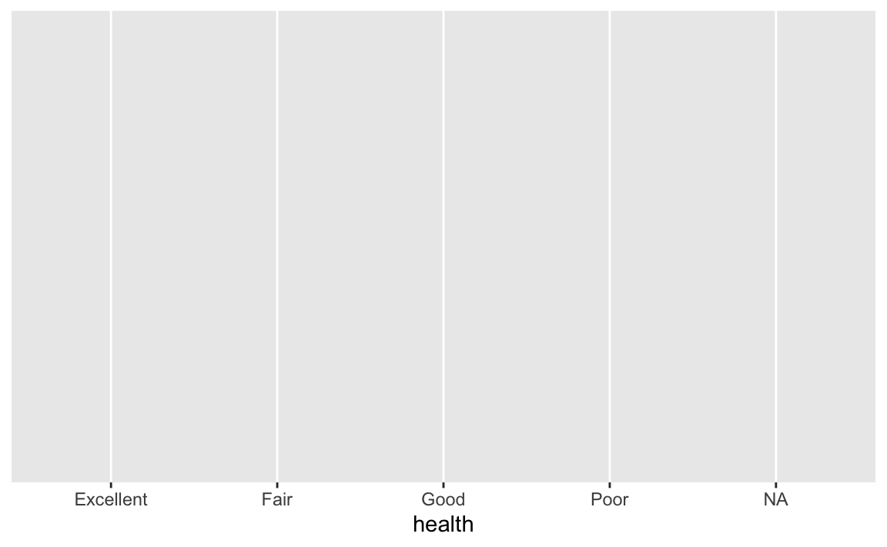
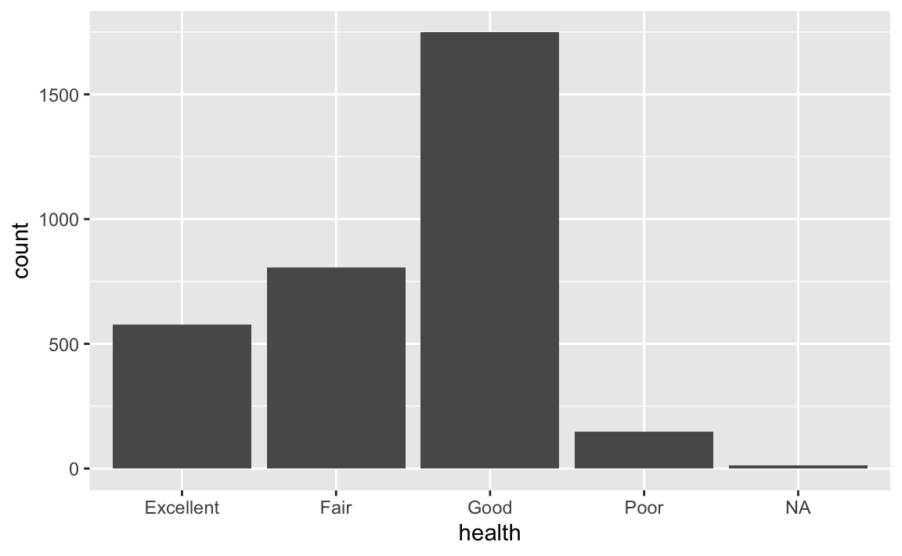
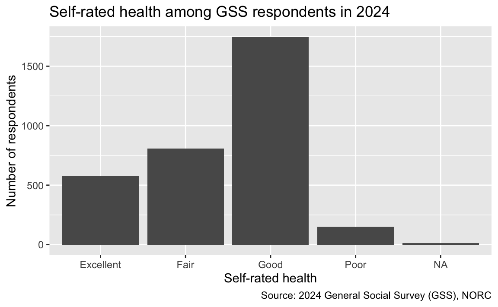
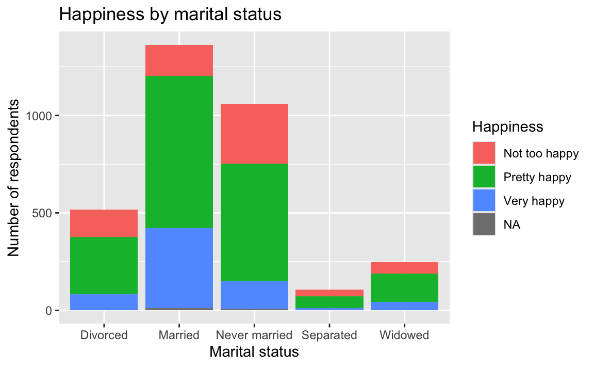
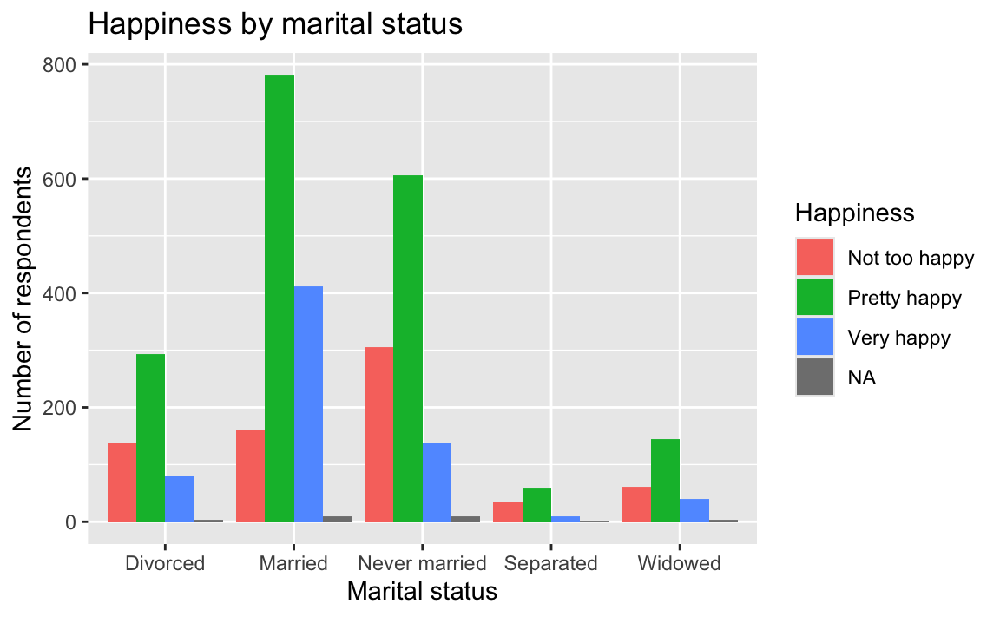
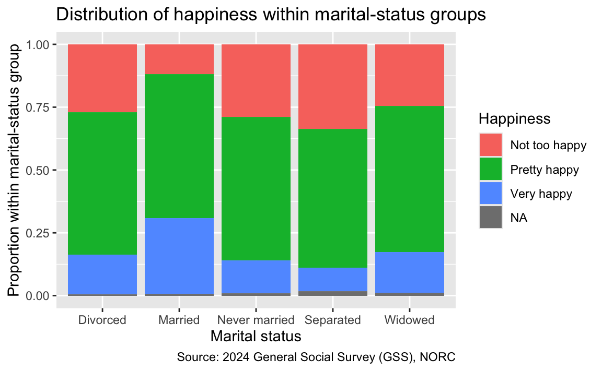
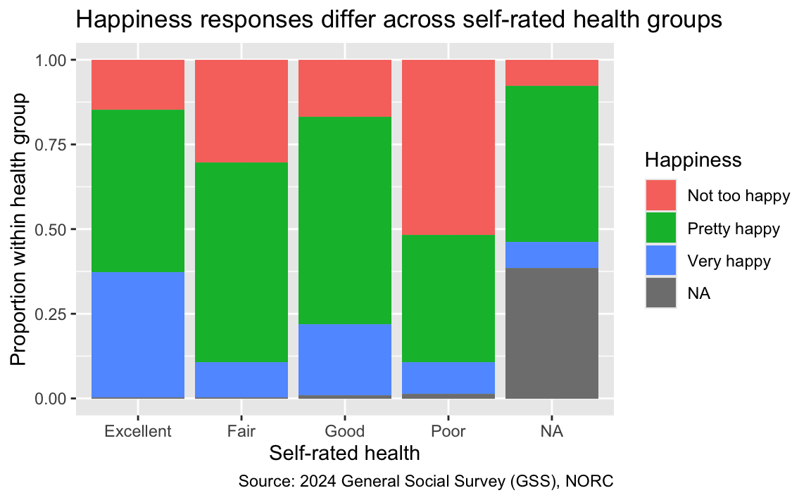

# AE 01: GSS + data visualization

Suggested answers

Application exercise

Answers

> **IMPORTANT:**
>
> These are suggested answers. This document should be used as a reference only; it’s not designed to be an exhaustive key.

In this mini-analysis, we use data from the 2024 General Social Survey (GSS) to get practice with creating and interpreting data visualizations.

## Getting started

### Packages

We’ll use the **tidyverse** package for this analysis.

``` downlit
library(tidyverse)
```

### Data

The data are stored as a CSV (comma-separated values) file in your repository’s `data` folder. Let’s read the file and save it as an object called `gss`.

``` downlit
gss <- read_csv("data/gss-2024.csv")
```

### Get to know the data

We can use the [`glimpse()`](https://pillar.r-lib.org/reference/glimpse.html) function to get an overview (or “glimpse”) of the data.

``` downlit
glimpse(gss)
```

    Rows: 3,294
    Columns: 9
    $ year              <dbl> 2024, 2024, 2024, 2024, 2024, 2024, 2024, 2024, 2024…
    $ marital_status    <chr> "Never married", "Never married", "Married", "Never …
    $ age               <dbl> 33, 64, 69, 19, 70, 53, 48, 30, 60, 25, 23, 68, 43, …
    $ education_years   <dbl> 16, 16, 14, 12, 13, 14, 13, 14, 14, 12, 18, 5, 14, 1…
    $ children          <dbl> 2, 0, 0, 0, 3, 2, 6, 1, 2, 0, 0, 1, 2, 1, 3, 1, 2, N…
    $ happiness         <chr> "Not too happy", "Pretty happy", "Pretty happy", "Pr…
    $ health            <chr> "Good", "Good", "Good", "Good", "Good", "Good", "Goo…
    $ employment_status <chr> "Working full time", "Retired", "Retired", "Working …
    $ party_id          <chr> "Not very strong democrat", "Strong democrat", "Stro…

- What does each observation (row) in the data set represent?

Each observation represents a respondent to the 2024 GSS.

- How many observations (rows) are in the data set?

There are 3294 respondents in the data set.

- How many variables (columns) are in the data set?

There are 9 variables in the data set.

### Variables of interest

The variables we’ll focus on are the following:

- `marital_status`: Respondent’s current marital status.
- `happiness`: Respondent’s self-reported general happiness.
- `health`: Respondent’s self-reported general health.

## Demo: One categorical variable

We begin with the question:

> What self-rated health levels are most common among respondents in the 2024 GSS?

- What type of plot is a good starting point for this question?

Both the question and the variable type should guide our choice of visualization. Since `health` is a categorical variable, a bar chart is a useful place to start.

- [`ggplot()`](https://ggplot2.tidyverse.org/reference/ggplot.html) creates the initial base coordinate system. The first argument is the data you’re plotting, `gss`.

``` downlit
ggplot(gss)
```

[](ae-01-gss-dataviz-A_files/figure-html/health-bar-data-1.png)

- [`aes()`](https://ggplot2.tidyverse.org/reference/aes.html) tells how variables in the data map to visual properties of the graph.

``` downlit
ggplot(gss, aes(x = health))
```

[](ae-01-gss-dataviz-A_files/figure-html/health-bar-mapping-1.png)

- A `geom_` function specifies how observations will be represented. [`geom_bar()`](https://ggplot2.tidyverse.org/reference/geom_bar.html) creates a bar chart and counts the rows in each category for us.

``` downlit
ggplot(gss, aes(x = health)) +
  geom_bar()
```

[](ae-01-gss-dataviz-A_files/figure-html/health-bar-geom-1.png)

- Which recorded health response is most common? Which is least common?

**Good** is the most common recorded health response among respondents in this data set, and **poor** is the least common. The `NA` bar represents the small number of respondents who did not provide a health response.

- The [`labs()`](https://ggplot2.tidyverse.org/reference/labs.html) function allows us to give the plot a meaningful title, axis labels, and a source.

``` downlit
ggplot(gss, aes(x = health)) +
  geom_bar() +
  labs(
    title = "Self-rated health among GSS respondents in 2024",
    x = "Self-rated health",
    y = "Number of respondents",
    caption = "Source: 2024 General Social Survey (GSS), NORC"
  )
```

[](ae-01-gss-dataviz-A_files/figure-html/health-bar-labs-1.png)

> **IMPORTANT:**
>
> Now that we’re done with our first task, it’s time to take a snapshot.
>
> 1.  Preview your Quarto document and review the output. If all looks good…
> 2.  Go to the Source Control pane and stage your changes to each file listed. Then commit your staged changes with a simple, informative message.
> 3.  Click Sync to push your changes to your application exercise repo on GitHub.
> 4.  Go to your repo on GitHub and confirm that you can see the updated files – you may need to refresh your browser window. Once your updated files are in your GitHub repo, you’re good to go!

## Two categorical variables

Now we ask:

> How does self-reported happiness vary across marital-status groups?

Both `marital_status` and `happiness` are categorical variables.

### Option 1 - Demo: Stacked bars

Map `happiness` to the fill color. By default, [`geom_bar()`](https://ggplot2.tidyverse.org/reference/geom_bar.html) stacks the happiness categories within each marital-status bar.

``` downlit
ggplot(gss, aes(x = marital_status, fill = happiness)) +
  geom_bar() +
  labs(
    title = "Happiness by marital status",
    x = "Marital status",
    y = "Number of respondents",
    fill = "Happiness"
  )
```

[](ae-01-gss-dataviz-A_files/figure-html/happiness-marital-stacked-1.png)

This graph displays counts. It also shows that the marital-status groups have different numbers of respondents, which makes the colored segments difficult to compare directly.

### Option 2 - Your turn: Dodged bars

Modify the stacked bar chart by setting `position = "dodge"` inside [`geom_bar()`](https://ggplot2.tidyverse.org/reference/geom_bar.html). This places the happiness categories side by side.

``` downlit
ggplot(gss, aes(x = marital_status, fill = happiness)) +
  geom_bar(position = "dodge") +
  labs(
    title = "Happiness by marital status",
    x = "Marital status",
    y = "Number of respondents",
    fill = "Happiness"
  )
```

[](ae-01-gss-dataviz-A_files/figure-html/happiness-marital-dodged-1.png)

Dodging makes it easier to compare the counts in each combination, but larger marital-status groups still tend to have taller bars.

### Option 3 - Demo: Filled bars

Suppose our question is specifically about the distribution of happiness *within each marital-status group*. Setting `position = "fill"` gives every marital-status bar the same total height and displays proportions instead of counts.

``` downlit
ggplot(gss, aes(x = marital_status, fill = happiness)) +
  geom_bar(position = "fill") +
  labs(
    title = "Distribution of happiness within marital-status groups",
    x = "Marital status",
    y = "Proportion within marital-status group",
    fill = "Happiness",
    caption = "Source: 2024 General Social Survey (GSS), NORC"
  )
```

[](ae-01-gss-dataviz-A_files/figure-html/happiness-marital-filled-1.png)

- What is the denominator used to calculate the proportions in each bar?

The denominator is the number of respondents in that marital-status group who have a recorded happiness response. Each bar adds to 100%.

- What patterns do you see?

“Pretty happy” is the most prevalent response across all marital-status groups. The married group has the largest proportion reporting “Very happy,” while the separated group has the largest proportion reporting “Not too happy.”

- How do these plots answer the question about how happiness varies across marital-status groups? Which plot is the best?

Stacked bars display counts split into groups. Dodged bars make it easier to compare counts for each combination. Filled bars compare within-group proportions; the denominator is the total for each x-axis group. The best position depends on the question you want the plot to answer.

> **IMPORTANT:**
>
> Now that we’re done with our second task, it’s time to take another snapshot.
>
> 1.  Preview your Quarto document.
> 2.  Stage and commit your changes with a simple and informative commit message.
> 3.  Push your changes to GitHub and confirm that the updated files appear in your repository.

## On your own

Do the following at the end of class or, if you run out of time, some before the next class.

Use `gss` to answer one of the following questions with an appropriate plot:

- Is self-reported happiness distributed differently across self-rated health groups?
- How does employment status vary across marital-status groups?
- What is the relationship between education years and age? Does it differ by marital status?

State your question, identify the variable type or types, and explain why your plot answers the question. Give the chart a meaningful title and labels, then describe the patterns using non-causal language.

**One possible answer:** Both `health` and `happiness` are categorical. A filled bar chart lets us compare the distribution of happiness within each health group.

``` downlit
gss |>
  ggplot(aes(x = health, fill = happiness)) +
  geom_bar(position = "fill") +
  labs(
    title = "Happiness responses differ across self-rated health groups",
    x = "Self-rated health",
    y = "Proportion within health group",
    fill = "Happiness",
    caption = "Source: 2024 General Social Survey (GSS), NORC"
  )
```

[](ae-01-gss-dataviz-A_files/figure-html/health-happiness-filled-1.png)

The proportion reporting “Very happy” is highest among respondents who rate their health as excellent. The proportion reporting “Not too happy” is highest among those who rate their health as poor. This is an association in the 2024 GSS data, not evidence that health causes happiness or that happiness causes health.

> **IMPORTANT:**
>
> Once you’re done, take one last snapshot:
>
> 1.  Preview your Quarto document.
> 2.  Stage and commit your changes with a simple and informative commit message.
> 3.  Push your changes to GitHub and confirm that the updated files appear in your repository.
