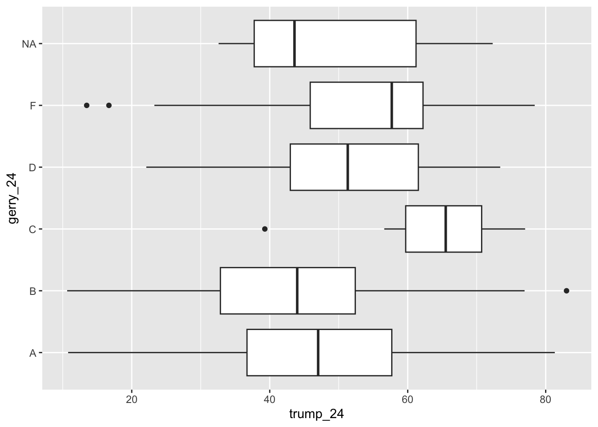
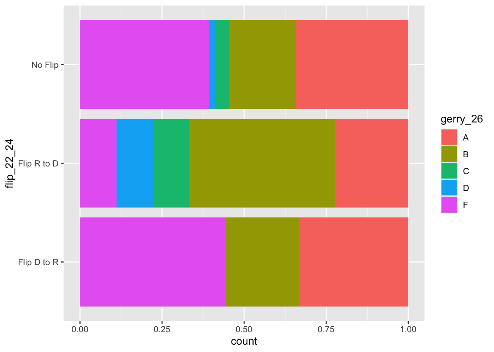

# AE 02: Gerrymandering + data exploration I

Suggested answers

Application exercise

Answers

> **IMPORTANT:**
>
> These are suggested answers. This document should be used as a reference only; it’s not designed to be an exhaustive key.

## Getting started

### Packages

We’ll use the **tidyverse** package for this analysis.

``` downlit
library(tidyverse)
```

### Data

``` downlit
gerrymander <- read_csv("data/gerrymander.csv")
```

``` downlit
glimpse(gerrymander)
```

    Rows: 443
    Columns: 14
    $ district       <chr> "AK-00", "AL-01", "AL-02", "AL-03", "AL-04", "AL-05", "…
    $ state_abb      <chr> "AK", "AL", "AL", "AL", "AL", "AL", "AL", "AL", "AR", "…
    $ state          <chr> "Alaska", "Alabama", "Alabama", "Alabama", "Alabama", "…
    $ house_rep_20   <chr> "Don Young", "Jerry Carl", "Barry Moore", "Mike Rogers"…
    $ house_party_20 <chr> "Republican", "Republican", "Republican", "Republican",…
    $ house_rep_22   <chr> "Mary Sattler Peltola", "Jerry L Carl", "Barry Moore", …
    $ house_party_22 <chr> "Democrat", "Republican", "Republican", "Republican", "…
    $ house_rep_24   <chr> "Nick Begich", "Barry Moore", "Shomari Figures", "Mike …
    $ house_party_24 <chr> "Republican", "Republican", "Democrat", "Republican", "…
    $ harris_24      <dbl> 41.41, 21.89, 53.52, 26.18, 15.96, 34.20, 29.68, 61.45,…
    $ trump_24       <dbl> 54.54, 76.94, 45.31, 72.71, 83.02, 64.02, 68.47, 37.50,…
    $ gerry_22       <chr> NA, "F", "F", "F", "F", "F", "F", "F", "C", "C", "C", "…
    $ gerry_24       <chr> NA, "B", "B", "B", "B", "B", "B", "B", "C", "C", "C", "…
    $ gerry_26       <chr> NA, "B", "B", "B", "B", "B", "B", "B", "C", "C", "C", "…

## Districts at the tails

Make side-by-side box plots of percent of vote received by Trump in 2024 Presidential Election by prevalence of gerrymandering. Identify any Congressional Districts that are potential outliers. Are they different from the rest of the Congressional Districts within the given gerrymandering level due to high support or low support for Trump in the 2024 Presidential Election? Which state are they in? Which city are they in?

``` downlit
ggplot(gerrymander, aes(x = trump_24, y = gerry_24)) +
  geom_boxplot()
```

    Warning: Removed 8 rows containing non-finite outside the scale range
    (`stat_boxplot()`).

[](ae-02-gerrymander-explore-I-A_files/figure-html/outliers-1.png)

``` downlit
gerrymander |>
  filter(gerry_24 == "F", trump_24 < 20) |>
  select(state, district, trump_24, gerry_24)
```

    # A tibble: 2 × 4
      state    district trump_24 gerry_24
      <chr>    <chr>       <dbl> <chr>   
    1 Georgia  GA-05        13.5 F       
    2 Illinois IL-07        16.7 F       

``` downlit
gerrymander |>
  filter(gerry_24 == "C", trump_24 < 40) |>
  select(state, district, trump_24, gerry_24)
```

    # A tibble: 1 × 4
      state       district trump_24 gerry_24
      <chr>       <chr>       <dbl> <chr>   
    1 Mississippi MS-02        39.3 C       

``` downlit
gerrymander |>
  filter(gerry_24 == "B", trump_24 > 80) |>
  select(state, district, trump_24, gerry_24)
```

    # A tibble: 1 × 4
      state   district trump_24 gerry_24
      <chr>   <chr>       <dbl> <chr>   
    1 Alabama AL-04        83.0 B       

## Flips

How does the prevalence of various levels of gerrymandering for the 2026 election vary among Congressional Districts that flipped from Republican to Democrat in the 2024 election compared to the 2022 election? Support your answer with a visualization as well as summary statistics. **Hint:** Calculate the conditional distribution of prevalance of various levels of gerrymandering based on whether a Democrat flipped the seat in the 2024 election compared to the 2022 election.

``` downlit
gerrymander <- gerrymander |>
  mutate(
    flip_22_24 = case_when(
      house_party_22 == "Republican" &
        house_party_24 == "Democrat" ~ "Flip R to D",
      house_party_22 == "Democrat" &
        house_party_24 == "Republican" ~ "Flip D to R",
      .default = "No Flip"
    )
  ) |>
  relocate(house_party_22, house_party_24, flip_22_24, gerry_26, .after = state)
```

``` downlit
gerrymander |>
  filter(!is.na(gerry_26)) |>
  ggplot(aes(y = flip_22_24, fill = gerry_26)) +
  geom_bar(position = "fill")
```

[](ae-02-gerrymander-explore-I-A_files/figure-html/flips-viz-1.png)

``` downlit
gerrymander |>
  filter(!is.na(gerry_26)) |>
  count(flip_22_24, gerry_26) |>
  group_by(flip_22_24) |>
  mutate(prop = n / sum(n))
```

    # A tibble: 13 × 4
    # Groups:   flip_22_24 [3]
       flip_22_24  gerry_26     n   prop
       <chr>       <chr>    <int>  <dbl>
     1 Flip D to R A            3 0.333 
     2 Flip D to R B            2 0.222 
     3 Flip D to R F            4 0.444 
     4 Flip R to D A            2 0.222 
     5 Flip R to D B            4 0.444 
     6 Flip R to D C            1 0.111 
     7 Flip R to D D            1 0.111 
     8 Flip R to D F            1 0.111 
     9 No Flip     A          142 0.342 
    10 No Flip     B           84 0.202 
    11 No Flip     C           18 0.0434
    12 No Flip     D            8 0.0193
    13 No Flip     F          163 0.393 
