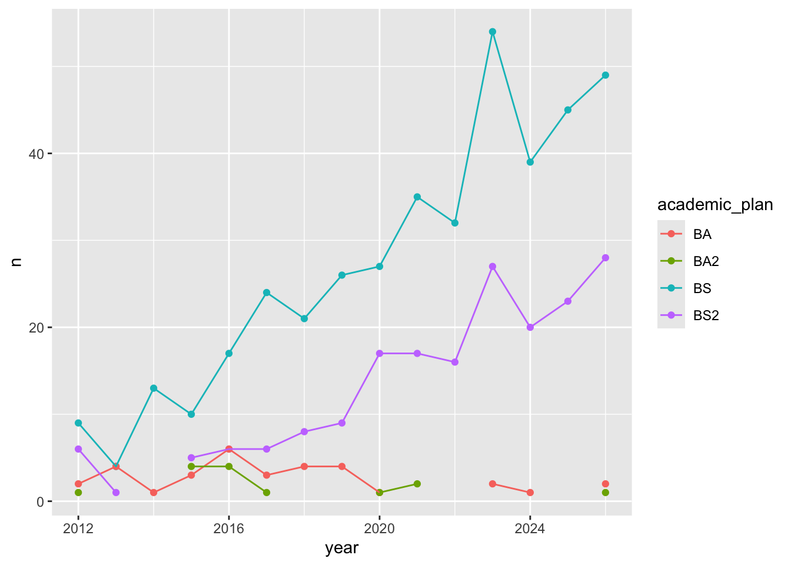
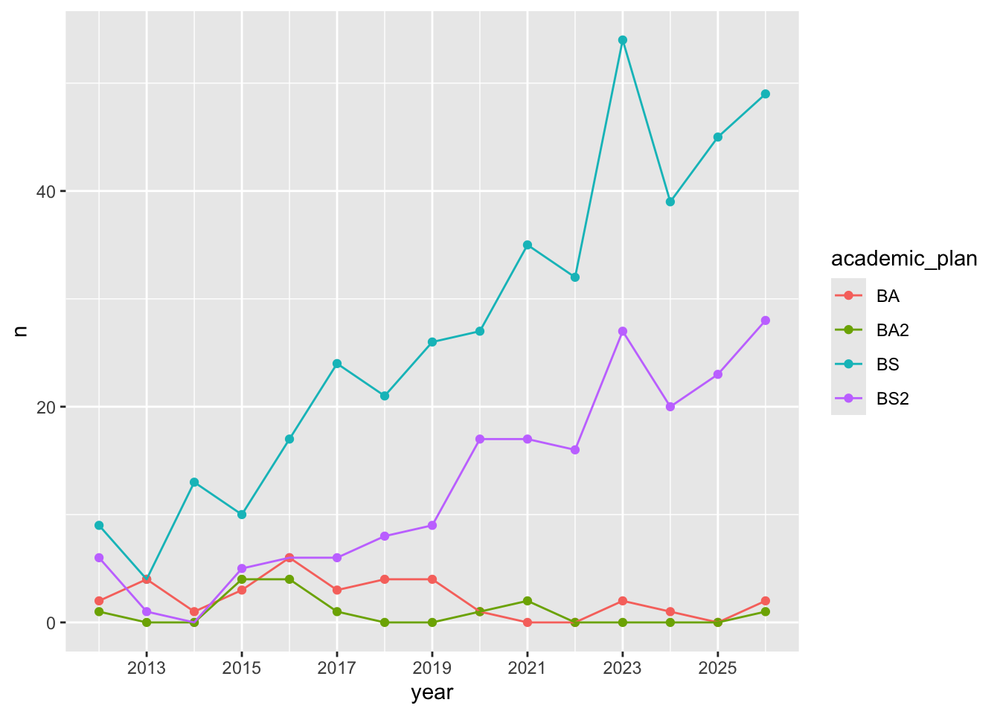
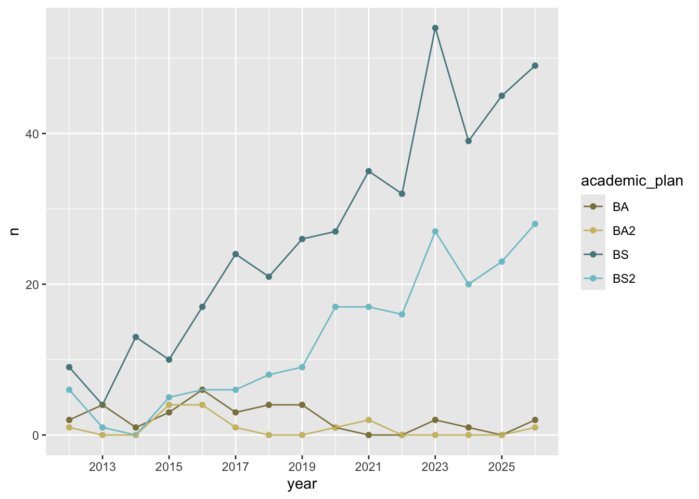
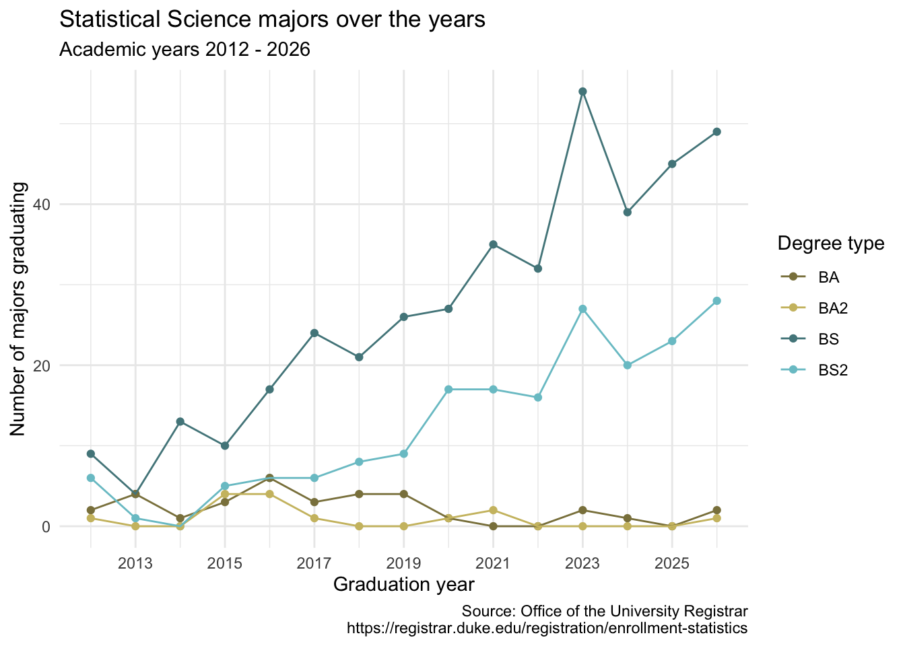
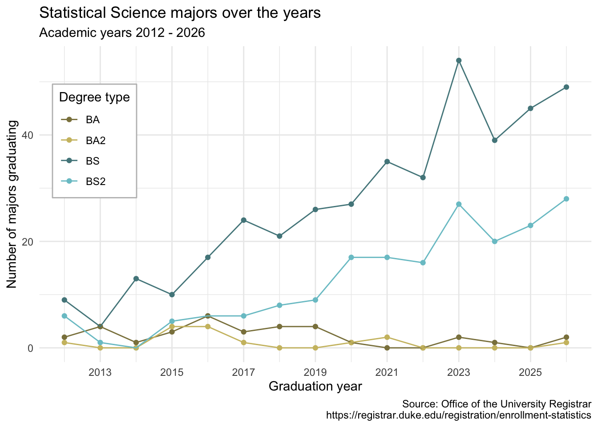
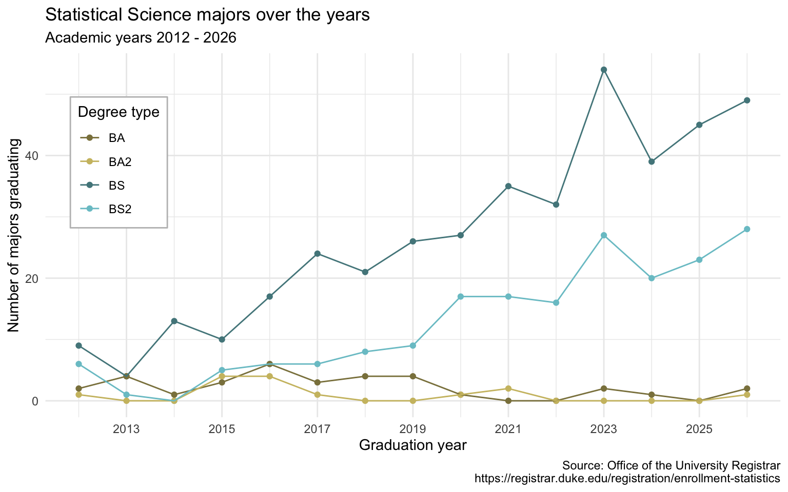

# AE 03: Tidying Stat Sci majors

Application exercise

Answers

> **IMPORTANT:**
>
> These are suggested answers. This document should be used as reference only, it’s not designed to be an exhaustive key.

## Data

The data come from the [Office of the University Registrar](https://registrar.duke.edu/registration/enrollment-statistics).

``` downlit
library(tidyverse)

majors <- read_csv("data/majors.csv")

statsci_majors <- majors |>
  filter(
    department == "Statistical Science",
    academic_plan != "Minor"
  )
```

And let’s take a look at the data.

``` downlit
statsci_majors
```

    # A tibble: 4 × 17
      department      academic_plan `2026` `2025` `2024` `2023` `2022` `2021` `2020`
      <chr>           <chr>          <dbl>  <dbl>  <dbl>  <dbl>  <dbl>  <dbl>  <dbl>
    1 Statistical Sc… BS                49     45     39     54     32     35     27
    2 Statistical Sc… BS2               28     23     20     27     16     17     17
    3 Statistical Sc… BA                 2     NA      1      2     NA     NA      1
    4 Statistical Sc… BA2                1     NA     NA     NA     NA      2      1
    # ℹ 8 more variables: `2019` <dbl>, `2018` <dbl>, `2017` <dbl>, `2016` <dbl>,
    #   `2015` <dbl>, `2014` <dbl>, `2013` <dbl>, `2012` <dbl>

## Pivoting

- **Demo:** Pivot the `statsci` data frame *longer* such that:

  - Each row represents a degree type / year combination
  - `year` and `n`umber of graduates for that year are columns in the data frame
  - The resulting `year` column is numeric

``` downlit
statsci_majors |>
  pivot_longer(
    cols = !c(department, academic_plan),
    names_to = "year",
    values_to = "n",
    names_transform = as.numeric
  )
```

    # A tibble: 60 × 4
       department          academic_plan  year     n
       <chr>               <chr>         <dbl> <dbl>
     1 Statistical Science BS             2026    49
     2 Statistical Science BS             2025    45
     3 Statistical Science BS             2024    39
     4 Statistical Science BS             2023    54
     5 Statistical Science BS             2022    32
     6 Statistical Science BS             2021    35
     7 Statistical Science BS             2020    27
     8 Statistical Science BS             2019    26
     9 Statistical Science BS             2018    21
    10 Statistical Science BS             2017    24
    # ℹ 50 more rows

- **Your Turn:** Now, repeat your code from above, but this time **save the result** to a **new** variable name.

``` downlit
statsci_majors_longer <- statsci_majors |>
  pivot_longer(
    cols = !c(department, academic_plan),
    names_to = "year",
    names_transform = as.numeric,
    values_to = "n"
  )
```

## Plotting

- **Your turn:** Now we will start making our plot, but let’s not get too fancy right away. Just get the geoms right for now and use default colors for different academic plans.

``` downlit
statsci_majors_longer |>
  ggplot(aes(x = year, y = n, color = academic_plan)) +
  geom_point() +
  geom_line()
```

    Warning: Removed 12 rows containing missing values or values outside the scale range
    (`geom_point()`).

[](ae-03-statsci-majors-A_files/figure-html/plot-draft-1.png)

- **Question**: Why was the pivot necessary in order to create this plot?

*Add your response here!*

- **Question:** What aspects of the plot need to be updated still?

*Add your response here.*

- **Demo:** Update `statsci_majors_longer` to fix the discontinuities.

``` downlit
statsci_majors_longer <- statsci_majors_longer |>
  mutate(n = if_else(is.na(n), 0, n))
```

- **Demo:** Update x-axis scale such that the years displayed go from 2011 to 2025 in increments of 2 years. Do this by adding on to your pipeline from earlier.

``` downlit
statsci_majors_longer |>
  ggplot(aes(x = year, y = n, color = academic_plan)) +
  geom_point() +
  geom_line() +
  scale_x_continuous(breaks = seq(2011, 2025, 2))
```

[](ae-03-statsci-majors-A_files/figure-html/plot-improve-1-1.png)

- **Demo:** Update line colors using the following level / color assignments. Once again, do this by adding on to your pipeline from earlier.
  - “BS” = “cadetblue4”

  - “BS2” = “cadetblue3”

  - “BA” = “lightgoldenrod4”

  - “BA2” = “lightgoldenrod3”

``` downlit
statsci_majors_longer |>
  ggplot(aes(x = year, y = n, color = academic_plan)) +
  geom_point() +
  geom_line() +
  scale_x_continuous(breaks = seq(2011, 2025, 2)) +
  scale_color_manual(
    values = c(
      "BS" = "cadetblue4",
      "BS2" = "cadetblue3",
      "BA" = "lightgoldenrod4",
      "BA2" = "lightgoldenrod3"
    )
  )
```

[](ae-03-statsci-majors-A_files/figure-html/plot-improve-2-1.png)

- **Your turn:** Update the plot labels (`title`, `subtitle`, `x`, `y`, and `caption`) and use [`theme_minimal()`](https://ggplot2.tidyverse.org/reference/ggtheme.html). Once again, do this by adding on to your pipeline from earlier.

``` downlit
statsci_majors_longer |>
  ggplot(aes(x = year, y = n, color = academic_plan)) +
  geom_point() +
  geom_line() +
  scale_x_continuous(breaks = seq(2011, 2025, 2)) +
  scale_color_manual(
    values = c(
      "BS" = "cadetblue4",
      "BS2" = "cadetblue3",
      "BA" = "lightgoldenrod4",
      "BA2" = "lightgoldenrod3"
    )
  ) +
  labs(
    x = "Graduation year",
    y = "Number of majors graduating",
    color = "Degree type",
    title = "Statistical Science majors over the years",
    subtitle = "Academic years 2012 - 2026",
    caption = "Source: Office of the University Registrar\nhttps://registrar.duke.edu/registration/enrollment-statistics"
  ) +
  theme_minimal()
```

[](ae-03-statsci-majors-A_files/figure-html/plot-improve-3-1.png)

- **Demo:** Move the legend into the plot, make its background white, and its border gray.

``` downlit
statsci_majors_longer |>
  ggplot(aes(x = year, y = n, color = academic_plan)) +
  geom_point() +
  geom_line() +
  scale_x_continuous(breaks = seq(2011, 2025, 2)) +
  scale_color_manual(
    values = c(
      "BS" = "cadetblue4",
      "BS2" = "cadetblue3",
      "BA" = "lightgoldenrod4",
      "BA2" = "lightgoldenrod3"
    )
  ) +
  labs(
    x = "Graduation year",
    y = "Number of majors graduating",
    color = "Degree type",
    title = "Statistical Science majors over the years",
    subtitle = "Academic years 2012 - 2026",
    caption = "Source: Office of the University Registrar\nhttps://registrar.duke.edu/registration/enrollment-statistics"
  ) +
  theme_minimal() +
  theme(
    legend.position = "inside",
    legend.position.inside = c(0.1, 0.7),
    legend.background = element_rect(fill = "white", color = "grey")
  )
```

[](ae-03-statsci-majors-A_files/figure-html/plot-improve-4-1.png)

- **Demo:** Finally, set `fig-width: 8` and `fig-height: 5` for your plot in the chunk options.

``` downlit
statsci_majors_longer |>
  ggplot(aes(x = year, y = n, color = academic_plan)) +
  geom_point() +
  geom_line() +
  scale_x_continuous(breaks = seq(2011, 2025, 2)) +
  scale_color_manual(
    values = c(
      "BS" = "cadetblue4",
      "BS2" = "cadetblue3",
      "BA" = "lightgoldenrod4",
      "BA2" = "lightgoldenrod3"
    )
  ) +
  labs(
    x = "Graduation year",
    y = "Number of majors graduating",
    color = "Degree type",
    title = "Statistical Science majors over the years",
    subtitle = "Academic years 2012 - 2026",
    caption = "Source: Office of the University Registrar\nhttps://registrar.duke.edu/registration/enrollment-statistics"
  ) +
  theme_minimal() +
  theme(
    legend.position = "inside",
    legend.position.inside = c(0.1, 0.7),
    legend.background = element_rect(fill = "white", color = "grey")
  )
```

[](ae-03-statsci-majors-A_files/figure-html/plot-improve-5-1.png)
