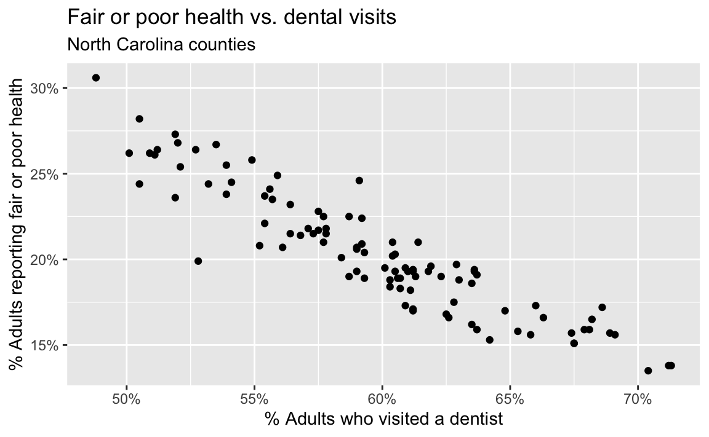
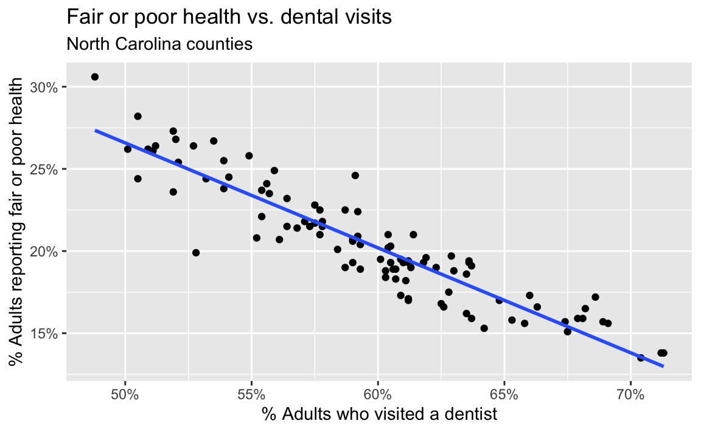
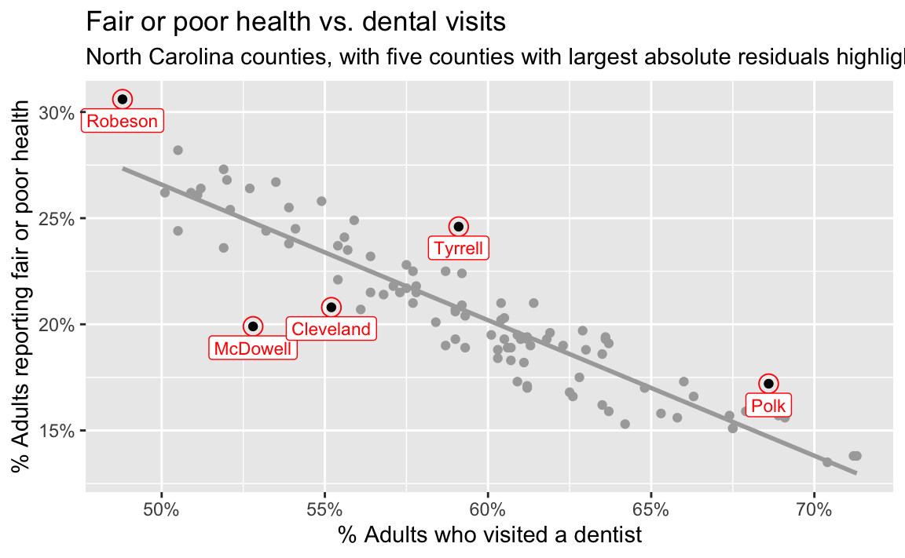

# AE 09: Dental visits and health in North Carolina

Suggested answers

Application exercise

Answers

> **IMPORTANT:**
>
> These are suggested answers. This document should be used as reference only; it is not designed to be an exhaustive key.

The data for this application exercise come from the [CDC PLACES 2025 county release](https://data.cdc.gov/500-Cities-Places/PLACES-Local-Data-for-Better-Health-County-Data-20/swc5-untb). PLACES provides model-based local health estimates for every U.S. county.

We will model the relationship between the estimated percentage of adults who visited a dentist during the previous year and the estimated percentage reporting fair or poor health across the 100 North Carolina counties.

## Getting started

### Packages

We will use the **tidyverse** package for data visualization and wrangling and the **tidymodels** package for modeling.

``` downlit
library(tidyverse)
library(tidymodels)
library(scales)
```

### Data

The data can be found in the `data` folder; the file is called `nc-places.csv`.

``` downlit
nc_places <- read_csv("data/nc-places.csv")
```

The variables used in this exercise are:

| Variable name | Description |
|:---|:---|
| `county` | North Carolina county name |
| `dental_visit` | Percentage of adults who visited a dentist or dental clinic during the previous year |
| `fair_or_poor_health` | Percentage of adults reporting fair or poor general health |

The percentage variables are age-adjusted, model-based estimates.

## Visualizing the relationship

- Create an appropriate plot to investigate the relationship between `dental_visit` and `fair_or_poor_health`. Put the predictor on the (x)-axis and the outcome on the (y)-axis. Add appropriate labels.

``` downlit
ggplot(
  nc_places,
  aes(x = dental_visit, y = fair_or_poor_health)
) +
  geom_point() +
  scale_x_continuous(labels = label_percent(scale = 1)) +
  scale_y_continuous(labels = label_percent(scale = 1)) +
  labs(
    x = "% Adults who visited a dentist",
    y = "% Adults reporting fair or poor health",
    title = "Fair or poor health vs. dental visits",
    subtitle = "North Carolina counties"
  )
```

[](ae-09-nc-places-model-A_files/figure-html/visualize-1.png)

- Describe the **form, direction, and strength** of the relationship. Note any unusual observations.

*The relationship is roughly linear, negative, and strong: counties with higher dental-visit prevalence tend to have lower fair-or-poor-health prevalence. There is at least one point noticeably below the overall trend.*

- If you were to draw a straight line that best represents this relationship, where would it go? Why?

*The line would slope downward from the upper left to the lower right and pass through the center of the point cloud, balancing the vertical residuals above and below it.*

- Now let R draw the line. Use [`geom_smooth()`](https://ggplot2.tidyverse.org/reference/geom_smooth.html) with `method = "lm"` and set `se = FALSE`.

``` downlit
ggplot(
  nc_places,
  aes(x = dental_visit, y = fair_or_poor_health)
) +
  geom_point() +
  geom_smooth(method = "lm", se = FALSE) +
  scale_x_continuous(labels = label_percent(scale = 1)) +
  scale_y_continuous(labels = label_percent(scale = 1)) +
  labs(
    x = "% Adults who visited a dentist",
    y = "% Adults reporting fair or poor health",
    title = "Fair or poor health vs. dental visits",
    subtitle = "North Carolina counties"
  )
```

[](ae-09-nc-places-model-A_files/figure-html/visualize-with-line-1.png)

- What types of questions can this plot help answer?

*How does county fair-or-poor-health prevalence tend to change with dental-visit prevalence? What fair-or-poor-health prevalence would we predict for a county with a given dental-visit prevalence?*

## Model fit and summary

- Fit a linear regression model that predicts fair-or-poor-health prevalence from dental-visit prevalence.

``` downlit
health_dental_fit <- linear_reg() |>
  fit(fair_or_poor_health ~ dental_visit, data = nc_places)

health_dental_fit
```

    parsnip model object


    Call:
    stats::lm(formula = fair_or_poor_health ~ dental_visit, data = data)

    Coefficients:
     (Intercept)  dental_visit  
         58.5134       -0.6387  

- Display the model summary and extract the slope and intercept estimates.

``` downlit
tidy(health_dental_fit)
```

    # A tibble: 2 × 5
      term         estimate std.error statistic  p.value
      <chr>           <dbl>     <dbl>     <dbl>    <dbl>
    1 (Intercept)    58.5      1.62        36.0 2.41e-58
    2 dental_visit   -0.639    0.0271     -23.6 3.42e-42

- Write the fitted model using mathematical notation.

\\ \widehat{\text{fair or poor health}} = 58.5 - 0.639 \times \text{dental visit} \\

- Interpret the slope in context.

*For each one percentage-point increase in counties’ dental-visit prevalences, their predicted fair-or-poor-health prevalences are 0.639 percentage points lower, on average.*

- Interpret the intercept in context. Is this interpretation meaningful for these data?

*For a county with 0% dental-visit prevalence, the model predicts a fair-or-poor-health prevalence of 58.5%. This is the mathematical interpretation, but it is not practically meaningful: observed dental-visit prevalence ranges from approximately 48% to 72%, so 0% is far outside the data.*

## Correlation

- Calculate the correlation between dental-visit prevalence and fair-or-poor-health prevalence. Interpret its sign and magnitude.

``` downlit
nc_places |>
  summarize(r = cor(dental_visit, fair_or_poor_health))
```

    # A tibble: 1 × 1
           r
       <dbl>
    1 -0.922

*The correlation is approximately (-0.922), indicating a strong negative linear relationship.*

## Predictions and residuals

- Use the model to predict fair-or-poor-health prevalence for a county where 60% of adults visited a dentist during the previous year.

``` downlit
new_county <- tibble(dental_visit = 60)

predict(health_dental_fit, new_data = new_county)
```

    # A tibble: 1 × 1
      .pred
      <dbl>
    1  20.2

*The predicted fair-or-poor-health prevalence is approximately 20.2%.*

- Use `augment()` to add predictions and residuals to the county data.

``` downlit
health_dental_aug <- augment(
  health_dental_fit,
  new_data = nc_places
)
```

### Durham County

- Durham County has a dental-visit prevalence of 68.2% and an observed fair-or-poor-health prevalence of 16.5%. Use the augmented data frame to identify the predicted value and residual for Durham County.

``` downlit
health_dental_aug |>
  filter(county == "Durham") |>
  select(county, dental_visit, fair_or_poor_health, .pred, .resid)
```

    # A tibble: 1 × 5
      county dental_visit fair_or_poor_health .pred .resid
      <chr>         <dbl>               <dbl> <dbl>  <dbl>
    1 Durham         68.2                16.5  15.0   1.54

*Durham’s positive residual means its observed fair-or-poor-health prevalence is about 1.54 percentage points higher than the model predicts.*

- Verify this residual by calculating the predicted value using the model and comparing it to the observed value. If your calculation doesn’t exactly match the residual returned by `augment()`, explain why.

*Using the rounded fitted model coefficients:*

\\ \begin{aligned} \widehat{y} &= 58.5 - 0.639(68.2) \\ &= 14.92 \\ e &= y - \widehat{y} \\ &= 16.5 - 14.92 \\ &= 1.58 \end{aligned} \\

*Using the rounded coefficients, Durham’s observed fair-or-poor-health prevalence is approximately 1.58 percentage points higher than its predicted prevalence. The residual returned by `augment()` is 1.54 because it uses the full-precision coefficient estimates.*

### Identifying potential outliers

- Identify the counties with the five highest absolute residuals. Report their observed values, predicted values, and residuals.

``` downlit
health_dental_aug <- health_dental_aug |>
  mutate(abs_resid = abs(.resid)) |>
  arrange(desc(abs_resid)) |>
  mutate(abs_resid_rank = row_number())

health_dental_aug |>
  filter(abs_resid_rank <= 5) |>
  select(
    abs_resid_rank,
    county,
    dental_visit,
    fair_or_poor_health,
    .pred,
    .resid
  )
```

    # A tibble: 5 × 6
      abs_resid_rank county    dental_visit fair_or_poor_health .pred .resid
               <int> <chr>            <dbl>               <dbl> <dbl>  <dbl>
    1              1 McDowell          52.8                19.9  24.8  -4.89
    2              2 Tyrrell           59.1                24.6  20.8   3.83
    3              3 Robeson           48.8                30.6  27.3   3.25
    4              4 Polk              68.6                17.2  14.7   2.50
    5              5 Cleveland         55.2                20.8  23.3  -2.46

- Mark these counties on the scatterplot. Do they appear to be outliers?

``` downlit
ggplot(data = nc_places, aes(x = dental_visit, y = fair_or_poor_health)) +
  geom_point(color = "darkgray") +
  geom_smooth(method = "lm", se = FALSE, color = "darkgray") +
  geom_point(
    data = health_dental_aug |>
      filter(abs_resid_rank <= 5)
  ) +
  geom_point(
    data = health_dental_aug |>
      filter(abs_resid_rank <= 5),
    color = "red",
    shape = "circle open",
    size = 4
  ) +
  geom_label(
    data = health_dental_aug |>
      filter(abs_resid_rank <= 5),
    aes(label = county),
    color = "red",
    nudge_y = -1,
    size = 3
  ) +
  coord_cartesian(clip = "off") +
  scale_x_continuous(labels = label_percent(scale = 1)) +
  scale_y_continuous(labels = label_percent(scale = 1)) +
  labs(
    x = "% Adults who visited a dentist",
    y = "% Adults reporting fair or poor health",
    title = "Fair or poor health vs. dental visits",
    subtitle = "North Carolina counties, with five counties with largest absolute residuals highlighted"
  )
```

    `geom_smooth()` using formula = 'y ~ x'

[](ae-09-nc-places-model-A_files/figure-html/visualize-potential-outliers-1.png)

*The five counties with the largest absolute residuals are marked in red on the plot. Of these five, only Robeson County stands out from the rest of the data, but it’s in the trajectory of the overall trend.*

## Interpreting responsibly

- Does this analysis establish that increasing dental visits causes better general health? Explain.

*No. The model describes a county-level association. Other county characteristics may be related to both access to dental care and general health, the direction of causation is not established, and county-level relationships do not necessarily hold for individuals.*
