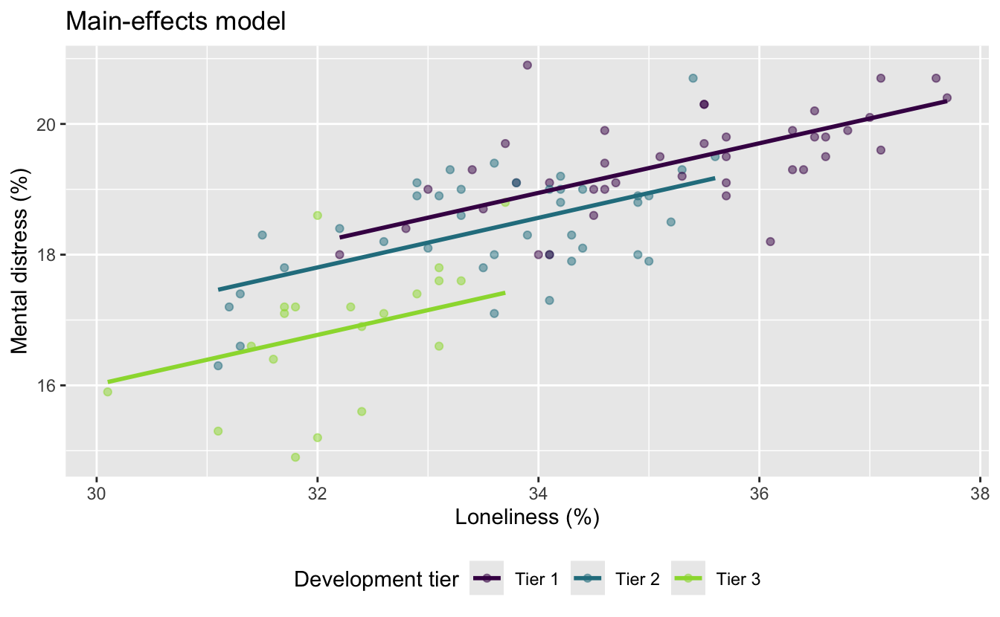
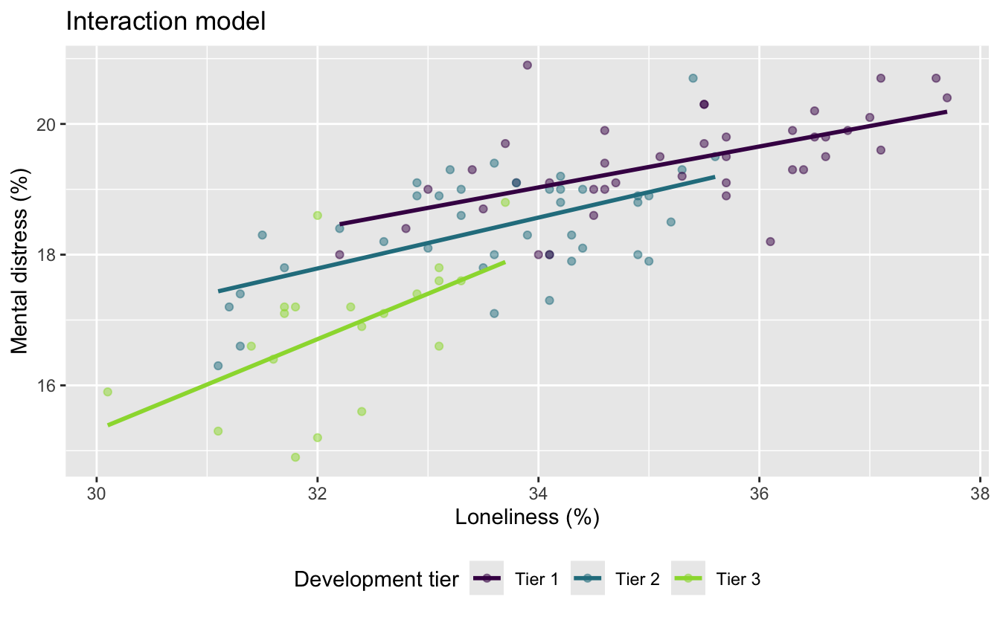

# AE 10: Mental distress with multiple predictors

Suggested answers

Application exercise

Answers

> **IMPORTANT:**
>
> These are suggested answers. This document should be used as reference only; it is not designed to be an exhaustive key.

In the previous application exercise, we used a linear regression model with one numerical predictor to study health outcomes across North Carolina counties. In this exercise, we will use both a numerical predictor and a categorical predictor to model frequent mental-distress prevalence. We will also investigate whether the relationship between loneliness and mental distress might differ by county development tier.

The data come from the [CDC PLACES 2025 county release](https://data.cdc.gov/500-Cities-Places/PLACES-Local-Data-for-Better-Health-County-Data-20/swc5-untb). PLACES provides model-based local health estimates for every U.S. county.

## Getting started

### Packages

We will use the **tidyverse** package for data visualization and wrangling, the **tidymodels** package for modeling, and the **scales** package for formatting percentages.

``` downlit
library(tidyverse)
library(tidymodels)
library(scales)
```

### Data

The data can be found in the `data` folder; the file is called `nc-places.csv`.

``` downlit
nc_places <- read_csv("data/nc-places.csv")
```

The variables used in this exercise are:

| Variable name | Description |
|:---|:---|
| `county` | North Carolina county name |
| `development_tier` | County development tier; Tier 1 is the most economically distressed and Tier 3 is the least economically distressed |
| `loneliness` | Percentage of adults reporting that they always, usually, or sometimes feel lonely |
| `mental_distress` | Percentage of adults experiencing frequent mental distress |

The percentage variables are age-adjusted, model-based estimates.

## The main-effects model

So far, we fit the following **main effects** model:

``` downlit
md_tier_lone_main_fit <- linear_reg() |>
  fit(
    mental_distress ~ development_tier + loneliness,
    data = nc_places
  )

tidy(md_tier_lone_main_fit)
```

    # A tibble: 4 × 5
      term                   estimate std.error statistic       p.value
      <chr>                     <dbl>     <dbl>     <dbl>         <dbl>
    1 (Intercept)               6.04     2.06        2.93 0.00420      
    2 development_tierTier 2   -0.381    0.187      -2.04 0.0437       
    3 development_tierTier 3   -1.41     0.265      -5.33 0.000000651  
    4 loneliness                0.379    0.0583      6.50 0.00000000352

- In this model, what assumption do we make about the relationship between loneliness and mental distress across the three development tiers?

*The main-effects model assumes that the relationship has the same slope in all three development tiers. The fitted lines are parallel: tier may change the predicted level of mental distress, but it does not change the predicted rate of increase in mental distress as loneliness increases.*

## Could the slopes differ?

The following plot also fits a separate regression line for each development tier.

Remembering what each tier represents can be helpful:

- **Tier 1:** 40 most economically distressed counties
- **Tier 2:** next 40 counties
- **Tier 3:** 20 least economically distressed counties

``` downlit
ggplot(
  nc_places,
  aes(x = loneliness, y = mental_distress, color = development_tier)
) +
  geom_point(alpha = 0.7) +
  geom_smooth(method = "lm", se = FALSE) +
  scale_x_continuous(labels = label_percent(scale = 1)) +
  scale_y_continuous(labels = label_percent(scale = 1)) +
  scale_color_viridis_d(end = 0.85) +
  labs(
    x = "Adults experiencing loneliness (%)",
    y = "Adults experiencing frequent mental distress (%)",
    color = "Development tier"
  ) +
  theme(legend.position = "bottom")
```

[](ae-10-nc-places-multi-model-A_files/figure-html/visualize-separate-lines-1.png)

- How do these lines differ from the parallel fitted lines produced by the main effects model?

*These lines are not constrained to be parallel. Each development tier has its own intercept and its own loneliness slope. The Tier 3 line is noticeably steeper than the Tier 1 and Tier 2 lines.*

## Fitting an interaction model

An **interaction effects** model allows the slope for loneliness to differ across development tiers. In a model formula, `development_tier * loneliness` includes:

- the main effect of `development_tier`,

- the main effect of `loneliness`, and

- their interaction.

- Fit the interaction model and examine its coefficients. Name the model `md_tier_lone_int`.

``` downlit
md_tier_lone_int <- linear_reg() |>
  fit(
    mental_distress ~ development_tier * loneliness,
    data = nc_places
  )

tidy(md_tier_lone_int)
```

    # A tibble: 6 × 5
      term                              estimate std.error statistic  p.value
      <chr>                                <dbl>     <dbl>     <dbl>    <dbl>
    1 (Intercept)                         8.39      2.89       2.91  0.00457 
    2 development_tierTier 2             -3.05      4.21      -0.725 0.471   
    3 development_tierTier 3            -13.9       6.75      -2.06  0.0424  
    4 loneliness                          0.313     0.0818     3.83  0.000233
    5 development_tierTier 2:loneliness   0.0761    0.122      0.622 0.535   
    6 development_tierTier 3:loneliness   0.381     0.206      1.85  0.0678  

- Which development tier is the baseline level?

*Tier 1 is the baseline level. It does not appear as a separate indicator term in the model output.*

## Comparing the two models visually

- Set the following code cell’s `eval` option to `true` to render the visualizations of main and interaction effect models. Describe what the code is doing.

``` downlit
md_tier_lone_main_aug <- augment(
  md_tier_lone_main_fit,
  new_data = nc_places
)

ggplot(
  md_tier_lone_main_aug,
  aes(x = loneliness, color = development_tier)
) +
  geom_point(aes(y = mental_distress), alpha = 0.5) +
  geom_line(aes(y = .pred), linewidth = 1) +
  scale_color_viridis_d(end = 0.85) +
  labs(
    x = "Loneliness (%)",
    y = "Mental distress (%)",
    color = "Development tier",
    title = "Main-effects model"
  ) +
  theme(legend.position = "bottom")
md_tier_lone_int_aug <- augment(
  md_tier_lone_int,
  new_data = nc_places
)

ggplot(
  md_tier_lone_int_aug,
  aes(x = loneliness, color = development_tier)
) +
  geom_point(aes(y = mental_distress), alpha = 0.5) +
  geom_line(aes(y = .pred), linewidth = 1) +
  scale_color_viridis_d(end = 0.85) +
  labs(
    x = "Loneliness (%)",
    y = "Mental distress (%)",
    color = "Development tier",
    title = "Interaction model"
  ) +
  theme(legend.position = "bottom")
```

[](ae-10-nc-places-multi-model-A_files/figure-html/compare-model-plots-1.png)

[](ae-10-nc-places-multi-model-A_files/figure-html/compare-model-plots-2.png)

*The code first uses `augment()` to add each model’s predictions to the county data. It then plots the observed county values and connects the fitted values within each development tier. The main-effects plot shows predictions from the model with a common loneliness slope, while the interaction plot shows predictions from the model with a separate slope for each tier.*

- Describe the key difference between the fitted lines in the two plots.

*The main-effects model produces three parallel lines with the same loneliness slope. The interaction model produces three lines with different slopes; the Tier 3 line is the steepest.*

- Which model makes the stronger assumption about the relationship between loneliness and mental distress? Explain.

*The main-effects model makes the stronger assumption because it requires the loneliness slope to be the same for all three tiers. The interaction model is more flexible because it allows the slope to vary by tier.*

## Interpreting the interaction model

- Write the fitted interaction model using mathematical notation. Your model should contain six coefficient estimates.

\\ \begin{aligned} \widehat{\text{mental distress %}} &= 8.39 - 3.05 \times \text{Tier 2} - 13.90 \times \text{Tier 3} \\ &\quad + 0.313 \times \text{loneliness %} \\ &\quad + 0.076 \times (\text{Tier 2} \times \text{loneliness %}) \\ &\quad + 0.381 \times (\text{Tier 3} \times \text{loneliness %}) \end{aligned} \\

- Write the model for Tier 1 counties using mathematical notation. Then, interpret the slope for loneliness in context.

*For Tier 1 counties, both tier indicators equal 0:*

\\ \widehat{\text{mental distress %}} = 8.39 + 0.313 \times \text{loneliness %} \\

*Among Tier 1 counties, each additional percentage point in loneliness prevalence is associated with a predicted 0.313 percentage-point increase in mental-distress prevalence, on average.*

- Write the model for Tier 2 counties using mathematical notation. Then, interpret the slope for loneliness in context.

*For Tier 2 counties, the intercept is (8.39 - 3.05 = 5.34), and the loneliness slope is (0.313 + 0.076 = 0.389):*

\\ \widehat{\text{mental distress %}} = 5.34 + 0.389 \times \text{loneliness %} \\

*Among Tier 2 counties, each additional percentage point in loneliness prevalence is associated with a predicted 0.389 percentage-point increase in mental-distress prevalence, on average.*

- Write the model for Tier 3 counties using mathematical notation. Then, interpret the slope for loneliness in context.

*For Tier 3 counties, the intercept is (8.39 - 13.90 = -5.51), and the loneliness slope is (0.313 + 0.381 = 0.694):*

\\ \widehat{\text{mental distress %}} = -5.51 + 0.694 \times \text{loneliness %} \\

*Among Tier 3 counties, each additional percentage point in loneliness prevalence is associated with a predicted 0.694 percentage-point increase in mental-distress prevalence, on average.*

- In the interaction model, what does the intercept represent? Is its interpretation meaningful for these data?

*The intercept predicts a mental-distress prevalence of 8.39% for a Tier 1 county with 0% loneliness. This is not meaningful in context because observed loneliness prevalences range from approximately 30.1% to 37.7%; 0% is far outside the observed data.*

## Comparing model fit

- Calculate the \\R^2\\ and adjusted \\R^2\\ for each model.

``` downlit
bind_rows(
  glance(md_tier_lone_main_fit) |>
    mutate(model = "Main effects"),
  glance(md_tier_lone_int) |>
    mutate(model = "Interaction effects")
) |>
  select(model, r.squared, adj.r.squared)
```

    # A tibble: 2 × 3
      model               r.squared adj.r.squared
      <chr>                   <dbl>         <dbl>
    1 Main effects            0.691         0.681
    2 Interaction effects     0.702         0.686

- Which model has the higher \\R^2\\? Why does adding interaction terms necessarily result in an \\R^2\\ that is at least as high?

*The interaction model has the higher (R^2): approximately 0.702, compared with 0.691 for the main-effects model. The interaction model contains all the terms in the main-effects model plus two additional terms. Those terms give it more flexibility to fit the observed data; if they are not helpful, their coefficients can effectively be 0, so (R^2) cannot decrease.*

- Which model has the higher adjusted \\R^2\\? Why is adjusted \\R^2\\ more useful than \\R^2\\ for this comparison?

*The interaction model also has the higher adjusted (R^2), approximately 0.686 versus 0.681. Adjusted (R^2) penalizes a model for adding predictor coefficients, so it helps determine whether the improvement in fit is sufficient to offset the additional complexity.*

- How large is the difference in fit between the two models? Do you consider this difference practically meaningful?

*The differences are small: (R^2) increases by about 0.011, and adjusted (R^2) increases by about 0.005. The interaction model explains only about one additional percentage point of variability, so the practical improvement is modest.*

- Considering both model fit and simplicity, which model would you choose for predicting mental-distress prevalence? Justify your choice.

*A reasonable choice is the main-effects model. Its fit is nearly as good, it uses two fewer coefficients, and its parallel lines are easier to communicate. Choosing the interaction model is also defensible if tier-specific rates of change are substantively important, but the improvement in fit is small.*
