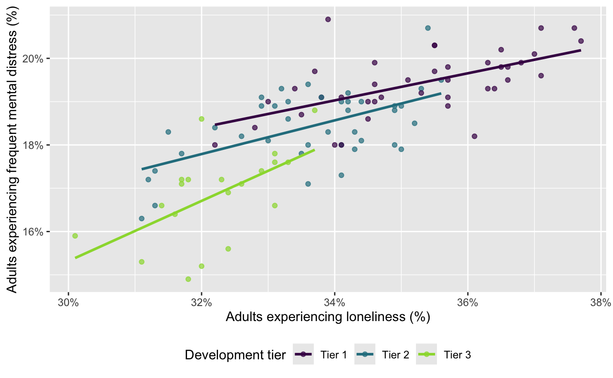

# AE 10: Mental distress with multiple predictors

Application exercise

In the previous application exercise, we used a linear regression model with one numerical predictor to study health outcomes across North Carolina counties. In this exercise, we will use both a numerical predictor and a categorical predictor to model frequent mental-distress prevalence. We will also investigate whether the relationship between loneliness and mental distress might differ by county development tier.

The data come from the [CDC PLACES 2025 county release](https://data.cdc.gov/500-Cities-Places/PLACES-Local-Data-for-Better-Health-County-Data-20/swc5-untb). PLACES provides model-based local health estimates for every U.S. county.

## Getting started

### Packages

We will use the **tidyverse** package for data visualization and wrangling, the **tidymodels** package for modeling, and the **scales** package for formatting percentages.

``` downlit
library(tidyverse)
library(tidymodels)
library(scales)
```

### Data

The data can be found in the `data` folder; the file is called `nc-places.csv`.

``` downlit
nc_places <- read_csv("data/nc-places.csv")
```

The variables used in this exercise are:

| Variable name | Description |
|:---|:---|
| `county` | North Carolina county name |
| `development_tier` | County development tier; Tier 1 is the most economically distressed and Tier 3 is the least economically distressed |
| `loneliness` | Percentage of adults reporting that they always, usually, or sometimes feel lonely |
| `mental_distress` | Percentage of adults experiencing frequent mental distress |

The percentage variables are age-adjusted, model-based estimates.

## The main-effects model

So far, we fit the following **main effects** model:

``` downlit
md_tier_lone_main_fit <- linear_reg() |>
  fit(
    mental_distress ~ development_tier + loneliness,
    data = nc_places
  )

tidy(md_tier_lone_main_fit)
```

    # A tibble: 4 × 5
      term                   estimate std.error statistic       p.value
      <chr>                     <dbl>     <dbl>     <dbl>         <dbl>
    1 (Intercept)               6.04     2.06        2.93 0.00420      
    2 development_tierTier 2   -0.381    0.187      -2.04 0.0437       
    3 development_tierTier 3   -1.41     0.265      -5.33 0.000000651  
    4 loneliness                0.379    0.0583      6.50 0.00000000352

- In this model, what assumption do we make about the relationship between loneliness and mental distress across the three development tiers?

*Add your response here.*

## Could the slopes differ?

The following plot also fits a separate regression line for each development tier.

Remembering what each tier represents can be helpful:

- **Tier 1:** 40 most economically distressed counties
- **Tier 2:** next 40 counties
- **Tier 3:** 20 least economically distressed counties

``` downlit
ggplot(
  nc_places,
  aes(x = loneliness, y = mental_distress, color = development_tier)
) +
  geom_point(alpha = 0.7) +
  geom_smooth(method = "lm", se = FALSE) +
  scale_x_continuous(labels = label_percent(scale = 1)) +
  scale_y_continuous(labels = label_percent(scale = 1)) +
  scale_color_viridis_d(end = 0.85) +
  labs(
    x = "Adults experiencing loneliness (%)",
    y = "Adults experiencing frequent mental distress (%)",
    color = "Development tier"
  ) +
  theme(legend.position = "bottom")
```

[](ae-10-nc-places-multi-model_files/figure-html/visualize-separate-lines-1.png)

- How do these lines differ from the parallel fitted lines produced by the main effects model?

*Add your response here.*

## Fitting an interaction model

An **interaction effects** model allows the slope for loneliness to differ across development tiers. In a model formula, `development_tier * loneliness` includes:

- the main effect of `development_tier`,

- the main effect of `loneliness`, and

- their interaction.

- Fit the interaction model and examine its coefficients. Name the model `md_tier_lone_int`.

``` downlit
# add code here
```

- Which development tier is the baseline level?

*Add your response here.*

## Comparing the two models visually

- Set the following code cell’s `eval` option to `true` to render the visualizations of main and interaction effect models. Describe what the code is doing.

``` downlit
md_tier_lone_main_aug <- augment(
  md_tier_lone_main_fit,
  new_data = nc_places
)

ggplot(
  md_tier_lone_main_aug,
  aes(x = loneliness, color = development_tier)
) +
  geom_point(aes(y = mental_distress), alpha = 0.5) +
  geom_line(aes(y = .pred), linewidth = 1) +
  scale_color_viridis_d(end = 0.85) +
  labs(
    x = "Loneliness (%)",
    y = "Mental distress (%)",
    color = "Development tier",
    title = "Main-effects model"
  ) +
  theme(legend.position = "bottom")

md_tier_lone_int_aug <- augment(
  md_tier_lone_int,
  new_data = nc_places
)

ggplot(
  md_tier_lone_int_aug,
  aes(x = loneliness, color = development_tier)
) +
  geom_point(aes(y = mental_distress), alpha = 0.5) +
  geom_line(aes(y = .pred), linewidth = 1) +
  scale_color_viridis_d(end = 0.85) +
  labs(
    x = "Loneliness (%)",
    y = "Mental distress (%)",
    color = "Development tier",
    title = "Interaction model"
  ) +
  theme(legend.position = "bottom")
```

*Add your response here.*

- Describe the key difference between the fitted lines in the two plots.

*Add your response here.*

- Which model makes the stronger assumption about the relationship between loneliness and mental distress? Explain.

*Add your response here.*

## Interpreting the interaction model

- Write the fitted interaction model using mathematical notation. Your model should contain six coefficient estimates.

*Add your response here.*

- Write the model for Tier 1 counties using mathematical notation. Then, interpret the slope for loneliness in context.

*Add your response here.*

- Write the model for Tier 2 counties using mathematical notation. Then, interpret the slope for loneliness in context.

*Add your response here.*

- Write the model for Tier 3 counties using mathematical notation. Then, interpret the slope for loneliness in context.

*Add your response here.*

- In the interaction model, what does the intercept represent? Is its interpretation meaningful for these data?

*Add your response here.*

## Comparing model fit

- Calculate the \\R^2\\ and adjusted \\R^2\\ for each model.

``` downlit
# add code here
```

- Which model has the higher \\R^2\\? Why does adding interaction terms necessarily result in an \\R^2\\ that is at least as high?

*Add your response here.*

- Which model has the higher adjusted \\R^2\\? Why is adjusted \\R^2\\ more useful than \\R^2\\ for this comparison?

*Add your response here.*

- How large is the difference in fit between the two models? Do you consider this difference practically meaningful?

*Add your response here.*

- Considering both model fit and simplicity, which model would you choose for predicting mental-distress prevalence? Justify your choice.

*Add your response here.*
