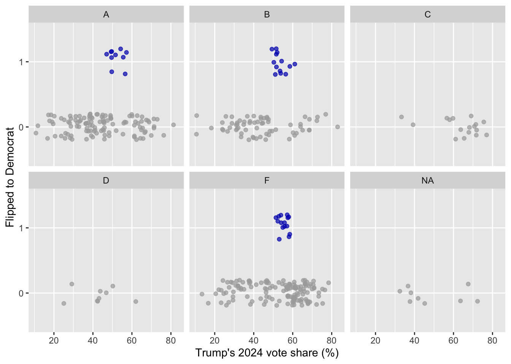

# AE 11: Predicting Dem flips

Suggested answers

Application exercise

Answers

> **IMPORTANT:**
>
> These are suggested answers. This document should be used as reference only, it’s not designed to be an exhaustive key.

In this application exercise, we will

- Fit a logistic regression model for a binary response variable in R
- Use a logistic regression model to predict probabilities and classify new observations
- Compare logistic regression models using AIC

We will predict whether a U.S. House seat flipped to Democrat in the 2026 midterm elections, using data from Decision Desk HQ as of 2026-11-04 at 11:14 am. At that time, some races had been called and others had not. We’ll learn from the called races and make predictions for the uncalled ones.

``` downlit
library(tidyverse)
library(tidymodels)
```

``` downlit
midterm_26 <- read_csv("data/midterm-26.csv")
```

    Rows: 435 Columns: 19
    ── Column specification ────────────────────────────────────────────────────────
    Delimiter: ","
    chr (15): district, state_abb, state, house_rep_20, house_party_20, house_re...
    dbl  (4): harris_24, trump_24, margin_26, flip_dem_24_26

    ℹ Use `spec()` to retrieve the full column specification for this data.
    ℹ Specify the column types or set `show_col_types = FALSE` to quiet this message.

``` downlit
glimpse(midterm_26)
```

    Rows: 435
    Columns: 19
    $ district       <chr> "AK-00", "AL-01", "AL-02", "AL-03", "AL-04", "AL-05", "…
    $ state_abb      <chr> "AK", "AL", "AL", "AL", "AL", "AL", "AL", "AL", "AR", "…
    $ state          <chr> "Alaska", "Alabama", "Alabama", "Alabama", "Alabama", "…
    $ house_rep_20   <chr> "Don Young", "Jerry Carl", "Barry Moore", "Mike Rogers"…
    $ house_party_20 <chr> "Republican", "Republican", "Republican", "Republican",…
    $ house_rep_22   <chr> "Mary Sattler Peltola", "Jerry L Carl", "Barry Moore", …
    $ house_party_22 <chr> "Democrat", "Republican", "Republican", "Republican", "…
    $ house_rep_24   <chr> "Nick Begich", "Barry Moore", "Shomari Figures", "Mike …
    $ house_party_24 <chr> "Republican", "Republican", "Democrat", "Republican", "…
    $ harris_24      <dbl> 41.41, 21.89, 53.52, 26.18, 15.96, 34.20, 29.68, 61.45,…
    $ trump_24       <dbl> 54.54, 76.94, 45.31, 72.71, 83.02, 64.02, 68.47, 37.50,…
    $ gerry_22       <chr> NA, "F", "F", "F", "F", "F", "F", "F", "C", "C", "C", "…
    $ gerry_24       <chr> NA, "B", "B", "B", "B", "B", "B", "B", "C", "C", "C", "…
    $ gerry_26       <chr> NA, "B", "B", "B", "B", "B", "B", "B", "C", "C", "C", "…
    $ rating_26      <chr> "Lean R", "Safe R", "Lean R", "Safe R", "Safe R", "Safe…
    $ leader_26      <chr> "Republican", "Republican", "Democrat", "Republican", "…
    $ margin_26      <dbl> 9.00, 18.00, 8.00, 28.00, 50.00, 7.00, 15.00, 39.00, 35…
    $ called_26      <chr> "uncalled", "called", "called", "called", "called", "ca…
    $ flip_dem_24_26 <dbl> NA, 0, 0, 0, 0, 0, 0, 0, 0, 0, 0, 0, NA, NA, 0, 0, NA, …

The variables we’ll use in this analysis are

- `district`: Congressional district
- `called_26`: Whether the 2026 race had been called (`called`) or not (`uncalled`)
- `flip_dem_24_26`: 1 if the seat was held by a Republican after 2024 and a Democrat leads in 2026, 0 otherwise (`NA` for uncalled races)
- `trump_24`: Trump’s 2024 vote share (%) in the district
- `gerry_26`: Grade (A-F) of the state’s 2026 congressional map from the Redistricting Report Card, where A is the fairest and F is the most gerrymandered

**Goal:** Use Trump’s 2024 vote share and the state’s gerrymandering grade to predict whether a seat flips to Democrat.

# Data prep

Make `flip_dem_24_26` a factor (so we can use it as the outcome of a logistic regression model), and split the data into called and uncalled races.

``` downlit
midterm_26 <- midterm_26 |>
  mutate(flip_dem_24_26 = as.factor(flip_dem_24_26))

midterm_called <- midterm_26 |>
  filter(called_26 == "called")

midterm_uncalled <- midterm_26 |>
  filter(called_26 == "uncalled")
```

How many called and uncalled races are there?

``` downlit
midterm_26 |>
  count(called_26)
```

    # A tibble: 2 × 2
      called_26     n
      <chr>     <int>
    1 called      391
    2 uncalled     44

*391 called and 44 uncalled.*

# Exercises

## Exercise 1

1.  Among the called races, how many seats flipped to Democrat?

``` downlit
midterm_called |>
  count(flip_dem_24_26)
```

    # A tibble: 2 × 2
      flip_dem_24_26     n
      <fct>          <int>
    1 0                353
    2 1                 38

*38 of the 391 called seats flipped to Democrat.*

2.  Calculate the proportion of called seats that flipped to Democrat for each gerrymandering grade. What do you notice?

``` downlit
midterm_called |>
  count(gerry_26, flip_dem_24_26) |>
  group_by(gerry_26) |>
  mutate(p = n / sum(n))
```

    # A tibble: 9 × 4
    # Groups:   gerry_26 [6]
      gerry_26 flip_dem_24_26     n      p
      <chr>    <fct>          <int>  <dbl>
    1 A        0                115 0.92  
    2 A        1                 10 0.08  
    3 B        0                 66 0.835 
    4 B        1                 13 0.165 
    5 C        0                 17 1     
    6 D        0                  9 1     
    7 F        0                137 0.901 
    8 F        1                 15 0.0987
    9 <NA>     0                  9 1     

*None of the seats in states with C or D grades flipped. The proportion of flips is highest in states with a B grade.*

3.  Visualize the relationship between `trump_24`, `gerry_26`, and `flip_dem_24_26` for the called races.

``` downlit
ggplot(
  midterm_called,
  aes(x = trump_24, y = flip_dem_24_26, color = flip_dem_24_26)
) +
  geom_jitter(height = 0.2, alpha = 0.7, show.legend = FALSE) +
  facet_wrap(~gerry_26) +
  scale_color_manual(values = c("0" = "darkgray", "1" = "#0015BC")) +
  labs(
    x = "Trump's 2024 vote share (%)",
    y = "Flipped to Democrat"
  )
```

[](ae-11-dem-flips-logistic-A_files/figure-html/flips-plot-1.png)

## Exercise 2

1.  Fit a logistic regression model predicting `flip_dem_24_26` from `trump_24` and `gerry_26` using the called races.

``` downlit
flip_gerry_fit <- logistic_reg() |>
  fit(flip_dem_24_26 ~ trump_24 + gerry_26, data = midterm_called)

tidy(flip_gerry_fit)
```

    # A tibble: 6 × 5
      term         estimate std.error statistic      p.value
      <chr>           <dbl>     <dbl>     <dbl>        <dbl>
    1 (Intercept)  -3.93       0.716    -5.48   0.0000000419
    2 trump_24      0.0310     0.0125    2.49   0.0129      
    3 gerry_26B     0.823      0.453     1.82   0.0694      
    4 gerry_26C   -15.6      951.       -0.0164 0.987       
    5 gerry_26D   -15.0     1308.       -0.0115 0.991       
    6 gerry_26F     0.00685    0.438     0.0156 0.988       

2.  Write out the fitted model for the log-odds.

\\ \log\left(\frac{\hat{p}}{1-\hat{p}}\right) = -3.93 + 0.0310 \times trump\\24 + 0.823 \times gerry\\26B - 15.6 \times gerry\\26C - 15.0 \times gerry\\26D + 0.00685 \times gerry\\26F \\

3.  Interpret the coefficient for `gerry_26B` in terms of odds.

*Holding Trump’s 2024 vote share constant, seats in states with a B-graded map are predicted to have odds of flipping to Democrat that are higher by a factor of* \\e^{0.823} \approx 2.28\\ *compared to seats in states with an A-graded map, on average.*

4.  The coefficients for `gerry_26C` and `gerry_26D` are very large and negative, with huge standard errors. Why? Hint: Look back at your answer to Exercise 1b.

*None of the called seats in states with C or D grades flipped, so the model pushes the predicted probability of a flip for these seats as close to 0 as it can.*

## Exercise 3

NY-17 is one of the uncalled races.

1.  What are Trump’s 2024 vote share and the gerrymandering grade for NY-17?

``` downlit
ny_17 <- midterm_uncalled |>
  filter(district == "NY-17")

ny_17 |>
  select(district, trump_24, gerry_26)
```

    # A tibble: 1 × 3
      district trump_24 gerry_26
      <chr>       <dbl> <chr>   
    1 NY-17        49.4 A       

2.  What is the predicted probability that NY-17 flips to Democrat? Answer the question using the [`predict()`](https://rdrr.io/r/stats/predict.html) function with the appropriate `type` argument.

``` downlit
predict(flip_gerry_fit, new_data = ny_17, type = "prob")
```

    # A tibble: 1 × 2
      .pred_0 .pred_1
        <dbl>   <dbl>
    1   0.917  0.0834

*About 0.08.*

3.  A probability is nice, but we want an actual decision. Classify NY-17. What threshold does [`predict()`](https://rdrr.io/r/stats/predict.html) use by default?

``` downlit
predict(flip_gerry_fit, new_data = ny_17, type = "class")
```

    # A tibble: 1 × 1
      .pred_class
      <fct>      
    1 0          

*The model predicts NY-17 doesn’t flip (0). The default threshold is 0.5.*

4.  Now try AK-00, another uncalled race. What happens, and why?

``` downlit
ak_00 <- midterm_uncalled |>
  filter(district == "AK-00")

ak_00 |>
  select(district, trump_24, gerry_26)
```

    # A tibble: 1 × 3
      district trump_24 gerry_26
      <chr>       <dbl> <chr>   
    1 AK-00        54.5 <NA>    

``` downlit
predict(flip_gerry_fit, new_data = ak_00, type = "prob")
```

    # A tibble: 1 × 2
      .pred_0 .pred_1
        <dbl>   <dbl>
    1      NA      NA

*The prediction is `NA` because Alaska has a single at-large district, so it doesn’t have a gerrymandering grade. The model can’t make a prediction without a value for every predictor.*

## Exercise 4

1.  Predict the probability of flipping to Democrat and classify all uncalled races. How many are predicted to flip to Democrat?

``` downlit
flip_uncalled_aug <- augment(flip_gerry_fit, new_data = midterm_uncalled)

flip_uncalled_aug |>
  count(.pred_class)
```

    # A tibble: 2 × 2
      .pred_class     n
      <fct>       <int>
    1 0              43
    2 <NA>            1

*None! All predicted probabilities are below 0.5.*

2.  Which uncalled races have the highest predicted probability of flipping to Democrat?

``` downlit
flip_uncalled_aug |>
  select(district, trump_24, gerry_26, house_party_24, .pred_1) |>
  arrange(desc(.pred_1))
```

    # A tibble: 44 × 5
       district trump_24 gerry_26 house_party_24 .pred_1
       <chr>       <dbl> <chr>    <chr>            <dbl>
     1 CA-05        57.6 B        Republican       0.211
     2 CA-23        57.1 B        Republican       0.209
     3 ME-02        53.8 B        Democrat         0.192
     4 CA-40        49.5 B        Republican       0.172
     5 TN-04        71.2 F        Republican       0.153
     6 FL-26        67.0 F        Republican       0.137
     7 TX-27        64.4 F        Republican       0.127
     8 TX-02        61.3 F        Republican       0.117
     9 NC-03        60.3 F        Republican       0.114
    10 NY-21        60.1 A        Republican       0.113
    # ℹ 34 more rows

*CA-05, CA-23, and ME-02 have the highest predicted probabilities, around 0.2. Note that ME-02 was held by a Democrat after 2024, so it can’t flip to Democrat. Our model doesn’t know that!*

3.  The overall proportion of called seats that flipped is about 0.1. Classify the uncalled races again, this time using 0.1 as the threshold. How many are predicted to flip now?

``` downlit
flip_uncalled_aug |>
  mutate(.pred_class_10 = if_else(.pred_1 > 0.1, 1, 0)) |>
  count(.pred_class_10)
```

    # A tibble: 3 × 2
      .pred_class_10     n
               <dbl> <int>
    1              0    16
    2              1    27
    3             NA     1

*27 uncalled races are predicted to flip to Democrat with a threshold of 0.1.*

## Exercise 5

In the slides, we fit a model predicting `flip_dem_24_26` from `trump_24` only. Is the model with `gerry_26` better?

1.  Fit the model from the slides, then compare the AIC values of the two models using `glance()`.

``` downlit
flip_trump_fit <- logistic_reg() |>
  fit(flip_dem_24_26 ~ trump_24, data = midterm_called)

glance(flip_trump_fit)
```

    # A tibble: 1 × 8
      null.deviance df.null logLik   AIC   BIC deviance df.residual  nobs
              <dbl>   <int>  <dbl> <dbl> <dbl>    <dbl>       <int> <int>
    1          249.     390  -122.  249.  257.     245.         389   391

``` downlit
glance(flip_gerry_fit)
```

    # A tibble: 1 × 8
      null.deviance df.null logLik   AIC   BIC deviance df.residual  nobs
              <dbl>   <int>  <dbl> <dbl> <dbl>    <dbl>       <int> <int>
    1          247.     381  -116.  244.  267.     232.         376   382

2.  Take a look at the `nobs` column in the output. Why can’t we compare these AIC values directly?

*The `trump_24` model was fit to all 391 called seats, but the `gerry_26` model was fit to only 382, because the 9 called seats with no gerrymandering grade were dropped. AIC can only be compared between models fit to the same data.*

3.  Refit both models on the called seats that have a gerrymandering grade, and compare the AIC values. Which model is better?

``` downlit
midterm_called_graded <- midterm_called |>
  filter(!is.na(gerry_26))

flip_trump_fit_graded <- logistic_reg() |>
  fit(flip_dem_24_26 ~ trump_24, data = midterm_called_graded)

flip_gerry_fit_graded <- logistic_reg() |>
  fit(flip_dem_24_26 ~ trump_24 + gerry_26, data = midterm_called_graded)

glance(flip_trump_fit_graded)$AIC
```

    [1] 246.9217

``` downlit
glance(flip_gerry_fit_graded)$AIC
```

    [1] 243.6752

*The model with `gerry_26` has a lower AIC (244.0 vs. 246.9), so it is the better model, though not by much.*
