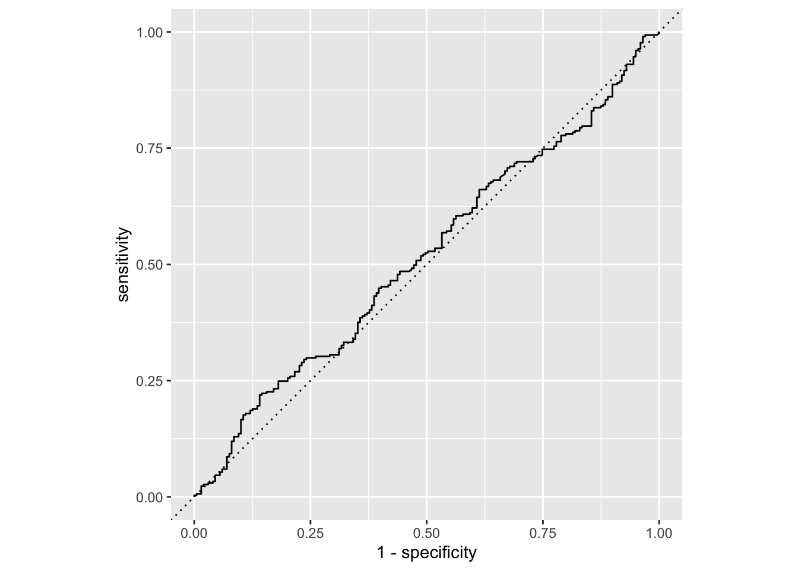
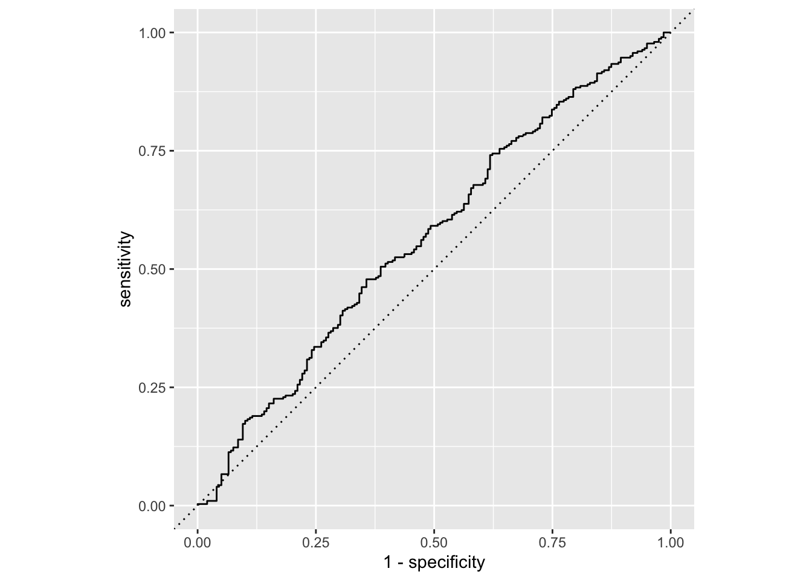
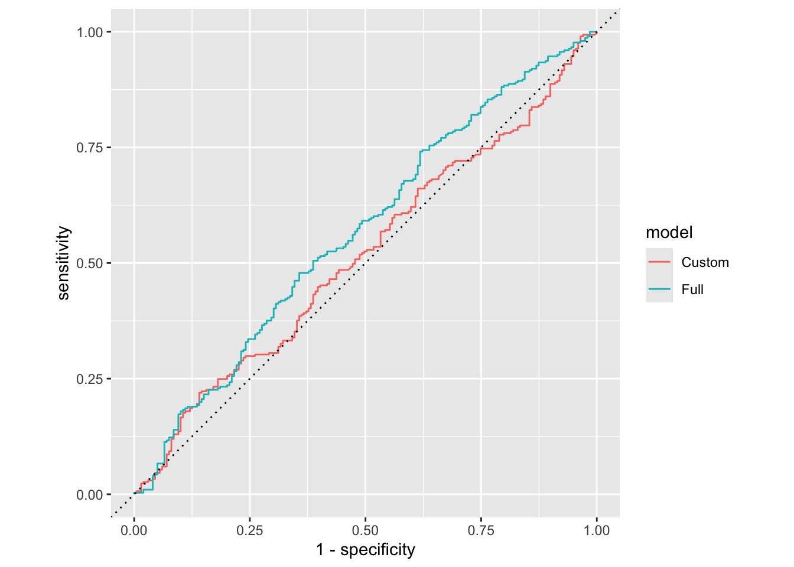

# AE 12: Chicago taxi classification

Suggested answers

Application exercise

Answers

> **IMPORTANT:**
>
> These are suggested answers. This document should be used as reference only, it’s not designed to be an exhaustive key.

In this application exercise, we will

- Split our data into testing and training
- Fit logistic regression regression models to testing data to classify outcomes
- Evaluate performance of models on testing data

We will use **tidyverse** and **tidymodels** for data exploration and modeling,

``` downlit
library(tidyverse)
library(tidymodels)
```

and the `chicago_taxi` dataset introduced in the lecture.

``` downlit
chicago_taxi <- read_csv("data/chicago-taxi.csv") |>
  mutate(
    tip = fct_relevel(tip, "no", "yes"),
    local = fct_relevel(local, "no", "yes"),
    dow = fct_relevel(dow, "Mon", "Tue", "Wed", "Thu", "Fri", "Sat", "Sun"),
    month = fct_relevel(month, "Jan", "Feb", "Mar", "Apr")
  )
```

    Rows: 2000 Columns: 7
    ── Column specification ────────────────────────────────────────────────────────
    Delimiter: ","
    chr (5): tip, company, local, dow, month
    dbl (2): distance, hour

    ℹ Use `spec()` to retrieve the full column specification for this data.
    ℹ Specify the column types or set `show_col_types = FALSE` to quiet this message.

Remember from the lecture that the `chicago_taxi` dataset contains information on whether a trip resulted in a tip (`yes`) or not (`no`) as well as numerical and categorical features of the trip.

``` downlit
glimpse(chicago_taxi)
```

    Rows: 2,000
    Columns: 7
    $ tip      <fct> no, no, no, no, no, no, no, no, no, no, no, no, no, no, no, n…
    $ distance <dbl> 0.40, 0.96, 1.07, 1.13, 10.81, 3.60, 1.08, 0.85, 17.92, 0.00,…
    $ company  <chr> "other", "Taxicab Insurance Agency Llc", "Sun Taxi", "other",…
    $ local    <fct> yes, no, no, no, no, no, yes, no, no, yes, yes, no, no, no, n…
    $ dow      <fct> Fri, Mon, Fri, Sat, Sat, Wed, Wed, Tue, Tue, Sun, Fri, Fri, F…
    $ month    <fct> Mar, Apr, Feb, Feb, Apr, Mar, Mar, Mar, Jan, Apr, Apr, Feb, M…
    $ hour     <dbl> 17, 8, 15, 14, 14, 12, 13, 8, 20, 16, 20, 8, 15, 15, 12, 0, 1…

# Spending your data

Split your data into testing and training in a reproducible manner and display the split object.

``` downlit
set.seed(1234)
chicago_taxi_split <- initial_split(chicago_taxi)
chicago_taxi_split
```

    <Training/Testing/Total>
    <1500/500/2000>

What percent of the original `chicago_taxi` data is allocated to training and what percent to testing? Compare your response to your neighbor’s. Are the percentages roughly consistent? What determines this in the `initial_split()`? How would the code need to be updated to allocate 80% of the data to training and the remaining 20% to testing?

``` downlit
# training percentage
7500 / 10000
```

    [1] 0.75

``` downlit
# testing percentage
2500 / 10000
```

    [1] 0.25

75% of the data is allocated to training and the remaining 25% to testing. This is because the `prop` argument in `initial_split()` is `3/4` by default. The code would need to be updated as follows for a 80%/20% split:

``` downlit
# split 80-20
set.seed(123456)
initial_split(chicago_taxi, prop = 0.8)
```

    <Training/Testing/Total>
    <1600/400/2000>

Let’s stick with the default split and save our testing and training data.

``` downlit
chicago_taxi_train <- training(chicago_taxi_split)
chicago_taxi_test <- testing(chicago_taxi_split)
```

# Model 1: Custom choice of predictors

## Fit

Fit a model for classifying trips as tipped or not based on a subset of predictors of your choice. Name the model `chicago_taxi_custom_fit` and display a tidy output of the model.

``` downlit
chicago_taxi_custom_fit <- logistic_reg() |>
  fit(
    tip ~ hour + distance + local + dow,
    data = chicago_taxi_train
  )
tidy(chicago_taxi_custom_fit)
```

    # A tibble: 10 × 5
       term        estimate std.error statistic   p.value
       <chr>          <dbl>     <dbl>     <dbl>     <dbl>
     1 (Intercept) -0.0380    0.239      -0.159 0.874    
     2 hour         0.00505   0.0128      0.395 0.693    
     3 distance     0.0343    0.00872     3.93  0.0000848
     4 localyes    -0.336     0.136      -2.47  0.0134   
     5 dowTue       0.210     0.197       1.07  0.286    
     6 dowWed       0.380     0.199       1.91  0.0563   
     7 dowThu       0.284     0.195       1.46  0.144    
     8 dowFri       0.380     0.194       1.95  0.0506   
     9 dowSat       0.203     0.236       0.862 0.388    
    10 dowSun       0.638     0.246       2.59  0.00963  

## Predict

Predict for the testing data using this model.

``` downlit
chicago_taxi_custom_aug <- augment(
  chicago_taxi_custom_fit,
  new_data = chicago_taxi_test
)
chicago_taxi_custom_aug
```

    # A tibble: 500 × 10
       .pred_class .pred_no .pred_yes tip   distance company local dow   month  hour
       <fct>          <dbl>     <dbl> <fct>    <dbl> <chr>   <fct> <fct> <fct> <dbl>
     1 yes            0.474     0.526 no        0.4  other   yes   Fri   Mar      17
     2 yes            0.388     0.612 no        1.07 Sun Ta… no    Fri   Feb      15
     3 yes            0.353     0.647 no       10.8  Sun Ta… no    Sat   Apr      14
     4 yes            0.473     0.527 no        1.08 Flash … yes   Wed   Mar      13
     5 yes            0.440     0.560 no        0.85 Taxica… no    Tue   Mar       8
     6 yes            0.292     0.708 no       17.9  City S… no    Tue   Jan      20
     7 yes            0.370     0.630 no        4.4  City S… no    Fri   Feb       8
     8 yes            0.340     0.660 no       10    Taxi A… no    Thu   Apr      15
     9 yes            0.467     0.533 no        1    other   yes   Fri   Mar      18
    10 yes            0.386     0.614 no        6.26 Flash … no    Tue   Apr      15
    # ℹ 490 more rows

## Evaluate

Calculate the false positive and false negative rates for the testing data using this model.

``` downlit
chicago_taxi_custom_aug |>
  count(.pred_class, tip) |>
  arrange(tip) |>
  group_by(tip) |>
  mutate(
    p = round(n / sum(n), 2),
    decision = case_when(
      .pred_class == "yes" & tip == "yes" ~ "True positive",
      .pred_class == "yes" & tip == "no" ~ "False positive",
      .pred_class == "no" & tip == "yes" ~ "False negative",
      .pred_class == "no" & tip == "no" ~ "True negative"
    )
  )
```

    # A tibble: 4 × 5
    # Groups:   tip [2]
      .pred_class tip       n     p decision      
      <fct>       <fct> <int> <dbl> <chr>         
    1 no          no       15  0.08 True negative 
    2 yes         no      184  0.92 False positive
    3 no          yes      28  0.09 False negative
    4 yes         yes     273  0.91 True positive 

Another commonly used display of this information is a confusion matrix. Create this using the `conf_mat()` function. You will need to review the documentation for the function to determine how to use it.

``` downlit
conf_mat(
  chicago_taxi_custom_aug,
  truth = tip,
  estimate = .pred_class
)
```

              Truth
    Prediction  no yes
           no   15  28
           yes 184 273

## Sensitivity, specificity, ROC curve

Calculate sensitivity and specificity and draw the ROC curve.

``` downlit
chicago_taxi_custom_roc <- roc_curve(
  chicago_taxi_custom_aug,
  truth = tip,
  .pred_yes,
  event_level = "second"
)
chicago_taxi_custom_roc
```

    # A tibble: 492 × 3
       .threshold specificity sensitivity
            <dbl>       <dbl>       <dbl>
     1   -Inf         0             1    
     2      0.421     0             1    
     3      0.425     0             0.997
     4      0.427     0.00503       0.993
     5      0.428     0.0101        0.993
     6      0.430     0.0151        0.993
     7      0.431     0.0201        0.993
     8      0.432     0.0251        0.993
     9      0.432     0.0302        0.993
    10      0.435     0.0302        0.990
    # ℹ 482 more rows

``` downlit
ggplot(chicago_taxi_custom_roc, aes(x = 1 - specificity, y = sensitivity)) +
  geom_path() +
  geom_abline(lty = 3) +
  coord_equal()
```

[](ae-12-chicago-taxi-classification-A_files/figure-html/forested-custom-roc-1.png)

# Model 2: All predictors

## Fit

Fit a model for classifying plots as forested or not based on all predictors available. Name the model `forested_full_fit` and display a tidy output of the model.

``` downlit
chicago_taxi_full_fit <- logistic_reg() |>
  fit(tip ~ ., data = chicago_taxi_train)
tidy(chicago_taxi_full_fit)
```

    # A tibble: 19 × 5
       term                                estimate std.error statistic  p.value
       <chr>                                  <dbl>     <dbl>     <dbl>    <dbl>
     1 (Intercept)                          0.0718    0.337       0.213 0.831   
     2 distance                             0.0321    0.00888     3.62  0.000295
     3 companyCity Service                 -0.0411    0.264      -0.156 0.876   
     4 companyFlash Cab                    -0.781     0.261      -2.99  0.00276 
     5 companyother                        -0.0866    0.237      -0.365 0.715   
     6 companySun Taxi                      0.0537    0.264       0.204 0.839   
     7 companyTaxi Affiliation Services    -0.291     0.247      -1.18  0.239   
     8 companyTaxicab Insurance Agency Llc -0.142     0.262      -0.542 0.588   
     9 localyes                            -0.348     0.138      -2.53  0.0115  
    10 dowTue                               0.197     0.199       0.992 0.321   
    11 dowWed                               0.361     0.201       1.80  0.0725  
    12 dowThu                               0.256     0.197       1.30  0.193   
    13 dowFri                               0.316     0.197       1.60  0.109   
    14 dowSat                               0.170     0.238       0.715 0.474   
    15 dowSun                               0.570     0.250       2.29  0.0223  
    16 monthFeb                             0.122     0.176       0.694 0.487   
    17 monthMar                             0.145     0.161       0.901 0.368   
    18 monthApr                             0.185     0.162       1.14  0.256   
    19 hour                                 0.00485   0.0129      0.375 0.707   

## Predict

Predict for the testing data using this model.

``` downlit
chicago_taxi_full_aug <- augment(
  chicago_taxi_full_fit,
  new_data = chicago_taxi_test
)
chicago_taxi_full_aug
```

    # A tibble: 500 × 10
       .pred_class .pred_no .pred_yes tip   distance company local dow   month  hour
       <fct>          <dbl>     <dbl> <fct>    <dbl> <chr>   <fct> <fct> <fct> <dbl>
     1 yes            0.452     0.548 no        0.4  other   yes   Fri   Mar      17
     2 yes            0.338     0.662 no        1.07 Sun Ta… no    Fri   Feb      15
     3 yes            0.290     0.710 no       10.8  Sun Ta… no    Sat   Apr      14
     4 no             0.611     0.389 no        1.08 Flash … yes   Wed   Mar      13
     5 yes            0.416     0.584 no        0.85 Taxica… no    Tue   Mar       8
     6 yes            0.289     0.711 no       17.9  City S… no    Tue   Jan      20
     7 yes            0.343     0.657 no        4.4  City S… no    Fri   Feb       8
     8 yes            0.351     0.649 no       10    Taxi A… no    Thu   Apr      15
     9 yes            0.446     0.554 no        1    other   yes   Fri   Mar      18
    10 no             0.513     0.487 no        6.26 Flash … no    Tue   Apr      15
    # ℹ 490 more rows

## Evaluate

Calculate the false positive and false negative rates for the testing data using this model.

``` downlit
chicago_taxi_full_aug |>
  count(.pred_class, tip) |>
  arrange(tip) |>
  group_by(tip) |>
  mutate(
    p = round(n / sum(n), 2),
    decision = case_when(
      .pred_class == "yes" & tip == "yes" ~ "True positive",
      .pred_class == "yes" & tip == "no" ~ "False positive",
      .pred_class == "no" & tip == "yes" ~ "False negative",
      .pred_class == "no" & tip == "no" ~ "True negative"
    )
  )
```

    # A tibble: 4 × 5
    # Groups:   tip [2]
      .pred_class tip       n     p decision      
      <fct>       <fct> <int> <dbl> <chr>         
    1 no          no       41  0.21 True negative 
    2 yes         no      158  0.79 False positive
    3 no          yes      37  0.12 False negative
    4 yes         yes     264  0.88 True positive 

## Sensitivity, specificity, ROC curve

Calculate sensitivity and specificity and draw the ROC curve.

``` downlit
chicago_taxi_full_roc <- roc_curve(
  chicago_taxi_full_aug,
  truth = tip,
  .pred_yes,
  event_level = "second"
)
chicago_taxi_full_roc
```

    # A tibble: 500 × 3
       .threshold specificity sensitivity
            <dbl>       <dbl>       <dbl>
     1   -Inf         0             1    
     2      0.274     0             1    
     3      0.298     0.00503       1    
     4      0.311     0.0101        1    
     5      0.347     0.0151        1    
     6      0.348     0.0151        0.997
     7      0.355     0.0151        0.993
     8      0.356     0.0151        0.990
     9      0.357     0.0201        0.990
    10      0.368     0.0201        0.987
    # ℹ 490 more rows

``` downlit
ggplot(chicago_taxi_full_roc, aes(x = 1 - specificity, y = sensitivity)) +
  geom_path() +
  geom_abline(lty = 3) +
  coord_equal()
```

[](ae-12-chicago-taxi-classification-A_files/figure-html/forested-full-roc-1.png)

# Model 1 vs. Model 2

Plot both ROC curves and articulate how you would use them to compare these models. Also calculate the areas under the two curves.

``` downlit
chicago_taxi_custom_roc <- chicago_taxi_custom_roc |>
  mutate(model = "Custom")
chicago_taxi_full_roc <- chicago_taxi_full_roc |>
  mutate(model = "Full")

bind_rows(
  chicago_taxi_custom_roc,
  chicago_taxi_full_roc
) |>
  ggplot(aes(x = 1 - specificity, y = sensitivity, color = model)) +
  geom_path() +
  geom_abline(lty = 3) +
  coord_equal()
```

[](ae-12-chicago-taxi-classification-A_files/figure-html/compare-1.png)

``` downlit
roc_auc(
  chicago_taxi_custom_aug,
  truth = tip,
  .pred_yes,
  event_level = "second"
)
```

    # A tibble: 1 × 3
      .metric .estimator .estimate
      <chr>   <chr>          <dbl>
    1 roc_auc binary         0.517

``` downlit
roc_auc(
  chicago_taxi_full_aug,
  truth = tip,
  .pred_yes,
  event_level = "second"
)
```

    # A tibble: 1 × 3
      .metric .estimator .estimate
      <chr>   <chr>          <dbl>
    1 roc_auc binary         0.568
