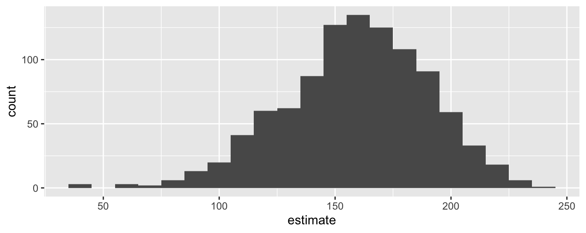
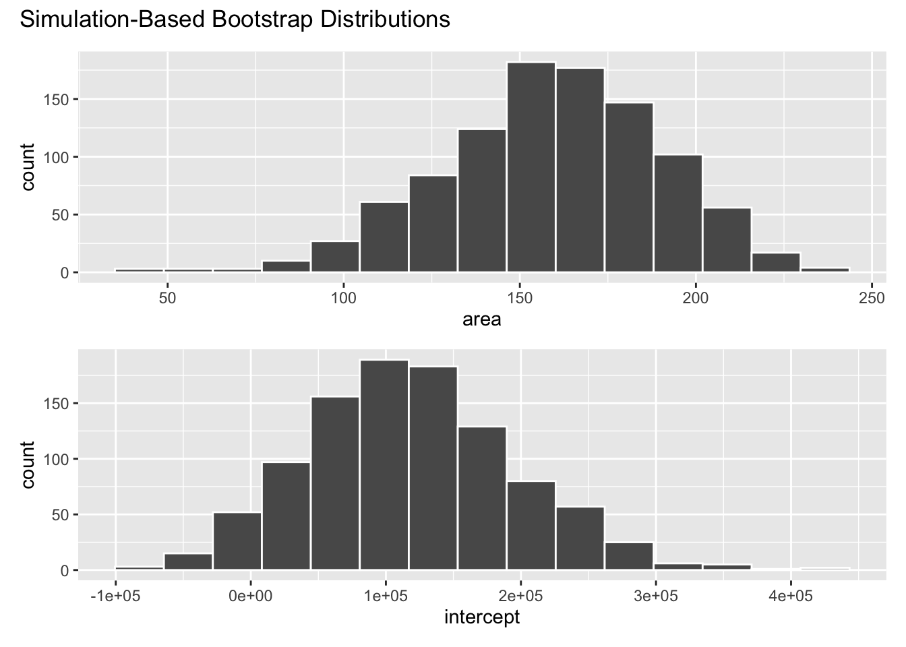
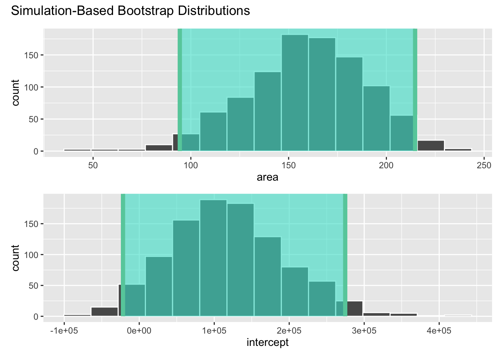
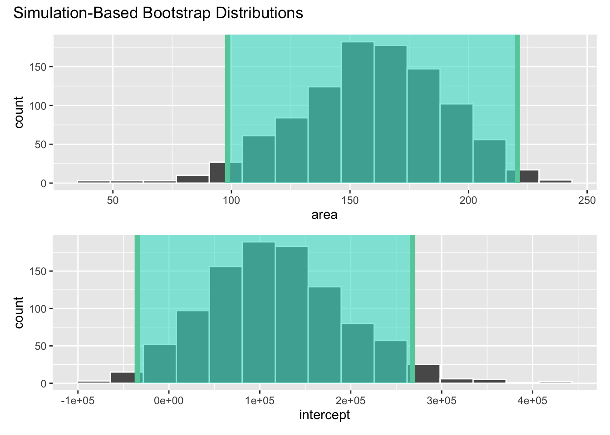
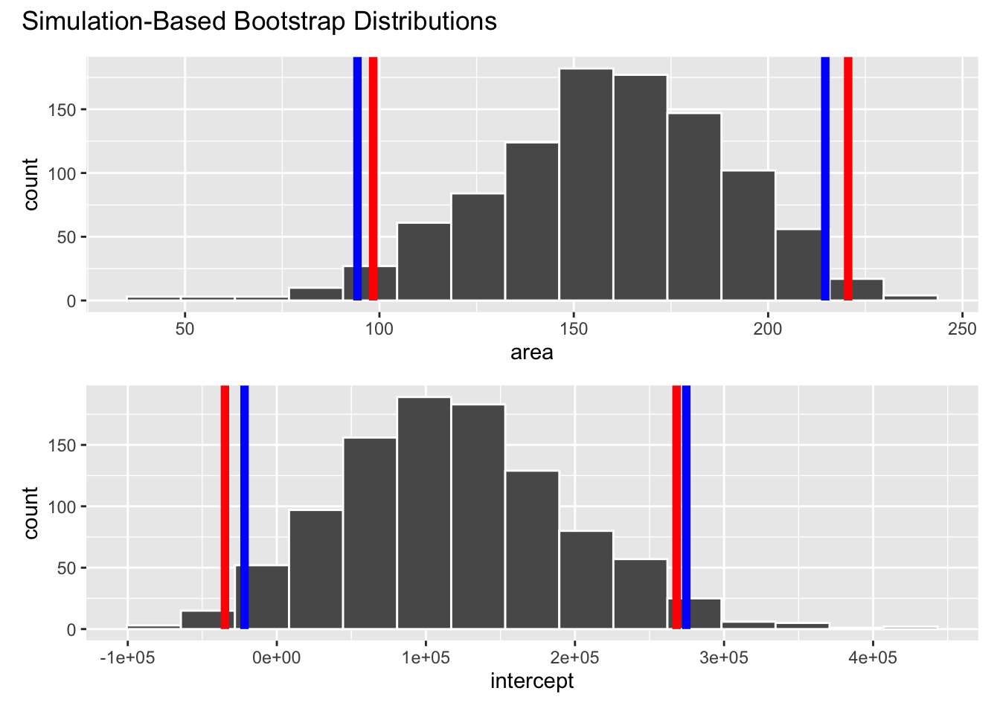

# AE 13: Houses in Duke Forest

Suggested answers

Application exercise

Answers

> **IMPORTANT:**
>
> These are suggested answers. This document should be used as reference only, it’s not designed to be an exhaustive key.

In this application exercise, we will use bootstrapping to construct confidence intervals.

## Packages

We will use **tidyverse** and **tidymodels** for data exploration and modeling, respectively, and the **openintro** package for the data, and the **knitr** package for formatting tables.

``` downlit
library(tidyverse)
library(tidymodels)
library(openintro)
library(knitr)
```

## Data

The data are on houses that were sold in the Duke Forest neighborhood of Durham, NC around November 2020. It was originally scraped from Zillow, and can be found in the `duke_forest` data set in the **openintro** R package.

Take a [`glimpse()`](https://pillar.r-lib.org/reference/glimpse.html) at the data to see what variables are available.

``` downlit
glimpse(duke_forest)
```

    Rows: 98
    Columns: 13
    $ address    <chr> "1 Learned Pl, Durham, NC 27705", "1616 Pinecrest Rd, Durha…
    $ price      <dbl> 1520000, 1030000, 420000, 680000, 428500, 456000, 1270000, …
    $ bed        <dbl> 3, 5, 2, 4, 4, 3, 5, 4, 4, 3, 4, 4, 3, 5, 4, 5, 3, 4, 4, 3,…
    $ bath       <dbl> 4.0, 4.0, 3.0, 3.0, 3.0, 3.0, 5.0, 3.0, 5.0, 2.0, 3.0, 3.0,…
    $ area       <dbl> 6040, 4475, 1745, 2091, 1772, 1950, 3909, 2841, 3924, 2173,…
    $ type       <chr> "Single Family", "Single Family", "Single Family", "Single …
    $ year_built <dbl> 1972, 1969, 1959, 1961, 2020, 2014, 1968, 1973, 1972, 1964,…
    $ heating    <chr> "Other, Gas", "Forced air, Gas", "Forced air, Gas", "Heat p…
    $ cooling    <fct> central, central, central, central, central, central, centr…
    $ parking    <chr> "0 spaces", "Carport, Covered", "Garage - Attached, Covered…
    $ lot        <dbl> 0.97, 1.38, 0.51, 0.84, 0.16, 0.45, 0.94, 0.79, 0.53, 0.73,…
    $ hoa        <chr> NA, NA, NA, NA, NA, NA, NA, NA, NA, NA, NA, NA, NA, NA, NA,…
    $ url        <chr> "https://www.zillow.com/homedetails/1-Learned-Pl-Durham-NC-…

## Model

Fit a linear model predicting `price` from `area`, and display the model output in a neatly formatted table.

``` downlit
df_fit <- linear_reg() |>
  fit(price ~ area, data = duke_forest)

tidy(df_fit) |>
  kable(digits = 2)
```

| term        |  estimate | std.error | statistic | p.value |
|:------------|----------:|----------:|----------:|--------:|
| (Intercept) | 116652.33 |  53302.46 |      2.19 |    0.03 |
| area        |    159.48 |     18.17 |      8.78 |    0.00 |

## Bootstrap confidence interval

### 1. Calculate the observed fit (slope)

Using functions from the **infer** package, calculate the observed fit from the original sample. The slope from this fit is the point estimate we’ll build our confidence intervals around.

``` downlit
observed_fit <- duke_forest |>
  specify(price ~ area) |>
  fit()

observed_fit
```

    # A tibble: 2 × 2
      term      estimate
      <chr>        <dbl>
    1 intercept  116652.
    2 area          159.

### 2. Take *n* bootstrap samples and fit models to each one.

Fill in the code, then set `eval: true` .

``` downlit
n <- 1000
set.seed(20261123)

boot_fits <- duke_forest |>
  specify(price ~ area) |>
  generate(reps = n, type = "bootstrap") |>
  fit()

boot_fits
```

    # A tibble: 2,000 × 3
    # Groups:   replicate [1,000]
       replicate term      estimate
           <int> <chr>        <dbl>
     1         1 intercept  237509.
     2         1 area          107.
     3         2 intercept   74019.
     4         2 area          181.
     5         3 intercept  -21657.
     6         3 area          216.
     7         4 intercept  155284.
     8         4 area          138.
     9         5 intercept   73044.
    10         5 area          178.
    # ℹ 1,990 more rows

- Make a histogram of the bootstrap samples to visualize the bootstrap distribution.

``` downlit
boot_fits |>
  filter(term == "area") |>
  ggplot(aes(x = estimate)) +
  geom_histogram(binwidth = 10)
```

[](ae-13-duke-forest-bootstrap-A_files/figure-html/boot-hist-1.png)

- A handy shortcut to visualize the bootstrap distribution is to use the `visualize()` function from the **infer** package. Use it to visualize the bootstrap distribution.

``` downlit
visualize(boot_fits)
```

[](ae-13-duke-forest-bootstrap-A_files/figure-html/boot-visualize-1.png)

### 3. Compute the 95% confidence interval

#### 3a. Percentile method

The percentile method constructs a confidence interval by taking the middle 95% of the bootstrap distribution of the slope.

Fill in the code, then set `eval: true` .

``` downlit
ci_percentile <- get_confidence_interval(
  boot_fits,
  point_estimate = observed_fit,
  level = 0.95,
  type = "percentile"
)

ci_percentile
```

    # A tibble: 2 × 3
      term      lower_ci upper_ci
      <chr>        <dbl>    <dbl>
    1 area          94.3     215.
    2 intercept -21676.   274667.

- Visualize the bootstrap distribution with the confidence interval shaded, by adding `shade_confidence_interval()` to the output of `visualize()`.

Fill in the code, then set `eval: true` .

``` downlit
visualize(boot_fits) +
  shade_confidence_interval(endpoints = ci_percentile)
```

[](ae-13-duke-forest-bootstrap-A_files/figure-html/ci-percentile-viz-1.png)

#### 3b. Standard error method

Another way to construct a confidence interval is to go a certain number of standard errors away from the observed slope in each direction:

\\ \text{point estimate} \pm z^\* \times SE \\

where \\SE\\ is the **bootstrap standard error**, the standard deviation of the bootstrapped slopes, and \\z^\*\\ depends on the confidence level (about 2, more precisely 1.96, for a 95% confidence interval).

> **NOTE:**
>
> The bootstrap standard error is the standard deviation of the bootstrap distribution of the slope. It estimates the same thing as the `std.error` column in the regression output from `tidy(df_fit)`: how much the slope would vary from one sample to another. The difference is in how it’s calculated: the bootstrap standard error is calculated **computationally**, by resampling the data many times, while the `std.error` in the regression output is calculated with a **theoretical** (mathematical) formula.

- Calculate the bootstrap standard error as the standard deviation of the bootstrap distribution of the slope.

Fill in the code, then set `eval: true` .

``` downlit
boot_fits |>
  ungroup() |> # boot_fits is grouped by replicate, ungroup to summarize across all
  filter(term == "area") |>
  summarize(se = sd(estimate))
```

    # A tibble: 1 × 1
         se
      <dbl>
    1  31.2

But you don’t need to directly calculate this, `get_confidence_interval()` can do it for you using the standard error method.

Fill in the code, then set `eval: true` .

``` downlit
ci_se <- get_confidence_interval(
  boot_fits,
  point_estimate = observed_fit,
  level = 0.95,
  type = "se"
)

ci_se
```

    # A tibble: 2 × 3
      term      lower_ci upper_ci
      <chr>        <dbl>    <dbl>
    1 area          98.4     221.
    2 intercept -34812.   268117.

- Visualize the confidence interval calculated with the standard error method on the bootstrap distribution, as you did for the percentile method.

``` downlit
visualize(boot_fits) +
  shade_confidence_interval(endpoints = ci_se)
```

[](ae-13-duke-forest-bootstrap-A_files/figure-html/ci-se-viz-1.png)

- Visualize both intervals on the same plot to compare them, with the standard error interval outlined in red and the percentile interval outlined in blue. Setting `fill = NULL` draws only the endpoints, without shading, so the two intervals don’t cover each other.

Fill in the code, then set `eval: true` .

``` downlit
visualize(boot_fits) +
  shade_confidence_interval(
    endpoints = ci_se,
    color = "red",
    fill = NULL
  ) +
  shade_confidence_interval(
    endpoints = ci_percentile,
    color = "blue",
    fill = NULL
  )
```

[](ae-13-duke-forest-bootstrap-A_files/figure-html/ci-compare-viz-1.png)

- How does this interval compare to the one you calculated with the percentile method in Step 3a?

The two intervals are similar, but not identical. The standard error method gives an interval that is symmetric around the observed slope, while the percentile method uses the middle 95% of the bootstrap distribution, so it doesn’t have to be symmetric.

## Changing confidence level

- Modify the code from Step 3a to create a 90% confidence interval.

``` downlit
get_confidence_interval(
  boot_fits,
  point_estimate = observed_fit,
  level = 0.90,
  type = "percentile"
)
```

    # A tibble: 2 × 3
      term      lower_ci upper_ci
      <chr>        <dbl>    <dbl>
    1 area          107.     208.
    2 intercept    -831.  250207.

- Modify the code from Step 3a to create a 99% confidence interval.

``` downlit
get_confidence_interval(
  boot_fits,
  point_estimate = observed_fit,
  level = 0.99,
  type = "percentile"
)
```

    # A tibble: 2 × 3
      term      lower_ci upper_ci
      <chr>        <dbl>    <dbl>
    1 area          61.7     227.
    2 intercept -52458.   355232.

- Which confidence level produces the most accurate confidence interval (90%, 95%, 99%)? Explain.

99% – highest confidence.

- Which confidence level produces the most precise confidence interval (90%, 95%, 99%)? Explain.

90% – narrowest interval.

- If we want to be very certain that we capture the population parameter, should we use a wider or a narrower interval? What drawbacks are associated with using a wider interval?

A wider interval increases the likelihood of capturing the population parameter, but it is less precise and may be less informative.
