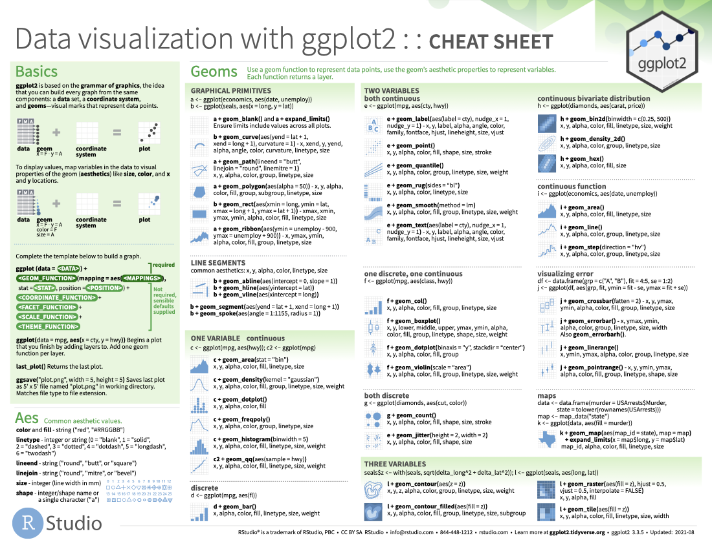
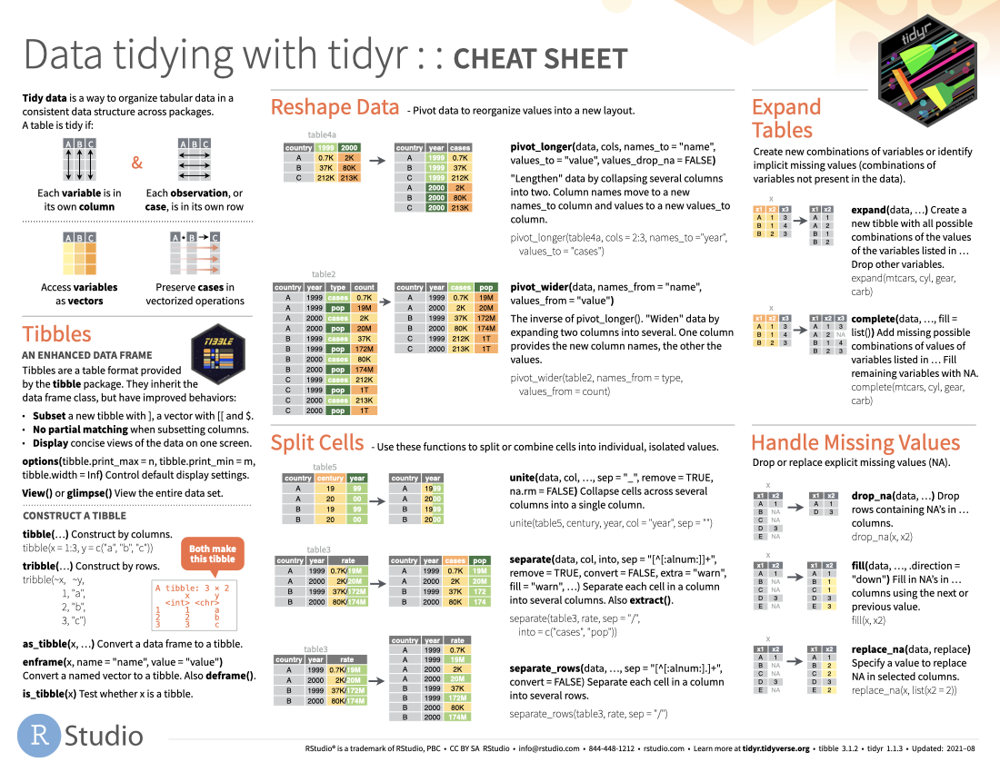
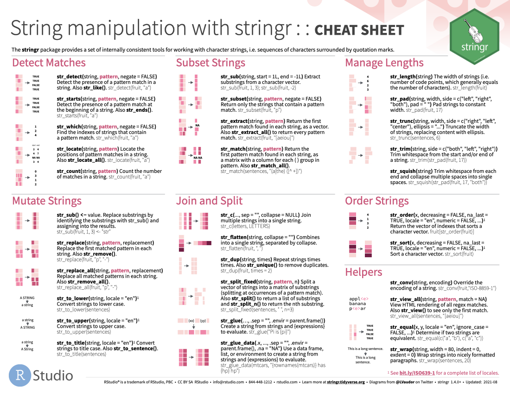
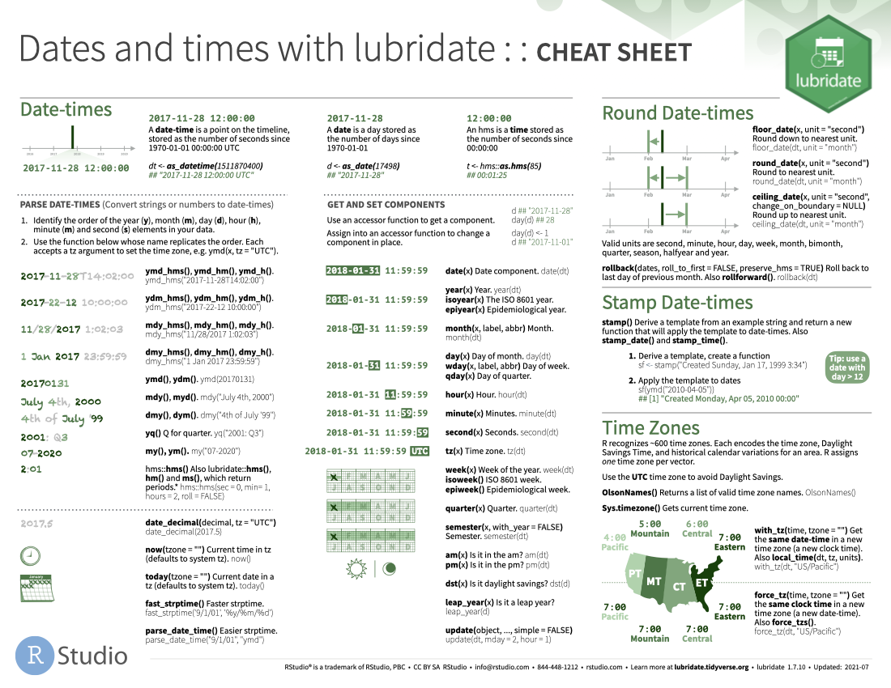
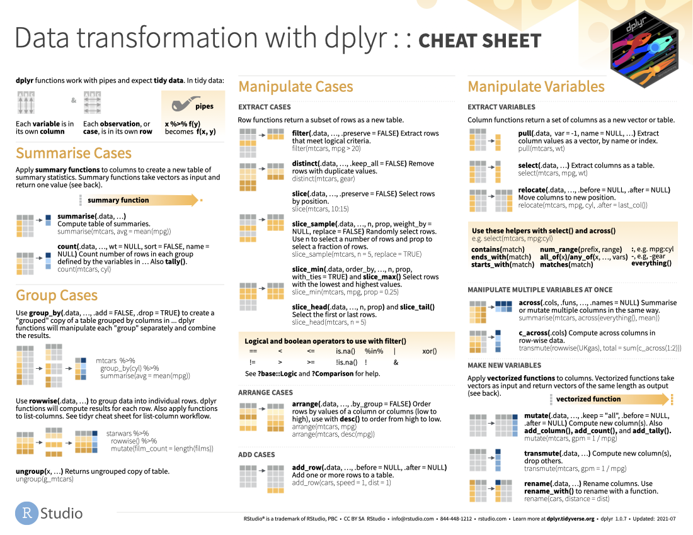
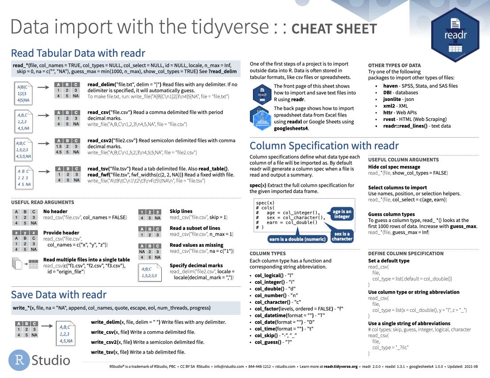
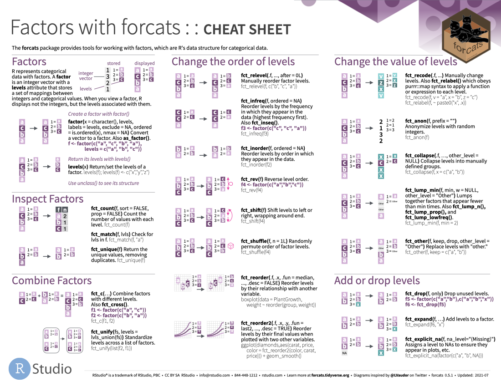
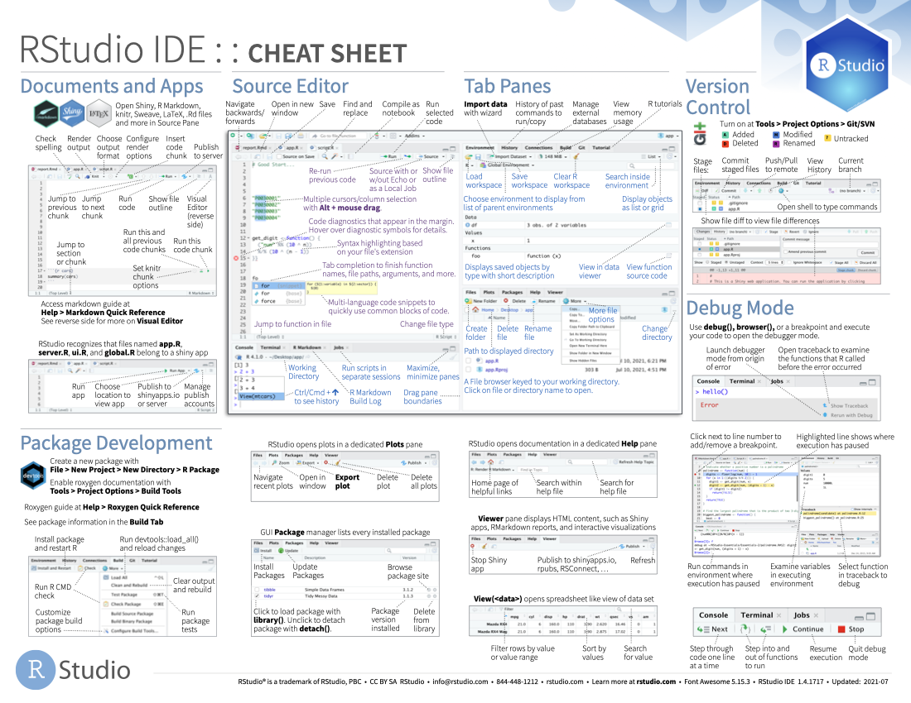

# R cheatsheets

The following cheatsheets come from <https://www.rstudio.com/resources/cheatsheets>. We haven’t covered every function and functionality listed on them, but you might still find them useful as references.

\

\

\

\

\

\

