# Exam 1 review

Questions

> **NOTE:**
>
> Suggested answers can be found [here](../exam-review/exam-1-review-A.llms.md), but resist the urge to peek before you go through it yourself.

## Blizzard salaries

In 2020, employees of Blizzard Entertainment circulated a spreadsheet to anonymously share salaries and recent pay increases amidst rising tension in the video game industry over wage disparities and executive compensation. (Source: [Blizzard Workers Share Salaries in Revolt Over Pay](https://www.bloomberg.com/news/articles/2020-08-03/blizzard-workers-share-salaries-in-revolt-over-wage-disparities))

The name of the data frame used for this analysis is `blizzard_salary` and the variables are:

- `percent_incr`: Raise given in July 2020, as percent increase with values ranging from 1 (1% increase) to 21.5 (21.5% increase)

- `salary_type`: Type of salary, with levels `Hourly` and `Salaried`

- `annual_salary`: Annual salary, in USD, with values ranging from \$50,939 to \$216,856.

- `performance_rating`: Most recent review performance rating, with levels `Poor`, `Successful`, `High`, and `Top`. The `Poor` level is the lowest rating and the `Top` level is the highest rating.

The first ten rows of `blizzard_salary` are shown below:

    # A tibble: 409 × 4
       percent_incr salary_type annual_salary performance_rating
              <dbl> <chr>               <dbl> <chr>             
     1          1   Salaried               1  High              
     2          1   Salaried               1  Successful        
     3          1   Salaried               1  High              
     4          1   Hourly             33987. Successful        
     5         NA   Hourly             34798. High              
     6         NA   Hourly             35360  <NA>              
     7         NA   Hourly             37440  <NA>              
     8          0   Hourly             37814. <NA>              
     9          4   Hourly             41101. Top               
    10          1.2 Hourly             42328  <NA>              
    # ℹ 399 more rows

### Question 1

Which of the following is ***correct***? Choose all that apply.

1.  The `blizzard_salary` dataset has 399 rows.

2.  The `blizzard_salary` dataset has 4 columns.

3.  Each row represents a Blizzard Entertainment worker who filled out the spreadsheet.

4.  The `percent_incr` variable is numerical and discrete.

5.  The `salary_type` variable is numerical.

6.  The `annual_salary` variable is numerical.

7.  The `performance_rating` variable is categorical and ordinal.

### Question 2

[Figure 1 (a)](#fig-blizzard-hist-1) and [Figure 1 (b)](#fig-blizzard-hist-2) show the distributions of annual salaries of hourly and salaried workers. The two figures show the same data, with the facets organized across rows and across columns. Which of the two figures is better for comparing the median annual salaries of hourly and salaried workers. Explain your reasoning.

[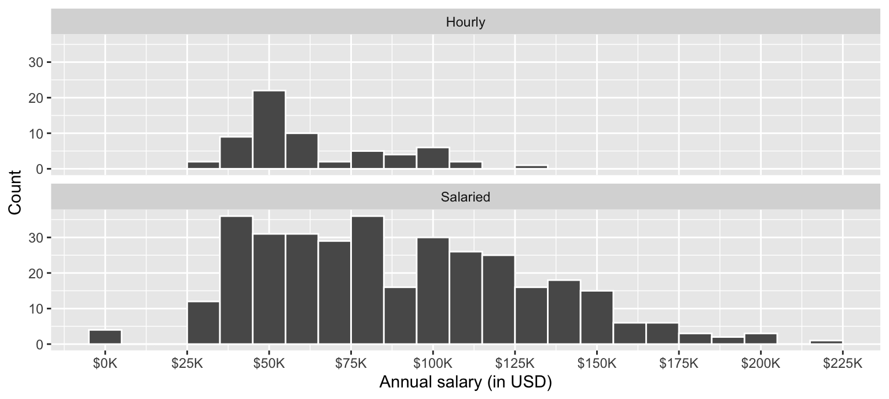](exam-1-review_files/figure-html/fig-blizzard-hist-1-1.png "Figure 1 (a): Option 1")

\(a\) Option 1

[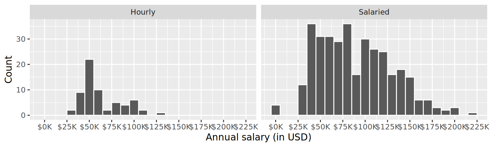](exam-1-review_files/figure-html/fig-blizzard-hist-2-1.png "Figure 1 (b): Option 2")

\(b\) Option 2

Figure 1: Distribution of annual salaries of Blizzard employees

### Question 3

Suppose your teammate wrote the following code as part of their analysis of the data.

``` downlit
blizzard_salary |>
  group_by(salary_type) |>
  summarize(
    mean_annual_salary = mean(annual_salary),
    median_annual_salary = median(annual_salary)
  )
```

They then printed out the results shown below. Unfortunately one of the numbers got erased from the printout. It’s indicated with `_____` below.

    # A tibble: 2 × 3
      salary_type mean_annual_salary median_annual_salary
      <chr>                    <dbl>                <dbl>
    1 Hourly                  63003.               54246.
    2 Salaried                90183.               _____

Which of the following is the best estimate for that erased value?

1.  30,000

2.  50,000

3.  80,000

4.  100,000

### Question 4

Which distribution of annual salaries has a higher standard deviation?

1.  Hourly workers

2.  Salaried workers

3.  Roughly the same

### Question 5

Which of the following alternate plots would also be useful for visualizing the distributions of annual salaries of hourly and salaried workers? Choose all that apply.

a\. Box plots

b\. Density plots

c\. Pie charts

d\. Waffle charts

e\. Histograms

f\. Scatterplots

### Questions 6 and 7

Suppose you made the bar plot shown in [Figure 2 (a)](#fig-performance-rating-1) to visualize the distribution of `performance_rating` and your teammate made the bar plot shown in [Figure 2 (b)](#fig-performance-rating-2).

[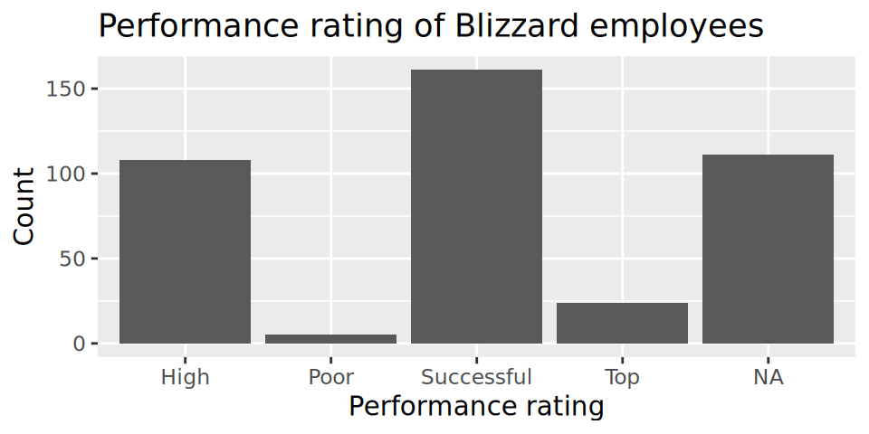](exam-1-review_files/figure-html/fig-performance-rating-1.png "Figure 2 (a): Option 1")

\(a\) Option 1

[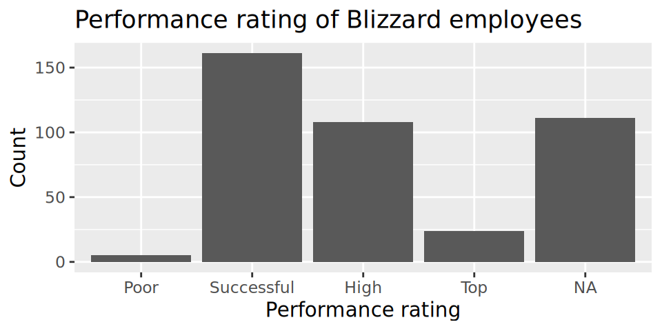](exam-1-review_files/figure-html/fig-performance-rating-2.png "Figure 2 (b): Option 2")

\(b\) Option 2

Figure 2: Distribution of performance rating

You made your bar plot without transforming the data in any way, while your friend did first transform the data with code like the following:

``` r
blizzard_salary <- blizzard_salary |>
  _(1)_(performance_rating = fct_relevel(performance_rating, _(2)_))
```

**Question 6:** What goes in the blank (1)?

1.  `arrange()`

2.  [`filter()`](https://rdrr.io/r/stats/filter.html)

3.  `mutate()`

4.  `summarize()`

**Question 7:** What goes in the blank (2)?

1.  `"Poor", "Successful", "High", "Top"`

2.  `"Successful", "High", "Top"`

3.  `"Top", "High", "Successful", "Poor"`

4.  `Poor, Successful, High, Top`

### Questions 8 - 10

Finally, another teammate creates the following two plots.

[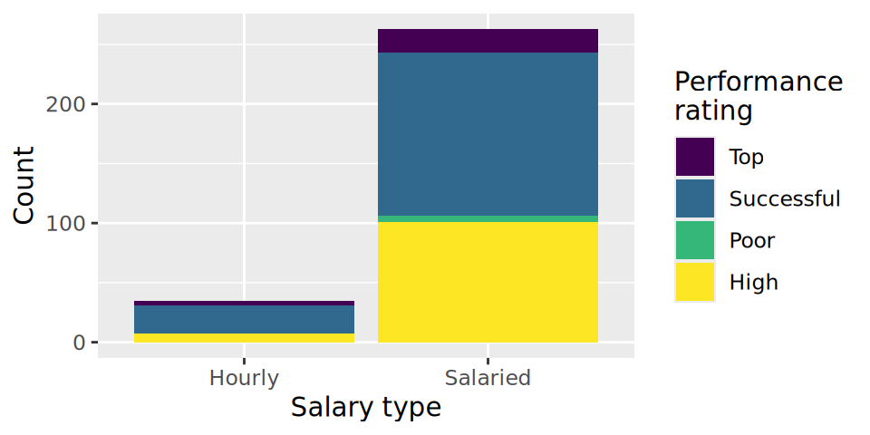](exam-1-review_files/figure-html/fig-salary-performance-rating-1.png "Figure 3 (a): Option 1")

\(a\) Option 1

[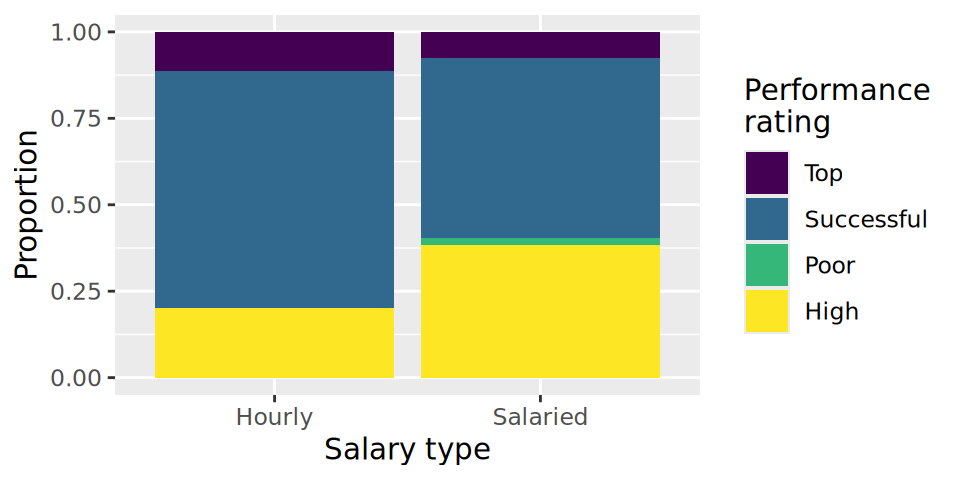](exam-1-review_files/figure-html/fig-salary-performance-rating-2.png "Figure 3 (b): Option 2")

\(b\) Option 2

Figure 3: Distribution of salary type by performance rating

**Question 8:** Your teammate asks you for help deciding which one to use in the final report for visualizing the relationship between performance rating and salary type. In 1-3 sentences, can you help them make a decision, justify your choice, and write the narrative that should go with the plot?

**Question 9:** A friend with a keen eye points out that the number of observations in [Figure 3 (a)](#fig-salary-performance-rating-1) seems lower than the total number of observations in `blizzard_salary`. What might be going on here? Explain your reasoning.

**Question 10:** Below are the proportions of performance ratings for hourly and salaried workers. Place these values in the corresponding segments in [Figure 3 (b)](#fig-salary-performance-rating-2).

    # A tibble: 4 × 3
      performance_rating Hourly Salaried
      <chr>               <dbl>    <dbl>
    1 High                0.2     0.384 
    2 Successful          0.686   0.521 
    3 Top                 0.114   0.0760
    4 Poor                0       0.0190

### Questions 11 and 12

The table below shows the distribution of `salary_type` and `performance_rating`.

    # A tibble: 2 × 6
      salary_type  Poor Successful  High   Top  `NA`
      <chr>       <int>      <int> <int> <int> <int>
    1 Hourly         NA         24     7     4    28
    2 Salaried        5        137   101    20    83

The pipeline below produces a data frame with a fewer number of rows than `blizzard_salary`.

``` r
blizzard_salary |>
  filter(salary_type _(1)_ "Hourly" _(2)_ performance_rating == "Poor") |>
  _(3)_(annual_salary)
```

    # A tibble: 5 × 4
      percent_incr salary_type annual_salary performance_rating
             <dbl> <chr>               <dbl> <chr>             
    1            0 Salaried            80000 Poor              
    2            3 Salaried            83000 Poor              
    3            0 Salaried           116000 Poor              
    4            0 Salaried           135219 Poor              
    5            0 Salaried           147500 Poor              

**Question 11:** Which of the following goes in blanks (1) and (2)?

|     | \(1\) | \(2\) |
|-----|:-----:|:-----:|
| a\. | `!=`  |  `|`  |
| b\. | `==`  |  `&`  |
| c\. | `!=`  |  `&`  |
| d\. | `==`  |  `|`  |

**Question 12:** Which function or functions go into blank (3)?

1.  `arrange()`

2.  `mutate()`

3.  [`order()`](https://rdrr.io/r/base/order.html)

4.  [`sort()`](https://rdrr.io/r/base/sort.html)

### Question 13

You’re reviewing another team’s work and they made the following visualization:

[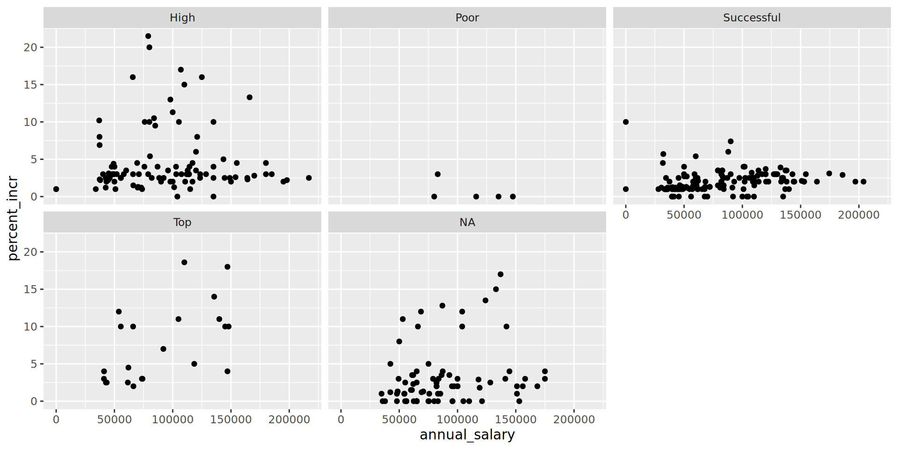](exam-1-review_files/figure-html/unnamed-chunk-6-1.png)

And they wrote the following interpretation for the relationship between annual salary and percent increase for Top performers:

> The relationship is positive, having a higher salary results in a higher percent increase. There is one clear outlier.

Which of the following is/are the most accurate and helpful) peer review note for this interpretation. Choose all that apply.

1.  The interpretation is complete and perfect, no changes needed!

2.  The interpretation doesn’t mention the direction of the relationship.

3.  The interpretation doesn’t mention the form of the relationship, which is linear.

4.  The interpretation doesn’t mention the strength of the relationship, which is somewhat strong.

5.  There isn’t a clear outlier in the plot. If any points stand out as potential outliers, more guidance should be given to the reader to identify them (e.g., salary and/or percent increase amount).

6.  The interpretation is causal – we don’t know if the cause of the high percent increase is higher annual salary based on observational data. The causal direction might be the other way around, or there may be other factors contributing to the apparent relationship.

### Question 14

Below is some code and its output.

```` markdown
```{r}
# label=plot blizzard

ggplot(blizzard_salary,aes(x=performance_rating,y=percent_incr))+geom_boxplot()
labs(x="Performance rating", y = "Percent increase")
```
````

    Warning: Removed 39 rows containing non-finite outside the scale range
    (`stat_boxplot()`).

[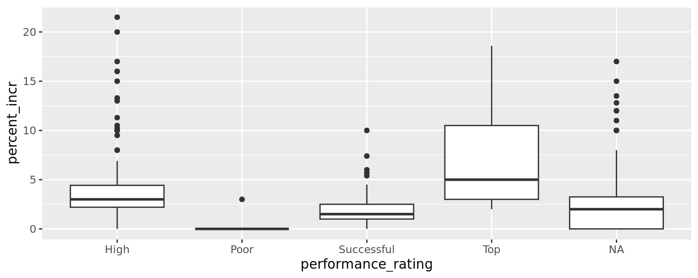](exam-1-review_files/figure-html/unnamed-chunk-7-1.png)

    <ggplot2::labels> List of 2
     $ x: chr "Performance rating"
     $ y: chr "Percent increase"

Part 1: List at least 5 things that should be fixed or improved in the code.

Part 2: What is the cause of the warning and what does it mean?

### Question 15

You’re working on a data analysis on salaries of Blizzard employees in a Quarto document in a project version controlled by Git. You create a plot and write up a paragraph describing any patterns in it. Then, your teammate says “render, commit, and push”.

Part 1: What do they mean by each of these three steps. In 1-2 sentences for each, explain in your own words what they mean.

1.  Render:

&nbsp;

2.  Commit:

&nbsp;

3.  Push:

Part 2: Your teammate is getting impatient and they interrupt you after you rendered and committed and say “I still can’t see your changes in our shared GitHub repo when I look at it in my web browser.” Which of the following answers is the most accurate?

1.  I rendered my document, you should be seeing my changes on GitHub when you look at it in your web browser.

2.  I committed my changes, you should be seeing my changes on GitHub when you look at it in your web browser.

3.  I didn’t yet push my changes, it’s expected that you are not seeing them on GitHub when you look at it in your web browser. Wait until I push, and check again.

4.  You need to pull to see my changes on GitHub in the web browser.

## Penguins

The `penguins` data set includes measurements for penguin species, including: flipper length, body mass, bill dimensions, and sex. The following table summarizes information on which species of penguins (Adelie, Gentoo, and Chinstrap) live on which islands (Biscoe, Dream, or Torgersen).

| Island    | Adelie | Gentoo | Chinstrap | Total |
|-----------|--------|--------|-----------|-------|
| Biscoe    | 44     | 124    | 0         | 168   |
| Dream     | 56     | 0      | 68        | 124   |
| Torgersen | 52     | 0      | 0         | 52    |
| Total     | 152    | 124    | 68        | 344   |

### Question 16

Which of the following plots is the result of the following code?

``` downlit
ggplot(penguins, aes(x = island, fill = species)) +
  geom_bar()
```

[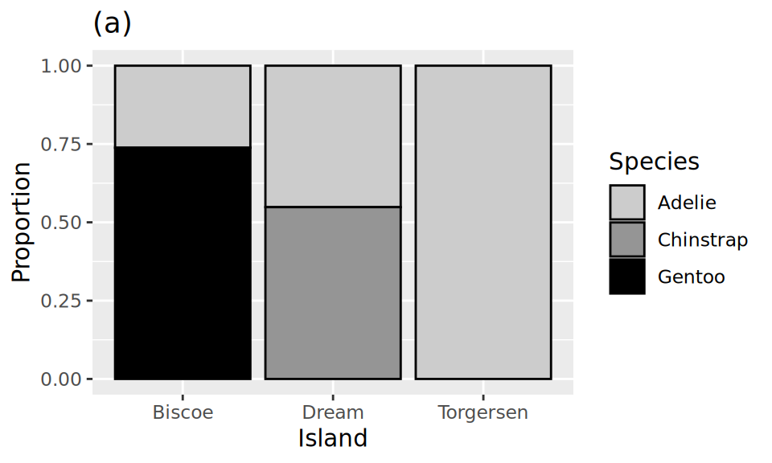](exam-1-review_files/figure-html/penguins-species-island-bar-plots-1.png)

[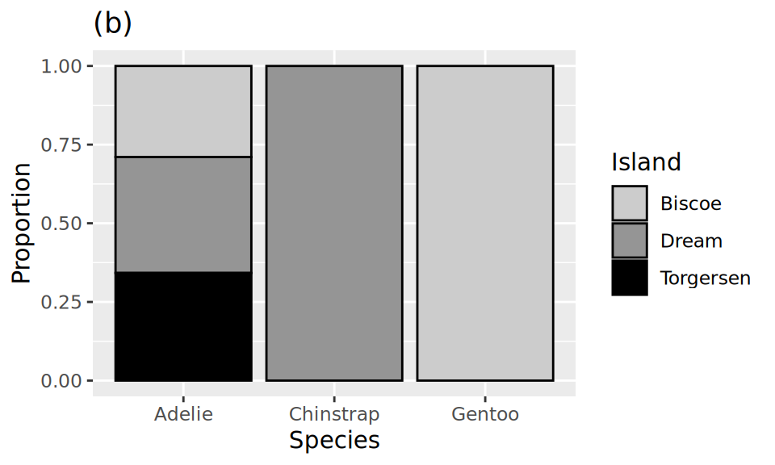](exam-1-review_files/figure-html/penguins-species-island-bar-plots-2.png)

[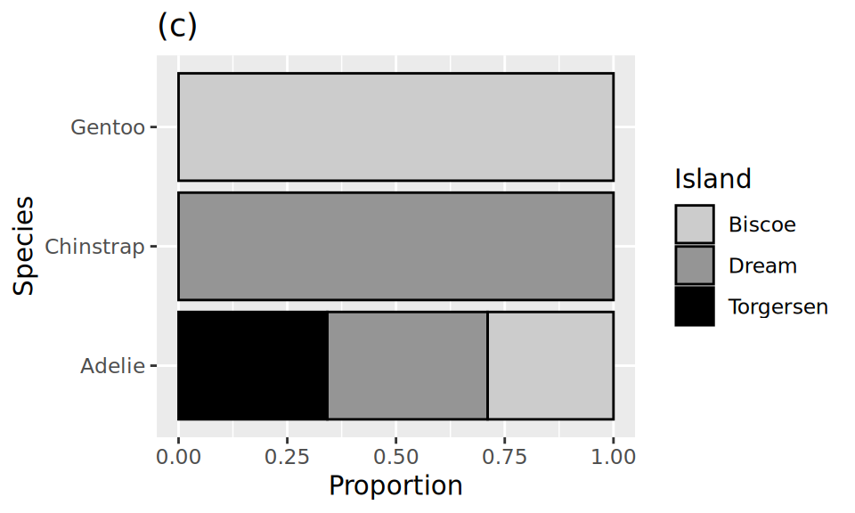](exam-1-review_files/figure-html/penguins-species-island-bar-plots-3.png)

[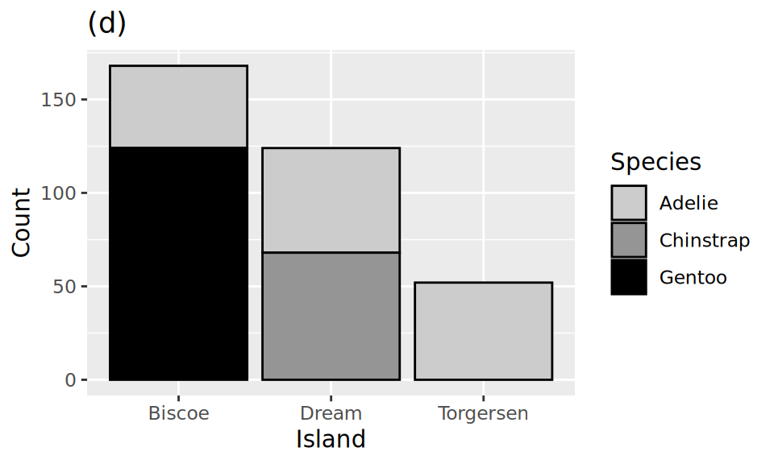](exam-1-review_files/figure-html/penguins-species-island-bar-plots-4.png)

[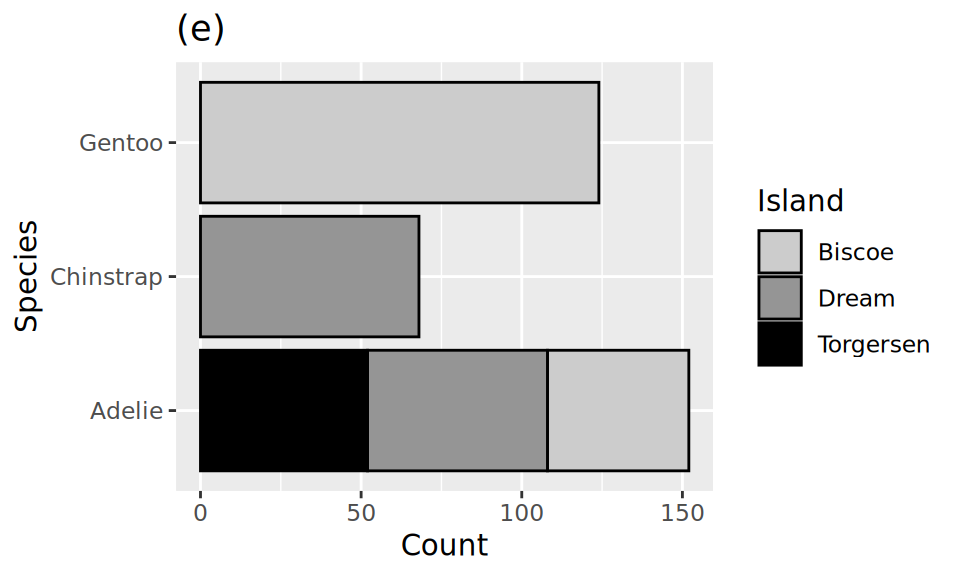](exam-1-review_files/figure-html/penguins-species-island-bar-plots-5.png)

## NYC Flights

The `flights` dataset includes characteristics of all flights departing from New York City airports (JFK, LGA, EWR) in 2013. Below is a peek at the first ten rows of the `flights` data.

    # A tibble: 336,776 × 19
        year month   day arr_delay carrier dep_time sched_dep_time dep_delay
       <int> <int> <int>     <dbl> <chr>      <int>          <int>     <dbl>
     1  2013     1     1        11 UA           517            515         2
     2  2013     1     1        20 UA           533            529         4
     3  2013     1     1        33 AA           542            540         2
     4  2013     1     1       -18 B6           544            545        -1
     5  2013     1     1       -25 DL           554            600        -6
     6  2013     1     1        12 UA           554            558        -4
     7  2013     1     1        19 B6           555            600        -5
     8  2013     1     1       -14 EV           557            600        -3
     9  2013     1     1        -8 B6           557            600        -3
    10  2013     1     1         8 AA           558            600        -2
    # ℹ 336,766 more rows
    # ℹ 11 more variables: arr_time <int>, sched_arr_time <int>, flight <int>,
    #   tailnum <chr>, origin <chr>, dest <chr>, air_time <dbl>, distance <dbl>,
    #   hour <dbl>, minute <dbl>, time_hour <dttm>

### Question 17

Based on this output, which of the following must be ***true*** about the `flights` data frame? **Select all that are true.**

1.  The `flights` data frame is a `tibble`.

2.  The `flights` data frame has 10 rows.

3.  The `flights` data frame has 8 columns.

4.  The `carrier` variable in the `flights` data frame is a character variable.

5.  There are no missing data in the `flights` data frame.

### Question 18

Which of the following pipelines produce(s) the output shown below? **Select all that apply.**

    # A tibble: 336,776 × 5
       arr_delay carrier  year month   day
           <dbl> <chr>   <int> <int> <int>
     1      1272 HA       2013     1     9
     2      1127 MQ       2013     6    15
     3      1109 MQ       2013     1    10
     4      1007 AA       2013     9    20
     5       989 MQ       2013     7    22
     6       931 DL       2013     4    10
     7       915 DL       2013     3    17
     8       895 DL       2013     7    22
     9       878 AA       2013    12     5
    10       875 MQ       2013     5     3
    # ℹ 336,766 more rows

a\.

``` downlit
flights |>
  select(arr_delay, carrier, year, month, day) |>
  arrange(desc(arr_delay))
```

b\.

``` downlit
flights |>
  select(arr_delay, carrier, year, month, day) |>
  arrange(arr_delay)
```

c\.

``` downlit
flights |>
  select(arr_delay, carrier, year, month, day) |>
  arrange(year)
```

d\.

``` downlit
flights |>
  arrange(desc(arr_delay)) |>
  select(arr_delay, carrier, year, month, day)
```

e\.

``` downlit
flights |>
  arrange(desc(arr_delay)) |>
  select(day, month, year, arr_delay, carrier)
```

## Countries and populations

We have a small dataset of six countries and their populations:

    # A tibble: 6 × 2
      country       population
      <chr>              <dbl>
    1 Curacao            150  
    2 Ecuador          18001  
    3 Iraq             44496. 
    4 New Zealand       5124. 
    5 Palau               18.0
    6 United States   333288. 

And another small dataset of five countries and the continent they’re in:

    # A tibble: 5 × 3
      entity      code  continent    
      <chr>       <chr> <chr>        
    1 Angola      AGO   Africa       
    2 Curacao     CUW   North America
    3 Ecuador     ECU   South America
    4 Iraq        IRQ   Asia         
    5 New Zealand NZL   Oceania      

You join the two datasets with the following:

``` downlit
population |>
  left_join(continents, by = join_by(country == entity))
```

### Question 19

How many rows will the resulting data frame have?

1.  4
2.  5
3.  6
4.  7
5.  8

### Question 20

What will be the columns of the resulting data frame?

1.  `country`, `population`

2.  `country`, `population`, `code`, `continent`

3.  `entity`, `code`, `continent`

4.  `entity`, `population`, `code`, `continent`

5.  `country`, `entity`, `population`, `code`, `continent`

## Duke Forest houses

The `duke_forest` dataset includes information on prices and various other features (number of bedrooms, bathrooms, area, year built, type of cooling, type of heating, etc.) of houses in the Duke Forest neighborhood of Durham, NC.

    Rows: 98
    Columns: 13
    $ address    <chr> "1 Learned Pl, Durham, NC 27705", "1616 Pinecrest Rd, Durha…
    $ price      <dbl> 1520000, 1030000, 420000, 680000, 428500, 456000, 1270000, …
    $ bed        <dbl> 3, 5, 2, 4, 4, 3, 5, 4, 4, 3, 4, 4, 3, 5, 4, 5, 3, 4, 4, 3,…
    $ bath       <dbl> 4.0, 4.0, 3.0, 3.0, 3.0, 3.0, 5.0, 3.0, 5.0, 2.0, 3.0, 3.0,…
    $ area       <dbl> 6040, 4475, 1745, 2091, 1772, 1950, 3909, 2841, 3924, 2173,…
    $ type       <chr> "Single Family", "Single Family", "Single Family", "Single …
    $ year_built <dbl> 1972, 1969, 1959, 1961, 2020, 2014, 1968, 1973, 1972, 1964,…
    $ heating    <chr> "Other, Gas", "Forced air, Gas", "Forced air, Gas", "Heat p…
    $ cooling    <fct> central, central, central, central, central, central, centr…
    $ parking    <chr> "0 spaces", "Carport, Covered", "Garage - Attached, Covered…
    $ lot        <dbl> 0.97, 1.38, 0.51, 0.84, 0.16, 0.45, 0.94, 0.79, 0.53, 0.73,…
    $ hoa        <chr> NA, NA, NA, NA, NA, NA, NA, NA, NA, NA, NA, NA, NA, NA, NA,…
    $ url        <chr> "https://www.zillow.com/homedetails/1-Learned-Pl-Durham-NC-…

The following summary table gives us some information about whether homes in this data set have garages and when they were built.

|           | Built earlier than 1950 | Built in 1950 or later |
|-----------|-------------------------|------------------------|
| Garage    | 5                       | 33                     |
| No garage | 3                       | 57                     |

The pipeline below produces a data frame with a fewer number of rows than `duke_forest`.

``` r
duke_forest |>
  filter(parking == "Garage" _(1)_ year_built _(2)_ 1950) |>
  select(parking, year_built, price, area) |>
  _(3)_(price_per_sqfeet = price / area)
```

    # A tibble: 5 × 5
      parking year_built  price  area price_per_sqfeet
      <chr>        <dbl>  <dbl> <dbl>            <dbl>
    1 Garage        1945 900000  2933            307. 
    2 Garage        1938 265000  1300            204. 
    3 Garage        1934 600000  2514            239. 
    4 Garage        1941 412500  1661            248. 
    5 Garage        1940 105000  1094             96.0

### Question 21

Which of the following goes in blanks (1) and (2)?

|     | \(1\) | \(2\) |
|-----|:-----:|:-----:|
| a\. |  `&`  |  `<`  |
| b\. |  `|`  |  `<`  |
| c\. |  `&`  | `>=`  |
| d\. |  `|`  | `>=`  |
| e\. |  `&`  | `!=`  |

### Question 22

Which function or functions go into blank (3)? **Select all that apply.**

1.  `arrange()`

2.  `mutate()`

3.  [`filter()`](https://rdrr.io/r/stats/filter.html)

4.  `summarize()`

5.  `slice()`

## Law & Order

You’ve heard of the tidyverse, now let’s visit the Law & Order-verse. Doink doink![^1]

Law & Order is a police procedural and legal drama television series that has been running since the 1990s. The Law & Order franchise includes a number of series such as Law & Order, Law & Order: SVU, Law & Order: Criminal Intent, etc.

You will work with data on average ratings for each season of three series from the Law & Order-verse – a subset of the data from the previous questions. Below is a peek at the first ten rows of the Law & Order data.

The plot below shows the distributions of average ratings of various Law & Order series across seasons.

[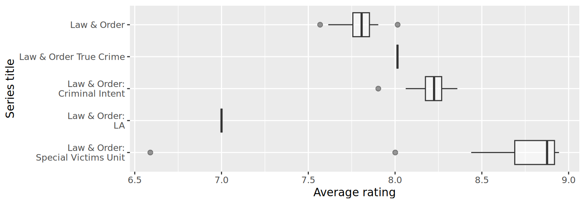](exam-1-review_files/figure-html/unnamed-chunk-13-1.png)

### Question 23

Based on the information from the side-by-side box plots, fill in the legend of the plot below with Law & Order series titles.

[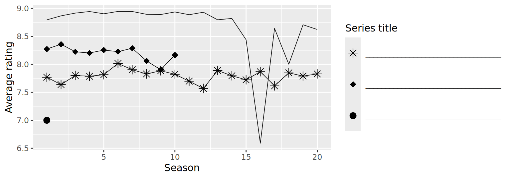](exam-1-review_files/figure-html/unnamed-chunk-14-1.png)

### Question 24

The following code calculates the standard deviations of average season ratings of the five Law & Order series. Unfortunately, the output is partially erased and replaced with blanks.

``` downlit
lo_titles <- c(
  "Law & Order",
  "Law & Order: Criminal Intent",
  "Law & Order: SVU"
)

law_and_order |>
  filter(title %in% lo_titles) |>
  group_by(title) |>
  summarize(mean_av_rating = mean(av_rating), sd_av_rating = sd(av_rating))
```

    # A tibble: 5 × 3
      title                         mean_av_rating sd_av_rating
      <chr>                                  <dbl>        <dbl>
    1 Law & Order                            _(1)_        0.106
    2 Law & Order: Criminal Intent            8.20        0.129
    4 Law & Order: SVU                        8.67        _(2)_

Based on the visualizations you’ve seen of these data so far, which of the following is ***true*** about the blanks in the output? **Select all that are true.**

1.  The **mean** of average ratings (Blank 1) of Law & Order seasons is **lower** than the other two means.

2.  The **mean** of average ratings (Blank 1) of Law & Order seasons is **higher** than the other two means.

3.  The **standard deviation** of average ratings of Law & Order: SVU seasons (Blank 2) is **lower** than the other two standard deviations.

4.  The **standard deviation** of average ratings of Law & Order: SVU seasons (Blank 2) is **higher** than the other two standard deviations.

5.  The **standard deviation** of average ratings of Law & Order: SVU seasons (Blank 2) is **between** the other two standard deviations.

## Romance and comedy

Finally, we focus on romance and comedy shows. We first filter the dataset for any shows that have romance or comedy as their genre (`genre_1`, `genre_2`, or `genre_3`) and then remove shows that have both of these genre labels. For the next two questions, we focus on these shows that we identify as either romance or comedy. We then calculate the mean of the average season ratings for each show, to obtain a single “mean average rating” value per show.

The plot below shows the distributions of mean average ratings of seasons of comedy and romance shows.

[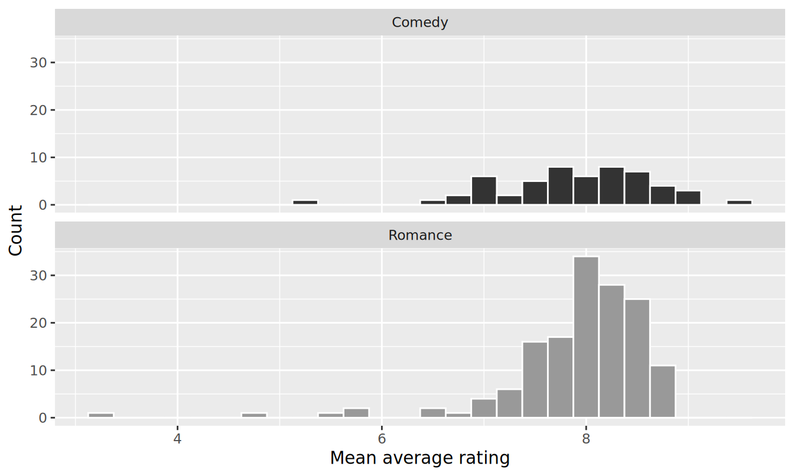](exam-1-review_files/figure-html/unnamed-chunk-17-1.png)

### Question 25

Which of the following statements is ***true*** about these distributions? **Select all that are true.**

1.  Mean average ratings of romance shows are bimodal.
2.  Mean average ratings of comedy are unimodal.
3.  Mean average ratings of romance shows is left skewed.
4.  Mean average ratings of comedy shows is right skewed.
5.  There are more romance shows than comedy shows.

## IMDB

The data for the next few questions come from the Internet Movie Database (IMDB). Specifically, the data are a random sample of movies released between 1980 and 2020.

The name of the data frame used for this analysis is `movies`, and it contains the variables shown in [Table 1](#tbl-data-dictionary).

| Variable | Description |
|----|----|
| `name` | name of the movie |
| `rating` | rating of the movie (R, PG, etc.) |
| `genre` | main genre of the movie. |
| `runtime` | duration of the movie |
| `year` | year of release |
| `release_date` | release date (YYYY-MM-DD) |
| `release_country` | release country |
| `score` | IMDB user rating |
| `votes` | number of user votes |
| `director` | the director |
| `writer` | writer of the movie |
| `star` | main actor/actress |
| `country` | country of origin |
| `budget` | the budget of a movie (some movies don’t have this, so it appears as 0) |
| `gross` | revenue of the movie |
| `company` | the production company |

Table 1: Data dictionary for `movies`

The first thirty rows of the `movies` data frame are shown in [Table 2](#tbl-data), with variable types suppressed (since we’ll ask about them later).

First 30 rows of `movies`, with variable types suppressed.

    # A tibble: 500 × 16
       name           score runtime genre     rating    release_country release_date
     1 Blue City        4.4 83 mins Action    R         United States   1986-05-02  
     2 Winter Sleep     8.1 196     Drama     Not Rated Turkey          2014-06-12  
     3 Rang De Basan…   8.1 167     Comedy    Not Rated United States   2006-01-26  
     4 Pokémon Detec…   6.6 104     Action    PG        United States   2019-05-10  
     5 A Bad Moms Ch…   5.6 104     Comedy    R         United States   2017-11-01  
     6 Replicas         5.5 107     Drama     PG-13     United States   2019-01-11  
     7 Windy City       5.8 103     Drama     R         Uruguay         1986-01-01  
     8 War for the P…   7.4 140     Action    PG-13     United States   2017-07-14  
     9 Tales from th…   6.4 98      Crime     R         United States   1995-05-24  
    10 Fire with Fire   6.5 103     Drama     PG-13     United States   1986-05-09  
    11 Raising Helen    6   119     Comedy    PG-13     United States   2004-05-28  
    12 Feeling Minne…   5.4 99      Comedy    R         United States   1996-09-13  
    13 The Babe         5.9 115     Biography PG        United States   1992-04-17  
    14 The Real Blon…   6   105     Comedy    R         United States   1998-02-27  
    15 To vlemma tou…   7.6 176     Drama     Not Rated United States   1997-11-01  
    16 Going the Dis…   6.3 102     Comedy    R         United States   2010-09-03  
    17 Jung on zo       6.8 103     Action    R         Hong Kong       1993-06-24  
    18 Rita, Sue and…   6.5 93      Comedy    R         United Kingdom  1987-05-29  
    19 Phone Booth      7   81      Crime     R         United States   2003-04-04  
    20 Happy Death D…   6.6 96      Comedy    PG-13     United States   2017-10-13  
    21 Barely Legal     4.7 90      Comedy    R         Thailand        2006-05-25  
    22 Three Kings      7.1 114     Action    R         United States   1999-10-01  
    23 Menace II Soc…   7.5 97      Crime     R         United States   1993-05-26  
    24 Four Rooms       6.8 98      Comedy    R         United States   1995-12-25  
    25 Quartet          6.8 98      Comedy    PG-13     United States   2013-03-01  
    26 Tape             7.2 86      Drama     R         Denmark         2002-07-12  
    27 Marked for De…   6   93      Action    R         United States   1990-10-05  
    28 Congo            5.2 109     Action    PG-13     United States   1995-06-09  
    29 Stop-Loss        6.4 112     Drama     R         United States   2008-03-28  
    30 Con Air          6.9 115     Action    R         United States   1997-06-06  
          budget     gross  votes  year director         writer        star         
                                          
     1  10000000   6947787   1100  1986 Michelle Manning Ross Macdona… Judd Nelson  
     2        NA   4018705  48000  2014 Nuri Bilge Ceyl… Ebru Ceylan   Haluk Bilgin…
     3        NA  10800778 115000  2006 Rakeysh Ompraka… Renzil D'Sil… Aamir Khan   
     4 150000000 433921300 146000  2019 Rob Letterman    Dan Hernandez Ryan Reynolds
     5  28000000 130560428  46000  2017 Jon Lucas        Jon Lucas     Mila Kunis   
     6  30000000   9330075  34000  2018 Jeffrey Nachman… Chad St. John Keanu Reeves 
     7        NA    343890    262  1984 Armyan Bernstein Armyan Berns… John Shea    
     8 150000000 490719763 235000  2017 Matt Reeves      Mark Bomback  Andy Serkis  
     9   6000000  11837928   7400  1995 Rusty Cundieff   Rusty Cundie… Clarence Wil…
    10        NA   4636169   1500  1986 Duncan Gibbins   Bill Phillips Craig Sheffer
    11  50000000  49718611  36000  2004 Garry Marshall   Patrick J. C… Kate Hudson  
    12        NA   3124440  11000  1996 Steven Baigelman Steven Baige… Keanu Reeves 
    13        NA  19930973   9300  1992 Arthur Hiller    John Fusco    John Goodman 
    14        NA     83488   3900  1997 Tom DiCillo      Tom DiCillo   Matthew Modi…
    15        NA        NA   6400  1995 Theodoros Angel… Theodoros An… Harvey Keitel
    16  32000000  42059111  57000  2010 Nanette Burstein Geoff LaTuli… Drew Barrymo…
    17        NA   3741869   6100  1993 Kirk Wong        Tin Nam Chun  Jackie Chan  
    18        NA    124167   3600  1987 Alan Clarke      Andrea Dunbar Siobhan Finn…
    19  13000000  97837138 255000  2002 Joel Schumacher  Larry Cohen   Colin Farrell
    20   4800000 125479266 124000  2017 Christopher Lan… Scott Lobdell Jessica Rothe
    21        NA     83439   5900  2003 David Mickey Ev… David H. Ste… Erik von Det…
    22  75000000 107752036 163000  1999 David O. Russell John Ridley   George Cloon…
    23   3500000  27912072  54000  1993 Albert Hughes    Allen Hughes  Tyrin Turner 
    24   4000000   4257354 100000  1995 Directors        Allison Ande… Tim Roth     
    25  11000000  59520298  19000  2012 Dustin Hoffman   Ronald Harwo… Maggie Smith 
    26    100000    515900  19000  2001 Richard Linklat… Stephen Belb… Ethan Hawke  
    27  12000000  57968936  21000  1990 Dwight H. Little Michael Grais Steven Seagal
    28  50000000 152022101  43000  1995 Frank Marshall   Michael Cric… Laura Linney 
    29  25000000  11212953  20000  2008 Kimberly Peirce  Mark Richard  Ryan Phillip…
    30  75000000 224012234 282000  1997 Simon West       Scott Rosenb… Nicolas Cage 
    # ℹ 470 more rows
    # ℹ 2 more variables: company, country

Table 2

### Question 26

The `name` and `runtime` variables are shown below, with the variable types suppressed.

    # A tibble: 500 × 2
      name                      runtime
    1 Blue City                 83 mins
    2 Winter Sleep              196    
    3 Rang De Basanti           167    
    4 Pokémon Detective Pikachu 104    
    5 A Bad Moms Christmas      104    
    6 Replicas                  107    
    # ℹ 494 more rows

What is the type of the `runtime` variable?

1.  Character

2.  Double

3.  Factor

4.  Integer

5.  Logical

### Question 27

The code below summarizes the data in a certain way.

``` downlit
movies |>
  summarize(sum(release_country == "United States"))
```

    # A tibble: 1 × 1
      `sum(release_country == "United States")`
                                          <int>
    1                                       435

Which of the following is ***TRUE*** about the code and its result? **Select all that are true.**

1.  Evaluates whether each `release_country` is equal to `"United States"` or not, which results in a logical variable.

2.  Filters out rows where `release_country` is not equal to `"United States"` and counts the remaining rows.

3.  Sums the logical values, where each `TRUE` is considered a 1 and each `FALSE` is considered a 0.

4.  Results in a character vector.

5.  The result shows there are 435 movies released in the United States.

### Question 28

Suppose you want a visualization that shows the number of movies in the sample in each `genre`. Your first attempt is as follows.

[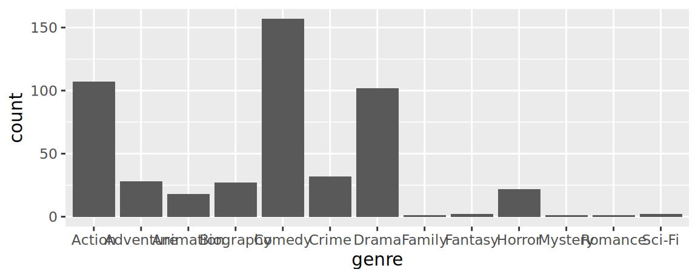](exam-1-review_files/figure-html/unnamed-chunk-23-1.png)

A friend of yours says that the visualization is difficult to read and they suggest using the following visualization instead.

[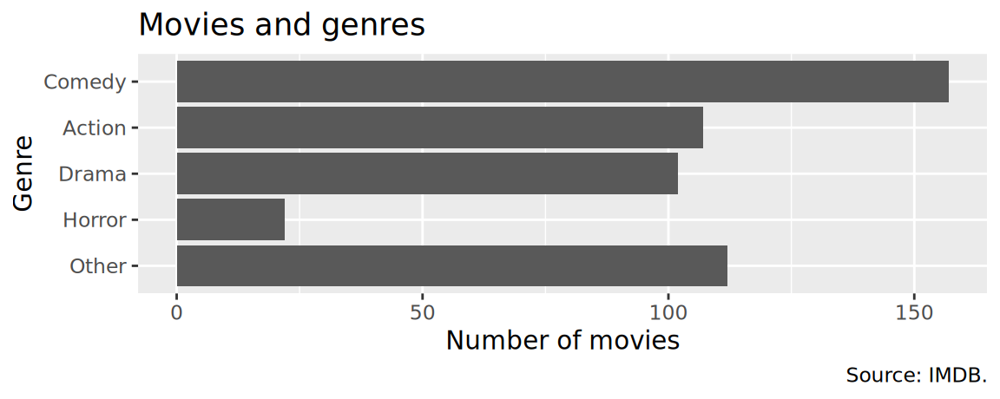](exam-1-review_files/figure-html/unnamed-chunk-24-1.png)

Which of the following modifications would your friend have made to your code to create their version? **Select all that apply.**

1.  Combine movies in genres other than Comedy, Drama, Action, and Horror into a new level called `"Other"`.

2.  Reorder the levels in descending order of numbers of observations, except for the `"Other"` level.

3.  Map `genre` to the `y` aesthetic.

4.  Add a title, x and y-axis labels, and a caption.

5.  Filter out all moves in genres other than Comedy, Drama, Action, and Horror before plotting.

### Question 29

Which of the following is ***TRUE*** about the code and its result? **Select all that are true.**

``` downlit
movies |>
  count(rating, genre) |>
  pivot_wider(names_from = genre, values_from = n, values_fill = 0)
```

    # A tibble: 6 × 6
      rating    Other Drama Action Comedy Horror
      <fct>     <int> <int>  <int>  <int>  <int>
    1 G             5     1      1      1      0
    2 PG           38    13     10     18      0
    3 PG-13        19    25     35     35      0
    4 R            45    50     57     96     21
    5 NC-17         1     2      0      1      0
    6 Not Rated     4    11      4      6      1

1.  The code counts how many movies are in each rating and genre combination.

2.  The code sorts the results in descending order.

3.  Each row of the output is a movie.

4.  The output shows that there are six distinct ratings in the dataset.

5.  The code reduces the number of variables and observations in the `movies` data frame to six.

## Gymnastics

The `gymnastics` dataset contains information about routines performed by gymnasts in the women’s artistic gymnastics competition at the 2024 Paris Olympics. Each row represents a single routine, so a gymnast who competed on all four apparatus appears in at least four rows. Variables include the gymnast’s `name`, `country`, `event` (apparatus), `competition` (round), and `score` (routine total).

    Rows: 561
    Columns: 5
    $ name        <chr> "Simone Biles", "Simone Biles", "Rebeca Andrade", "Rebeca …
    $ country     <chr> "United States", "United States", "Brazil", "Brazil", "Uni…
    $ event       <chr> "Vault", "Vault", "Vault", "Vault", "Vault", "Vault", "Vau…
    $ competition <chr> "Qualification", "Qualification", "Qualification", "Qualif…
    $ score       <dbl> 15.800, 14.800, 14.900, 14.466, 14.666, 14.200, 14.333, 14…

The `continents` dataset contains countries (`entity`) and the `continent` each one is in.

    Rows: 285
    Columns: 2
    $ entity    <chr> "Abkhazia", "Afghanistan", "Akrotiri and Dhekelia", "Aland I…
    $ continent <chr> "Asia", "Asia", "Asia", "Europe", "Europe", "Africa", "Ocean…

A student joins the two datasets and summarizes average vault score by continent with the following pipeline:

``` downlit
gymnastics |>
  left_join(continents, join_by(country == entity)) |>
  filter(event == "Vault") |>
  group_by(continent) |>
  summarize(mean_vault_score = mean(score, na.rm = TRUE)) |>
  arrange(desc(mean_vault_score))
```

    # A tibble: 7 × 2
      continent     mean_vault_score
      <chr>                    <dbl>
    1 South America             14.1
    2 North America             14.1
    3 <NA>                      13.7
    4 Europe                    13.5
    5 Asia                      13.5
    6 Oceania                   13.4
    7 Africa                    13.3

### Question 30

Part 1: The resulting summary has a row where `continent` is `NA`. Explain what this row represents — i.e., what is happening in the join that produces it?

Part 2: The student then runs the following code and gets the output shown:

``` downlit
gymnastics |>
  anti_join(continents, join_by(country == entity)) |>
  distinct(country)
```

    # A tibble: 3 × 1
      country       
      <chr>         
    1 Great Britain 
    2 AUT           
    3 Chinese Taipei

What is the `mean_vault_score` of athletes from the Great Britain, Austria, and Chinese Taipei? Provide a justification for how you arrived at this number.

## Inflation around the world

The `country_inflation` dataset contains annual inflation rates for countries around the world from 1993 to 2025. The first five rows and a handful of the columns are shown below:

    # A tibble: 5 × 6
      country   `1993` `2000` `2010` `2020` `2025`
      <chr>      <dbl>  <dbl>  <dbl>  <dbl>  <dbl>
    1 Australia   1.75   4.46   2.92  0.847   2.87
    2 Austria     3.63   2.34   1.81  1.38    3.53
    3 Belgium     2.75   2.54   2.19  0.741   2.47
    4 Canada      1.87   2.72   1.78  0.717   2.07
    5 Chile      12.7    3.84   1.41  3.05   NA   

A student reshapes the data with the following code:

``` downlit
country_inflation_long <- country_inflation |>
  pivot_longer(
    cols = !country,
    names_to = "year",
    names_transform = as.numeric,
    values_to = "inflation_rate"
  )
```

and then uses `country_inflation_long` to make the following plot:

    Warning: Removed 1 row containing missing values or values outside the scale range
    (`geom_line()`).

    Warning: Removed 1 row containing missing values or values outside the scale range
    (`geom_point()`).

[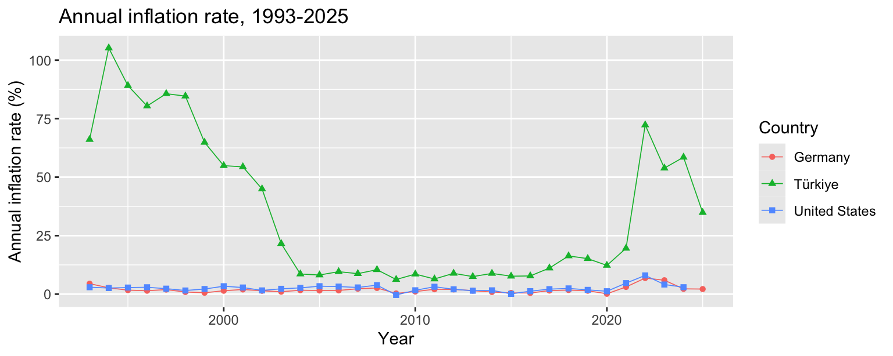](exam-1-review_files/figure-html/fig-inflation-1.png "Figure 4: Annual inflation rate for selected countries, 1993-2025")

Figure 4: Annual inflation rate for selected countries, 1993-2025

### Question 31

The original `country_inflation` dataset has 38 rows and 34 columns. How would you calculate the number of rows and columns `country_inflation_long` has, and what does each row represent? Explain, in your own words, what `pivot_longer()` did to the data, including what the `names_transform = as.numeric` argument accomplished.

### Question 32

A student wants to compare each country’s inflation rate in 2025 to its rate in 1993 (the first and last years in the `country_inflation` dataset). They write the following pipeline:

``` downlit
country_inflation |>
  filter(!is.na(`1993`), !is.na(`2025`)) |>
  mutate(inf_ratio = `2025` / `1993`) |>
  select(country, inf_ratio) |>
  arrange(desc(inf_ratio)) |>
  slice_head(n = 5)
```

    # A tibble: 5 × 2
      country        inf_ratio
      <chr>              <dbl>
    1 New Zealand         2.20
    2 Australia           1.64
    3 Denmark             1.51
    4 Ireland             1.50
    5 United Kingdom      1.48

Part 1: In 1-2 sentences, describe what the resulting data frame represents and how to interpret the values in `inf_ratio` (e.g., what does an `inf_ratio` of 2.20 mean for New Zealand?).

Part 2: A teammate says the [`filter()`](https://rdrr.io/r/stats/filter.html) step is unnecessary because “`mutate()` works fine with missing values.” Explain what would be different about the resulting data frame if the [`filter()`](https://rdrr.io/r/stats/filter.html) step were removed, and why that could be misleading.

Part 3: Another teammate suggests replacing `mutate()` with `summarize()` in this pipeline, keeping everything else the same. Explain why that would not accomplish the student’s goal.

Part 4: That teammate is dead set on using `summarize()` instead of `mutate()`. What other modification would they need to make to the code to get the same result?

Part 5: The student then removes `slice_head(n = 5)` from their pipeline so the result contains all countries, saves it as `inflation_ratios`, and makes the following plot:

[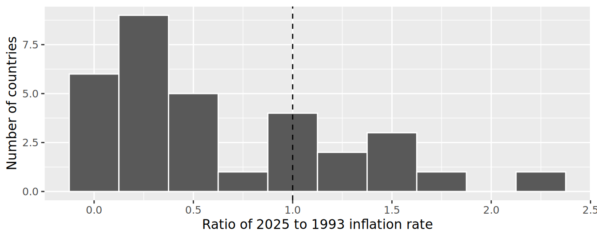](exam-1-review_files/figure-html/fig-inflation-ratios-1.png "Figure 5: Ratio of 2025 to 1993 inflation rates")

Figure 5: Ratio of 2025 to 1993 inflation rates

In a few sentences, describe the distribution shown in [Figure 5](#fig-inflation-ratios), explain what the dashed vertical line at 1 represents, and state what it means for the countries to the left vs. the right of that line.

## Bonus

Pick a concept we introduced in class so far that you’ve been struggling with and explain it in your own words.

## Footnotes

[^1]: “Doink doink” is the scene and episode introductory sound on the Law & Order series. If you’ve never heard it, you’re not at any disadvantage for the exam. If you’ve ever heard it, good luck getting it out of your head!
