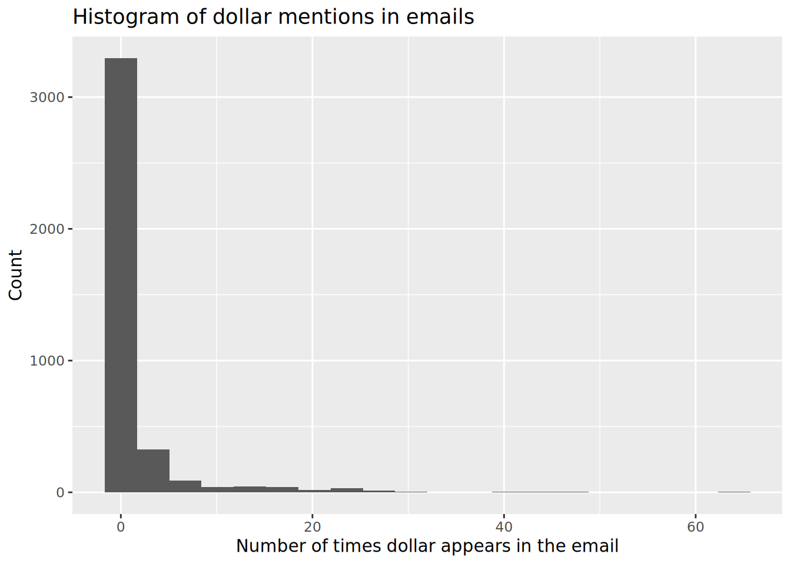
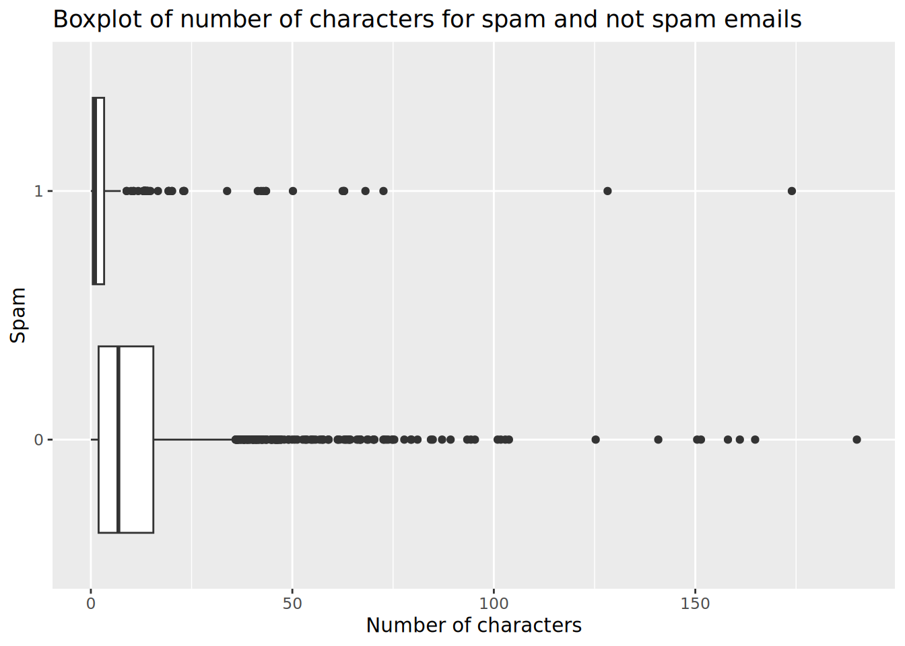

# Exam 2 review

Suggested answers

1.  \(c\) For every additional \$1,000 of annual salary, the model predicts the raise to be higher, on average, by 0.0155%.
2.  \(d\) \\R^2\\ of `raise_2_fit` is higher than \\R^2\\ of `raise_1_fit` since `raise_2_fit` has one more predictor
3.  The reference level of `performance_rating` is High, since it’s the first level alphabetically. Therefore, the coefficient -2.40% is the predicted difference in raise comparing High to Successful. In this context a negative coefficient makes sense since we would expect those with High performance rating to get higher raises than those with Successful performance.
4.  \(a\) “Poor”, “Successful”, “High”, “Top”.
5.  \(c\) Option 3. It’s a linear model with no interaction effect, so parallel lines. And since the slope for `salary_typeSalaried` is positive, its intercept is higher. The equations of the lines are as follows:
    - Hourly:

      \\ \begin{align\*} \widehat{percent\\incr} &= 1.24 + 0.0000137 \times annual\\salary + 0.913 \times salary\\typeSalaried \\ &= 1.24 + 0.0000137 \times annual\\salary + 0.913 \times 0 \\ &= 1.24 + 0.0000137 \times annual\\salary \end{align\*} \\

    - Salaried:

      \\ \begin{align\*} \widehat{percent\\incr} &= 1.24 + 0.0000137 \times annual\\salary + 0.913 \times salary\\typeSalaried \\ &= 1.24 + 0.0000137 \times annual\\salary + 0.913 \times 1 \\ &= 2.153 + 0.0000137 \times annual\\salary \end{align\*} \\
6.  \(c\) The model predicts that the percentage increase employees with Successful performance get, on average, is higher by a factor of 1025 compared to the employees with Poor performance rating.
7.  \(d\) `as.numeric(str_remove(runtime, " mins"))`
8.  \(e\) Blue City \\\>\\ Rang De Basanti \\\>\\ Winter Sleep
9.  \(b\) 31% of the variability in movie scores is explained by their runtime.
10. \(a\) summarize
11. \(b\) A value between 0 and 0.434.
12. \(e\) G-rated movies that are 0 minutes in length are predicted to score, on average, 4.525 points.
13. \(c\) All else held constant, for each additional minute of runtime, movie scores will be higher by 0.021 points on average.
14. \(c\) is greater than
15. \(a\) \\\widehat{score} = (4.525 - 0.257) + 0.021 \times runtime\\
16. \(a\) and (d).
17. A parsimonious model is the simplest model with the best predictive performance.
18. a.\

``` downlit
library(tidyverse)
library(tidymodels)
```

    Warning: package 'dials' was built under R version 4.6.2

``` downlit
library(openintro)
```

Spam is a factor; it is an indicator for if an email was spam or not.

``` downlit
email |>
  count(spam) |>
  mutate(percent = (n / sum(n)) * 100)
```

    # A tibble: 2 × 3
      spam      n percent
      <fct> <int>   <dbl>
    1 0      3554   90.6 
    2 1       367    9.36

About 9.36 percent of the emails are labeled spam.

b.\
Dollar is a double.

``` downlit
email |>
  ggplot(aes(x = dollar)) +
  geom_histogram(bins = 20) +
  labs(
    title = "Histogram of dollar mentions in emails",
    x = "Number of times dollar appears in the email",
    y = "Count"
  )
```

[](exam-2-review-A_files/figure-html/dollar-distribution-1.png)

``` downlit
email |>
  summarize(
    dollar_median = median(dollar),
    dollar_iqr = IQR(dollar),
    dollar_q25 = quantile(dollar, 0.25),
    dollar_q75 = quantile(dollar, 0.75)
  )
```

    # A tibble: 1 × 4
      dollar_median dollar_iqr dollar_q25 dollar_q75
              <dbl>      <dbl>      <dbl>      <dbl>
    1             0          0          0          0

The distribution of `dollar` is unimodal and right-skewed with a median of 0. In fact, the majority of the emails have 0 dollar signs in them.

c.\

``` downlit
spam_dollar_fit <- logistic_reg() |>
  fit(spam ~ dollar, data = email)

tidy(spam_dollar_fit)
```

    # A tibble: 2 × 5
      term        estimate std.error statistic p.value
      <chr>          <dbl>     <dbl>     <dbl>   <dbl>
    1 (Intercept)  -2.21      0.0569    -38.9  0      
    2 dollar       -0.0564    0.0195     -2.89 0.00380

d.\

The probability the email is spam in this case is 7.6%. Since it is less than 50% the email is classified as not spam.

``` downlit
new_email = tibble(dollar = 5)

predict(spam_dollar_fit, new_data = new_email, type = "prob")
```

    # A tibble: 1 × 2
      .pred_0 .pred_1
        <dbl>   <dbl>
    1   0.924  0.0763

19. a\.

``` downlit
spam_dollar_winner_urg_fit <- logistic_reg() |>
  fit(
    spam ~ dollar + winner + urgent_subj,
    data = email
  )

tidy(spam_dollar_winner_urg_fit)
```

    # A tibble: 4 × 5
      term         estimate std.error statistic  p.value
      <chr>           <dbl>     <dbl>     <dbl>    <dbl>
    1 (Intercept)   -2.26      0.0581    -38.9  0       
    2 dollar        -0.0663    0.0195     -3.40 6.86e- 4
    3 winneryes      1.78      0.287       6.21 5.21e-10
    4 urgent_subj1   2.61      0.767       3.40 6.75e- 4

b\.

``` downlit
spam_dollar_winner_urg_aug <- augment(
  spam_dollar_winner_urg_fit,
  new_data = email
)

spam_dollar_winner_urg_aug
```

    # A tibble: 3,921 × 24
       .pred_class .pred_0 .pred_1 spam  to_multiple from     cc sent_email
       <fct>         <dbl>   <dbl> <fct> <fct>       <fct> <int> <fct>     
     1 0             0.906  0.0944 0     0           1         0 0         
     2 0             0.906  0.0944 0     0           1         0 0         
     3 0             0.926  0.0740 0     0           1         0 0         
     4 0             0.906  0.0944 0     0           1         0 0         
     5 0             0.906  0.0944 0     0           1         0 0         
     6 0             0.906  0.0944 0     0           1         0 0         
     7 0             0.906  0.0944 0     1           1         0 1         
     8 0             0.906  0.0944 0     1           1         1 1         
     9 0             0.906  0.0944 0     0           1         0 0         
    10 0             0.906  0.0944 0     0           1         0 0         
    # ℹ 3,911 more rows
    # ℹ 16 more variables: time <dttm>, image <dbl>, attach <dbl>, dollar <dbl>,
    #   winner <fct>, inherit <dbl>, viagra <dbl>, password <dbl>, num_char <dbl>,
    #   line_breaks <int>, format <fct>, re_subj <fct>, exclaim_subj <dbl>,
    #   urgent_subj <fct>, exclaim_mess <dbl>, number <fct>

c\.

``` downlit
email_pred_counts <- spam_dollar_winner_urg_aug |>
  count(spam, .pred_class)

email_pred_counts
```

    # A tibble: 4 × 3
      spam  .pred_class     n
      <fct> <fct>       <int>
    1 0     0            3551
    2 0     1               3
    3 1     0             363
    4 1     1               4

There are 4 emails that are spam and are correctly identified. There are 363 emails that are spam that are labelled as not spam. There are 3 emails that are not spam that are labelled as spam. There are 3551 emails that are not spam and are correctly identified.

d\.

The false positive rate is 0.0844% and false negative rate is 98.9%.

``` downlit
email_pred_counts |>
  group_by(spam) |>
  mutate(p = n / sum(n))
```

    # A tibble: 4 × 4
    # Groups:   spam [2]
      spam  .pred_class     n        p
      <fct> <fct>       <int>    <dbl>
    1 0     0            3551 0.999   
    2 0     1               3 0.000844
    3 1     0             363 0.989   
    4 1     1               4 0.0109  

20. a\.

``` downlit
email |>
  ggplot(aes(x = num_char, y = spam)) +
  geom_boxplot() +
  labs(
    title = "Boxplot of number of characters for spam and not spam emails",
    x = "Number of characters",
    y = "Spam"
  )
```

[](exam-2-review-A_files/figure-html/spam-vs-num-char-1.png)

Number of characters could be reasonable predictor of spam. Also, this plot supports differences in distributions. (I also included the predictors from the previous question – `winner` and `urgent_subj` in addition to `dollar`)

``` downlit
spam_dollar_char_fit <- logistic_reg() |>
  fit(
    spam ~ dollar + winner + urgent_subj + num_char,
    data = email
  )

tidy(spam_dollar_char_fit)
```

    # A tibble: 5 × 5
      term         estimate std.error statistic   p.value
      <chr>           <dbl>     <dbl>     <dbl>     <dbl>
    1 (Intercept)   -1.84     0.0724     -25.5  4.23e-143
    2 dollar        -0.0206   0.0203      -1.02 3.10e-  1
    3 winneryes      2.01     0.303        6.62 3.62e- 11
    4 urgent_subj1   2.31     0.772        3.00 2.74e-  3
    5 num_char      -0.0619   0.00835     -7.41 1.26e- 13

b\.

``` downlit
spam_dollar_char_fit_aug <- augment(spam_dollar_char_fit, new_data = email)
```

c\.

``` downlit
pred_counts <- spam_dollar_char_fit_aug |>
  count(spam, .pred_class)
pred_counts
```

    # A tibble: 4 × 3
      spam  .pred_class     n
      <fct> <fct>       <int>
    1 0     0            3547
    2 0     1               7
    3 1     0             353
    4 1     1              14

d\.

The false negative rate decreased to 96.2%. The false positive rate is a tiny bit higher at 0.2%.

``` downlit
pred_counts |>
  group_by(spam) |>
  mutate(p = n / sum(n))
```

    # A tibble: 4 × 4
    # Groups:   spam [2]
      spam  .pred_class     n       p
      <fct> <fct>       <int>   <dbl>
    1 0     0            3547 0.998  
    2 0     1               7 0.00197
    3 1     0             353 0.962  
    4 1     1              14 0.0381 

e\. The model from Question 20 is preferable over the model in Question 19. While the false positive rate increased, the false negative rate decreased by a larger amount; and overall more emails are categorized correctly (3547+14 = 3561 emails vs 3551 + 4 = 3555) for the model used in Question 20.

21. \(b\) `page |> html_elements(".title") |> html_attr("href")`. The `.` in `.title` selects elements with `class="title"`, and the URL is stored in the `href` attribute of the `<a>` element, not in its text, so we need `html_attr("href")`. Option (a) returns the title text, `"On dining at Duke"`, and option (d) returns all attributes (both `class` and `href`), not just the URL. Options (c) and (e) treat `href` as if it were an element (tag), but it’s an attribute, so `html_elements("href")` finds nothing.

22. \(b\) `chronicle |> mutate(article_content = map_chr(url, scrape_article))`. `scrape_article()` works on a single URL, so we need [`map_chr()`](https://purrr.tidyverse.org/reference/map.html) to apply it to each URL in turn (the vector to iterate over comes first, then the function). [`map_chr()`](https://purrr.tidyverse.org/reference/map.html) returns a character vector, one value per row, which [`mutate()`](https://dplyr.tidyverse.org/reference/mutate.html) adds as a new column. Option (e) would create a list column instead of a character column, and option (d) would collapse the data frame to just the `article_content` column.
