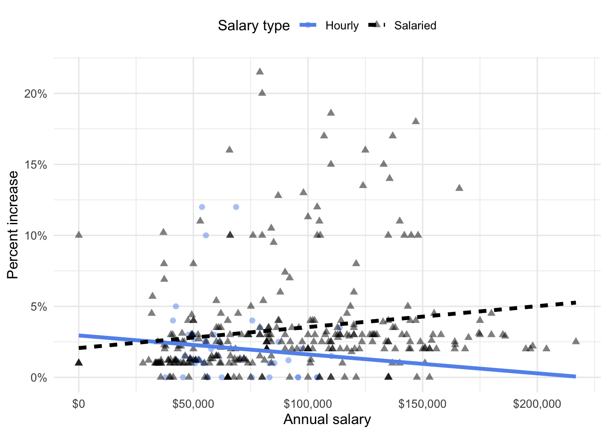
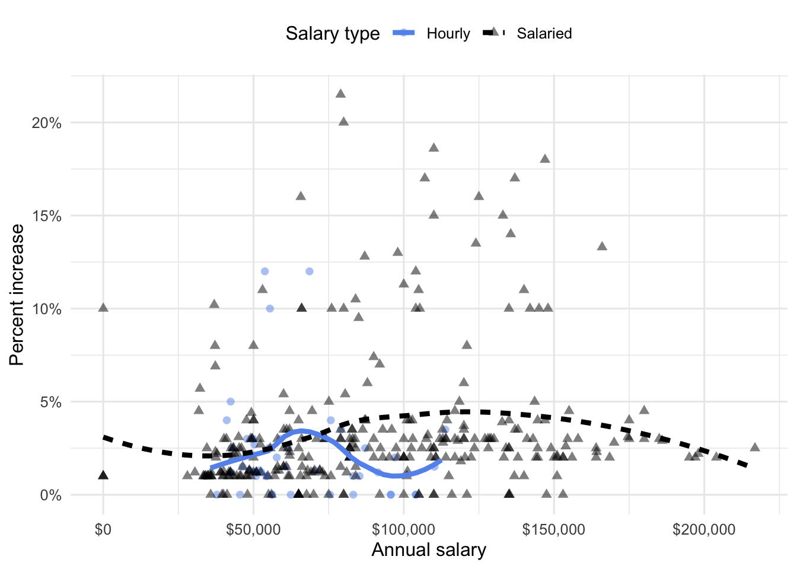
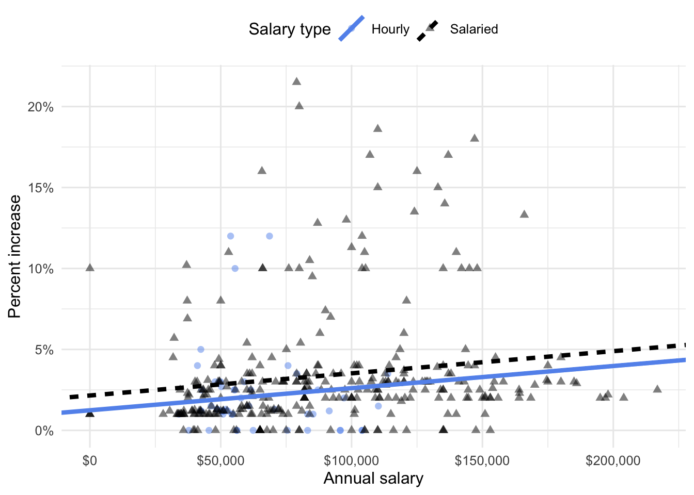
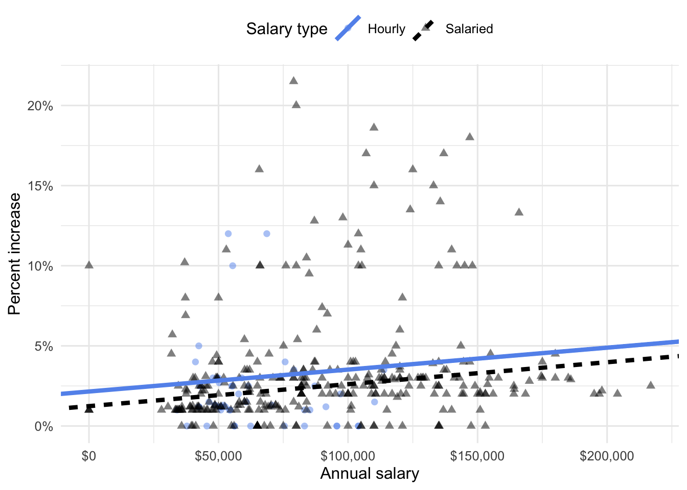
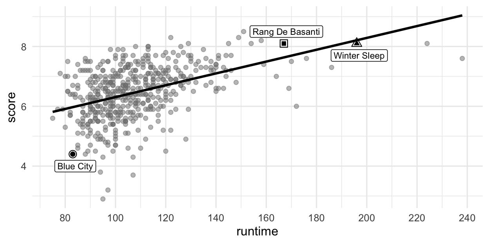
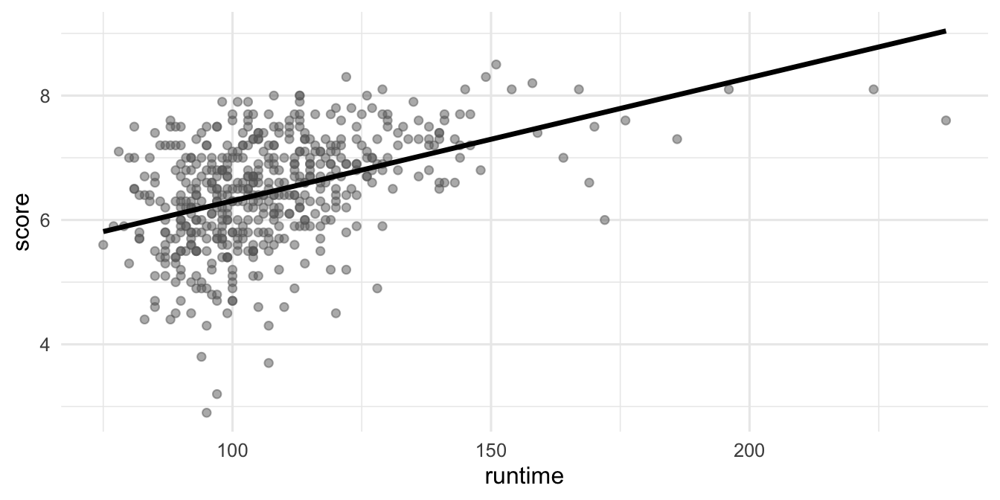
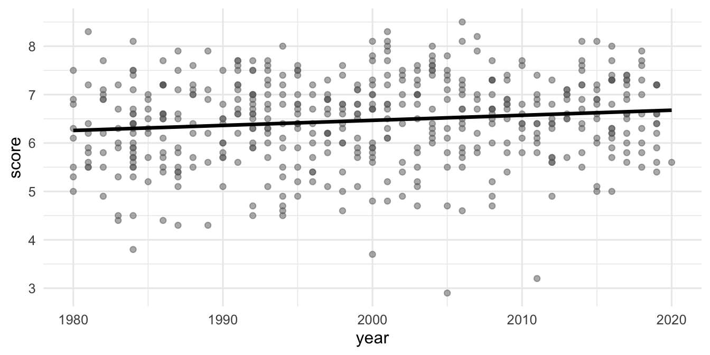
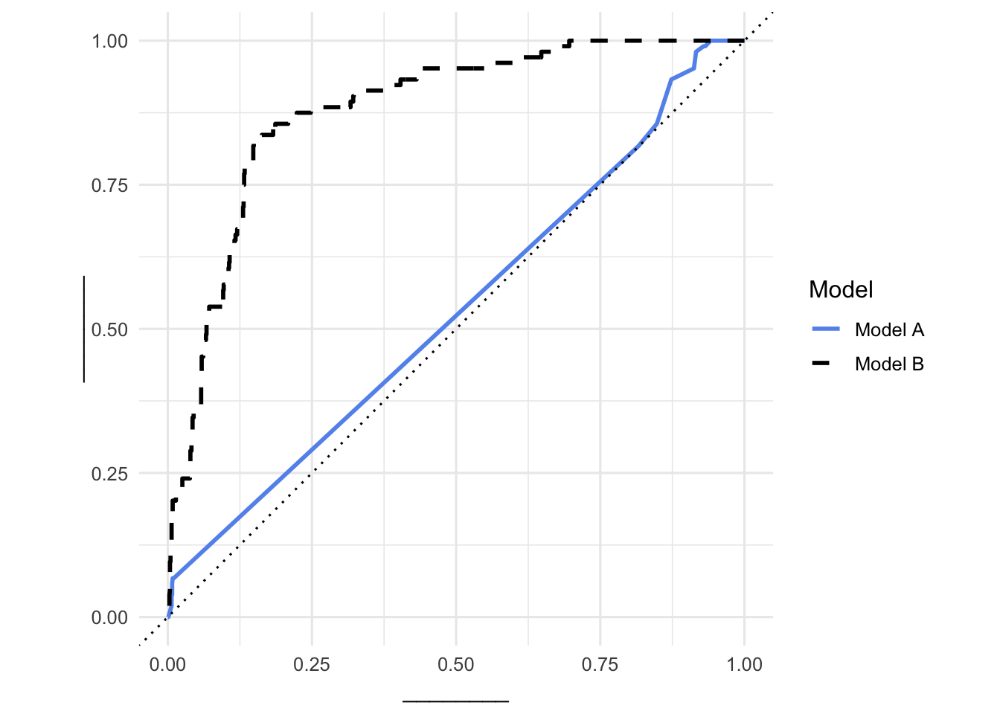

# Exam 2 review

Questions

> **NOTE:**
>
> Suggested answers can be found [here](../exam-review/exam-2-review-A.llms.md), but resist the urge to peek before you go through it yourself.

# Blizzard salaries

In 2020, employees of Blizzard Entertainment circulated a spreadsheet to anonymously share salaries and recent pay increases amidst rising tension in the video game industry over wage disparities and executive compensation. (Source: [Blizzard Workers Share Salaries in Revolt Over Pay](https://www.bloomberg.com/news/articles/2020-08-03/blizzard-workers-share-salaries-in-revolt-over-wage-disparities))

The name of the data frame used for this analysis is `blizzard_salary` and the variables are:

- `percent_incr`: Raise given in July 2020, as percent increase with values ranging from 0 (no increase) to 21.5 (21.5% increase)

- `salary_type`: Type of salary, with levels `Hourly` and `Salaried`

- `annual_salary`: Annual salary, in USD, with values ranging from \$1 to \$216,856.

- `performance_rating`: Most recent review performance rating, with levels `Poor`, `Successful`, `High`, and `Top`. The `Poor` level is the lowest rating and the `Top` level is the highest rating.

The first ten rows of `blizzard_salary` are shown below:

    # A tibble: 409 × 4
       percent_incr salary_type annual_salary performance_rating
              <dbl> <chr>               <dbl> <chr>             
     1          1   Salaried               1  High              
     2          1   Salaried               1  Successful        
     3          1   Salaried               1  High              
     4          1   Hourly             33987. Successful        
     5         NA   Hourly             34798. High              
     6         NA   Hourly             35360  <NA>              
     7         NA   Hourly             37440  <NA>              
     8          0   Hourly             37814. <NA>              
     9          4   Hourly             41101. Top               
    10          1.2 Hourly             42328  <NA>              
    # ℹ 399 more rows

## Question 1

You fit a model for predicting raises (`percent_incr`) from salaries (`annual_salary`). We’ll call this model `raise_1_fit`. A tidy output of the model is shown below.

    # A tibble: 2 × 5
      term           estimate  std.error statistic   p.value
      <chr>             <dbl>      <dbl>     <dbl>     <dbl>
    1 (Intercept)   1.87      0.432           4.33 0.0000194
    2 annual_salary 0.0000155 0.00000452      3.43 0.000669 

Which of the following is the best interpretation of the slope coefficient?

1.  For every additional \$1,000 of annual salary, the model predicts the raise to be higher, on average, by 1.55%.

2.  For every additional \$1,000 of annual salary, the raise goes up by 0.0155%.

3.  For every additional \$1,000 of annual salary, the model predicts the raise to be higher, on average, by 0.0155%.

4.  For every additional \$1,000 of annual salary, the model predicts the raise to be higher, on average, by 1.87%.

## Question 2

You then fit a model for predicting raises (`percent_incr`) from salaries (`annual_salary`) and performance ratings (`performance_rating`). We’ll call this model `raise_2_fit`. Which of the following is definitely true based on the information you have so far?

1.  Intercept of `raise_2_fit` is higher than intercept of `raise_1_fit`.

2.  Slope of `raise_2_fit` is higher than RMSE of `raise_1_fit`.

3.  Adjusted \\R^2\\ of `raise_2_fit` is higher than adjusted \\R^2\\ of `raise_1_fit`.

4.  \\R^2\\ of `raise_2_fit` is higher than \\R^2\\ of `raise_1_fit`.

## Question 3

The tidy model output for the `raise_2_fit` model you fit is shown below.

    # A tibble: 5 × 5
      term                            estimate  std.error statistic  p.value
      <chr>                              <dbl>      <dbl>     <dbl>    <dbl>
    1 (Intercept)                   3.55       0.508           6.99 1.99e-11
    2 annual_salary                 0.00000989 0.00000436      2.27 2.42e- 2
    3 performance_ratingPoor       -4.06       1.42           -2.86 4.58e- 3
    4 performance_ratingSuccessful -2.40       0.397          -6.05 4.68e- 9
    5 performance_ratingTop         2.99       0.715           4.18 3.92e- 5

When your teammate sees this model output, they remark:

> “The coefficient for `performance_ratingSuccessful` is negative. That’s weird. I guess it means that people who get successful performance ratings get lower raises.”

How would you respond to your teammate?

## Question 4

Ultimately, your teammate decides they don’t like the negative slope coefficients in the model output you created (not that there’s anything wrong with negative slope coefficients!), does something else, and comes up with the following model output.

    # A tibble: 5 × 5
      term                            estimate  std.error statistic    p.value
      <chr>                              <dbl>      <dbl>     <dbl>      <dbl>
    1 (Intercept)                  -0.511      1.47          -0.347 0.729     
    2 annual_salary                 0.00000989 0.00000436     2.27  0.0242    
    3 performance_ratingSuccessful  1.66       1.42           1.17  0.242     
    4 performance_ratingHigh        4.06       1.42           2.86  0.00458   
    5 performance_ratingTop         7.05       1.53           4.60  0.00000644

Unfortunately, they didn’t write their code in a Quarto document; instead, they just wrote some code in the Console and then lost track of their work. They remember using the `fct_relevel()` function and doing something like the following:

``` r
blizzard_salary <- blizzard_salary |>
  mutate(performance_rating = fct_relevel(performance_rating, ___))
```

What should they put in the blank to get the same model output as above?

1.  “Poor”, “Successful”, “High”, “Top”
2.  “Successful”, “High”, “Top”
3.  “Top”, “High”, “Successful”, “Poor”
4.  Poor, Successful, High, Top

## Question 5

Suppose we fit a model to predict `percent_incr` from `annual_salary` and `salary_type`. A tidy output of the model is shown below.

    # A tibble: 3 × 5
      term                 estimate  std.error statistic p.value
      <chr>                   <dbl>      <dbl>     <dbl>   <dbl>
    1 (Intercept)         1.24      0.570           2.18 0.0300 
    2 annual_salary       0.0000137 0.00000464      2.96 0.00329
    3 salary_typeSalaried 0.913     0.544           1.68 0.0938 

Which of the following visualizations represents this model? Explain your reasoning.

[](exam-2-review_files/figure-html/fig-raise-salary-type-1.png "Figure 1 (a): Option 1")

\(a\) Option 1

[](exam-2-review_files/figure-html/fig-raise-salary-type-2.png "Figure 1 (b): Option 2")

\(b\) Option 2

[](exam-2-review_files/figure-html/fig-raise-salary-type-3.png "Figure 1 (c): Option 3")

\(c\) Option 3

[](exam-2-review_files/figure-html/fig-raise-salary-type-4.png "Figure 1 (d): Option 4")

\(d\) Option 4

Figure 1: Visualizations of the relationship between percent increase, annual salary, and salary type

## Question 6

Suppose you now fit a model to predict the natural log of percent increase, `log(percent_incr)`, from performance rating. The model is called `raise_4_fit`.

You’re provided the following:

``` downlit
tidy(raise_4_fit) |>
  select(term, estimate) |>
  mutate(exp_estimate = exp(estimate))
```

    # A tibble: 4 × 3
      term                         estimate exp_estimate
      <chr>                           <dbl>        <dbl>
    1 (Intercept)                     -7.15     0.000786
    2 performance_ratingSuccessful     6.93  1025.      
    3 performance_ratingHigh           8.17  3534.      
    4 performance_ratingTop            8.91  7438.      

Based on this, which of the following is true?

a\. The model predicts that the percentage increase employees with Successful performance get, on average, is higher by 10.25% compared to the employees with Poor performance rating.

b\. The model predicts that the percentage increase employees with Successful performance get, on average, is higher by 6.93% compared to the employees with Poor performance rating.

c\. The model predicts that the percentage increase employees with Successful performance get, on average, is higher by a factor of 1025 compared to the employees with Poor performance rating.

d\. The model predicts that the percentage increase employees with Successful performance get, on average, is higher by a factor of 6.93 compared to the employees with Poor performance rating.

## Question 7

Go back to the model `raise_1_fit` from Question 1, which predicts raises (`percent_incr`) from salaries (`annual_salary`). Interpret the intercept in the context of the data.

# Movies

The data for this part come from the Internet Movie Database (IMDB). Specifically, the data are a random sample of movies released between 1980 and 2020.

The name of the data frame used for this analysis is `movies`, and it contains the variables shown in [Table 1](#tbl-data-dictionary).

| Variable | Description |
|----|----|
| `name` | name of the movie |
| `rating` | rating of the movie (R, PG, etc.) |
| `genre` | main genre of the movie |
| `runtime` | duration of the movie |
| `year` | year of release |
| `release_date` | release date (YYYY-MM-DD) |
| `release_country` | release country |
| `score` | IMDB user rating |
| `votes` | number of user votes |
| `director` | the director |
| `writer` | writer of the movie |
| `star` | main actor/actress |
| `country` | country of origin |
| `budget` | the budget of a movie (some movies don’t have this, so it appears as 0) |
| `gross` | revenue of the movie |
| `company` | the production company |

Table 1: Data dictionary for `movies`

The first thirty rows of the `movies` data frame are shown in [Table 2](#tbl-data), with variable types suppressed.

First 30 rows of `movies`, with variable types suppressed.

    # A tibble: 500 × 16
       name           score runtime genre     rating    release_country release_date
     1 Blue City        4.4 83 mins Action    R         United States   1986-05-02  
     2 Winter Sleep     8.1 196     Drama     Not Rated Turkey          2014-06-12  
     3 Rang De Basan…   8.1 167     Comedy    Not Rated United States   2006-01-26  
     4 Pokémon Detec…   6.6 104     Action    PG        United States   2019-05-10  
     5 A Bad Moms Ch…   5.6 104     Comedy    R         United States   2017-11-01  
     6 Replicas         5.5 107     Drama     PG-13     United States   2019-01-11  
     7 Windy City       5.8 103     Drama     R         Uruguay         1986-01-01  
     8 War for the P…   7.4 140     Action    PG-13     United States   2017-07-14  
     9 Tales from th…   6.4 98      Crime     R         United States   1995-05-24  
    10 Fire with Fire   6.5 103     Drama     PG-13     United States   1986-05-09  
    11 Raising Helen    6   119     Comedy    PG-13     United States   2004-05-28  
    12 Feeling Minne…   5.4 99      Comedy    R         United States   1996-09-13  
    13 The Babe         5.9 115     Biography PG        United States   1992-04-17  
    14 The Real Blon…   6   105     Comedy    R         United States   1998-02-27  
    15 To vlemma tou…   7.6 176     Drama     Not Rated United States   1997-11-01  
    16 Going the Dis…   6.3 102     Comedy    R         United States   2010-09-03  
    17 Jung on zo       6.8 103     Action    R         Hong Kong       1993-06-24  
    18 Rita, Sue and…   6.5 93      Comedy    R         United Kingdom  1987-05-29  
    19 Phone Booth      7   81      Crime     R         United States   2003-04-04  
    20 Happy Death D…   6.6 96      Comedy    PG-13     United States   2017-10-13  
    21 Barely Legal     4.7 90      Comedy    R         Thailand        2006-05-25  
    22 Three Kings      7.1 114     Action    R         United States   1999-10-01  
    23 Menace II Soc…   7.5 97      Crime     R         United States   1993-05-26  
    24 Four Rooms       6.8 98      Comedy    R         United States   1995-12-25  
    25 Quartet          6.8 98      Comedy    PG-13     United States   2013-03-01  
    26 Tape             7.2 86      Drama     R         Denmark         2002-07-12  
    27 Marked for De…   6   93      Action    R         United States   1990-10-05  
    28 Congo            5.2 109     Action    PG-13     United States   1995-06-09  
    29 Stop-Loss        6.4 112     Drama     R         United States   2008-03-28  
    30 Con Air          6.9 115     Action    R         United States   1997-06-06  
    # ℹ 470 more rows
    # ℹ 9 more variables: budget, gross, votes, year,
    #   director, writer, star, company, country

Table 2

## Score vs. runtime

In this part, we fit a model predicting `score` from `runtime` and name it `score_runtime_fit`.

``` downlit
score_runtime_fit <- linear_reg() |>
  fit(score ~ runtime, data = movies)
```

[Figure 2](#fig-score-runtime) visualizes the relationship between `score` and `runtime` as well as the linear model for predicting `score` from `runtime`. The first three movies in [Table 2](#tbl-data) are labeled in the visualization as well. Answer all questions in this part based on [Figure 2](#fig-score-runtime).

[](exam-2-review_files/figure-html/fig-score-runtime-1.png "Figure 2: Scatterplot of score vs. runtime for movies.")

Figure 2: Scatterplot of `score` vs. `runtime` for `movies`.

### Question 8

Partial code for producing [Figure 2](#fig-score-runtime) is given below. Which of the following goes in the blank on Line 2?

``` numberSource
movies |>
  mutate(runtime = ___) |>
  ggplot(aes(x = runtime, y = score)) +
  geom_point(alpha = 0.5) +
  geom_smooth(method = "lm", se = FALSE)
# additional code for annotating the labeled movies on the plot
```

1.  `grepl(" mins", runtime)`

2.  `grep(" mins", runtime)`

3.  `str_remove(runtime, " mins")`

4.  `as.numeric(str_remove(runtime, " mins"))`

5.  `na.rm(runtime)`

### Question 9

Based on this model, order the three labeled movies in [Figure 2](#fig-score-runtime) in decreasing order of the magnitude (absolute value) of their residuals.

1.  Winter Sleep \> Rang De Basanti \> Blue City

2.  Winter Sleep \> Blue City \> Rang De Basanti

3.  Rang De Basanti \> Winter Sleep \> Blue City

4.  Blue City \> Winter Sleep \> Rang De Basanti

5.  Blue City \> Rang De Basanti \> Winter Sleep

### Question 10

The R-squared for the model visualized in [Figure 2](#fig-score-runtime) is 19%. Which of the following is the ***best*** interpretation of this value?

1.  19% of the variability in movie runtimes is explained by their scores.

2.  19% of the variability in movie scores is explained by their runtimes.

3.  The model accurately predicts scores of 19% of the movies in this sample.

4.  The model accurately predicts scores of 19% of all movies.

5.  The correlation between scores and runtimes of movies is 0.19.

## Score vs. runtime or year

The visualizations below show the relationship between `score` and `runtime` as well as `score` and `year`, respectively. Additionally, the lines of best fit are overlaid on the visualizations.

[](exam-2-review_files/figure-html/unnamed-chunk-12-1.png)

[](exam-2-review_files/figure-html/unnamed-chunk-12-2.png)

The correlation coefficients of these relationships are calculated below, though some of the code and the output are missing. Answer all questions in this part based on the code and output shown below.

``` r
movies |>
  __blank_1__(
    r_score_runtime = cor(runtime, score),
    r_score_year = cor(year, score)
  )
```

    # A tibble: 1 × 2
      r_score_runtime r_score_year
                <dbl>        <dbl>
    1           0.434 __blank_2__       

### Question 11

Which of the following goes in `__blank_1__`?

1.  `summarize`

2.  `mutate`

3.  `group_by`

4.  `arrange`

5.  `filter`

### Question 12

What can we say about the value that goes in `__blank_2__`?

1.  `NA`

2.  A value between 0 and 0.434.

3.  A value between 0.434 and 1.

4.  A value between 0 and -0.434.

5.  A value between -1 and -0.434.

## Score vs. runtime and rating

In this part, we fit a model predicting `score` from `runtime` and `rating` (categorized as G, PG, PG-13, R, NC-17, and Not Rated), and name it `score_runtime_rating_fit`.

The model output for `score_runtime_rating_fit` is shown in [Table 3](#tbl-score-runtime-rating-tidy). Answer all questions in this part based on [Table 3](#tbl-score-runtime-rating-tidy).

| term            | estimate | std.error | statistic | p.value |
|:----------------|---------:|----------:|----------:|--------:|
| (Intercept)     |    4.525 |     0.332 |    13.647 |   0.000 |
| runtime         |    0.021 |     0.002 |    10.702 |   0.000 |
| ratingPG        |   -0.189 |     0.295 |    -0.642 |   0.521 |
| ratingPG-13     |   -0.452 |     0.292 |    -1.547 |   0.123 |
| ratingR         |   -0.257 |     0.285 |    -0.901 |   0.368 |
| ratingNC-17     |   -0.355 |     0.486 |    -0.730 |   0.466 |
| ratingNot Rated |   -0.282 |     0.328 |    -0.860 |   0.390 |

Table 3: Regression output for `score_runtime_rating_fit`.

### Question 13

Which of the following is ***TRUE*** about the intercept of `score_runtime_rating_fit`? **Select all that are true.**

1.  Keeping runtime constant, G-rated movies are predicted to score, on average, 4.525 points.

2.  Keeping runtime constant, movies without a rating are predicted to score, on average, 4.525 points.

3.  Movies without a rating that are 0 minutes in length are predicted to score, on average, 4.525 points.

4.  All else held constant, movies that are 0 minutes in length are predicted to score, on average, 4.525 points.

5.  G-rated movies that are 0 minutes in length are predicted to score, on average, 4.525 points.

### Question 14

Which of the following is the ***best*** interpretation of the slope of `runtime` in `score_runtime_rating_fit`?

1.  All else held constant, as runtime increases by 1 minute, the score of the movie increases by 0.021 points.

2.  For G-rated movies, all else held constant, as runtime increases by 1 minute, the score of the movie increases by 0.021 points.

3.  All else held constant, for each additional minute of runtime, movie scores will be higher by 0.021 points on average.

4.  G-rated movies that are 0 minutes in length are predicted to score 0.021 points on average.

5.  For each higher level of rating, the movie scores go up by 0.021 points on average.

### Question 15

Fill in the blank:

> R-squared for `score_runtime_rating_fit` (the model predicting `score` from `runtime` and `rating`) \_\_\_\_\_\_\_\_\_ the R-squared of the model `score_runtime_fit` (for predicting `score` from `runtime` alone).

1.  is less than

2.  is equal to

3.  is greater than

4.  cannot be compared (based on the information provided) to

5.  is both greater than and less than

### Question 16

The model `score_runtime_rating_fit` (the model predicting `score` from `runtime` and `rating`) can be visualized as parallel lines for each level of `rating`. Which of the following is the equation of the line for R-rated movies?

1.  \\\widehat{score} = (4.525 - 0.257) + 0.021 \times runtime\\

2.  \\score = (4.525 - 0.257) + 0.021 \times runtime\\

3.  \\\widehat{score} = 4.525 + (0.021 - 0.257) \times runtime\\

4.  \\score = 4.525 + (0.021 - 0.257) \times runtime\\

5.  \\\widehat{score} = (4.525 + 0.021) - 0.257 \times runtime\\

### Question 17

Answer the following based on [Table 3](#tbl-score-runtime-rating-tidy).

1.  Interpret the coefficient for `ratingR` in the context of the data.

2.  The R-squared of `score_runtime_fit` (predicting `score` from `runtime` alone) is 0.188 and the R-squared of `score_runtime_rating_fit` (predicting `score` from `runtime` and `rating`) is 0.2. The adjusted R-squared values of these models are 0.187 and 0.191, respectively. Your friend says, “R-squared went up when we added `rating`, so `rating` must be a useful predictor of score.” Which statistic should be used to compare these two models? Based on that statistic, which model would you choose, and why?

# Building a spam filter

The data come from incoming emails in David Diez’s (one of the authors of the OpenIntro textbooks) Gmail account for the first three months of 2012. All personally identifiable information has been removed. The dataset is called `email` and it’s in the **openintro** package.

The outcome variable is `spam`, which takes the value `1` if the email is spam, `0` otherwise.

The data are split into training and testing sets.

``` downlit
set.seed(1234)
email_split <- initial_split(email, prop = 0.7)
email_training <- training(email_split)
email_testing <- testing(email_split)
```

## Question 18

What percent of the emails are in the training set and what percent are in the testing set?

1.  Training: 50%, Testing: 50%

2.  Training: 70%, Testing: 30%

3.  Training: 75%, Testing: 25%

4.  Training: 30%, Testing: 70%

5.  Training: 80%, Testing: 20%

## Question 19

A model is fit predicting `spam` from `dollar`, `winner` (indicating whether “winner” appeared in the email: `"no"` or `"yes"`), and `urgent_subj` (whether the word “urgent” is in the subject of the email: `0` or `1`). We will call this model Model A (`email_fit_A`). The output of this model is shown below.

``` downlit
email_fit_A <- logistic_reg() |>
    fit(spam ~ dollar + winner + urgent_subj, data = email_training)

tidy(email_fit_A)
```

    # A tibble: 4 × 5
      term         estimate std.error statistic   p.value
      <chr>           <dbl>     <dbl>     <dbl>     <dbl>
    1 (Intercept)   -2.24      0.0688    -32.5  2.87e-232
    2 dollar        -0.0597    0.0223     -2.68 7.46e-  3
    3 winneryes      1.63      0.348       4.68 2.80e-  6
    4 urgent_subj1   2.99      0.869       3.44 5.76e-  4

Interpret the coefficients of the model.

## Question 20

Emails in the testing set are used to evaluate the performance of the model.

``` downlit
email_aug_A <- augment(email_fit_A, new_data = email_testing)
```

Then, the following pipeline is run:

``` downlit
email_aug_A |>
    group_by(spam) |>
    count(.pred_class)
```

    # A tibble: 3 × 3
    # Groups:   spam [2]
      spam  .pred_class     n
      <fct> <fct>       <int>
    1 0     0            1072
    2 0     1               1
    3 1     0             104

Describe what each line of the pipeline does and what the pipeline computes.

## Question 21

There are four possible combinations of actual (`spam`) and predicted (`.pred_class`) classes, but the output of the pipeline in the previous question has only three rows. Which combination is missing, and why?

## Question 22

Based on the output of the pipeline in Question 20, show how you would calculate the false positive and false negative rates. You do not actually have to calculate the final numeric values, but you should show the formulas for how to compute them.

## Question 23

Another model is fit predicting `spam` from all variables in the dataset except `time` (the date and time the email was sent). We will call this model Model B (`email_fit_B`).

``` downlit
# fmt: skip
email_fit_B <- logistic_reg() |>
    fit(
        spam ~ to_multiple + from + cc + sent_email + image + attach + dollar + winner + inherit + viagra + password + num_char + line_breaks + format + re_subj + exclaim_subj + urgent_subj + exclaim_mess + number,
        data = email_training
    )
```

Once again, this model is used to make predictions for the testing dataset.

``` downlit
email_aug_B <- augment(email_fit_B, new_data = email_testing)
```

Shown below are the ROC curves for Model A and Model B.

[](exam-2-review_files/figure-html/unnamed-chunk-23-1.png)

1.  Fill in the labels for the x and y axes in the ROC curve plot.

2.  What does the diagonal dotted line in the ROC curve plot represent?

3.  Based on the ROC curves, which model appears to have better classification ability? Justify your answer.

# Web scraping

In this part, we revisit the work we did scraping opinion articles from The Chronicle.

## Question 24

Below is a simplified version of the HTML source code for one article listing on The Chronicle’s opinion page.

``` html
<div class="article-listing">
  <a class="title" href="/article/2026/09/duke-opinion-on-dining">On dining at Duke</a>
  <span class="byline">By Jane Doe</span>
</div>
```

Suppose this HTML has been read into R with `read_html()` and saved as `page`. Which of the following returns the URL of the article, i.e., `"/article/2026/09/duke-opinion-on-dining"`?

1.  `page |> html_elements(".title") |> html_text()`

2.  `page |> html_elements(".title") |> html_attr("href")`

3.  `page |> html_elements(".title") |> html_elements("href")`

4.  `page |> html_elements(".title") |> html_attrs()`

5.  `page |> html_elements("href") |> html_text()`

## Question 25

You have a data frame called `chronicle` with 500 rows, one for each opinion article, and a column called `url` containing the URL of each article. You also have the following function, which takes the URL of a single article and returns the text of that article as a single character string.

``` downlit
scrape_article <- function(url) {
  article_page <- read_html(url)
  html_element(article_page, ".article-content") |>
    html_text2() |>
    str_remove_all("\n\n")
}
```

Which of the following adds a character column called `article_content` to `chronicle` with the text of each of the 500 articles?

1.  `chronicle |> mutate(article_content = scrape_article(url))`

2.  `chronicle |> mutate(article_content = map_chr(url, scrape_article))`

3.  `chronicle |> mutate(article_content = map_chr(scrape_article, url))`

4.  `chronicle |> summarize(article_content = map_chr(url, scrape_article))`

5.  `chronicle |> mutate(article_content = map(url, scrape_article))`

# Miscellaneous

## Question 26

Which of the following is the definition of a regression model? Select all that apply.

a\. \\\hat{y} = b_0 + b_1 X_1\\

b\. \\y = \beta_0 + \beta_1 X_1\\

c\. \\\hat{y} = \beta_0 + \beta_1 X_1 + \epsilon\\

d\. \\y = \beta_0 + \beta_1 X_1 + \epsilon\\

## Question 27

Define the term “parsimonious model”.
