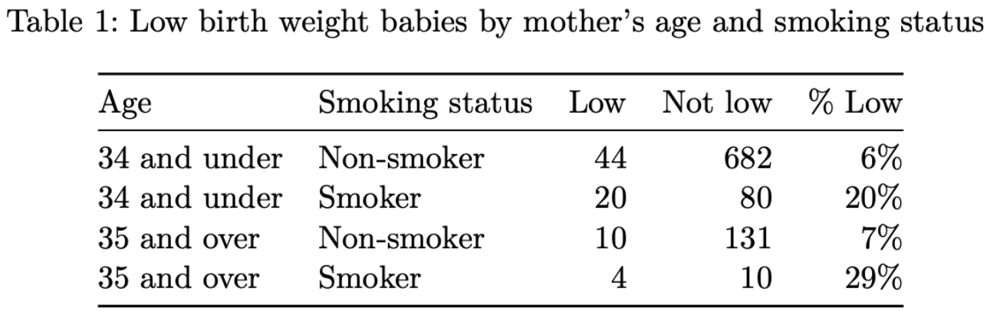

# Introduction

In this homework, you will use simulation-based inference to study birth outcomes and lemur weights.
You will begin by preparing and exploring birth records, evaluating a potentially misleading visualization, and using bootstrapping to quantify uncertainty in regression slopes.
Next, you will use a randomization test and a bootstrap confidence interval to conduct inference for the slope of a model relating lemur weight to age.

## Learning objectives

By the end of this homework, you will:

- prepare data by handling missing values and recoding categorical variables;
- create and critically evaluate tables and visualizations of conditional distributions;
- use bootstrap confidence intervals to conduct inference for slopes in regression models with one or more predictors;
- conduct and interpret a simulation-based hypothesis test for a regression slope; and
- construct and interpret bootstrap confidence intervals and connect them to hypothesis tests.

## Guidelines

By now you should be familiar with guidelines for homework assignments.
If not, please refer to an earlier homework assignment for details.

## AI support and feedback



# Packages

You will use the [**tidyverse**](https://www.tidyverse.org/packages), [**tidymodels**](https://www.tidymodels.org/), and [**knitr**](https://yihui.org/knitr/) packages for this homework, at a minimum.

```{r}
#| message: false
library(tidyverse)
library(tidymodels)
library(knitr)
```

# Part 1 - Babies

Every year, the US releases to the public a large dataset containing information on births recorded in the country.
This dataset has been of interest to medical researchers who are studying the relation between habits and practices of expectant mothers and the birth of their children.[^1]
This is a random sample of 1,000 cases from the dataset released in 2014.

[^1]: United States Department of Health and Human Services.
    Centers for Disease Control and Prevention.
    National Center for Health Statistics.
    Natality Detail File, 2014 United States.
    Inter-university Consortium for Political and Social Research, 2016-10-07.
    doi:10.3886/ICPSR36461.v1.

The data are available in your `data` folder in `births14.csv`.
Questions 1-8 use these data.

The variables in the data are as follows:

-   `fage`: Father's age in years.
-   `mage`: Mother's age in years.
-   `mature`: Maturity status of mother.
-   `weeks`: Length of pregnancy in weeks.
-   `premie`: Whether the birth was classified as premature (premie) or full-term.
-   `visits`: Number of hospital visits during pregnancy.
-   `gained`: Weight gained by mother during pregnancy in pounds.
-   `weight`: Weight of the baby at birth in pounds.
-   `lowbirthweight`: Whether baby was classified as low birthweight (low) or not (⁠not low⁠).
-   `sex`: Sex of the baby, female or male.
-   `habit`: Status of the mother as a nonsmoker or a smoker.
-   `marital`: Whether mother is married or ⁠not married⁠ at birth.
-   `whitemom`: Whether mom is white or ⁠not white⁠.

## Question 1

In this question you start exploring the data to make decisions about how to prepare it for the analysis.

First, read the data in and store it as `births14_raw`.

Then, in a single pipeline, filter for any rows of the `births14_raw` data frame where one or more of the following variables has an `NA` value: `mage`, `weight`, `habit`, `mature`, `lowbirthweight`, then select only these five variables to display.

## Question 2

In this question you start your data prep.

In a single pipeline, remove any rows of the `births14_raw` data frame with `NA` values among those you identified as having `NA` values in the previous question, and save the results as `births14`.

Then, find and state the numbers of rows and columns of `births14`.

::: callout-tip
You should end up with 981 rows.
If you do not, revisit your earlier work to make sure you have removed all rows with `NA` values in any of the specified columns.
:::

## Question 3

This question walks you through an exploration of a threshold used when the data set was put together.

One of the variables in the data is `mature`, indicating whether the mom is considered "mature" or "younger".
This categorization is based on a medical threshold used for pregnancies.
Using the data alone (not medical knowledge or external resources), determine the threshold age used to categorize moms as "mature" vs. "younger".
Describe your process, include any evidence (summary statistics and/or visualization), and clearly state the threshold you determined.

## Question 4

This question walks you through an exploration of another threshold used when the data set was put together.

Another variable in the data is `lowbirthweight`, indicating whether the baby's weight is considered "low" or "not low" at birth.
This categorization is based on a medical threshold used for births.
Using the data alone (not medical knowledge or external resources), determine the threshold weight used to categorize baby weights as "low" vs. "not low".
Describe your process, include any evidence (summary statistics and/or visualization), and clearly state the threshold you determined.

::: source-control
Preview, commit, and push your changes to GitHub with an informative and concise commit message.
:::

## Question 5

In this question you finish up your data prep for the remaining steps of the analysis.

In a single pipeline, recode the variables `mature`, `habit`, and `lowbirthweight` in the `births14` data frame as follows:

-   `mature` : "mature mom" → "35 and over", "younger mom" → "34 and under"
-   `habit` : "smoker" → "Smoker", "nonsmoker" → "Non-smoker"
-   `lowbirthweight` : "low" → "Low", "not low" → "Not low"

In that same pipeline, relocate these three variables to be the first three columns of the data frame.

Save the result back to `births14` and display the first 10 rows (and however many columns fit across the page) of `births14`.

## Question 6

This question explores low birth weight prevalence.

Your fellow researchers are interested in exploring how the baby weight at birth varies by characteristics of the mother.

a.  One researcher in your group made a summary table that shows the number of low birth weight babies for every possible combination of mother's `mature` and `habit` status. The table is shown below. Recreate this table in a single pipeline. Make sure to get the caption, table number, and column names exactly right.

    {width="80%"}

b.  Another researcher in the group made the barplot below that shows the distribution of low birth weight babies conditional on mother's age and smoking status. Recreate this visualization, paying attention to all details, including figure width and aspect ratio (which you don't need to get exactly right, but you should strive to get close).

    {width="80%"}

c.  Refer back to the visualization you recreated in part (b), in light of the numbers in the table you recreated in part (a).
    What is misleading about the visualization?
    Explain in 1-2 sentences.

d.  Update the visualization to correct the issue you identified in part (c).
    Briefly explain what you did to fix the issue and what the new visualization shows.
    Note that there are a few ways you can address the issue, but you should select the best option.

## Question 7

In this question you will conduct inference for a slope in a model with a single predictor.

a.  Fit a model for predicting baby weight (`weight`) from mother's age category (`mature`).
    Display the tidy model output.

b.  Construct a 95% confidence interval for the slope of the model from part (a), using bootstrapping with 1,000 resamples and the percentile method.
    Set a seed before generating your bootstrap resamples.
    Display the bounds of the interval and interpret it in the context of the data and the research question.

c.  Visualize the bootstrap distribution you used to construct the confidence interval.
    Comment on its shape and center.

d.  Based on your interval from part (b), do these data provide convincing evidence of a discernible difference between the average weights of babies born to mothers who are 35 years and older vs. those born to mothers who are 34 years and younger?
    Explain your reasoning.
    Note: You do not need to conduct a hypothesis test to answer this question, justify your answer with your confidence interval only.

## Question 8

In this question you will conduct inference for slopes in a model with two predictors.

a.  Fit a model for predicting baby weight (`weight`) from mother's age (`mage`) and smoking status (`habit`).
    Display the tidy model output.

b.  Construct 95% confidence intervals for the slopes of the model from part (a), using bootstrapping with 1,000 resamples and the percentile method.
    Set a seed before generating your bootstrap resamples.
    Display the bounds of the intervals and interpret them in the context of the data and the research question.

c.  Visualize the bootstrap distributions you used to construct the confidence intervals.
    Comment on their shapes and centers.

::: openai
Get feedback from AI if you haven't already!
Just launch Codex in Positron and ask it to review your answer for any question(s) you haven't yet reviewed.
Revise your answers based on the feedback before moving on.
:::

::: source-control
Preview, commit, and push your changes to GitHub with an informative and concise commit message.
:::

# Part 2 - Lemurs

In Part 1, you used bootstrap confidence intervals to conduct inference for regression coefficients.
Here, you will compare a randomization test with a bootstrap confidence interval for the slope of a model relating weight to age.

Questions 9 and 10 use data from the Duke Lemur Center, made available through [TidyTuesday](https://github.com/rfordatascience/tidytuesday/blob/main/data/2021/2021-08-24/readme.md).
The homework file contains one weight observation per lemur.
The variables you will use are:

-   `taxon`: Taxonomic code identifying the animal's taxon. The code `"LCAT"` represents ring-tailed lemurs (*Lemur catta*).
-   `dlc_id`: Unique identifier assigned to an animal by the Duke Lemur Center.
-   `weight_g`: The animal's weight, in grams, on the date it was weighed.
-   `age_at_wt_d`: The animal's age, in days, on the date it was weighed, calculated as the weighing date minus its date of birth.

Read `lemurs.csv` from your `data` folder and save it as `lemurs_raw`.
Filter for ring-tailed lemurs (`taxon == "LCAT"`) whose age at weighing was at most 365 days, and save the result as `lemurs`.
Use this filtered data frame for both questions below.
You should have 171 rows, each representing a different lemur.

## Question 9

The goal of this question is to answer the following research question:

> Do these data provide convincing evidence of a linear association between age and weight among ring-tailed lemurs aged at most 365 days?

a.  Create a scatterplot of weight (`weight_g`) versus age at weighing (`age_at_wt_d`) and add a fitted regression line.
    Describe the relationship and comment on whether a linear model appears reasonable.

b.  Fit a model for predicting weight from age at weighing.
    Display the tidy model output and interpret the estimated slope in context, including its units.

c.  State hypotheses about the population slope in the context of the data and the research question.
    Conduct a two-sided randomization test at the 5% discernability level, using the slope as your test statistic.
    Set a seed and use 1,000 permutations (`reps = 1000`) to simulate the randomization distribution under the null hypothesis of independence between age and weight.
    Visualize this distribution and calculate the p-value.

d.  State your decision on the hypotheses and provide a one-sentence conclusion in the context of the data and the research question.

## Question 10

In this question you will construct a confidence interval for the slope of the model from Question 9 and compare the results with your hypothesis test.

a.  Based on your hypothesis test in Question 9, would you expect a 95% confidence interval for the population slope to include 0?
    Explain your reasoning.

b.  Construct a 95% bootstrap confidence interval for the slope using 1,000 resamples (`reps = 1000`) and the percentile method.
    Set a seed before generating your bootstrap resamples and display the bounds of the interval.

c.  Visualize the bootstrap distribution and comment on its shape and center.
    Explain why its center differs from that of the randomization distribution in Question 9.

d.  Interpret the confidence interval in the context of the data and the research question.
    Does it include 0, and does the result align with your hypothesis test?
    Note that a randomization test and a percentile bootstrap confidence interval are not guaranteed to give matching conclusions.

e.  Can you interpret this slope as the average daily weight gain of an individual lemur?
    Explain what the data allow you to conclude, considering that each lemur appears only once in this data frame.

::: openai
This would be a good time to get feedback from AI if you haven't already!
Just launch Codex in Positron and ask it to review your answer for any question(s) you haven't yet reviewed.
Revise your answers based on the feedback before moving on.
:::

# AI use disclosure



# Wrap-up

::: source-control
Before you wrap up the assignment, make sure that you preview, commit, and push one final time so that the final versions of both your `.qmd` file and the rendered PDF are pushed to GitHub, and your source control pane is empty.
We will be checking these to make sure you have been practicing committing and pushing changes.
:::

## Submission



## Grading and feedback

You can get immediate feedback on all of the questions with AI.

Submit your final version of `hw-7.pdf` to Gradescope.
Be sure to select the pages associated with each question.

A subset of the questions will be carefully graded for correctness and quality of explanation by the course instructional team.
You will receive that feedback in about a week.

There are also workflow points for:

- committing at least three times as you work through your homework,
- having your final version of `.qmd` and `.pdf` files in your GitHub repository, and
- overall organization.
