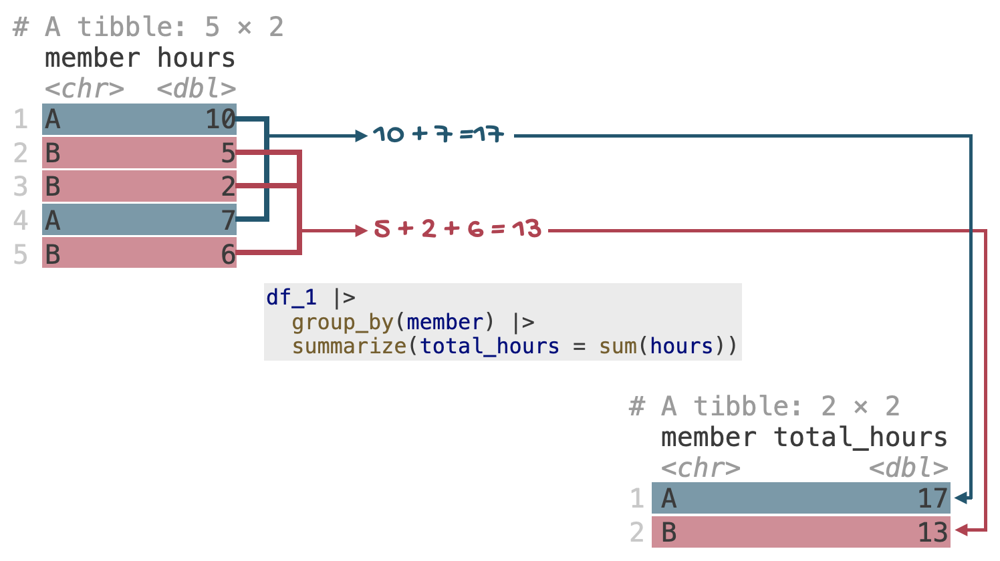

# Lab 2

Get in teams, then [`group_by()`](https://dplyr.tidyverse.org/reference/group_by.html)

Lab

Due: End of lab on Thurs, Sep 10

> **IMPORTANT:**
>
> … and sit with them!

# Introduction

This lab is a deep dive into [`group_by()`](https://dplyr.tidyverse.org/reference/group_by.html)!

Make sure to upload your completed lab to Gradescope **by the end of your lab session** and commit and push your final version to GitHub.

## Learning objectives

By the end of this lab, you will:

- use `dplyr` pipelines to arrange, group, summarize, and transform data;
- group data by one or more variables and calculate summaries within groups;
- explain how grouping affects the number of rows, columns, and groups in a data frame;
- distinguish between [`summarize()`](https://dplyr.tidyverse.org/reference/summarise.html) and [`mutate()`](https://dplyr.tidyverse.org/reference/mutate.html) when working with grouped data; and
- understand how to use `.groups` argument in [`summarize()`](https://dplyr.tidyverse.org/reference/summarise.html) to control the grouping structure of the output.

# Getting started

Clone your **lab-2** repository using the same process used in Lab 0.

1.  Go to the course GitHub organization at [github.com/sta199-f26](https://github.com/sta199-f26) and click on the repository with prefix `lab-2`.
2.  Select the green **Code** button and choose **HTTPS** under **Clone**. Click on the clipboard icon to copy the repo URL.
3.  In Positron’s Welcome window, click on *New Folder From Git…*.
4.  Paste the repository URL into the dialog box labeled *Git repository URL* and select **OK**.
5.  Open `lab-2.qmd` in the Explorer pane.

Then, click *lab-2.qmd* to open the template Quarto file and update the `authors` field to add your name first (first and last) and then your teammates’ names (first and last). Render the document. If you get a popup window error, click “Try again”. Examine the rendered document and make sure your name is updated in the document. Commit and push your changes with a meaningful commit message and push to GitHub.

## Guidelines

### Code

Code should follow the [tidyverse style](https://style.tidyverse.org/). Particularly,

- there should be spaces before and line breaks after each `+` when building a `ggplot`,
- there should also be spaces before and line breaks after each `|>` in a data transformation pipeline,
- code should be properly indented,
- there should be spaces around `=` signs and spaces after commas.

Additionally, all code should be visible in the PDF output, i.e., should not run off the page on the PDF. Long lines that run off the page should be split across multiple lines with line breaks.[^1]

### Plots

- Plots should have an informative title and, if needed, also a subtitle.
- Axes and legends should be labeled with both the variable name and its units (if applicable).
- Careful consideration should be given to aesthetic choices.

### Workflow

Continuing to develop a sound workflow for reproducible data analysis is important as you complete the lab and other assignments in this course.

- You should have at least 3 commits with meaningful commit messages by the end of the assignment.
- Final versions of both your `.qmd` file and the rendered PDF should be pushed to GitHub.

# Packages

In this lab we will work with the **tidyverse** package.

``` downlit
library(tidyverse)
```

- **Run** the code cell by clicking on the green triangle (play) button for the code cell labeled `load-packages`. This loads the package to make its features (the functions and datasets in it) accessible from your *Console*.
- Then, **render** the document, which loads this package to make its features (the functions and datasets in it) available for other code cells in your Quarto document.

# Questions

For each part of each question below, copy and paste the code cell(s) provided into your Quarto document. Run and analyze the output. Then, answer the questions.

## Question 1

**Throwback Thursday**

Review the feedback for your Lab 1 submission on Gradescope and write one sentence about what you learned.

## Question 2

**Grouping by one variable.**

For this question, you will work with the following dataset called `df_1`. The [`tibble()`](https://tibble.tidyverse.org/reference/tibble.html) function creates the data frame (the `tibble` object) `df_1` with two variables: `member` and `hours`. The following code is already included in your lab document.

``` downlit
df_1 <- tibble(
  member = c("A", "B", "B", "A", "B"),
  hours = c(10, 5, 2, 7, 6)
)

df_1
```

1.  What does the following pipeline do? Run it, analyze the result, and articulate in words what [`arrange()`](https://dplyr.tidyverse.org/reference/arrange.html) does.

``` downlit
df_1 |>
  arrange(member)
```

2.  What does the following pipeline do? Run it, analyze the result, and articulate in words what [`group_by()`](https://dplyr.tidyverse.org/reference/group_by.html) does.

``` downlit
df_1 |>
  group_by(member)
```

Preview, commit, and push your changes to GitHub with the commit message “Added answer for Q1, parts a and b”.

Make sure to commit and push all changed files so that your Git pane is empty afterward.

3.  Run the following code cell and analyze the result.
    - How many rows does the output have?
    - How many columns does the output have?
    - Is the output grouped? If so, how many groups does it have?

``` downlit
df_1 |>
  group_by(member) |>
  summarize(total_hours = sum(hours))
```

> **TIP:**
>
> [](images/lab-2/group_by.png "A visual representation of what group_by() does")
>
> A visual representation of what [`group_by()`](https://dplyr.tidyverse.org/reference/group_by.html) does

4.  Run the following code cell and analyze the result.
    - How many rows does the output have?
    - How many columns does the output have?
    - Is the output grouped? If so, how many groups does it have?

``` downlit
df_1 |>
  summarize(total_hours = sum(hours))
```

Preview, commit, and push your changes to GitHub with a meaningful commit message.

## Question 3

**Grouping by two variables.**

For this question, you will work with the following dataset called `df_2`. The [`tibble()`](https://tibble.tidyverse.org/reference/tibble.html) function creates the data frame (the `tibble` object) `df_2` with three variables: `shift`, `member` and `hours`. The following code is already included in your lab document.

``` downlit
df_2 <- tibble(
  shift = c(
    "day",
    "day",
    "night",
    "day",
    "night",
    "day",
    "night",
    "night",
    "day",
    "night"
  ),
  member = c("A", "B", "B", "A", "B", "B", "B", "A", "A", "B"),
  hours = c(10, 5, 2, 7, 6, 5, 4, 2, 3, 5)
)

df_2
```

1.  How many levels does `member` have? How many levels does `shift`have? How many possible combinations are there of the levels of `member` and `shift`?

    > **TIP:**
    > You can use the [`distinct()`](https://dplyr.tidyverse.org/reference/distinct.html) function to identify the levels of a categorical variable.

2.  Run the following code cell and analyze the result.

    - How many rows does the output have?
    - How many columns does the output have?
    - Is the output grouped? If so, how many groups does it have?
    - What does the message mean?

``` downlit
df_2 |>
  group_by(shift, member) |>
  summarize(mean_hours = mean(hours))
```

3.  Run the following code cell and analyze the result.
    - How many rows does the output have?
    - How many columns does the output have?
    - Is the output grouped? If so, how many groups does it have?

``` downlit
df_2 |>
  group_by(shift, member) |>
  summarize(mean_hours = mean(hours), .groups = "drop")
```

4.  In the following code cell, we add one more step to the data pipelines from the previous two parts. The new step uses `slice_head(n = 1)`, which is designed to give the first row of the output. Run each and analyze the result. You will notice the results are different. Why?

``` downlit
# pipeline from part b + slice_head()
df_2 |>
  group_by(shift, member) |>
  summarize(mean_hours = mean(hours)) |>
  slice_head(n = 1)

# pipeline from part c + slice_head()
df_2 |>
  group_by(shift, member) |>
  summarize(mean_hours = mean(hours), .groups = "drop") |>
  slice_head(n = 1)
```

5.  Run the following code cell and analyze the result.
    - How many rows does the output have?
    - How many columns does the output have?
    - Is the output grouped? If so, how many groups does it have?
    - Articulate the difference between [`summarize()`](https://dplyr.tidyverse.org/reference/summarise.html) and [`mutate()`](https://dplyr.tidyverse.org/reference/mutate.html).

``` downlit
df_2 |>
  group_by(shift, member) |>
  mutate(mean_hours = mean(hours)) |>
  arrange(shift, member)
```

Preview, commit, and push your changes to GitHub with a meaningful commit message.

# Wrap-up

## Submission

Submit your PDF document to Gradescope by the end of the lab to be considered “on time”:

- Go to <http://www.gradescope.com> and click *Log in* in the top right corner.
- Click *School Credentials* \\\rightarrow\\ *Duke NetID* and log in using your NetID credentials.
- Click on your *STA 199* course.
- Click on the assignment, and you’ll be prompted to submit it.
- Mark all the pages associated with question. All the pages of your lab should be associated with at least one question (i.e., should be “checked”).

> **IMPORTANT:**
>
> Make sure you have:
>
> - attempted every question;
> - previewed your Quarto document;
> - committed and pushed all final changes to GitHub, ending with no pending or staged changes in the Source Control pane; and
> - submitted your rendered PDF to Gradescope.

## Grading and feedback

This lab is worth 30 points:

- 10 points for attending lab and submitting work by the end of lab; and
- 20 points for correct and complete answers, clear presentation, and following the required workflow.

The workflow portion includes making at least three meaningful commits, pushing the final `.qmd` and rendered PDF to GitHub, and keeping your work organized.

## Footnotes

[^1]: Remember, haikus not novellas when writing code!
