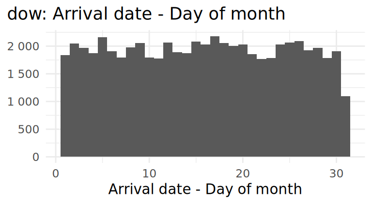
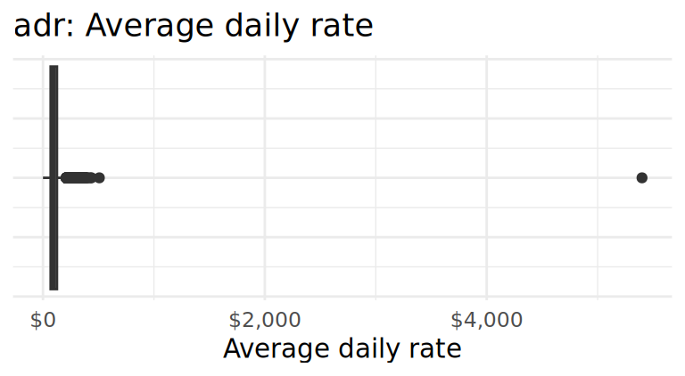
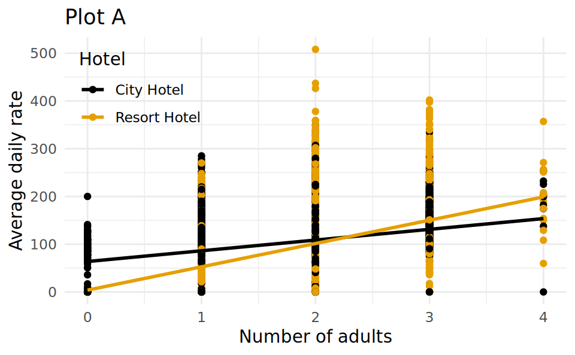
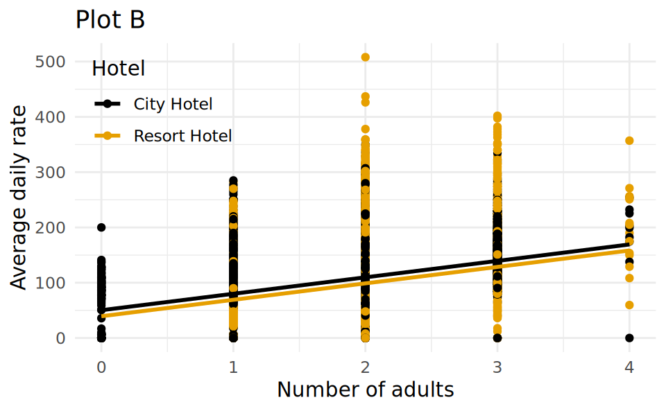

# Lab 6

\#canceled

Lab

Due: End of lab on Thurs, Nov 12

# Introduction

In this lab you’ll work with hotel cancellations. The data describe the demand of two different types of hotels. Each observation represents a hotel booking between July 1, 2015 and August 31, 2017. Some bookings were canceled (`is_canceled = 1`) and others were kept, i.e., the guests checked into the hotel (`is_canceled = 0`). You can view the code book for all variables [here](https://github.com/rfordatascience/tidytuesday/blob/master/data/2020/2020-02-11/readme.md).

## Getting started

By now you should be familiar with how to get started with a lab assignment by cloning the GitHub repo for the assignment. If you’re not sure how, refer back to an earlier lab.

Open the *lab-6.qmd* template Quarto file and update the `authors` field to add your name first (first and last) and then your teammates’ names (first and last). Render the document. Examine the rendered document and make sure your and your teammates’ names are updated in the document. Commit and push your changes with a meaningful commit message and push to GitHub.

Click to expand if you need a refresher on assignment guidelines.

### Code

Code should follow the [tidyverse style](https://style.tidyverse.org/). Particularly,

- there should be spaces before and line breaks after each `+` when building a `ggplot`,
- there should also be spaces before and line breaks after each `|>` in a data transformation pipeline,
- code should be properly indented,
- there should be spaces around `=` signs and spaces after commas.

Additionally, all code should be visible in the PDF output, i.e., should not run off the page on the PDF. Long lines that run off the page should be split across multiple lines with line breaks.[^1]

### Plots

- Plots should have an informative title and, if needed, also a subtitle.
- Axes and legends should be labeled with both the variable name and its units (if applicable).
- Careful consideration should be given to aesthetic choices.

### Workflow

Continuing to develop a sound workflow for reproducible data analysis is important as you complete the lab and other assignments in this course.

- You should have at least 3 commits with meaningful commit messages by the end of the assignment.
- Final versions of both your `.qmd` file and the rendered PDF should be pushed to GitHub.

## Packages

In this lab we will work with the **tidyverse** and **tidymodels** packages.

``` downlit
library(tidyverse)
library(tidymodels)
```

    Warning: package 'dials' was built under R version 4.6.2

## Data

The dataset, called `hotels.csv`, can be found in the `data` folder.

``` downlit
hotels <- read_csv("data/hotels.csv")
```

Below is an exploratory summary of the variables in the dataset we will use in our analysis.

| Cancellation status | Number of bookings |
|:--------------------|-------------------:|
| 0 - Not canceled    |              37583 |
| 1 - Canceled        |              22112 |

[](lab-6_files/figure-html/unnamed-chunk-5-1.png)

[](lab-6_files/figure-html/unnamed-chunk-6-1.png)

 

| Number of adults | Number of bookings |
|-----------------:|-------------------:|
|                0 |                196 |
|                1 |              11478 |
|                2 |              44995 |
|                3 |               2984 |
|                4 |                 33 |
|                5 |                  2 |
|                6 |                  1 |
|               10 |                  1 |
|               20 |                  1 |
|               26 |                  2 |
|               40 |                  1 |
|               55 |                  1 |

# Questions

## Part 1 - Data prep

### Question 1

1.  One of the outcome variables you’ll use is `is_canceled`. Transform this variable to the appropriate data class so that
    - it uses informative labels (“not canceled” and “canceled” instead of 0 and 1, respectively), and
    - the levels are ordered such that when we fit a logistic regression model to predict this outcome, success is defined as “canceled” (what we’re predicting)
2.  Based on the exploratory summaries above, you should address a few data quality issues before moving forward with the analysis. To do so, filter the dataset to remove
    - any bookings with average daily rate greater than \$1,000 and
    - any bookings with number of adults greater than or equal to 5.
3.  Split the data into a training set (75%) and a testing set (25%), setting the random seed to `1117` for reproducibility.

## Part 2 - Predicting cancellations

### Question 2

Using these data, one of our goals is to explore the following question:

> *Are reservations earlier in the month or later in the month more likely to be canceled?*

1.  In a single pipeline, calculate the mean arrival dates (`arrival_date_day_of_month`) for reservations that were canceled and reservations that were not canceled.

> **TIP:**
>
> Think carefully about which dataset you should use: `hotels`, the training subset, or the testing subset?

2.  In your own words, explain why we cannot use a linear model to model the relationship between if a hotel reservation was canceled and the day of month for the booking.

3.  Fit the appropriate model to predict whether a reservation was canceled from `arrival_date_day_of_month` and display a tidy summary of the model output. Then, interpret the slope coefficient in context of the data and the research question.

> **TIP:**
>
> The slope interpretation will have the following format:
>
> > The model predicts that, for each day the booking is \_\_\_ (later / earlier) in the month, the \_\_\_ (chance / probability / odds) of a hotel cancellation is \_\_\_ (lower / higher) by a factor of \_\_\_, on average.

4.  Calculate the probability that the hotel reservation is canceled if the arrival date is on the 17th of the month. Based on this probability, would you predict this booking would be canceled or not canceled? Explain your reasoning for your classification.

### Question 3

1.  Fit another model to predict whether a reservation was canceled from `arrival_date_day_of_month` and `hotel` type (Resort or City Hotel), allowing the relationship between `arrival_date_day_of_month` and `is_canceled` to vary based on `hotel` type. Display a tidy output of the model.

2.  Interpret the intercept in context of the data.

## Part 3 - Predicting daily rates

### Question 4

The dataset also contains information about the average daily rate (`adr`) for each reservation. The following model predicts `adr` from `adults` and `hotel` type.

    # A tibble: 3 × 5
      term              estimate std.error statistic   p.value
      <chr>                <dbl>     <dbl>     <dbl>     <dbl>
    1 (Intercept)           50.3     0.861      58.4 0        
    2 adults                29.7     0.444      67.0 0        
    3 hotelResort Hotel    -10.9     0.458     -23.8 8.40e-125

1.  Which of the following is the best interpretation of the slope coefficient for `adults`?

    For each additional adult in the booking, the average daily rate is predicted to be higher by \$29.70

    A. on average, holding hotel type constant.

    B. for Resort Hotels compared to City Hotels, on average.

    C. for City Hotels compared to Resort Hotels, on average.

    D. on average, not holding any other variables constant.

2.  Which of the following is the correct interpretation of the slope coefficient for `hotel`?

    A. For each additional Resort Hotel booking, the predicted average daily rate is \$10.90 lower, holding number of adults constant.

    B. For each additional adult in the booking, the average daily rate is predicted to be lower by \$10.90 for resort hotels compared to City Hotels, on average.

    C. Resort Hotel bookings are predicted to have an average daily rate that is \$10.90 lower than City Hotels, on average, holding number of adults constant.

    D. Resort Hotel bookings are predicted to have an average daily rate that is \$10.90 higher than City Hotels, on average, holding number of adults constant.

3.  Which of the following is the correct interpretation of the intercept?

    A. The predicted average daily rate for a booking with 0 adults at a Resort Hotel is \$50.30, on average.

    B. The predicted average daily rate for a booking with 0 adults at a City Hotel is \$50.30, on average.

    C. For each additional adult and Resort Hotel in the booking, the average daily rate is predicted to be \$50.30 higher, on average.

    D. For each additional adult and City Hotel in the booking, the average daily rate is predicted to be \$50.30 higher, on average.

4.  Which of the following (Plot A or Plot B) is the correct visual representation of this model?

[](lab-6_files/figure-html/unnamed-chunk-12-1.png)

[](lab-6_files/figure-html/unnamed-chunk-12-2.png)

> **TIP:**
>
> Think about whether you should include only main effects of `adults` and `hotel` or also their interaction effect as well in your model in order to match the plot.

> **NOTE:**
>
> If you were to continue this analysis, you could evaluate the model performance on the testing set. You could also explore including other predictors in the model to see if they improve model performance.

# Wrap-up

At this point, you should know the deal! If you don’t know how to submit your lab and how it will be graded, review a previous lab and/or ask your TA for help. And before then, make sure to run through the following checklist one last time.

> **IMPORTANT:**
>
> Make sure you have:
>
> - attempted every question;
> - previewed your Quarto document;
> - committed and pushed all final changes to GitHub, ending with no pending or staged changes in the Source Control pane; and
> - submitted your rendered PDF to Gradescope.

## Footnotes

[^1]: Remember, haikus not novellas when writing code!
