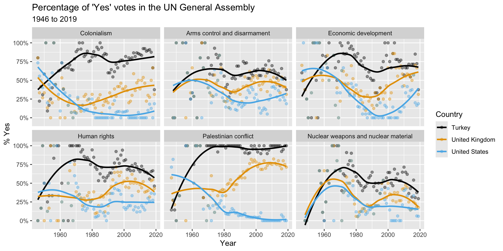
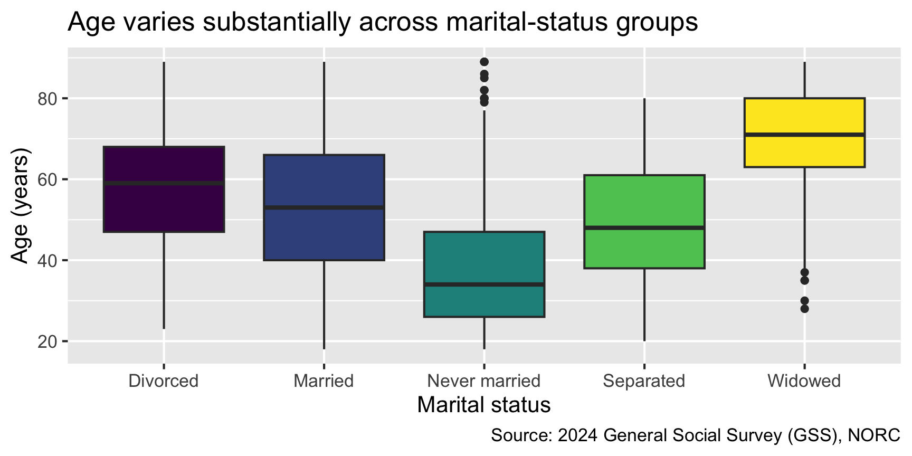
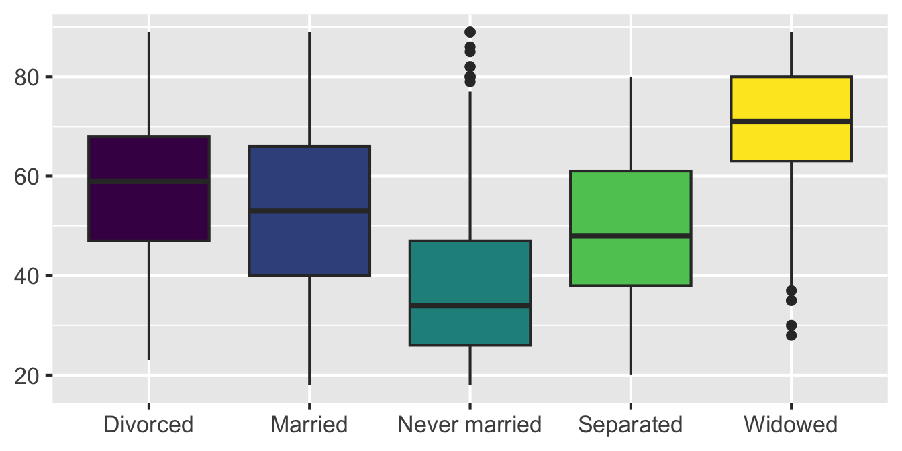
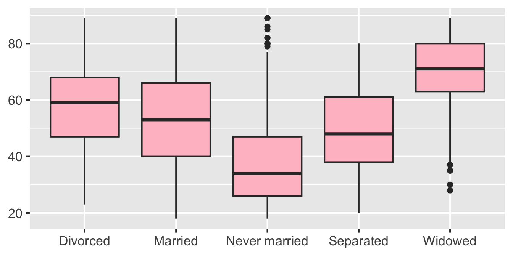
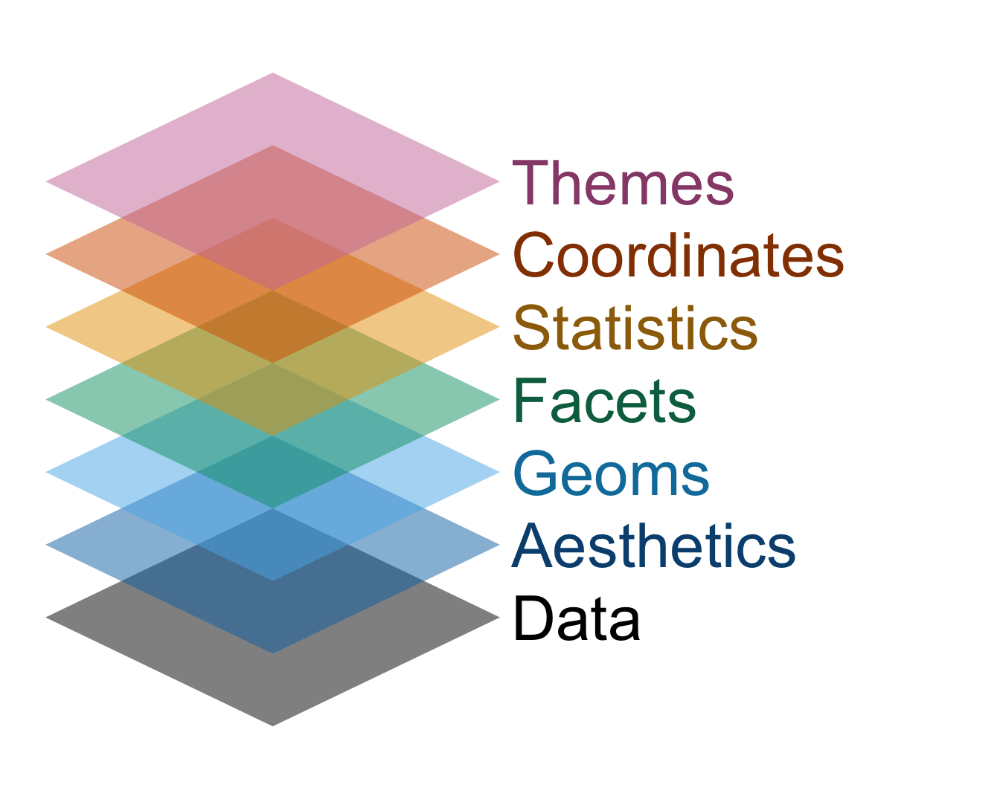

# Grammar of data visualization

Lecture 3

Author

Affiliation

Dr. Mine Çetinkaya-Rundel

Duke University\
STA 199 - Fall 2026

Published

August 31, 2026

# Warm up

## While you wait…

**1. Clone your `ae` repository**

Go to the [course GitHub organization](https://github.com/sta199-f26) and clone `ae-YOUR-GITHUB-NAME` repo to [your Positron session](https://cmgr.oit.duke.edu/containers) in your container.

**2. Participate** 📱💻

Remember this visualization from the code along video – what was it about?

[](images/03/un-data-viz.png)

[](images/03/wooclap-qr.png)

Go to [wooclap.com](https://app.wooclap.com/IOAADOR) and use the code IOAADOR.

## Outline

- Last week:

  - We introduced you to the course toolkit.

  - You **cloned** your `lab` repository and started making some updates in your Quarto documents.

  - You **committed and pushed** your changes back – at least most of you did!

. . .

- Today:

  - You will **clone** your `ae` (application exercise) repository.

  - We will introduce data visualization.

  - You will work on the application exercise on data visualization, **commit** your changes, and **push** them.

# Data visualization

## Load packages

``` r
library(tidyverse)
```

\

> **NOTE:**
>
> **tidyverse** is the collection of R packages designed for data science.

## Load the data

``` r
gss <- read_csv("data/gss-2024.csv")
```

\

> **NOTE:**
>
> We can read this as “read the CSV file called `gss-2024.csv` in the data folder” and save the result as `gss`.

## 2024 General Social Survey (GSS)

GSS is a widely respected, nationally representative sociological survey that tracks how American opinions, attitudes, and behaviors change over time.

We’re working with GSS data from the most recent wave:

- Each row represents one survey respondent.
- The variables describe demographics, education, family, happiness, employment, and political identification.

> **NOTE:**
>
> The GSS is a cross-sectional survey. We can describe associations, but these data do not establish causation.

Source: [gss.norc.org/about-the-gss.html](https://gss.norc.org/about-the-gss.html).

## View the data

``` r
gss
```

    # A tibble: 3,294 × 9
        year marital_status   age education_years children happiness     health
       <dbl> <chr>          <dbl>           <dbl>    <dbl> <chr>         <chr> 
     1  2024 Never married     33              16        2 Not too happy Good  
     2  2024 Never married     64              16        0 Pretty happy  Good  
     3  2024 Married           69              14        0 Pretty happy  Good  
     4  2024 Never married     19              12        0 Pretty happy  Good  
     5  2024 Divorced          70              13        3 Not too happy Good  
     6  2024 Married           53              14        2 Pretty happy  Good  
     7  2024 Married           48              13        6 Pretty happy  Good  
     8  2024 Divorced          30              14        1 Not too happy Good  
     9  2024 Married           60              14        2 Very happy    Good  
    10  2024 Never married     25              12        0 Pretty happy  Good  
    # ℹ 3,284 more rows
    # ℹ 2 more variables: employment_status <chr>, party_id <chr>

## Variables in our extract

| Variable            | Description                           | Type        |
|---------------------|---------------------------------------|-------------|
| `marital_status`    | Current marital status                | Categorical |
| `age`               | Age in years                          | Numerical   |
| `education_years`   | Completed years of education          | Numerical   |
| `children`          | Number of children; 8 means 8 or more | Numerical   |
| `happiness`         | Self-reported happiness               | Categorical |
| `health`            | Self-reported general health          | Categorical |
| `employment_status` | Current employment status             | Categorical |
| `party_id`          | Party identification                  | Categorical |

## Start with a question

How does age vary across marital-status groups?

Before writing code:

- Which variables do we need?
- What type is each variable?
- What kind of plot might answer the question?

## Age by marital status

``` r
ggplot(gss, aes(x = marital_status, y = age, fill = marital_status)) +
  geom_boxplot(show.legend = FALSE) +
  labs(
    title = "Age varies substantially across marital-status groups",
    x = "Marital status",
    y = "Age (years)",
    caption = "Source: 2024 General Social Survey (GSS), NORC"
  ) +
  scale_fill_viridis_d()
```

    Warning: Removed 94 rows containing non-finite outside the scale range
    (`stat_boxplot()`).

[](03-grammar-of-data-visualization_files/figure-revealjs/age-marital-boxplot-1.png)

## Participate 📱💻

The plot was created, but R displayed the warning below. What happened to the 94 observations?

``` text
Warning: Removed 94 rows containing non-finite values
outside the scale range (`stat_boxplot()`).
```

[](images/03/wooclap-qr.png)

Go to [wooclap.com](https://app.wooclap.com/IOAADOR) and use the code IOAADOR.

## Interpret the plot

With a partner:

- Which group has the highest median age? The lowest?
- Which groups have the greatest variability?
- What does one box summarize?
- Can this plot tell us whether marital status causes differences in age?

[](03-grammar-of-data-visualization_files/figure-revealjs/unnamed-chunk-1-1.png)

## Plot autopsy

``` r
ggplot(
  data = gss, # <1>
  mapping = aes(x = marital_status, y = age, fill = marital_status) # <2>
) +
  geom_boxplot() + # <3>
  labs(...) + # <4>
  scale_fill_viridis_d() # <5>
```

1.  The **data** to visualize
2.  The variables **mapped** to visual properties
3.  The **geometric object** used to represent the observations
4.  The plot **labels**
5.  The **scale** used to map values to colors

. . .

Which component would you change to plot different variables? Which component controls the variable represented by the fill color?

## Mapping and aesthetics

**Aesthetics** are visual properties such as position, color, fill, shape, size, and transparency.

. . .

For the GSS boxplot:

``` r
aes(
  x = marital_status,
  y = age,
  fill = marital_status
)
```

| Variable         | Aesthetic  |
|------------------|------------|
| `marital_status` | x position |
| `age`            | y position |
| `marital_status` | fill color |

[](03-grammar-of-data-visualization_files/figure-revealjs/age-marital-boxplot-simplified-1.png)

## Map a variable; set a value

**Map:** fill varies with a variable, so ggplot2 creates a legend

``` r
geom_boxplot(aes(fill = marital_status))
```

[](03-grammar-of-data-visualization_files/figure-revealjs/unnamed-chunk-2-1.png)

**Set:** every box has the same fill, so no legend is needed

``` r
geom_boxplot(fill = "pink")
```

[](03-grammar-of-data-visualization_files/figure-revealjs/age-marital-boxplot-setting-1.png)

> **TIP:**
>
> Variables belong inside `aes()`; fixed visual choices belong outside it.

## Grammar of graphics

- When building or reading a plot, work through the layers as if they’re a checklist.

- Not every plot needs every component, but each component is a separate decision.

[](images/03/gg-layers.png)

# Application exercise

## Let’s get laptops out!

- Go to the [course GitHub organization](https://github.com/sta199-f26) and clone `ae-YOUR-GITHUB-NAME` repo to [your Positron session](https://cmgr.oit.duke.edu/containers) in your container.

- Open `ae-01-gss-dataviz.qmd` in Positron and follow the instructions to complete the application exercise.
