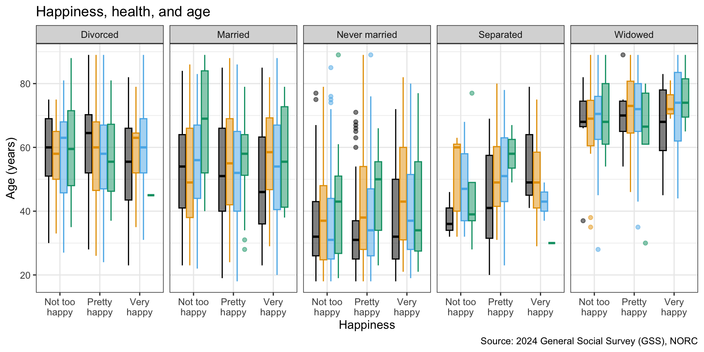
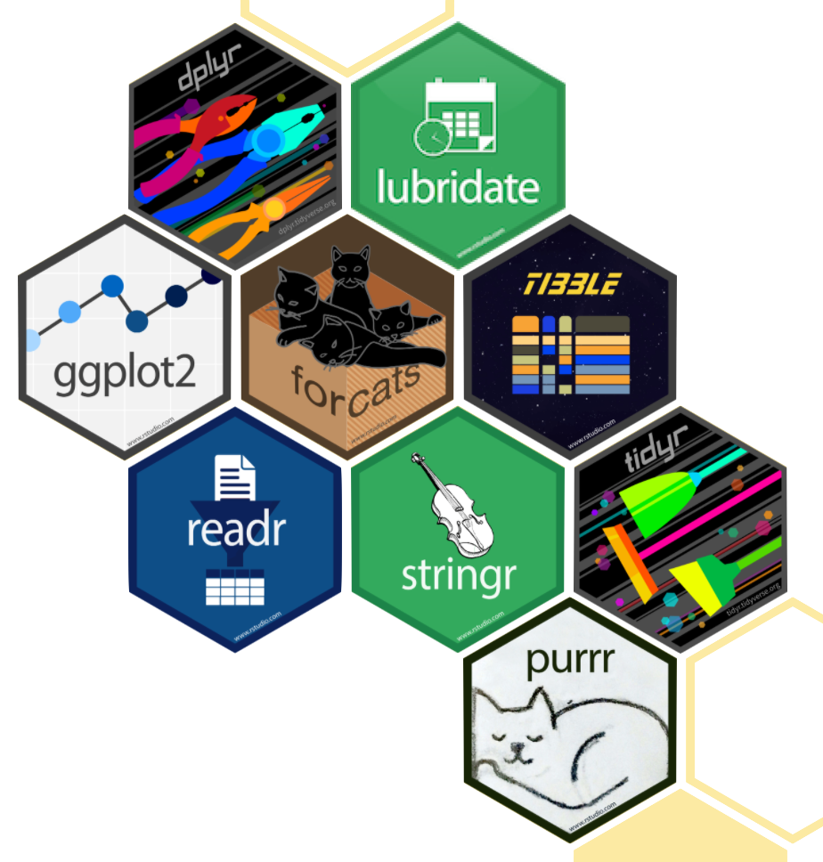

# Grammar of data transformation

Lecture 4

Author

Affiliation

Dr. Mine Çetinkaya-Rundel

Duke University\
STA 199 - Fall 2026

Published

September 2, 2026

# Warm up

## While you wait: Participate 📱

Which of the following is **true** about the code below?

``` r
ggplot(mtcars, _[blank]_(x = wt, y = mpg)) +
  geom_point() +
  geom_smooth()
```

- `mtcars` is the name of the variable being plotted on the x-axis
- The function that goes in the blank is `map()`
- The data are being visualized with a scatterplot and a smooth line
- Some points on the plot will be colored differently than others

[](images/04/wooclap-qr.png)

Go to [wooclap.com](https://app.wooclap.com/LISGDPO) and use the code LISGDPO.

## Announcements

- Following along with code along videos: See <https://sta199-f26.github.io/computing-code-alongs.html>

- Lab 1 is tomorrow, HW 1 is due next Wednesday

- No class on Monday, September 7 (Labor Day)

# From last time

## Let’s get laptops out!

**If you were here on Monday and worked on `ae-01`:**

- Go to Positron and open your `ae` project.

- Open `ae-01-gss-dataviz.qmd` in Positron and pick up where we left off.

**If you’re new here and didn’t work on `ae-01`:**

- Go to the [course GitHub organization](https://github.com/sta199-f26) and clone `ae-YOUR-GITHUB-NAME` repo to [your Positron session](https://cmgr.oit.duke.edu/containers) in your container.

- Open `ae-01-gss-dataviz.qmd` in Positron and follow the instructions to complete the application exercise.

## Start with the question

| Question | Variables | A useful first plot |
|----|----|----|
| What values are common? | One categorical | Bar chart |
| What is the distribution? | One numerical | Histogram or boxplot |
| Do groups differ? | Numerical + categorical | Boxplot or histogram by group |
| Are two categorical variables associated? | Two categorical | Filled or dodged bar chart |
| Are two numerical variables associated? | Two numerical | Scatterplot |

## Interesting Qs \<-\> many variables

Bring the third, fourth, fifth, etc. variable to the plot using additional aesthetics such as `color`, `shape`, `size`, `linewidth`, etc. and/or with faceting (creating small multiple plots based on the levels of a variable):

[](04-grammar-of-data-transformation_files/figure-revealjs/four-vars-1.png)

A short list\
(for now)\
of R essentials
===============

## Packages

- Installed with `install.packages()`, once per system:

``` r
install.packages("tidyverse")
```

> **NOTE:**
>
> We already pre-installed many of the package you’ll need for this course, so you might go the whole semester without needing to run `install.packages()`!

. . .

- Loaded with `library()`, once per session:

``` r
library(tidyverse)
```

## tidyverse

aka the package you’ll hear about the most…

[](https://tidyverse.org)

[tidyverse.org](https://www.tidyverse.org/)

- The **tidyverse** is an opinionated collection of R packages designed for data science
- All packages share an underlying philosophy and a common grammar

## Data frames and variables

- Each row of a data frame is an **observation**

. . .

- Each column of a data frame is a **variable**

. . .

- Columns (variables) in data frames can be accessed with `$`:

``` r
dataframe$variable_name
```

## `gss` data frame

``` r
gss
```

    # A tibble: 3,294 × 9
        year marital_status   age education_years children happiness     health
       <dbl> <chr>          <dbl>           <dbl>    <dbl> <chr>         <chr> 
     1  2024 Never married     33              16        2 Not too happy Good  
     2  2024 Never married     64              16        0 Pretty happy  Good  
     3  2024 Married           69              14        0 Pretty happy  Good  
     4  2024 Never married     19              12        0 Pretty happy  Good  
     5  2024 Divorced          70              13        3 Not too happy Good  
     6  2024 Married           53              14        2 Pretty happy  Good  
     7  2024 Married           48              13        6 Pretty happy  Good  
     8  2024 Divorced          30              14        1 Not too happy Good  
     9  2024 Married           60              14        2 Very happy    Good  
    10  2024 Never married     25              12        0 Pretty happy  Good  
    # ℹ 3,284 more rows
    # ℹ 2 more variables: employment_status <chr>, party_id <chr>

## `health` variable

``` r
gss$health
```

       [1] "Good"      "Good"      "Good"      "Good"      "Good"      "Good"     
       [7] "Good"      "Good"      "Good"      "Good"      "Good"      "Excellent"
      [13] "Fair"      "Good"      "Fair"      "Excellent" "Good"      "Good"     
      [19] "Good"      "Good"      "Good"      "Excellent" "Good"      "Good"     
      [25] "Good"      "Good"      "Good"      "Good"      "Good"      "Good"     
      [31] "Good"      "Good"      "Excellent" "Fair"      "Good"      "Good"     
      [37] "Excellent" "Good"      "Good"      "Good"      "Fair"      "Good"     
      [43] "Good"      "Good"      "Poor"      "Good"      "Excellent" "Good"     
      [49] "Excellent" "Good"      "Good"      "Good"      "Good"      "Good"     
      [55] "Poor"      "Fair"      "Good"      "Good"      "Fair"      "Fair"     
      [61] "Good"      "Good"      "Poor"      "Excellent" "Excellent" "Fair"     
      [67] "Good"      "Good"      "Excellent" "Good"      "Good"      "Fair"     
      [73] "Good"      "Fair"      "Good"      "Excellent" "Good"      "Excellent"
      [79] "Good"      "Good"      "Good"      "Good"      "Fair"      "Fair"     
      [85] "Fair"      "Fair"      "Good"      "Good"      "Good"      "Excellent"
      [91] "Excellent" "Fair"      "Good"      "Excellent" "Good"      "Good"     
      [97] "Good"      "Excellent" "Fair"      "Good"      "Good"      "Excellent"
     [103] "Fair"      "Good"      "Fair"      "Good"      "Good"      "Good"     
     [109] "Good"      "Fair"      "Good"      "Good"      "Fair"      "Good"     
     [115] "Poor"      "Good"      "Fair"      "Fair"      "Excellent" "Good"     
     [121] "Good"      "Fair"      "Excellent" "Good"      "Fair"      "Fair"     
     [127] "Excellent" "Fair"      "Excellent" "Fair"      "Good"      "Fair"     
     [133] "Good"      "Fair"      "Good"      "Good"      "Good"      "Good"     
     [139] "Good"      "Good"      "Excellent" "Good"      "Good"      "Good"     
     [145] "Good"      "Fair"      "Excellent" "Good"      "Good"      "Good"     
     [151] "Good"      "Fair"      "Good"      "Excellent" "Good"      "Good"     
     [157] "Good"      "Good"      "Good"      "Good"      "Excellent" "Good"     
     [163] "Excellent" "Good"      "Excellent" "Good"      "Good"      "Good"     
     [169] "Good"      "Excellent" "Fair"      "Poor"      "Good"      "Good"     
     [175] "Excellent" "Good"      "Fair"      "Fair"      "Good"      "Fair"     
     [181] "Fair"      "Good"      "Good"      "Excellent" "Excellent" "Fair"     
     [187] "Good"      "Excellent" "Good"      "Fair"      "Good"      "Good"     
     [193] "Fair"      "Excellent" "Fair"      "Poor"      "Fair"      "Good"     
     [199] "Fair"      "Fair"      "Good"      "Good"      "Good"      "Good"     
     [205] "Excellent" "Poor"      "Excellent" "Good"      "Good"      "Good"     
     [211] "Good"      "Good"      "Good"      "Fair"      "Fair"      "Fair"     
     [217] "Fair"      "Good"      "Good"      "Good"      "Good"      "Good"     
     [223] "Good"      "Fair"      "Good"      "Good"      "Good"      "Good"     
     [229] "Poor"      "Good"      "Good"      "Excellent" "Good"      "Fair"     
     [235] "Good"      "Fair"      "Good"      "Good"      "Good"      "Fair"     
     [241] "Good"      "Good"      "Good"      "Fair"      "Fair"      "Good"     
     [247] "Good"      "Fair"      "Poor"      "Good"      "Poor"      "Fair"     
     [253] "Excellent" "Fair"      "Excellent" "Fair"      "Poor"      "Good"     
     [259] "Good"      "Good"      "Excellent" "Good"      "Good"      "Fair"     
     [265] "Good"      "Good"      "Fair"      "Good"      "Good"      "Fair"     
     [271] "Fair"      "Good"      "Fair"      "Fair"      "Fair"      "Fair"     
     [277] "Fair"      "Good"      "Good"      "Good"      "Excellent" "Good"     
     [283] "Good"      "Poor"      "Good"      "Excellent" "Good"      "Good"     
     [289] "Excellent" "Good"      "Good"      "Good"      "Good"      "Good"     
     [295] "Good"      "Good"      "Good"      "Good"      "Excellent" "Excellent"
     [301] "Good"      "Fair"      "Good"      "Excellent" "Poor"      "Good"     
     [307] "Good"      "Good"      "Good"      "Poor"      "Good"      "Fair"     
     [313] "Fair"      "Excellent" "Good"      "Fair"      "Good"      "Fair"     
     [319] "Fair"      "Fair"      "Fair"      "Good"      "Good"      "Good"     
     [325] "Good"      "Fair"      "Good"      "Fair"      "Poor"      "Excellent"
     [331] "Excellent" "Good"      "Fair"      "Good"      "Fair"      "Good"     
     [337] "Excellent" "Good"      "Fair"      "Good"      "Good"      "Good"     
     [343] "Fair"      "Excellent" "Excellent" "Fair"      "Good"      "Good"     
     [349] "Fair"      "Good"      "Good"      "Good"      "Good"      "Good"     
     [355] "Good"      "Good"      "Excellent" "Excellent" "Good"      "Fair"     
     [361] "Good"      "Excellent" "Good"      "Fair"      "Poor"      "Good"     
     [367] "Fair"      "Excellent" "Fair"      "Fair"      "Good"      "Good"     
     [373] "Good"      "Good"      "Good"      "Good"      "Good"      "Fair"     
     [379] "Fair"      "Fair"      "Excellent" "Good"      "Good"      "Excellent"
     [385] "Good"      "Good"      "Poor"      "Good"      "Fair"      "Fair"     
     [391] "Good"      "Good"      "Excellent" "Fair"      "Good"      "Fair"     
     [397] "Good"      "Fair"      "Good"      "Excellent" "Good"      "Poor"     
     [403] "Good"      "Excellent" "Good"      "Good"      "Good"      "Good"     
     [409] "Good"      "Fair"      "Excellent" "Good"      "Fair"      "Fair"     
     [415] "Good"      "Good"      "Good"      "Fair"      "Excellent" "Good"     
     [421] "Good"      "Fair"      "Good"      "Good"      "Good"      "Fair"     
     [427] "Good"      "Good"      "Good"      "Good"      "Fair"      "Excellent"
     [433] "Excellent" "Excellent" "Fair"      "Good"      "Fair"      "Fair"     
     [439] "Good"      "Excellent" "Excellent" "Good"      "Fair"      "Good"     
     [445] "Good"      "Fair"      "Good"      "Excellent" "Good"      "Good"     
     [451] "Good"      "Excellent" "Excellent" "Good"      "Good"      "Good"     
     [457] "Good"      "Good"      "Fair"      "Excellent" "Fair"      "Fair"     
     [463] "Fair"      "Good"      "Excellent" "Fair"      "Good"      "Good"     
     [469] "Good"      "Fair"      "Good"      "Fair"      "Good"      "Poor"     
     [475] "Excellent" "Good"      "Excellent" "Excellent" "Fair"      "Excellent"
     [481] "Good"      "Excellent" "Good"      "Fair"      "Excellent" "Excellent"
     [487] "Excellent" "Fair"      "Excellent" "Excellent" "Fair"      "Excellent"
     [493] "Good"      "Good"      "Good"      "Good"      "Fair"      "Good"     
     [499] "Poor"      "Fair"      NA          "Excellent" "Good"      "Poor"     
     [505] NA          "Fair"      "Good"      "Excellent" "Good"      "Poor"     
     [511] "Fair"      "Good"      "Good"      "Good"      "Good"      "Fair"     
     [517] "Good"      NA          "Good"      "Good"      "Good"      "Excellent"
     [523] "Good"      "Excellent" "Good"      "Good"      "Good"      "Good"     
     [529] "Good"      "Good"      "Good"      "Good"      "Excellent" "Good"     
     [535] "Good"      "Good"      "Excellent" "Excellent" "Good"      "Good"     
     [541] "Good"      "Fair"      "Good"      "Excellent" "Fair"      "Good"     
     [547] "Excellent" "Good"      "Good"      "Fair"      "Good"      "Excellent"
     [553] "Excellent" "Fair"      "Excellent" "Fair"      "Excellent" "Good"     
     [559] "Good"      "Good"      "Fair"      "Good"      "Good"      "Good"     
     [565] "Good"      "Good"      "Fair"      "Good"      "Excellent" "Excellent"
     [571] "Good"      "Good"      "Poor"      "Good"      "Poor"      "Good"     
     [577] "Excellent" "Fair"      "Good"      "Fair"      "Good"      "Fair"     
     [583] "Fair"      "Poor"      "Good"      "Poor"      "Good"      "Fair"     
     [589] "Good"      "Good"      "Good"      "Good"      "Fair"      "Fair"     
     [595] "Fair"      "Poor"      "Poor"      "Fair"      "Fair"      "Good"     
     [601] "Fair"      "Excellent" "Excellent" "Good"      "Fair"      "Good"     
     [607] "Excellent" "Good"      "Good"      "Good"      "Excellent" "Good"     
     [613] "Good"      "Good"      "Good"      "Excellent" "Fair"      "Fair"     
     [619] "Good"      "Good"      "Excellent" "Good"      "Fair"      "Good"     
     [625] "Excellent" "Good"      "Good"      "Good"      "Fair"      "Good"     
     [631] "Fair"      "Good"      "Excellent" "Good"      "Fair"      "Fair"     
     [637] "Good"      "Good"      "Good"      "Fair"      "Excellent" "Fair"     
     [643] "Good"      "Fair"      "Fair"      "Fair"      "Excellent" "Excellent"
     [649] "Good"      "Good"      "Good"      "Good"      "Fair"      "Good"     
     [655] "Fair"      "Fair"      "Fair"      "Good"      "Fair"      "Excellent"
     [661] "Fair"      "Good"      "Good"      "Good"      "Good"      "Good"     
     [667] "Good"      "Good"      "Fair"      "Excellent" "Good"      "Fair"     
     [673] "Excellent" "Good"      "Good"      "Good"      "Excellent" "Excellent"
     [679] "Excellent" "Good"      "Fair"      "Excellent" "Excellent" "Good"     
     [685] "Good"      "Excellent" "Fair"      "Good"      "Good"      "Excellent"
     [691] "Excellent" "Good"      "Fair"      "Good"      "Good"      "Fair"     
     [697] "Good"      "Excellent" "Fair"      "Good"      "Good"      "Good"     
     [703] "Good"      "Fair"      "Good"      "Fair"      "Excellent" "Fair"     
     [709] "Fair"      "Fair"      "Good"      "Fair"      "Poor"      "Good"     
     [715] "Poor"      "Good"      "Excellent" "Good"      "Fair"      "Fair"     
     [721] NA          "Fair"      "Good"      "Poor"      "Good"      "Good"     
     [727] "Poor"      "Fair"      "Excellent" "Good"      "Fair"      "Good"     
     [733] "Excellent" "Fair"      "Good"      "Fair"      "Fair"      "Fair"     
     [739] "Good"      "Good"      "Good"      "Excellent" "Good"      "Good"     
     [745] "Fair"      "Fair"      "Good"      "Excellent" "Excellent" "Fair"     
     [751] "Good"      "Good"      "Good"      "Good"      "Good"      "Good"     
     [757] "Fair"      "Good"      "Good"      "Excellent" "Good"      "Good"     
     [763] "Fair"      "Fair"      "Fair"      "Good"      "Good"      "Fair"     
     [769] "Good"      "Fair"      "Excellent" "Fair"      "Good"      "Poor"     
     [775] "Good"      "Good"      "Good"      "Fair"      "Good"      "Fair"     
     [781] "Fair"      "Good"      "Good"      "Excellent" "Excellent" "Good"     
     [787] "Good"      "Fair"      "Good"      "Excellent" "Good"      "Fair"     
     [793] "Good"      "Good"      "Good"      "Excellent" "Excellent" "Excellent"
     [799] "Good"      "Good"      "Poor"      "Good"      "Fair"      "Good"     
     [805] "Excellent" "Good"      "Fair"      "Fair"      "Good"      "Fair"     
     [811] "Fair"      "Good"      "Good"      "Excellent" "Excellent" "Good"     
     [817] "Excellent" "Good"      "Fair"      "Fair"      "Excellent" "Fair"     
     [823] "Excellent" "Fair"      "Good"      "Good"      "Good"      "Fair"     
     [829] "Good"      "Good"      "Poor"      "Fair"      "Good"      "Fair"     
     [835] "Fair"      "Excellent" "Fair"      "Fair"      "Fair"      "Good"     
     [841] "Fair"      "Good"      "Good"      "Excellent" "Good"      "Good"     
     [847] "Good"      "Excellent" "Good"      "Good"      "Excellent" "Good"     
     [853] "Excellent" "Fair"      "Fair"      "Fair"      "Excellent" "Excellent"
     [859] "Good"      "Fair"      "Excellent" "Excellent" "Fair"      "Good"     
     [865] "Good"      "Good"      "Poor"      "Good"      "Good"      "Excellent"
     [871] "Good"      "Good"      "Fair"      "Good"      "Excellent" "Good"     
     [877] "Good"      "Good"      "Good"      "Good"      "Good"      "Good"     
     [883] "Good"      "Good"      "Fair"      "Fair"      "Fair"      "Good"     
     [889] "Poor"      "Good"      "Fair"      "Good"      "Fair"      "Poor"     
     [895] "Fair"      "Good"      "Good"      "Good"      "Fair"      "Fair"     
     [901] "Good"      "Good"      "Good"      "Excellent" "Good"      "Good"     
     [907] "Excellent" "Good"      "Good"      "Fair"      "Good"      "Fair"     
     [913] "Excellent" "Good"      "Excellent" "Good"      "Good"      "Good"     
     [919] "Good"      "Good"      "Excellent" "Good"      "Excellent" "Good"     
     [925] "Good"      "Good"      "Good"      "Good"      "Excellent" "Fair"     
     [931] "Fair"      "Excellent" "Good"      "Excellent" "Good"      "Good"     
     [937] "Good"      "Good"      "Good"      "Excellent" "Excellent" "Fair"     
     [943] "Good"      "Excellent" "Good"      "Good"      "Good"      "Good"     
     [949] "Good"      "Good"      "Good"      "Excellent" "Good"      "Good"     
     [955] "Excellent" "Good"      "Excellent" "Excellent" "Good"      "Fair"     
     [961] "Good"      "Good"      "Good"      "Excellent" "Good"      "Excellent"
     [967] "Good"      "Good"      "Excellent" "Good"      "Fair"      "Fair"     
     [973] "Good"      "Fair"      "Good"      "Fair"      "Excellent" "Excellent"
     [979] "Good"      "Good"      "Excellent" "Fair"      "Fair"      "Good"     
     [985] "Good"      "Good"      "Excellent" "Excellent" "Good"      "Good"     
     [991] "Fair"      "Excellent" "Good"      "Excellent" "Good"      "Good"     
     [997] "Good"      "Fair"      "Good"      "Excellent" "Excellent" "Good"     
    [1003] "Fair"      "Good"      "Fair"      "Fair"      "Good"      "Good"     
    [1009] "Fair"      "Poor"      "Good"      "Excellent" "Good"      "Good"     
    [1015] "Good"      "Fair"      "Good"      "Excellent" "Fair"      "Good"     
    [1021] "Good"      "Good"      "Fair"      "Good"      "Fair"      "Good"     
    [1027] "Good"      "Good"      "Good"      "Good"      "Good"      "Fair"     
    [1033] "Good"      "Good"      "Fair"      "Poor"      "Good"      "Good"     
    [1039] "Good"      "Fair"      "Fair"      "Good"      "Good"      "Fair"     
    [1045] "Good"      "Fair"      "Excellent" "Good"      "Good"      "Fair"     
    [1051] "Fair"      "Excellent" "Good"      "Good"      "Good"      "Fair"     
    [1057] "Fair"      "Excellent" "Good"      "Good"      "Excellent" "Excellent"
    [1063] "Excellent" "Good"      "Good"      "Good"      "Good"      "Excellent"
    [1069] "Excellent" "Excellent" "Good"      "Fair"      "Good"      "Poor"     
    [1075] "Good"      "Good"      "Good"      "Fair"      "Poor"      "Excellent"
    [1081] "Excellent" "Good"      "Good"      "Excellent" "Good"      "Good"     
    [1087] "Good"      "Good"      "Fair"      "Fair"      "Good"      "Fair"     
    [1093] "Fair"      "Good"      "Good"      "Good"      "Fair"      "Excellent"
    [1099] "Good"      "Good"      "Good"      "Fair"      "Poor"      "Good"     
    [1105] "Fair"      "Fair"      "Poor"      "Fair"      "Excellent" "Good"     
    [1111] "Fair"      "Fair"      "Good"      "Good"      "Good"      "Good"     
    [1117] "Good"      "Good"      "Good"      "Good"      "Fair"      "Good"     
    [1123] "Excellent" "Good"      "Good"      "Good"      "Excellent" "Fair"     
    [1129] "Fair"      "Excellent" "Good"      "Good"      "Fair"      "Excellent"
    [1135] "Fair"      "Excellent" "Good"      "Good"      "Poor"      "Good"     
    [1141] "Good"      "Fair"      "Good"      "Poor"      "Good"      "Fair"     
    [1147] "Good"      "Excellent" "Good"      "Good"      "Fair"      "Fair"     
    [1153] "Fair"      "Fair"      "Good"      "Good"      "Good"      "Excellent"
    [1159] "Excellent" "Poor"      "Fair"      "Good"      "Excellent" "Good"     
    [1165] "Fair"      "Good"      "Fair"      "Good"      "Good"      "Good"     
    [1171] "Good"      "Excellent" "Good"      "Fair"      "Good"      "Good"     
    [1177] "Excellent" "Good"      "Excellent" "Fair"      "Fair"      "Good"     
    [1183] "Good"      "Excellent" "Good"      "Excellent" "Excellent" "Good"     
    [1189] "Good"      "Good"      "Excellent" "Good"      "Excellent" "Excellent"
    [1195] "Good"      "Excellent" "Good"      "Good"      "Fair"      "Good"     
    [1201] "Good"      "Excellent" "Good"      "Good"      "Fair"      "Fair"     
    [1207] "Fair"      "Good"      "Good"      "Good"      "Excellent" "Good"     
    [1213] "Good"      "Poor"      "Good"      "Good"      "Good"      "Fair"     
    [1219] "Good"      "Excellent" "Good"      "Fair"      "Good"      "Good"     
    [1225] "Good"      "Excellent" "Good"      "Good"      "Good"      "Fair"     
    [1231] "Fair"      "Good"      "Good"      "Good"      "Good"      "Excellent"
    [1237] "Excellent" "Good"      "Good"      "Excellent" "Good"      "Good"     
    [1243] "Good"      "Good"      "Fair"      "Poor"      "Excellent" "Excellent"
    [1249] "Good"      "Good"      "Excellent" "Good"      "Good"      "Good"     
    [1255] "Fair"      "Good"      "Excellent" "Excellent" "Good"      "Poor"     
    [1261] "Good"      "Excellent" "Fair"      "Good"      "Fair"      "Fair"     
    [1267] "Good"      "Good"      "Good"      "Fair"      "Excellent" "Good"     
    [1273] "Excellent" "Excellent" "Fair"      "Excellent" "Fair"      "Good"     
    [1279] "Fair"      "Excellent" "Excellent" "Fair"      "Excellent" "Good"     
    [1285] "Good"      "Good"      "Excellent" NA          "Good"      "Good"     
    [1291] "Excellent" "Good"      "Fair"      "Excellent" "Good"      "Good"     
    [1297] "Good"      "Good"      "Excellent" "Fair"      "Excellent" "Good"     
    [1303] "Excellent" "Good"      "Excellent" "Fair"      "Good"      "Excellent"
    [1309] "Fair"      "Good"      "Excellent" NA          "Good"      "Good"     
    [1315] "Good"      "Excellent" "Good"      "Good"      "Good"      "Excellent"
    [1321] "Good"      "Good"      "Excellent" "Good"      "Good"      "Fair"     
    [1327] "Good"      "Good"      "Fair"      "Good"      "Good"      "Fair"     
    [1333] "Excellent" "Good"      "Fair"      "Excellent" "Good"      "Good"     
    [1339] "Fair"      "Excellent" "Excellent" "Good"      "Fair"      "Good"     
    [1345] "Excellent" "Good"      "Excellent" "Excellent" "Poor"      "Good"     
    [1351] "Fair"      "Good"      "Good"      "Excellent" "Excellent" "Good"     
    [1357] "Good"      "Fair"      "Excellent" "Good"      "Excellent" "Good"     
    [1363] "Good"      "Fair"      "Good"      "Good"      "Good"      "Good"     
    [1369] "Good"      "Good"      "Good"      "Good"      "Excellent" "Excellent"
    [1375] "Good"      "Excellent" "Fair"      "Good"      "Good"      "Fair"     
    [1381] "Excellent" "Excellent" "Good"      "Fair"      "Fair"      "Good"     
    [1387] "Good"      "Excellent" "Good"      "Fair"      "Good"      "Good"     
    [1393] "Good"      "Good"      "Good"      "Excellent" "Fair"      "Poor"     
    [1399] "Good"      "Fair"      "Fair"      "Good"      "Fair"      "Excellent"
    [1405] "Fair"      "Fair"      "Excellent" "Fair"      "Good"      "Excellent"
    [1411] "Good"      "Good"      "Good"      "Poor"      "Good"      "Excellent"
    [1417] "Good"      "Good"      "Excellent" "Good"      "Good"      "Good"     
    [1423] "Good"      "Good"      "Fair"      "Excellent" "Excellent" "Fair"     
    [1429] "Poor"      "Good"      "Good"      "Good"      "Good"      "Good"     
    [1435] "Excellent" "Fair"      "Good"      "Good"      "Good"      "Good"     
    [1441] "Excellent" "Good"      "Good"      "Poor"      "Good"      "Good"     
    [1447] "Good"      "Fair"      "Good"      NA          "Good"      "Good"     
    [1453] "Good"      "Good"      "Good"      "Excellent" "Good"      "Good"     
    [1459] "Good"      "Excellent" "Good"      "Excellent" "Good"      "Good"     
    [1465] "Good"      "Good"      "Good"      "Good"      "Good"      "Good"     
    [1471] "Good"      "Poor"      "Good"      "Good"      "Good"      "Good"     
    [1477] "Good"      "Good"      "Good"      "Good"      "Good"      "Good"     
    [1483] "Good"      "Good"      "Good"      "Excellent" "Good"      "Fair"     
    [1489] "Fair"      "Good"      "Good"      "Good"      "Fair"      "Excellent"
    [1495] "Fair"      "Good"      "Good"      "Fair"      "Good"      "Good"     
    [1501] "Fair"      "Good"      "Fair"      "Good"      "Excellent" "Good"     
    [1507] "Good"      "Good"      "Excellent" "Excellent" "Good"      "Fair"     
    [1513] "Excellent" "Good"      "Good"      "Good"      "Good"      "Good"     
    [1519] "Poor"      "Good"      "Fair"      "Good"      "Good"      "Excellent"
    [1525] "Good"      "Good"      "Fair"      "Fair"      "Good"      "Good"     
    [1531] "Good"      "Fair"      "Excellent" "Fair"      "Good"      "Good"     
    [1537] "Good"      "Good"      "Fair"      "Good"      "Good"      "Excellent"
    [1543] "Fair"      "Good"      "Fair"      "Good"      "Good"      "Good"     
    [1549] "Excellent" "Good"      "Good"      "Excellent" "Good"      "Excellent"
    [1555] "Good"      "Excellent" "Fair"      "Good"      "Good"      "Good"     
    [1561] "Fair"      "Good"      "Poor"      "Good"      "Good"      "Fair"     
    [1567] "Fair"      "Poor"      "Fair"      "Fair"      "Good"      "Excellent"
    [1573] "Good"      "Good"      "Fair"      "Good"      "Excellent" NA         
    [1579] "Good"      "Poor"      "Good"      "Good"      "Good"      "Fair"     
    [1585] "Good"      "Fair"      "Fair"      "Good"      "Good"      "Excellent"
    [1591] "Good"      "Good"      "Excellent" "Good"      "Excellent" "Good"     
    [1597] "Good"      "Fair"      "Good"      "Good"      "Poor"      "Good"     
    [1603] "Good"      "Good"      "Good"      "Fair"      "Fair"      "Good"     
    [1609] "Good"      "Excellent" "Excellent" "Good"      "Good"      "Good"     
    [1615] "Good"      "Good"      "Good"      "Good"      "Excellent" "Good"     
    [1621] "Good"      "Good"      "Good"      "Fair"      "Fair"      "Good"     
    [1627] "Fair"      "Good"      "Good"      "Excellent" "Good"      "Fair"     
    [1633] "Good"      "Fair"      "Good"      "Poor"      "Good"      "Fair"     
    [1639] "Poor"      "Poor"      "Good"      "Good"      "Good"      "Fair"     
    [1645] "Good"      "Fair"      "Good"      "Good"      "Excellent" "Good"     
    [1651] "Poor"      "Good"      "Good"      "Good"      "Good"      "Fair"     
    [1657] "Fair"      "Good"      "Good"      "Fair"      "Good"      "Fair"     
    [1663] "Excellent" "Good"      "Fair"      "Poor"      "Fair"      "Excellent"
    [1669] "Excellent" "Excellent" "Fair"      "Good"      "Poor"      "Excellent"
    [1675] "Fair"      "Fair"      "Good"      "Poor"      "Fair"      "Good"     
    [1681] "Good"      "Good"      "Fair"      "Excellent" "Good"      "Poor"     
    [1687] "Poor"      "Fair"      "Good"      "Good"      "Good"      "Good"     
    [1693] "Fair"      "Good"      "Good"      "Good"      "Good"      "Excellent"
    [1699] "Excellent" "Good"      "Excellent" "Fair"      "Fair"      "Good"     
    [1705] "Good"      "Good"      "Fair"      "Good"      "Fair"      "Fair"     
    [1711] "Good"      "Good"      "Good"      "Fair"      "Good"      "Good"     
    [1717] "Fair"      "Excellent" "Fair"      "Poor"      "Excellent" "Good"     
    [1723] "Good"      "Excellent" "Good"      "Good"      "Good"      "Good"     
    [1729] "Good"      "Good"      "Good"      "Excellent" "Fair"      "Poor"     
    [1735] "Fair"      "Good"      "Good"      "Good"      "Excellent" "Good"     
    [1741] "Good"      "Good"      "Fair"      "Good"      "Good"      "Good"     
    [1747] "Excellent" "Good"      "Good"      "Good"      "Fair"      "Excellent"
    [1753] "Fair"      "Excellent" "Good"      "Good"      "Excellent" "Good"     
    [1759] "Good"      "Good"      "Good"      "Excellent" "Excellent" "Good"     
    [1765] "Fair"      "Fair"      "Good"      "Fair"      "Fair"      "Good"     
    [1771] "Excellent" "Good"      "Fair"      "Fair"      "Good"      "Fair"     
    [1777] "Good"      "Fair"      "Fair"      "Good"      "Fair"      "Good"     
    [1783] "Good"      "Good"      "Poor"      "Good"      "Good"      "Good"     
    [1789] "Good"      "Excellent" "Good"      "Fair"      "Good"      "Good"     
    [1795] "Good"      "Good"      "Good"      "Good"      "Good"      "Fair"     
    [1801] "Excellent" "Poor"      "Good"      "Poor"      "Good"      "Fair"     
    [1807] "Good"      "Good"      "Good"      "Good"      "Good"      "Good"     
    [1813] "Fair"      "Fair"      "Good"      "Good"      "Good"      "Poor"     
    [1819] "Fair"      "Poor"      "Good"      "Fair"      "Excellent" "Good"     
    [1825] "Good"      "Poor"      "Good"      "Excellent" "Good"      "Good"     
    [1831] "Good"      "Excellent" "Good"      "Good"      "Excellent" "Excellent"
    [1837] "Excellent" "Excellent" "Good"      "Good"      "Good"      "Good"     
    [1843] "Good"      "Good"      "Fair"      "Good"      "Good"      "Fair"     
    [1849] "Excellent" "Good"      "Good"      "Good"      "Poor"      "Good"     
    [1855] "Good"      "Excellent" "Good"      "Good"      "Good"      "Fair"     
    [1861] "Good"      "Fair"      "Good"      "Good"      "Good"      "Good"     
    [1867] "Excellent" "Fair"      "Good"      "Fair"      "Poor"      "Good"     
    [1873] "Good"      "Good"      "Good"      "Good"      "Good"      "Good"     
    [1879] "Good"      "Fair"      "Good"      "Good"      "Fair"      "Good"     
    [1885] "Good"      "Good"      "Good"      "Good"      "Good"      "Fair"     
    [1891] "Excellent" "Good"      "Good"      "Excellent" "Excellent" "Good"     
    [1897] "Good"      "Good"      "Poor"      "Good"      "Fair"      "Excellent"
    [1903] "Good"      "Excellent" "Fair"      "Excellent" "Good"      "Fair"     
    [1909] "Fair"      "Good"      "Good"      "Good"      "Good"      "Good"     
    [1915] "Excellent" "Good"      "Fair"      "Good"      "Excellent" "Good"     
    [1921] "Fair"      "Good"      "Good"      "Good"      "Good"      "Good"     
    [1927] "Excellent" "Good"      "Good"      "Good"      "Good"      "Excellent"
    [1933] "Excellent" "Good"      "Good"      "Good"      "Good"      "Good"     
    [1939] "Fair"      "Good"      "Good"      "Fair"      "Good"      "Good"     
    [1945] "Good"      "Good"      "Good"      "Good"      "Poor"      "Poor"     
    [1951] "Fair"      "Excellent" "Good"      "Fair"      "Good"      "Fair"     
    [1957] "Good"      "Excellent" "Good"      "Fair"      "Fair"      "Good"     
    [1963] "Good"      "Good"      "Good"      "Fair"      "Fair"      "Good"     
    [1969] "Fair"      "Good"      "Good"      "Good"      "Excellent" "Fair"     
    [1975] "Excellent" "Excellent" "Good"      "Fair"      "Good"      "Fair"     
    [1981] "Fair"      "Fair"      "Fair"      "Good"      "Fair"      "Fair"     
    [1987] "Fair"      "Good"      "Fair"      "Excellent" "Fair"      "Excellent"
    [1993] "Excellent" "Excellent" "Good"      "Fair"      "Good"      "Excellent"
    [1999] "Fair"      "Good"      "Fair"      "Good"      "Good"      "Good"     
    [2005] "Fair"      "Excellent" "Excellent" "Good"      "Good"      "Good"     
    [2011] "Excellent" "Excellent" "Fair"      "Excellent" "Good"      "Good"     
    [2017] "Good"      "Excellent" "Good"      "Fair"      "Good"      "Fair"     
    [2023] "Fair"      "Fair"      "Fair"      "Good"      "Good"      "Good"     
    [2029] "Good"      "Good"      "Good"      "Fair"      "Excellent" "Good"     
    [2035] "Good"      "Fair"      "Fair"      "Good"      "Good"      "Fair"     
    [2041] "Fair"      "Good"      "Fair"      "Good"      "Fair"      "Good"     
    [2047] "Fair"      "Good"      "Good"      "Good"      "Fair"      "Poor"     
    [2053] "Good"      "Good"      "Good"      "Poor"      "Good"      "Fair"     
    [2059] "Good"      "Fair"      "Good"      "Fair"      "Good"      "Good"     
    [2065] "Good"      "Fair"      "Good"      "Good"      "Excellent" "Fair"     
    [2071] "Excellent" "Good"      "Fair"      "Good"      "Good"      "Good"     
    [2077] "Fair"      "Excellent" "Good"      "Excellent" "Good"      "Good"     
    [2083] "Excellent" "Good"      "Fair"      "Excellent" "Good"      "Excellent"
    [2089] "Good"      "Excellent" "Good"      "Excellent" "Excellent" "Good"     
    [2095] "Good"      "Excellent" "Excellent" "Good"      "Excellent" "Good"     
    [2101] "Good"      "Good"      "Good"      "Good"      "Poor"      "Fair"     
    [2107] "Excellent" "Fair"      "Excellent" "Fair"      "Excellent" "Good"     
    [2113] "Excellent" "Fair"      "Good"      "Poor"      "Good"      "Poor"     
    [2119] "Fair"      "Excellent" "Good"      "Excellent" "Good"      "Good"     
    [2125] "Excellent" "Good"      "Good"      "Good"      "Good"      "Fair"     
    [2131] "Excellent" "Good"      "Good"      "Good"      "Excellent" "Good"     
    [2137] "Excellent" "Excellent" "Good"      "Good"      "Good"      "Good"     
    [2143] "Fair"      "Good"      "Good"      "Fair"      "Good"      "Fair"     
    [2149] "Poor"      "Good"      "Good"      "Fair"      "Good"      "Good"     
    [2155] "Good"      "Good"      "Fair"      "Good"      "Fair"      "Fair"     
    [2161] "Good"      "Good"      "Good"      "Good"      "Good"      "Good"     
    [2167] "Good"      "Fair"      "Fair"      "Excellent" "Fair"      "Good"     
    [2173] "Fair"      "Fair"      "Good"      "Good"      "Excellent" "Fair"     
    [2179] "Fair"      "Good"      "Excellent" "Fair"      "Fair"      "Fair"     
    [2185] "Good"      NA          "Fair"      "Fair"      "Fair"      "Poor"     
    [2191] "Poor"      "Fair"      "Good"      "Fair"      "Excellent" "Good"     
    [2197] "Excellent" "Good"      "Poor"      "Fair"      "Poor"      "Fair"     
    [2203] "Good"      "Good"      "Good"      "Excellent" "Fair"      "Fair"     
    [2209] "Fair"      "Excellent" "Excellent" "Good"      "Good"      "Good"     
    [2215] "Good"      "Fair"      "Good"      "Good"      "Good"      "Poor"     
    [2221] "Poor"      "Excellent" "Good"      "Good"      "Good"      "Fair"     
    [2227] "Fair"      "Excellent" "Fair"      "Good"      "Excellent" "Fair"     
    [2233] "Good"      "Good"      "Fair"      "Good"      "Good"      "Fair"     
    [2239] "Excellent" "Good"      "Fair"      "Excellent" "Good"      "Excellent"
    [2245] "Fair"      "Good"      "Good"      "Excellent" "Good"      "Excellent"
    [2251] "Good"      "Good"      "Excellent" "Fair"      "Good"      "Good"     
    [2257] "Good"      "Good"      "Excellent" "Fair"      "Good"      "Fair"     
    [2263] "Good"      "Excellent" "Poor"      "Excellent" "Fair"      "Fair"     
    [2269] "Fair"      "Good"      "Excellent" "Fair"      "Good"      "Fair"     
    [2275] "Fair"      "Good"      "Fair"      "Good"      "Excellent" "Good"     
    [2281] "Good"      "Good"      "Excellent" "Good"      "Excellent" "Poor"     
    [2287] "Fair"      "Fair"      "Good"      "Good"      "Good"      "Good"     
    [2293] "Excellent" "Good"      "Fair"      "Good"      "Good"      "Good"     
    [2299] "Good"      "Good"      "Excellent" "Excellent" "Good"      "Excellent"
    [2305] "Good"      "Good"      "Excellent" "Good"      "Good"      "Good"     
    [2311] "Good"      "Fair"      "Good"      "Fair"      "Excellent" NA         
    [2317] "Good"      "Good"      "Good"      "Good"      "Fair"      "Good"     
    [2323] "Good"      "Fair"      "Good"      "Excellent" "Good"      "Good"     
    [2329] "Poor"      "Excellent" "Fair"      "Excellent" "Excellent" "Excellent"
    [2335] "Good"      "Good"      "Good"      "Excellent" "Good"      "Good"     
    [2341] "Good"      "Fair"      "Good"      "Good"      "Excellent" "Fair"     
    [2347] "Good"      "Good"      "Fair"      "Fair"      "Fair"      "Good"     
    [2353] "Good"      "Good"      "Good"      "Fair"      "Fair"      "Excellent"
    [2359] "Good"      "Good"      "Fair"      "Fair"      "Fair"      "Good"     
    [2365] "Good"      "Fair"      "Good"      "Good"      "Fair"      "Good"     
    [2371] "Good"      "Fair"      "Good"      "Good"      "Good"      "Excellent"
    [2377] "Good"      "Good"      "Good"      "Good"      "Good"      "Good"     
    [2383] "Excellent" "Excellent" "Fair"      "Good"      "Good"      "Excellent"
    [2389] "Good"      "Excellent" "Good"      "Good"      "Good"      "Excellent"
    [2395] "Excellent" "Good"      "Good"      "Fair"      "Poor"      "Excellent"
    [2401] "Good"      "Good"      "Fair"      "Good"      "Fair"      "Good"     
    [2407] "Good"      "Good"      "Fair"      "Good"      "Fair"      "Excellent"
    [2413] "Good"      "Fair"      "Excellent" "Good"      "Excellent" "Excellent"
    [2419] "Good"      "Fair"      "Poor"      "Fair"      "Good"      "Fair"     
    [2425] "Fair"      "Good"      "Good"      "Poor"      "Excellent" "Good"     
    [2431] "Good"      "Good"      "Good"      "Fair"      "Good"      "Excellent"
    [2437] "Excellent" "Excellent" "Good"      "Good"      "Good"      "Good"     
    [2443] "Excellent" "Fair"      "Fair"      "Good"      "Excellent" "Excellent"
    [2449] "Good"      "Good"      "Fair"      "Good"      "Good"      "Good"     
    [2455] "Good"      "Poor"      "Good"      "Excellent" "Good"      "Good"     
    [2461] "Good"      "Fair"      "Good"      "Good"      "Poor"      "Good"     
    [2467] "Fair"      "Fair"      "Fair"      "Fair"      "Fair"      "Good"     
    [2473] "Good"      "Good"      "Poor"      "Good"      "Good"      "Poor"     
    [2479] "Good"      "Good"      "Fair"      "Fair"      "Excellent" "Excellent"
    [2485] "Good"      "Good"      "Good"      "Fair"      "Good"      "Fair"     
    [2491] "Good"      "Excellent" "Good"      "Fair"      "Good"      "Good"     
    [2497] "Fair"      "Good"      "Good"      "Good"      "Good"      "Fair"     
    [2503] "Good"      "Good"      "Fair"      "Excellent" "Excellent" "Poor"     
    [2509] "Excellent" "Good"      "Good"      "Good"      "Fair"      "Poor"     
    [2515] "Excellent" "Fair"      "Fair"      "Fair"      "Good"      "Good"     
    [2521] "Good"      "Fair"      "Fair"      "Good"      "Fair"      "Good"     
    [2527] "Good"      "Fair"      "Excellent" "Fair"      "Good"      "Fair"     
    [2533] "Good"      "Good"      "Fair"      "Good"      "Good"      "Good"     
    [2539] "Fair"      "Good"      "Fair"      "Fair"      "Good"      "Good"     
    [2545] "Excellent" "Fair"      "Good"      "Good"      "Good"      "Excellent"
    [2551] "Poor"      "Good"      "Excellent" "Fair"      "Good"      "Excellent"
    [2557] "Fair"      "Good"      "Good"      "Fair"      "Fair"      "Good"     
    [2563] "Good"      "Good"      "Fair"      NA          "Fair"      "Good"     
    [2569] "Good"      "Good"      "Good"      "Good"      "Excellent" "Good"     
    [2575] "Good"      "Excellent" "Excellent" "Good"      "Good"      "Good"     
    [2581] "Good"      "Good"      "Excellent" "Good"      "Excellent" "Good"     
    [2587] "Good"      "Fair"      "Fair"      "Good"      "Good"      "Good"     
    [2593] "Fair"      "Good"      "Good"      "Good"      "Fair"      "Fair"     
    [2599] "Good"      "Good"      "Good"      "Fair"      "Fair"      "Fair"     
    [2605] "Fair"      "Good"      "Fair"      "Fair"      "Fair"      "Good"     
    [2611] "Good"      "Excellent" "Fair"      "Fair"      "Good"      "Excellent"
    [2617] "Good"      "Fair"      "Good"      "Good"      "Good"      "Excellent"
    [2623] "Excellent" "Fair"      "Poor"      "Good"      "Excellent" "Good"     
    [2629] "Good"      "Good"      "Fair"      "Good"      "Good"      "Excellent"
    [2635] "Fair"      "Excellent" "Fair"      "Poor"      "Good"      "Fair"     
    [2641] "Fair"      "Good"      "Fair"      "Fair"      "Poor"      "Good"     
    [2647] "Good"      "Poor"      "Excellent" "Good"      "Good"      "Good"     
    [2653] "Good"      "Excellent" "Fair"      "Good"      "Good"      "Good"     
    [2659] "Excellent" "Fair"      "Poor"      "Good"      "Good"      "Fair"     
    [2665] "Good"      "Good"      "Good"      "Fair"      "Good"      "Good"     
    [2671] "Good"      "Fair"      "Good"      "Good"      "Fair"      "Fair"     
    [2677] "Fair"      "Good"      "Poor"      "Fair"      "Good"      "Good"     
    [2683] "Good"      "Excellent" "Excellent" "Excellent" "Fair"      "Good"     
    [2689] "Fair"      "Good"      "Fair"      "Poor"      "Fair"      "Fair"     
    [2695] "Good"      "Good"      "Good"      "Fair"      "Good"      "Fair"     
    [2701] "Good"      "Good"      "Fair"      "Good"      "Good"      "Good"     
    [2707] "Good"      "Good"      "Excellent" "Good"      "Excellent" "Good"     
    [2713] "Excellent" "Good"      "Good"      "Good"      "Excellent" "Excellent"
    [2719] "Good"      "Good"      "Excellent" "Good"      "Good"      "Excellent"
    [2725] "Fair"      "Good"      "Fair"      "Good"      "Good"      "Fair"     
    [2731] "Fair"      "Excellent" "Poor"      "Fair"      "Good"      "Good"     
    [2737] "Fair"      "Poor"      "Fair"      "Good"      "Good"      "Fair"     
    [2743] "Fair"      "Fair"      "Good"      "Good"      "Excellent" "Good"     
    [2749] "Fair"      "Good"      "Excellent" "Fair"      "Fair"      "Excellent"
    [2755] "Fair"      "Poor"      "Good"      "Excellent" "Good"      "Good"     
    [2761] "Fair"      "Good"      "Fair"      "Good"      "Good"      "Fair"     
    [2767] "Good"      "Poor"      "Good"      "Good"      "Good"      "Fair"     
    [2773] "Good"      "Poor"      "Excellent" "Good"      "Fair"      "Fair"     
    [2779] NA          "Good"      "Good"      NA          "Good"      "Good"     
    [2785] "Good"      "Good"      "Fair"      "Excellent" "Good"      "Good"     
    [2791] "Excellent" "Good"      "Excellent" "Good"      "Good"      "Fair"     
    [2797] "Good"      "Fair"      "Good"      "Fair"      "Excellent" "Fair"     
    [2803] "Good"      "Good"      "Good"      "Good"      "Good"      "Good"     
    [2809] "Fair"      "Fair"      "Fair"      "Good"      "Poor"      "Poor"     
    [2815] "Good"      "Excellent" "Good"      "Excellent" "Good"      "Fair"     
    [2821] "Fair"      "Good"      "Fair"      "Good"      "Fair"      "Fair"     
    [2827] "Fair"      "Good"      "Good"      "Poor"      "Good"      "Fair"     
    [2833] "Fair"      "Good"      "Excellent" "Fair"      "Good"      "Excellent"
    [2839] "Fair"      "Fair"      "Excellent" "Excellent" "Good"      "Good"     
    [2845] "Fair"      "Fair"      "Good"      "Good"      "Good"      "Fair"     
    [2851] "Excellent" "Fair"      "Good"      "Fair"      "Fair"      "Good"     
    [2857] "Good"      "Good"      "Excellent" "Fair"      "Excellent" "Poor"     
    [2863] "Good"      "Excellent" "Fair"      "Fair"      "Good"      "Good"     
    [2869] "Excellent" "Fair"      "Excellent" "Good"      "Good"      "Excellent"
    [2875] "Good"      "Good"      "Fair"      "Fair"      "Good"      "Good"     
    [2881] "Good"      "Good"      "Excellent" "Good"      "Fair"      "Good"     
    [2887] "Excellent" "Fair"      "Good"      "Excellent" "Good"      "Good"     
    [2893] "Excellent" "Good"      "Poor"      "Good"      "Good"      "Good"     
    [2899] "Good"      "Excellent" "Good"      "Excellent" "Fair"      "Good"     
    [2905] "Fair"      "Good"      "Good"      "Good"      "Good"      "Fair"     
    [2911] "Poor"      "Excellent" "Fair"      "Fair"      "Excellent" "Good"     
    [2917] "Good"      "Good"      "Excellent" "Excellent" "Good"      "Good"     
    [2923] "Good"      "Good"      "Excellent" "Excellent" "Excellent" "Good"     
    [2929] "Good"      "Fair"      "Good"      "Good"      "Excellent" "Excellent"
    [2935] "Excellent" "Good"      "Fair"      "Fair"      "Fair"      "Excellent"
    [2941] "Poor"      "Good"      "Good"      "Good"      "Fair"      "Good"     
    [2947] "Good"      "Fair"      "Fair"      "Good"      "Fair"      "Good"     
    [2953] "Good"      "Excellent" "Good"      "Good"      "Good"      "Good"     
    [2959] "Good"      "Excellent" "Excellent" "Fair"      "Good"      "Excellent"
    [2965] "Excellent" "Fair"      "Excellent" "Excellent" "Good"      "Good"     
    [2971] "Good"      "Good"      "Fair"      "Fair"      "Fair"      "Good"     
    [2977] "Fair"      "Good"      "Good"      "Poor"      "Good"      "Fair"     
    [2983] "Fair"      "Poor"      "Fair"      "Good"      "Good"      "Good"     
    [2989] "Good"      "Fair"      "Excellent" "Fair"      "Good"      "Good"     
    [2995] "Fair"      "Fair"      "Fair"      "Poor"      "Fair"      "Good"     
    [3001] "Good"      "Excellent" "Good"      "Fair"      "Good"      "Fair"     
    [3007] "Good"      "Fair"      "Poor"      "Poor"      "Fair"      "Fair"     
    [3013] "Poor"      "Fair"      "Fair"      "Poor"      "Good"      "Fair"     
    [3019] "Good"      "Fair"      "Fair"      "Good"      "Fair"      "Poor"     
    [3025] "Good"      "Good"      "Fair"      "Poor"      "Good"      "Poor"     
    [3031] "Good"      "Good"      "Good"      "Fair"      "Fair"      "Good"     
    [3037] "Fair"      "Good"      "Good"      "Excellent" "Good"      "Poor"     
    [3043] "Good"      "Excellent" "Excellent" "Excellent" "Excellent" "Good"     
    [3049] "Good"      "Fair"      "Good"      "Good"      "Good"      "Good"     
    [3055] "Good"      "Good"      "Excellent" "Excellent" "Fair"      "Good"     
    [3061] "Good"      "Good"      "Fair"      "Good"      "Good"      "Excellent"
    [3067] "Fair"      "Good"      "Fair"      "Good"      "Fair"      "Good"     
    [3073] "Good"      "Good"      "Excellent" "Excellent" "Good"      "Fair"     
    [3079] "Excellent" "Excellent" "Good"      "Fair"      "Good"      "Good"     
    [3085] "Excellent" "Fair"      "Good"      "Fair"      "Fair"      "Fair"     
    [3091] "Excellent" "Fair"      "Fair"      "Good"      "Excellent" "Fair"     
    [3097] "Fair"      "Fair"      "Good"      "Good"      "Fair"      "Good"     
    [3103] "Fair"      "Good"      "Good"      "Good"      "Good"      "Excellent"
    [3109] "Good"      "Fair"      "Excellent" "Excellent" "Excellent" "Good"     
    [3115] "Fair"      "Good"      "Excellent" "Excellent" "Good"      "Poor"     
    [3121] "Good"      "Fair"      "Good"      "Fair"      "Good"      "Good"     
    [3127] "Good"      "Good"      "Good"      "Good"      "Good"      "Fair"     
    [3133] "Good"      "Fair"      "Good"      "Good"      "Good"      "Good"     
    [3139] "Poor"      "Excellent" "Good"      "Good"      "Fair"      "Good"     
    [3145] "Fair"      "Good"      "Good"      "Poor"      "Good"      "Good"     
    [3151] "Good"      "Excellent" "Good"      "Excellent" "Fair"      "Fair"     
    [3157] "Good"      "Poor"      "Good"      "Poor"      "Good"      "Good"     
    [3163] "Good"      "Good"      "Fair"      "Good"      "Fair"      "Fair"     
    [3169] "Fair"      "Fair"      "Good"      "Good"      "Fair"      "Good"     
    [3175] "Excellent" "Fair"      "Fair"      "Good"      "Good"      "Fair"     
    [3181] "Good"      "Fair"      "Fair"      "Fair"      "Good"      "Good"     
    [3187] "Fair"      "Excellent" "Good"      "Good"      "Good"      "Good"     
    [3193] "Poor"      "Poor"      "Fair"      "Fair"      "Good"      "Good"     
    [3199] "Good"      "Good"      "Good"      "Good"      "Poor"      "Excellent"
    [3205] "Fair"      "Fair"      "Poor"      "Good"      "Good"      "Excellent"
    [3211] "Fair"      "Good"      "Excellent" "Fair"      "Good"      "Excellent"
    [3217] "Good"      "Good"      "Fair"      "Good"      "Good"      "Good"     
    [3223] "Good"      "Good"      "Good"      "Fair"      "Fair"      "Poor"     
    [3229] "Fair"      "Fair"      "Poor"      "Good"      "Fair"      "Fair"     
    [3235] "Good"      "Good"      "Fair"      "Good"      "Excellent" "Good"     
    [3241] "Excellent" "Good"      "Excellent" "Fair"      "Excellent" "Excellent"
    [3247] "Good"      "Good"      "Excellent" "Good"      "Fair"      "Good"     
    [3253] "Fair"      "Good"      "Good"      "Good"      "Good"      "Good"     
    [3259] "Good"      "Good"      "Fair"      "Excellent" "Good"      "Excellent"
    [3265] "Good"      "Good"      "Fair"      "Good"      "Excellent" "Excellent"
    [3271] "Good"      "Good"      "Good"      "Excellent" "Good"      "Excellent"
    [3277] "Fair"      "Fair"      "Good"      "Good"      "Good"      "Good"     
    [3283] "Fair"      "Fair"      "Excellent" "Excellent" "Excellent" "Excellent"
    [3289] "Good"      "Fair"      "Fair"      "Good"      "Excellent" "Good"     

## Participate 📱

Why did the error occur?

``` r
happiness
```

    Error:
    ! object 'happiness' not found

- Name of the variable is misspelled
- There is no such variable in the gss data frame
- Must refer to variable in a data frame with `$`: `gss$happiness`
- Must refer to variable in a data frame with `|>`: `gss |> happiness`
- Must refer to variable in a data frame with `$`: `happiness$gss`

[](images/04/wooclap-qr.png)

Go to [wooclap.com](https://app.wooclap.com/LISGDPO) and use the code LISGDPO.

## `function(argument)`

Functions are (most often) verbs, followed by what they will be applied to in parentheses, and separated by commas:

``` r
do_this(to_this)
do_that(to_this, to_that, with_those)
```

## Help

Object documentation can be accessed with `?`

``` r
?mean
```

[Video](images/04/mean-docs.mov)

# Data transformation

## A quick reminder

``` numberSource
gss |> # <1>
  filter(age > 45) |> # <2>
  select(age, employment_status, party_id, happiness) # <3>
```

1.  Start with the `gss` data frame
2.  Filter for respondents older than 45
3.  Select the columns `age`, `employment_status`, `party_id`, and `happiness`

    # A tibble: 1,814 × 4
         age employment_status                      party_id               happiness
       <dbl> <chr>                                  <chr>                  <chr>    
     1    64 Retired                                Strong democrat        Pretty h…
     2    69 Retired                                Strong democrat        Pretty h…
     3    70 Retired                                Independent (neither,… Not too …
     4    53 Unemployed, laid off, looking for work Independent (neither,… Pretty h…
     5    48 Working full time                      Strong democrat        Pretty h…
     6    60 Working full time                      Not very strong democ… Very hap…
     7    68 Retired                                Independent, close to… Very hap…
     8    63 Working full time                      Independent (neither,… Very hap…
     9    64 Working full time                      Independent, close to… Pretty h…
    10    63 Working part time                      Strong republican      Very hap…
    # ℹ 1,804 more rows

## Participate 📱💻

In data transformation with the pipe operator `|>`, what does the operator do?

- It ends a pipeline and prints the result.
- It joins two data frames together.
- It passes the output from the previous command into the first argument of the function in the next command.
- It is equivalent to the “or” operator.

[](images/04/wooclap-qr.png)

Go to [wooclap.com](https://app.wooclap.com/LISGDPO) and use the code LISGDPO.

## The pipe `|>`

The pipe operator passes what comes before it into the function that comes after it as the first argument in that function.

``` r
sum(1, 2)
```

    [1] 3

``` r
1 |>
  sum(2)
```

    [1] 3

\

``` r
select(filter(gss, age > 50), health)
```

    # A tibble: 1,568 × 1
       health   
       <chr>    
     1 Good     
     2 Good     
     3 Good     
     4 Good     
     5 Good     
     6 Excellent
     7 Fair     
     8 Good     
     9 Good     
    10 Good     
    # ℹ 1,558 more rows

``` r
gss |>
  filter(age > 50) |>
  select(health)
```

    # A tibble: 1,568 × 1
       health   
       <chr>    
     1 Good     
     2 Good     
     3 Good     
     4 Good     
     5 Good     
     6 Excellent
     7 Fair     
     8 Good     
     9 Good     
    10 Good     
    # ℹ 1,558 more rows

## Code style tip 

In data **transformation** pipelines, always use a

- space before `|>`
- line break after `|>`
- indent next line of code

In data **visualization** layers, always use a

- space before `+`
- line break after `+`
- indent next line of code

> **TIP:**
>
> Positron automatically takes care of this formatting when you save a document, or when you preview and it saves it for you. Don’t be surprised when it moves your code around to correct your code style!

## The pipe, in action

Write a single pipeline to find respondents who are living the dream: retired, in excellent health, very happy, and younger than 50 years old.

Display their ages, employment statuses, health statuses, happiness levels, and the number of children they have. Arrange the rows in increasing order of age.

## The pipe - Step 1

Write a single pipeline to find respondents who are living the dream: retired, in excellent health, very happy, and younger than 50 years old. Display their ages, employment statuses, health statuses, happiness levels, and the number of children they have.

Start with the `gss` data frame:

``` r
gss
```

    # A tibble: 3,294 × 9
        year marital_status   age education_years children happiness     health
       <dbl> <chr>          <dbl>           <dbl>    <dbl> <chr>         <chr> 
     1  2024 Never married     33              16        2 Not too happy Good  
     2  2024 Never married     64              16        0 Pretty happy  Good  
     3  2024 Married           69              14        0 Pretty happy  Good  
     4  2024 Never married     19              12        0 Pretty happy  Good  
     5  2024 Divorced          70              13        3 Not too happy Good  
     6  2024 Married           53              14        2 Pretty happy  Good  
     7  2024 Married           48              13        6 Pretty happy  Good  
     8  2024 Divorced          30              14        1 Not too happy Good  
     9  2024 Married           60              14        2 Very happy    Good  
    10  2024 Never married     25              12        0 Pretty happy  Good  
    # ℹ 3,284 more rows
    # ℹ 2 more variables: employment_status <chr>, party_id <chr>

## The pipe - Step 2

Find respondents who are living the dream: **retired**, in excellent health, very happy, and younger than 50 years old. Display their ages, employment statuses, health statuses, happiness levels, and the number of children they have.

``` numberSource
gss |>
  filter(employment_status == "Retired")
```

    # A tibble: 795 × 9
        year marital_status   age education_years children happiness     health   
       <dbl> <chr>          <dbl>           <dbl>    <dbl> <chr>         <chr>    
     1  2024 Never married     64              16        0 Pretty happy  Good     
     2  2024 Married           69              14        0 Pretty happy  Good     
     3  2024 Divorced          70              13        3 Not too happy Good     
     4  2024 Widowed           68               5        1 Very happy    Excellent
     5  2024 Married           NA              13       NA Very happy    Good     
     6  2024 Divorced          75              13        2 Pretty happy  Good     
     7  2024 Married           73              16        2 Pretty happy  Good     
     8  2024 Married           74              14        3 Pretty happy  Good     
     9  2024 Married           70              16       NA Very happy    Good     
    10  2024 Married           79              17        2 Pretty happy  Good     
    # ℹ 785 more rows
    # ℹ 2 more variables: employment_status <chr>, party_id <chr>

## The pipe - Step 3

Find respondents who are living the dream: retired, **in excellent health**, very happy, and younger than 50 years old. Display their ages, employment statuses, health statuses, happiness levels, and the number of children they have.

``` numberSource
gss |>
  filter(
    employment_status == "Retired",
    health == "Excellent"
  )
```

    # A tibble: 120 × 9
        year marital_status   age education_years children happiness     health   
       <dbl> <chr>          <dbl>           <dbl>    <dbl> <chr>         <chr>    
     1  2024 Widowed           68               5        1 Very happy    Excellent
     2  2024 Widowed           83              16        0 Very happy    Excellent
     3  2024 Married           NA              16        2 Pretty happy  Excellent
     4  2024 Widowed           75              14        2 Pretty happy  Excellent
     5  2024 Divorced          72              16        3 Pretty happy  Excellent
     6  2024 Married           66              18        1 Pretty happy  Excellent
     7  2024 Widowed           NA               1        3 Pretty happy  Excellent
     8  2024 Divorced          66              16        1 Pretty happy  Excellent
     9  2024 Divorced          69              18        0 Not too happy Excellent
    10  2024 Married           NA              12        2 Very happy    Excellent
    # ℹ 110 more rows
    # ℹ 2 more variables: employment_status <chr>, party_id <chr>

## The pipe - Step 4

Find respondents who are living the dream: retired, in excellent health, **very happy**, and younger than 50 years old. Display their ages, employment statuses, health statuses, happiness levels, and the number of children they have.

``` numberSource
gss |>
  filter(
    employment_status == "Retired",
    health == "Excellent",
    happiness == "Very happy"
  )
```

    # A tibble: 44 × 9
        year marital_status   age education_years children happiness  health   
       <dbl> <chr>          <dbl>           <dbl>    <dbl> <chr>      <chr>    
     1  2024 Widowed           68               5        1 Very happy Excellent
     2  2024 Widowed           83              16        0 Very happy Excellent
     3  2024 Married           NA              12        2 Very happy Excellent
     4  2024 Divorced          NA              17        1 Very happy Excellent
     5  2024 Never married     71              18        0 Very happy Excellent
     6  2024 Married           75               2        6 Very happy Excellent
     7  2024 Divorced          66              16        3 Very happy Excellent
     8  2024 Married           79              13        1 Very happy Excellent
     9  2024 Divorced          71              18        2 Very happy Excellent
    10  2024 Married           74              17        1 Very happy Excellent
    # ℹ 34 more rows
    # ℹ 2 more variables: employment_status <chr>, party_id <chr>

## The pipe - Step 5

Find respondents who are living the dream: retired, in excellent health, very happy, and **younger than 50 years old**. Display their ages, employment statuses, health statuses, happiness levels, and the number of children they have.

``` numberSource
gss |>
  filter(
    employment_status == "Retired",
    health == "Excellent",
    happiness == "Very happy",
    age < 50
  )
```

    # A tibble: 1 × 9
       year marital_status   age education_years children happiness  health   
      <dbl> <chr>          <dbl>           <dbl>    <dbl> <chr>      <chr>    
    1  2024 Never married     47              20        3 Very happy Excellent
    # ℹ 2 more variables: employment_status <chr>, party_id <chr>

## The pipe - Step 7

Find respondents who are living the dream: retired, in excellent health, very happy, and younger than 50 years old. **Display their ages, employment statuses, health statuses, happiness levels, and the number of children they have.**

``` numberSource
gss |>
  filter(
    employment_status == "Retired",
    health == "Excellent",
    happiness == "Very happy",
    age < 50
  ) |>
  select(age, employment_status, health, happiness, children)
```

    # A tibble: 1 × 5
        age employment_status health    happiness  children
      <dbl> <chr>             <chr>     <chr>         <dbl>
    1    47 Retired           Excellent Very happy        3
