# Exploratory data analysis I

Lecture 5

Author

Affiliation

Dr. Mine Çetinkaya-Rundel

Duke University\
STA 199 - Fall 2026

Published

September 9, 2026

# Warm up

## While you wait: Participate 📱

Suppose you have a dataset `df` with 100 rows and 5 columns: `x1`, `x2`, `x3`, `x4`, and `x5`. `x1` is a categorical variable with levels `a` and `b`. You run the following code:

``` downlit
x |>
  filter(x1 == "a") |>
  select(x1, x2, x5)
```

The resulting data frame will have:

- 3 columns, 50 rows
- 3 columns, 100 rows
- 3 columns, can’t tell how many rows
- 5 columns, 100 rows
- 5 columns, can’t tell how many rows

[](images/05/wooclap-qr.png)

Go to [wooclap.com](https://app.wooclap.com/KUCTINK) and use the code KUCTINK.

## Announcements

HW 1 is due tonight at 11:59 pm:

- Push all work to GitHub.

- Submit a PDF of your PDF file to Gradescope and mark your pages.

## *Getting to know you* feedback: Questions

- Is the course designed for students with no prior coding or statistics background?
- What is the balance between learning statistical concepts and programming in R? How often will students code?
- How should students use readings, videos, and other materials—and which are essential?
- What should students expect from discussion projects, collaboration, and required uploads?
- What will exams look like, and what practice or study materials will be available?
- Where can students get help, and what kinds of collaboration are appropriate?
- How does the course compare to COMPSCI 216 (Everything Data) and STA 323 (Statistical Computing)?

## *Getting to know you* feedback: Concerns

- Dominant concern: lack of prior coding experience—especially learning R, syntax, troubleshooting, and technical tools such as Git and GitHub
- Keeping pace: falling behind or being less prepared than classmates
- Workload: time management for labs, HW, projects, and other commitments
- Assessment: format of exams, details of grading, and effective study strategies
- Smaller themes: Group-project dynamics, large-lecture setting, and confidence with math/statistical terminology

# From last time

## In this class, you will…

Build cakes (`ggplot`) 

Stack dolls (pipe `|>`) 

Master these constructs, and everything will be A-Ok!

Source: [Cake by Anirban Sengupta on Unsplash](https://unsplash.com/photos/white-pink-and-yellow-cake-GQvNc4bDRYw) and [Matryoshka dolls by Julia Kadel on Unsplash](https://unsplash.com/photos/a-group-of-russian-nesting-dolls-sitting-on-a-table-YmULswIbc3I).

# Exploratory data analysis

## Packages

- For data wrangling and visualization: [**tidyverse**](https://www.tidyverse.org/packages/)
- For pretty axis labels: [**scales**](https://scales.r-lib.org)

``` downlit
library(tidyverse)
library(scales)
```

## Data: `gerrymander`

``` downlit
gerrymander <- read_csv("data/gerrymander.csv")
```

## What is gerrymandering?

<https://www.washingtonpost.com/business/wonkblog/gerrymandering-explained/2016/04/21/e447f5c2-07fe-11e6-bfed-ef65dff5970d_video.html>

## Participate 📱💻

You are given a new dataset to analyze. What are some of the first things you would do to get to know the data?

[](images/05/wooclap-qr.png)

Go to [wooclap.com](https://app.wooclap.com/KUCTINK) and use the code KUCTINK.

## Data: `gerrymander`

``` downlit
glimpse(gerrymander)
```

    Rows: 443
    Columns: 14
    $ district       <chr> "AK-00", "AL-01", "AL-02", "AL-03", "AL-04", "AL-05", "…
    $ state_abb      <chr> "AK", "AL", "AL", "AL", "AL", "AL", "AL", "AL", "AR", "…
    $ state          <chr> "Alaska", "Alabama", "Alabama", "Alabama", "Alabama", "…
    $ house_rep_20   <chr> "Don Young", "Jerry Carl", "Barry Moore", "Mike Rogers"…
    $ house_party_20 <chr> "Republican", "Republican", "Republican", "Republican",…
    $ house_rep_22   <chr> "Mary Sattler Peltola", "Jerry L Carl", "Barry Moore", …
    $ house_party_22 <chr> "Democrat", "Republican", "Republican", "Republican", "…
    $ house_rep_24   <chr> "Nick Begich", "Barry Moore", "Shomari Figures", "Mike …
    $ house_party_24 <chr> "Republican", "Republican", "Democrat", "Republican", "…
    $ harris_24      <dbl> 41.41, 21.89, 53.52, 26.18, 15.96, 34.20, 29.68, 61.45,…
    $ trump_24       <dbl> 54.54, 76.94, 45.31, 72.71, 83.02, 64.02, 68.47, 37.50,…
    $ gerry_22       <chr> NA, "F", "F", "F", "F", "F", "F", "F", "C", "C", "C", "…
    $ gerry_24       <chr> NA, "B", "B", "B", "B", "B", "B", "B", "C", "C", "C", "…
    $ gerry_26       <chr> NA, "B", "B", "B", "B", "B", "B", "B", "C", "C", "C", "…

. . .

How many congressional districts are there in the United States? How many rows are there in the data? Do the number of rows in the data match your expectations?

## Data: `gerrymander`

- Rows: Congressional districts in the 2020, 2022, and 2024 elections

- Columns:

  - Congressional district, state abbreviation, and state name

  - Name and party of the House candidate who won in 2020, 2022, and 2024

  - 2024 election: % for Harris, % for Trump

  - Gerrymandering score for 2022, 2024, and 2026 (A: Good, B: Better than average with some bias, C: Average, D/F: Poor)

## Variable types: `district`

| Variable         | Type            |
|------------------|-----------------|
| `district`       | categorical, ID |
| `state_abb`      |                 |
| `state`          |                 |
| `house_rep_20`   |                 |
| `house_party_20` |                 |
| `house_rep_22`   |                 |
| `house_party_22` |                 |
| `house_rep_24`   |                 |
| `house_party_24` |                 |
| `harris_24`      |                 |
| `trump_24`       |                 |
| `gerry_22`       |                 |
| `gerry_24`       |                 |
| `gerry_26`       |                 |

``` downlit
gerrymander |>
  select(district)
```

    # A tibble: 443 × 1
       district
       <chr>   
     1 AK-00   
     2 AL-01   
     3 AL-02   
     4 AL-03   
     5 AL-04   
     6 AL-05   
     7 AL-06   
     8 AL-07   
     9 AR-01   
    10 AR-02   
    # ℹ 433 more rows

## Variable types: `state_abb`

| Variable         | Type            |
|------------------|-----------------|
| `district`       | categorical, ID |
| `state_abb`      | categorical     |
| `state`          |                 |
| `house_rep_20`   |                 |
| `house_party_20` |                 |
| `house_rep_22`   |                 |
| `house_party_22` |                 |
| `house_rep_24`   |                 |
| `house_party_24` |                 |
| `harris_24`      |                 |
| `trump_24`       |                 |
| `gerry_22`       |                 |
| `gerry_24`       |                 |
| `gerry_26`       |                 |

``` downlit
gerrymander |>
  select(district, state_abb)
```

    # A tibble: 443 × 2
       district state_abb
       <chr>    <chr>    
     1 AK-00    AK       
     2 AL-01    AL       
     3 AL-02    AL       
     4 AL-03    AL       
     5 AL-04    AL       
     6 AL-05    AL       
     7 AL-06    AL       
     8 AL-07    AL       
     9 AR-01    AR       
    10 AR-02    AR       
    # ℹ 433 more rows

## Variable types: `state`

| Variable         | Type            |
|------------------|-----------------|
| `district`       | categorical, ID |
| `state_abb`      | categorical     |
| `state`          | categorical     |
| `house_rep_20`   |                 |
| `house_party_20` |                 |
| `house_rep_22`   |                 |
| `house_party_22` |                 |
| `house_rep_24`   |                 |
| `house_party_24` |                 |
| `harris_24`      |                 |
| `trump_24`       |                 |
| `gerry_22`       |                 |
| `gerry_24`       |                 |
| `gerry_26`       |                 |

``` downlit
gerrymander |>
  select(district, state)
```

    # A tibble: 443 × 2
       district state   
       <chr>    <chr>   
     1 AK-00    Alaska  
     2 AL-01    Alabama 
     3 AL-02    Alabama 
     4 AL-03    Alabama 
     5 AL-04    Alabama 
     6 AL-05    Alabama 
     7 AL-06    Alabama 
     8 AL-07    Alabama 
     9 AR-01    Arkansas
    10 AR-02    Arkansas
    # ℹ 433 more rows

## Variable types: House representatives

| Variable         | Type            |
|------------------|-----------------|
| `district`       | categorical, ID |
| `state_abb`      | categorical     |
| `state`          | categorical     |
| `house_rep_20`   | categorical, ID |
| `house_party_20` |                 |
| `house_rep_22`   | categorical, ID |
| `house_party_22` |                 |
| `house_rep_24`   | categorical, ID |
| `house_party_24` |                 |
| `harris_24`      |                 |
| `trump_24`       |                 |
| `gerry_22`       |                 |
| `gerry_24`       |                 |
| `gerry_26`       |                 |

``` downlit
gerrymander |>
  select(district, starts_with("house_rep"))
```

    # A tibble: 443 × 4
       district house_rep_20                   house_rep_22             house_rep_24
       <chr>    <chr>                          <chr>                    <chr>       
     1 AK-00    "Don Young"                    "Mary Sattler Peltola"   "Nick Begic…
     2 AL-01    "Jerry Carl"                   "Jerry L Carl"           "Barry Moor…
     3 AL-02    "Barry Moore"                  "Barry Moore"            "Shomari Fi…
     4 AL-03    "Mike Rogers"                  "Mike Rogers"            "Mike Roger…
     5 AL-04    "Robert B Aderholt"            "Robert B Aderholt"      "Robert B. …
     6 AL-05    "Mo Brooks"                    "Dale Strong"            "Dale W. St…
     7 AL-06    "Gary J Palmer"                "Gary J Palmer"          "Gary J. Pa…
     8 AL-07    "Terri A Sewell"               "Terri A Sewell"         "Terri A. S…
     9 AR-01    "Eric A \\\"Rick\\\" Crawford" "Eric A Â\u0080\u009cRi… "Eric A. \\…
    10 AR-02    "J French Hill"                "J French Hill"          "J. French …
    # ℹ 433 more rows

## Variable types: winning parties

| Variable         | Type            |
|------------------|-----------------|
| `district`       | categorical, ID |
| `state_abb`      | categorical     |
| `state`          | categorical     |
| `house_rep_20`   | categorical, ID |
| `house_party_20` | categorical     |
| `house_rep_22`   | categorical, ID |
| `house_party_22` | categorical     |
| `house_rep_24`   | categorical, ID |
| `house_party_24` | categorical     |
| `harris_24`      |                 |
| `trump_24`       |                 |
| `gerry_22`       |                 |
| `gerry_24`       |                 |
| `gerry_26`       |                 |

``` downlit
gerrymander |>
  select(district, starts_with("house_party"))
```

    # A tibble: 443 × 4
       district house_party_20 house_party_22 house_party_24
       <chr>    <chr>          <chr>          <chr>         
     1 AK-00    Republican     Democrat       Republican    
     2 AL-01    Republican     Republican     Republican    
     3 AL-02    Republican     Republican     Democrat      
     4 AL-03    Republican     Republican     Republican    
     5 AL-04    Republican     Republican     Republican    
     6 AL-05    Republican     Republican     Republican    
     7 AL-06    Republican     Republican     Republican    
     8 AL-07    Democrat       Democrat       Democrat      
     9 AR-01    Republican     Republican     Republican    
    10 AR-02    Republican     Republican     Republican    
    # ℹ 433 more rows

## Variable types: `harris_24` and `trump_24`

| Variable         | Type                  |
|------------------|-----------------------|
| `district`       | categorical, ID       |
| `state_abb`      | categorical           |
| `state`          | categorical           |
| `house_rep_20`   | categorical, ID       |
| `house_party_20` | categorical           |
| `house_rep_22`   | categorical, ID       |
| `house_party_22` | categorical           |
| `house_rep_24`   | categorical, ID       |
| `house_party_24` | categorical           |
| `harris_24`      | numerical, continuous |
| `trump_24`       | numerical, continuous |
| `gerry_22`       |                       |
| `gerry_24`       |                       |
| `gerry_26`       |                       |

``` downlit
gerrymander |>
  select(district, harris_24, trump_24)
```

    # A tibble: 443 × 3
       district harris_24 trump_24
       <chr>        <dbl>    <dbl>
     1 AK-00         41.4     54.5
     2 AL-01         21.9     76.9
     3 AL-02         53.5     45.3
     4 AL-03         26.2     72.7
     5 AL-04         16.0     83.0
     6 AL-05         34.2     64.0
     7 AL-06         29.7     68.5
     8 AL-07         61.4     37.5
     9 AR-01         26.4     71.7
    10 AR-02         41.0     56.6
    # ℹ 433 more rows

## Variable types: Gerrymandering level

| Variable         | Type                  |
|------------------|-----------------------|
| `district`       | categorical, ID       |
| `state_abb`      | categorical           |
| `state`          | categorical           |
| `house_rep_20`   | categorical, ID       |
| `house_party_20` | categorical           |
| `house_rep_22`   | categorical, ID       |
| `house_party_22` | categorical           |
| `house_rep_24`   | categorical, ID       |
| `house_party_24` | categorical           |
| `harris_24`      | numerical, continuous |
| `trump_24`       | numerical, continuous |
| `gerry_22`       | categorical, ordinal  |
| `gerry_24`       | categorical, ordinal  |
| `gerry_26`       | categorical, ordinal  |

``` downlit
gerrymander |>
  select(district, starts_with("gerry"))
```

    # A tibble: 443 × 4
       district gerry_22 gerry_24 gerry_26
       <chr>    <chr>    <chr>    <chr>   
     1 AK-00    <NA>     <NA>     <NA>    
     2 AL-01    F        B        B       
     3 AL-02    F        B        B       
     4 AL-03    F        B        B       
     5 AL-04    F        B        B       
     6 AL-05    F        B        B       
     7 AL-06    F        B        B       
     8 AL-07    F        B        B       
     9 AR-01    C        C        C       
    10 AR-02    C        C        C       
    # ℹ 433 more rows

Based on the [Gerrymandering Project’s](https://nervous-noyce-f2ebc6.netlify.app/redistricting-report-card/) Redistricting Report Card. (A: Good, B: Better than average with some bias, C: Average, D/F: Poor)

# Univariate analysis

## Univariate analysis

Analyzing a single variable:

- Numerical: histogram, box plot, density plot, etc.

- Categorical: bar plot, pie chart, etc.

## Focus: 2024 Elections

``` downlit
gerrymander_24 <- gerrymander |>
  filter(!is.na(house_rep_24))

dim(gerrymander_24)
```

    [1] 435  14

## Histogram - Step 1

``` downlit
ggplot(gerrymander_24)
```

[](05-exploratory-data-analysis-I_files/figure-revealjs/unnamed-chunk-14-1.png)

## Histogram - Step 2

``` downlit
ggplot(gerrymander_24, aes(x = trump_24))
```

[](05-exploratory-data-analysis-I_files/figure-revealjs/unnamed-chunk-15-1.png)

## Histogram - Step 3

``` numberSource
ggplot(gerrymander_24, aes(x = trump_24)) +
  geom_histogram()
```

    `stat_bin()` using `bins = 30`. Pick better value `binwidth`.

[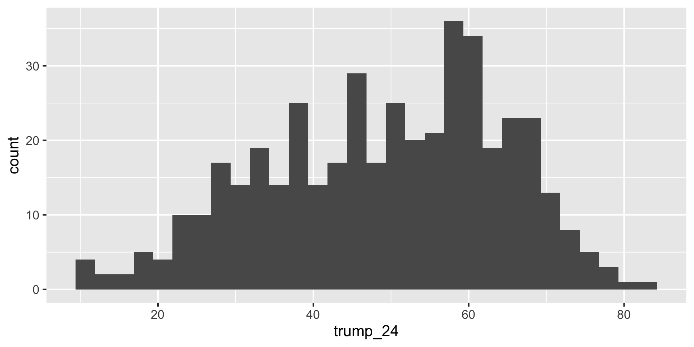](05-exploratory-data-analysis-I_files/figure-revealjs/unnamed-chunk-16-1.png)

## Participate 📱💻

Which of the following has the most appropriate binwidth for visualizing the distribution of `trump_24`?

[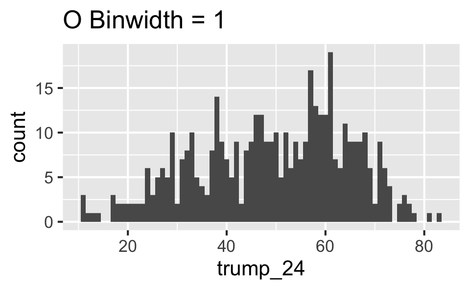](05-exploratory-data-analysis-I_files/figure-revealjs/unnamed-chunk-17-1.png)

[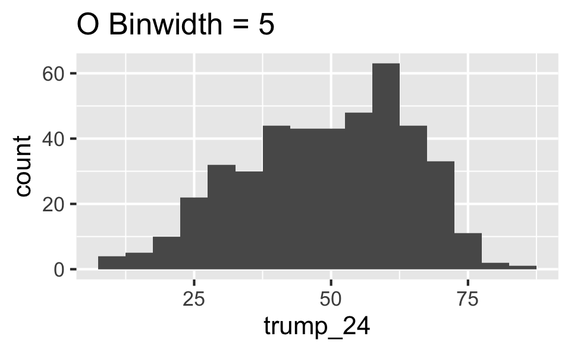](05-exploratory-data-analysis-I_files/figure-revealjs/unnamed-chunk-17-2.png)

[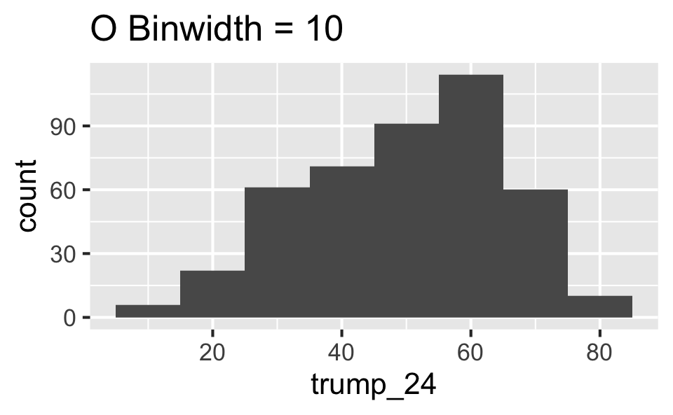](05-exploratory-data-analysis-I_files/figure-revealjs/unnamed-chunk-17-3.png)

[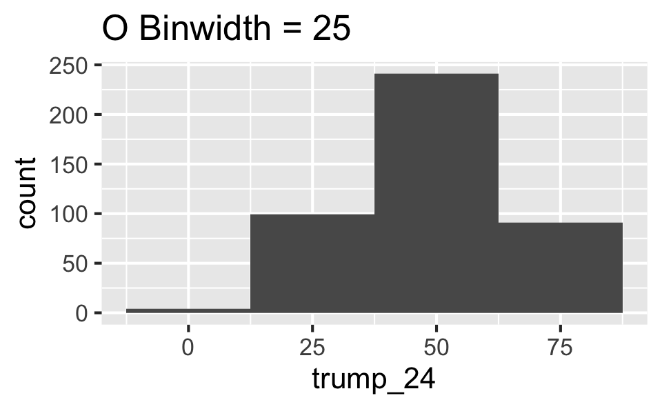](05-exploratory-data-analysis-I_files/figure-revealjs/unnamed-chunk-17-4.png)

[](images/05/wooclap-qr.png)

Go to [wooclap.com](https://app.wooclap.com/KUCTINK) and use the code KUCTINK.

## Histogram - Step 4

``` numberSource
ggplot(gerrymander_24, aes(x = trump_24)) +
  geom_histogram(binwidth = 5) +
  scale_x_continuous(labels = label_percent(scale = 1))
```

[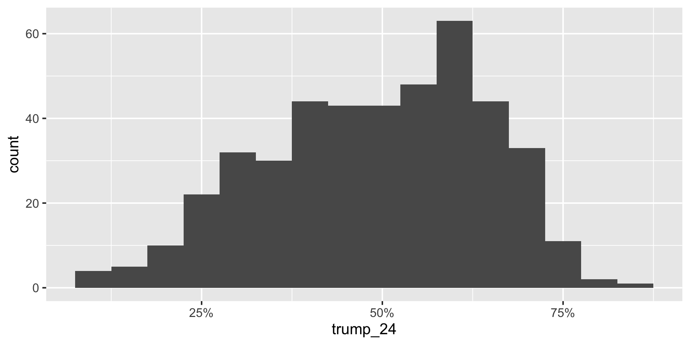](05-exploratory-data-analysis-I_files/figure-revealjs/unnamed-chunk-18-1.png)

## Histogram - Step 5

``` numberSource
ggplot(gerrymander_24, aes(x = trump_24)) +
  geom_histogram(binwidth = 5) +
  scale_x_continuous(labels = label_percent(scale = 1)) +
  labs(
    title = "Percent of vote received by Trump in 2024 Presidential Election",
    subtitle = "From each Congressional District",
    x = "Percent of vote",
    y = "Count"
  )
```

[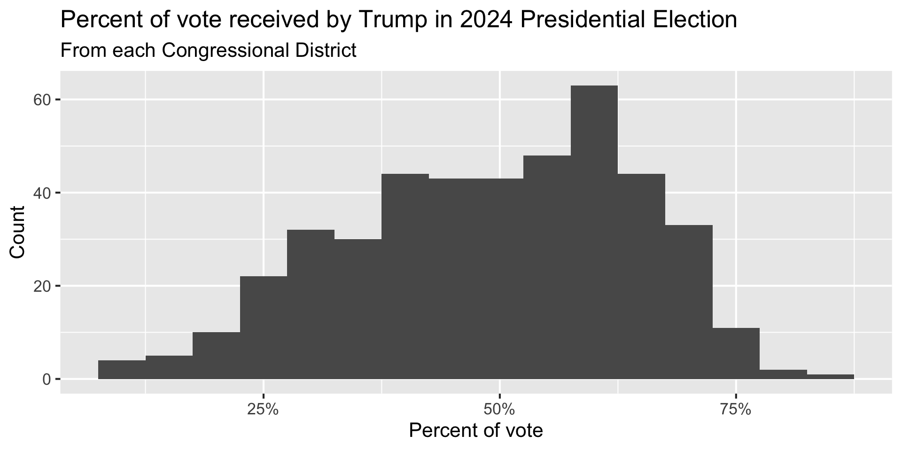](05-exploratory-data-analysis-I_files/figure-revealjs/unnamed-chunk-19-1.png)

## Box plot - Step 1

``` downlit
ggplot(gerrymander_24)
```

[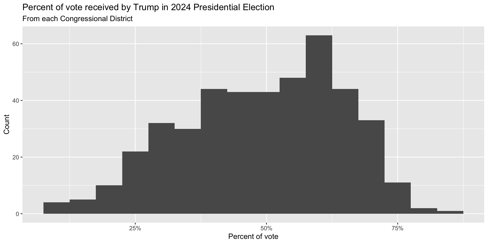](05-exploratory-data-analysis-I_files/figure-revealjs/unnamed-chunk-20-1.png)

## Box plot - Step 2

``` downlit
ggplot(gerrymander_24, aes(x = trump_24))
```

[](05-exploratory-data-analysis-I_files/figure-revealjs/unnamed-chunk-21-1.png)

## Box plot - Step 3

``` numberSource
ggplot(gerrymander_24, aes(x = trump_24)) +
  geom_boxplot()
```

[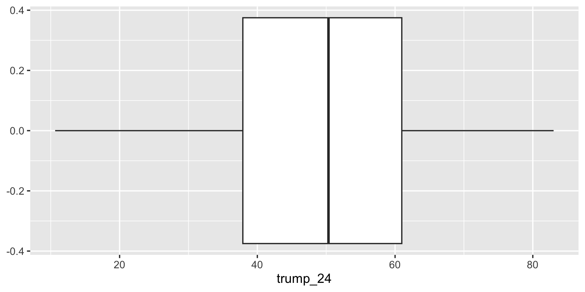](05-exploratory-data-analysis-I_files/figure-revealjs/unnamed-chunk-22-1.png)

## Box plot - Alternative Step 2 + 3

``` downlit
ggplot(gerrymander_24, aes(y = trump_24)) +
  geom_boxplot()
```

[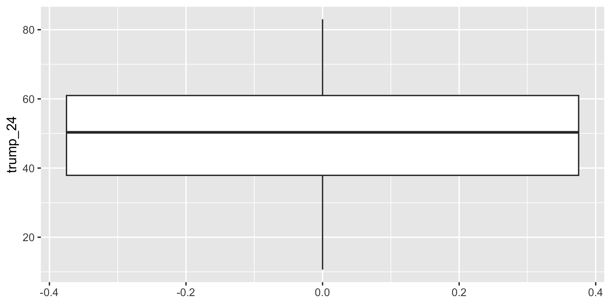](05-exploratory-data-analysis-I_files/figure-revealjs/unnamed-chunk-23-1.png)

## Box plot - Step 4

``` numberSource
ggplot(gerrymander_24, aes(x = trump_24)) +
  geom_boxplot() +
  labs(
    title = "Percent of vote received by Trump in 2024 Presidential Election",
    subtitle = "From each Congressional District",
    x = "Percent of vote",
    y = NULL
  )
```

[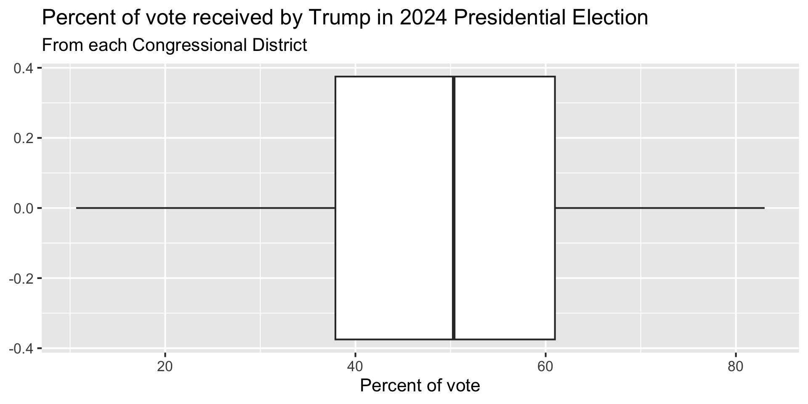](05-exploratory-data-analysis-I_files/figure-revealjs/unnamed-chunk-24-1.png)

## Density plot - Step 1

``` downlit
ggplot(gerrymander_24)
```

[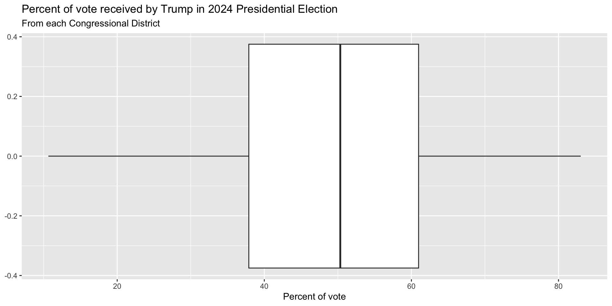](05-exploratory-data-analysis-I_files/figure-revealjs/unnamed-chunk-25-1.png)

## Density plot - Step 2

``` downlit
ggplot(gerrymander_24, aes(x = trump_24))
```

[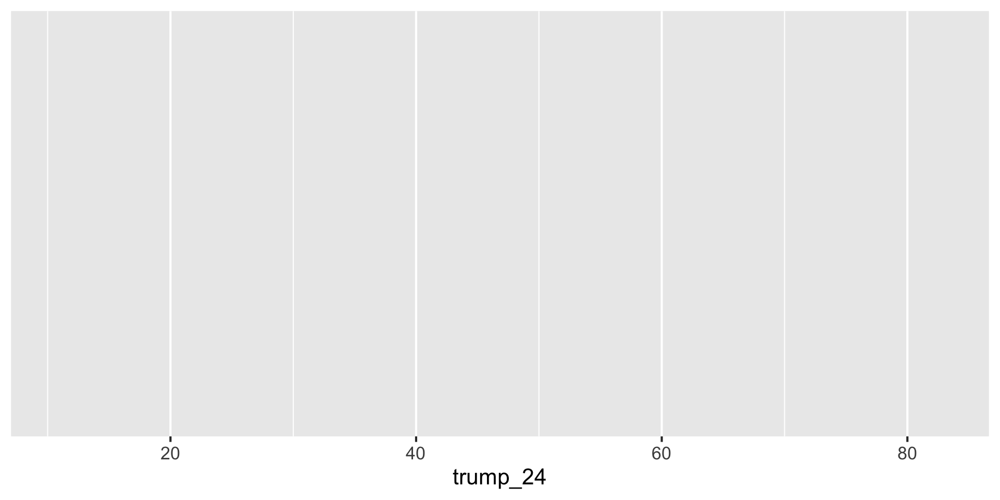](05-exploratory-data-analysis-I_files/figure-revealjs/unnamed-chunk-26-1.png)

## Density plot - Step 3

``` numberSource
ggplot(gerrymander_24, aes(x = trump_24)) +
  geom_density()
```

[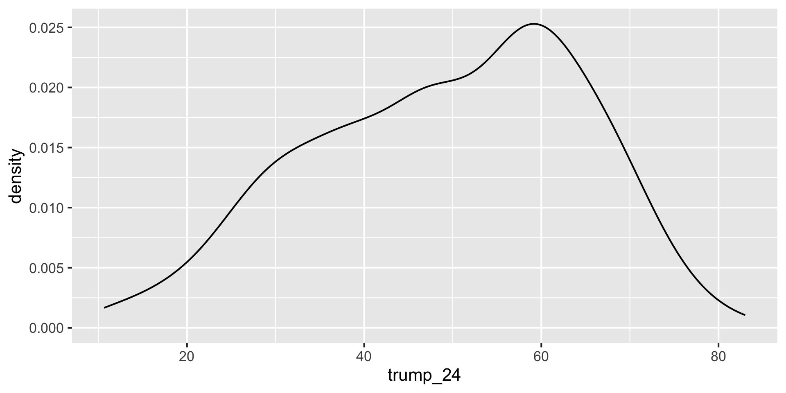](05-exploratory-data-analysis-I_files/figure-revealjs/unnamed-chunk-27-1.png)

## Density plot - Step 4

``` downlit
ggplot(gerrymander_24, aes(x = trump_24)) +
  geom_density(color = "firebrick")
```

[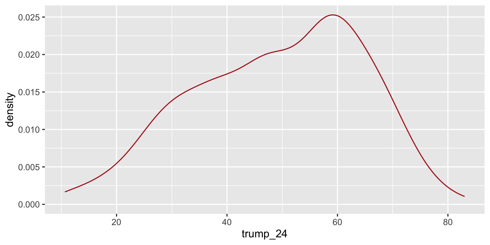](05-exploratory-data-analysis-I_files/figure-revealjs/unnamed-chunk-28-1.png)

## Density plot - Step 5

``` downlit
ggplot(gerrymander_24, aes(x = trump_24)) +
  geom_density(color = "firebrick", fill = "firebrick1")
```

[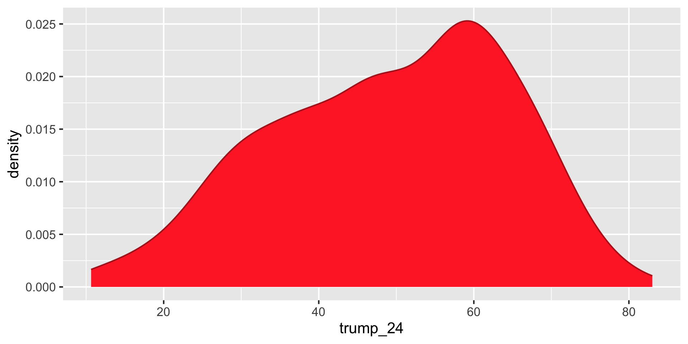](05-exploratory-data-analysis-I_files/figure-revealjs/unnamed-chunk-29-1.png)

## Density plot - Step 6

``` downlit
ggplot(gerrymander_24, aes(x = trump_24)) +
  geom_density(color = "firebrick", fill = "firebrick1", alpha = 0.5)
```

[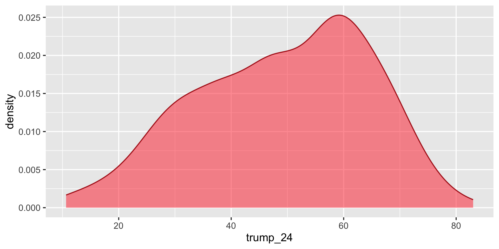](05-exploratory-data-analysis-I_files/figure-revealjs/unnamed-chunk-30-1.png)

## Density plot - Step 7

``` downlit
ggplot(gerrymander_24, aes(x = trump_24)) +
  geom_density(
    color = "firebrick",
    fill = "firebrick1",
    alpha = 0.5,
    linewidth = 1
  )
```

[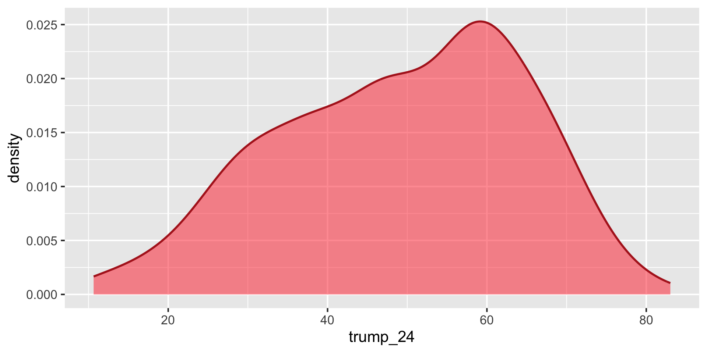](05-exploratory-data-analysis-I_files/figure-revealjs/unnamed-chunk-31-1.png)

## Density plot - Step 8

``` numberSource
ggplot(gerrymander_24, aes(x = trump_24)) +
  geom_density(
    color = "firebrick",
    fill = "firebrick1",
    alpha = 0.5,
    linewidth = 2
  ) +
  labs(
    title = "Percent of vote received by Trump in 2024 Presidential Election",
    subtitle = "From each Congressional District",
    x = "Percent of vote",
    y = "Density"
  )
```

[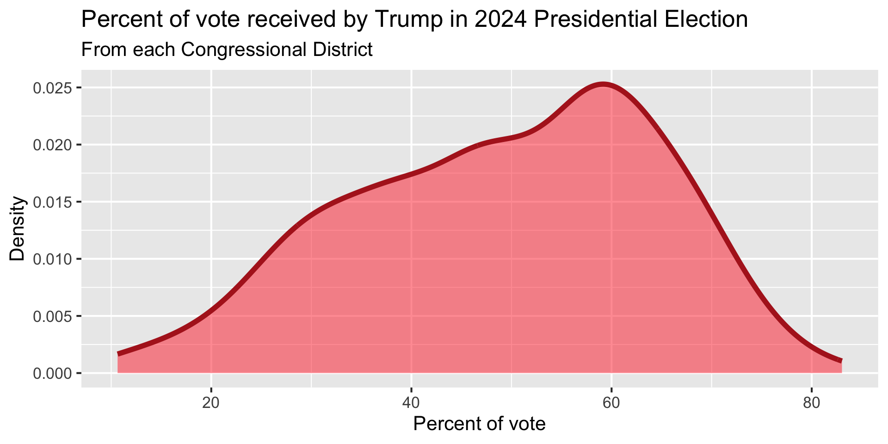](05-exploratory-data-analysis-I_files/figure-revealjs/unnamed-chunk-32-1.png)

## Summary statistics

``` downlit
gerrymander_24 |>
  summarize(
    mean = mean(trump_24),
    sd = sd(trump_24),
    min = min(trump_24),
    q25 = quantile(trump_24, 0.25),
    median = median(trump_24),
    q75 = quantile(trump_24, 0.75),
    max = max(trump_24),
  )
```

    # A tibble: 1 × 7
       mean    sd   min   q25 median   q75   max
      <dbl> <dbl> <dbl> <dbl>  <dbl> <dbl> <dbl>
    1  49.2  15.2  10.6  37.9   50.3  61.0  83.0

## Distribution of votes for Trump in the 2024 election

Describe the distribution of percent of vote received by Trump in 2024 Presidential Election from Congressional Districts.

- Shape: The distribution of votes for Trump in the 2024 election from Congressional Districts is **unimodal and left-skewed**.

- Center: The percent of vote received by Trump in the 2024 Presidential Election from a **typical** Congressional Districts is 50.3%.

- Spread: In the **middle 50%** of Congressional Districts, 37.9% to 61% of voters voted for Trump in the 2024 Presidential Election.

- Unusual observations: -

# Bivariate analysis

## Bivariate analysis

Analyzing the relationship between two variables:

- Numerical + numerical: scatterplot

- Numerical + categorical: side-by-side box plots, violin plots, etc.

- Categorical + categorical: stacked bar plots

- Using an aesthetic (e.g., fill, color, shape, etc.) or facets to represent the second variable in any plot

## Side-by-side box plots

``` numberSource
ggplot(
  gerrymander_24,
  aes(
    x = trump_24,
    y = gerry_24
  )
) +
  geom_boxplot()
```

[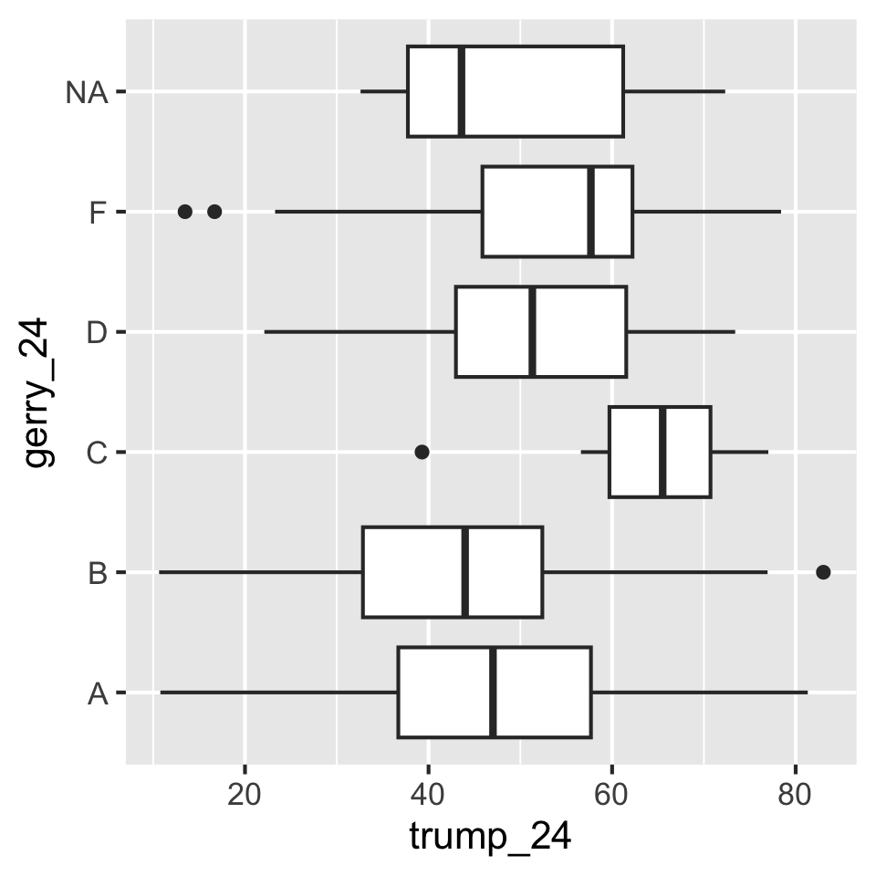](05-exploratory-data-analysis-I_files/figure-revealjs/unnamed-chunk-34-1.png)

## Participate 📱💻

What goes in the `[blank]` in the code below to do the following step for each level of `gerry_24`?

``` downlit
gerrymander_24 |>
  # [blank]
  summarize(
    min = min(trump_24),
    q25 = quantile(trump_24, 0.25),
    median = median(trump_24),
    q75 = quantile(trump_24, 0.75),
    max = max(trump_24),
  )
```

- `filter(gerry_24)`
- `group_by(gerry_24)`
- `mutate(gerry_24)`
- `select(gerry_24)`

[](images/05/wooclap-qr.png)

Go to [wooclap.com](https://app.wooclap.com/KUCTINK) and use the code KUCTINK.

## Grouped summary statistics

``` downlit
gerrymander_24 |>
  group_by(gerry_24) |>
  summarize(
    min = min(trump_24),
    q25 = quantile(trump_24, 0.25),
    median = median(trump_24),
    q75 = quantile(trump_24, 0.75),
    max = max(trump_24),
  )
```

    # A tibble: 6 × 6
      gerry_24   min   q25 median   q75   max
      <chr>    <dbl> <dbl>  <dbl> <dbl> <dbl>
    1 A         10.8  36.7   47.0  57.7  81.3
    2 B         10.6  32.8   44.0  52.4  83.0
    3 C         39.3  59.7   65.5  70.7  77.0
    4 D         22.1  43.0   51.3  61.5  73.4
    5 F         13.5  45.9   57.7  62.2  78.4
    6 <NA>      32.6  37.8   43.6  61.2  72.3

## `NA` for gerrymandering?

``` numberSource
gerrymander_24 |>
  filter(is.na(gerry_24)) |>
  select(district, starts_with("state"), starts_with("gerry"))
```

    # A tibble: 10 × 6
       district state_abb state        gerry_22 gerry_24 gerry_26
       <chr>    <chr>     <chr>        <chr>    <chr>    <chr>   
     1 AK-00    AK        Alaska       <NA>     <NA>     <NA>    
     2 DE-00    DE        Delaware     <NA>     <NA>     <NA>    
     3 HI-01    HI        Hawaii       <NA>     <NA>     <NA>    
     4 HI-02    HI        Hawaii       <NA>     <NA>     <NA>    
     5 ND-00    ND        North Dakota <NA>     <NA>     <NA>    
     6 RI-01    RI        Rhode Island <NA>     <NA>     <NA>    
     7 RI-02    RI        Rhode Island <NA>     <NA>     <NA>    
     8 SD-00    SD        South Dakota <NA>     <NA>     <NA>    
     9 VT-00    VT        Vermont      <NA>     <NA>     <NA>    
    10 WY-00    WY        Wyoming      <NA>     <NA>     <NA>    

## Density plots

``` numberSource
gerrymander_24 |>
  filter(!is.na(gerry_24)) |>
  ggplot(aes(x = trump_24, color = gerry_24)) +
  geom_density()
```

[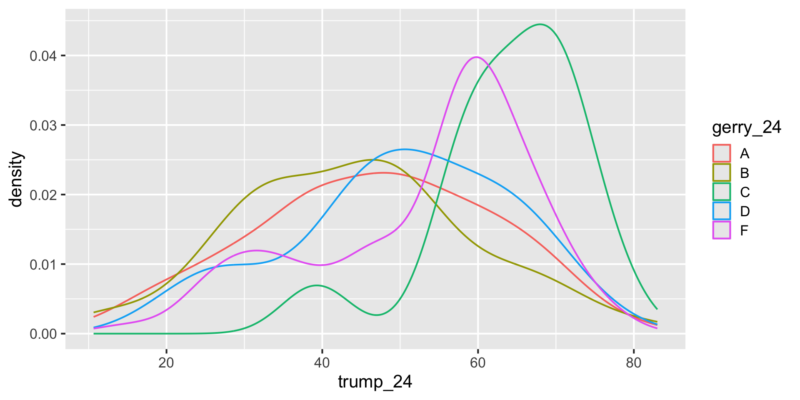](05-exploratory-data-analysis-I_files/figure-revealjs/unnamed-chunk-38-1.png)

## Filled density plots

``` numberSource
gerrymander_24 |>
  filter(!is.na(gerry_24)) |>
  ggplot(aes(x = trump_24, color = gerry_24, fill = gerry_24)) +
  geom_density()
```

[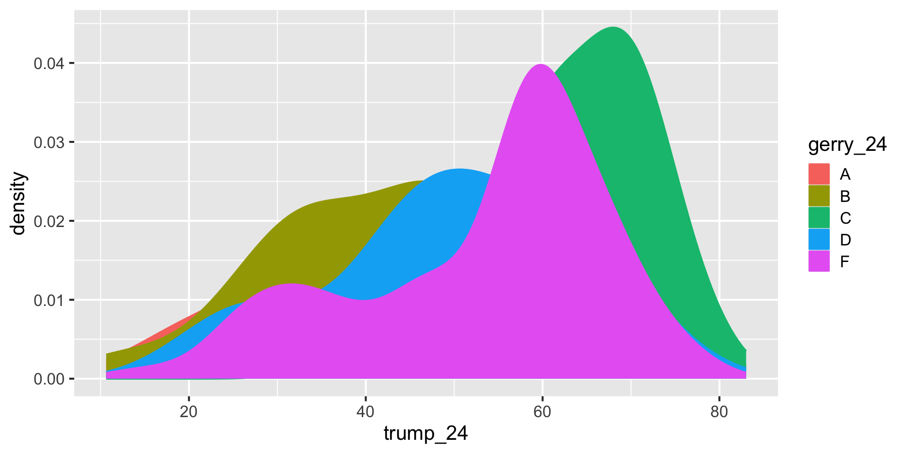](05-exploratory-data-analysis-I_files/figure-revealjs/unnamed-chunk-39-1.png)

## Better filled density plots

``` numberSource
gerrymander_24 |>
  filter(!is.na(gerry_24)) |>
  ggplot(aes(x = trump_24, color = gerry_24, fill = gerry_24)) +
  geom_density(alpha = 0.5)
```

[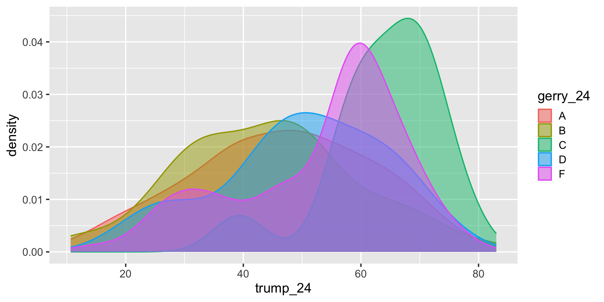](05-exploratory-data-analysis-I_files/figure-revealjs/unnamed-chunk-40-1.png)

## Better colors

``` numberSource
gerrymander_24 |>
  filter(!is.na(gerry_24)) |>
  ggplot(aes(x = trump_24, color = gerry_24, fill = gerry_24)) +
  geom_density(alpha = 0.5) +
  scale_color_viridis_d() +
  scale_fill_viridis_d()
```

[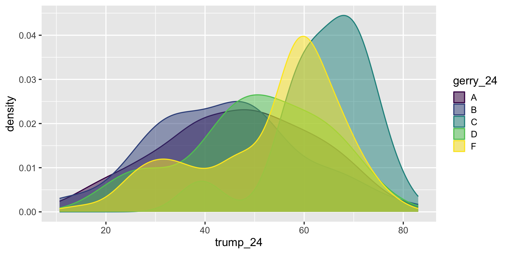](05-exploratory-data-analysis-I_files/figure-revealjs/unnamed-chunk-41-1.png)

## Violin plots

``` numberSource
gerrymander_24 |>
  filter(!is.na(gerry_24)) |>
  ggplot(aes(x = trump_24, y = gerry_24, color = gerry_24)) +
  geom_violin() +
  scale_color_viridis_d()
```

[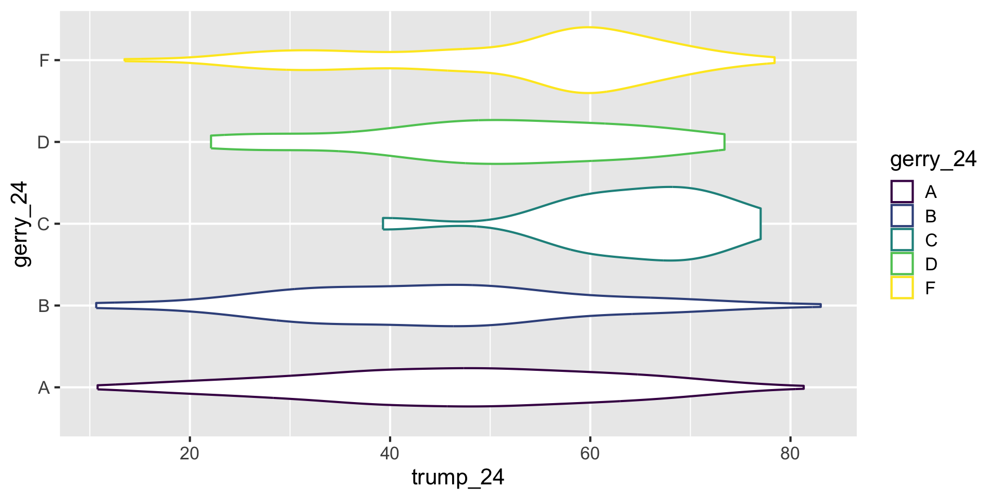](05-exploratory-data-analysis-I_files/figure-revealjs/unnamed-chunk-42-1.png)

## Multiple geoms

``` numberSource
gerrymander_24 |>
  filter(!is.na(gerry_24)) |>
  ggplot(aes(x = trump_24, y = gerry_24, color = gerry_24)) +
  geom_violin() +
  geom_point() +
  scale_color_viridis_d()
```

[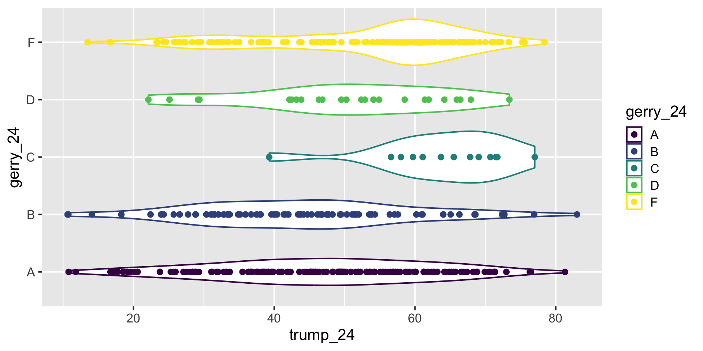](05-exploratory-data-analysis-I_files/figure-revealjs/unnamed-chunk-43-1.png)

## Multiple geoms

``` numberSource
gerrymander_24 |>
  filter(!is.na(gerry_24)) |>
  ggplot(aes(x = trump_24, y = gerry_24, color = gerry_24)) +
  geom_violin() +
  geom_jitter() +
  scale_color_viridis_d()
```

[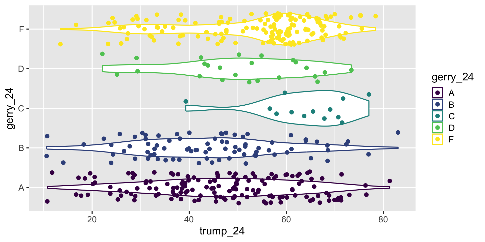](05-exploratory-data-analysis-I_files/figure-revealjs/unnamed-chunk-44-1.png)

## Remove legend

``` numberSource
gerrymander_24 |>
  filter(!is.na(gerry_24)) |>
  ggplot(aes(x = trump_24, y = gerry_24, color = gerry_24)) +
  geom_violin() +
  geom_jitter() +
  scale_color_viridis_d() +
  theme(legend.position = "none")
```

[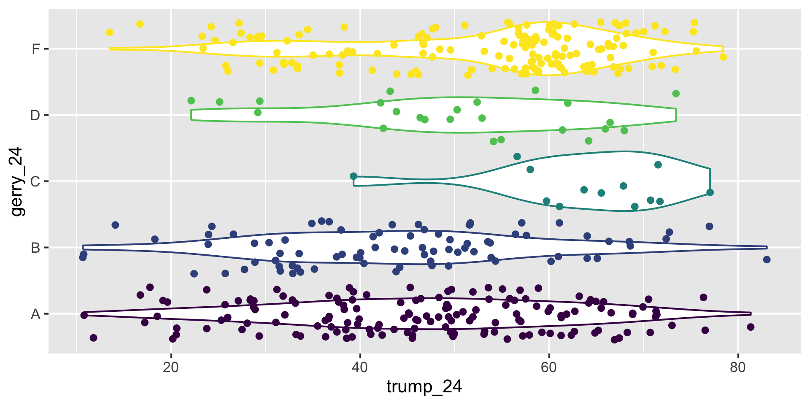](05-exploratory-data-analysis-I_files/figure-revealjs/unnamed-chunk-45-1.png)
