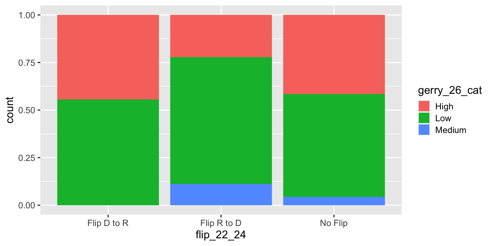
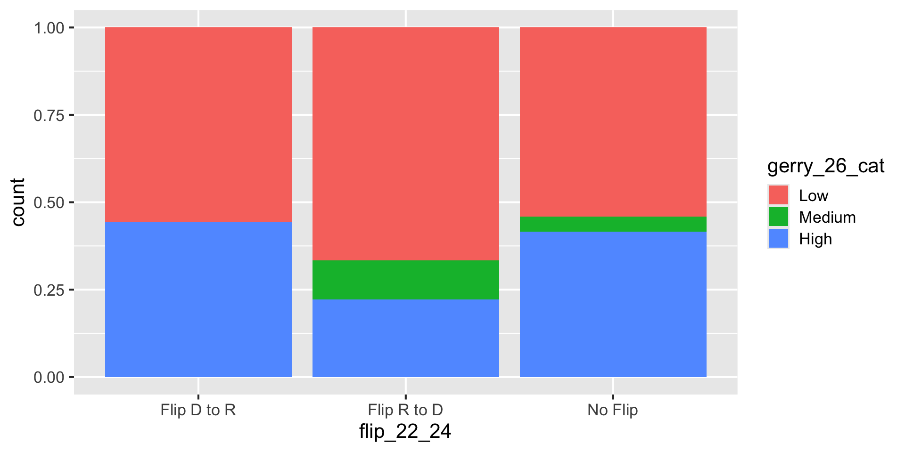

# Exploratory data analysis II

Lecture 6

Author

Affiliation

Dr. Mine Çetinkaya-Rundel and Josh Lim

Duke University\
STA 199 - Fall 2026

Published

September 14, 2026

# Warm up

## While you wait: Get your application exercise

If you haven’t done so at the end of last class:

- Go to your `ae` project in Positron.

- Make sure all of your changes up to this point are committed and pushed, i.e., there’s nothing left in your source control pane.

- Click sync to get today’s application exercise file. You can also click on the three dots next to CHANGES and click Pull.

## Wait a minute, this ain’t Mine

- Hi, I’m Josh
- 3rd Year PhD in Statistical Science
- From the Bay Area, California
- Graduated from UCLA in 2024
- Fun Fact: I actually got to teach this course in the summer (like just over a month ago!)

## My lovely class

[](images/06/joshsummer.png)

## Hmm, Josh have I seen you somewhere before?

\


[](images/06/dukevolley.jpg)

## Announcements

HW 2 is due Wednesday, Sep 16 at 11:59 pm:

- Push all work to GitHub.

- Submit a PDF of your `hw-2.pdf` file to Gradescope and mark your pages.

# From last time: Application exercise

## AE 02

Work through the application exercise `ae-02`. Periodically, and at the end, preview, commit, and push your edits.

## Multivariate analysis

Analyzing the relationship between multiple variables:

- In general, one variable is identified as the **outcome** of interest

- The remaining variables are **predictors** or **explanatory variables**

- Plots for exploring multivariate relationships are the same as those for bivariate relationships, but **conditional** on one or more variables

  - Conditioning can be done via faceting or aesthetic mappings (e.g., scatterplot of `y` vs. `x1`, colored by `x2`, faceted by `x3`)

- Summary statistics for exploring multivariate relationships are the same as those for bivariate relationships, but **conditional** on one or more variables

  - Conditioning can be done via grouping (e.g., correlation between `y` and `x1`, grouped by levels of `x2` and `x3`)

## From the application exercise: `flip_22_24`

``` downlit
gerrymander_24 <- gerrymander_24 |>
  mutate(
    flip_22_24 = case_when(
      house_party_22 == "Republican" &
        house_party_24 == "Democrat" ~ "Flip R to D",
      house_party_22 == "Democrat" &
        house_party_24 == "Republican" ~ "Flip D to R",
      .default = "No Flip"
    )
  ) |>
  relocate(house_party_22, house_party_24, flip_22_24, gerry_26, .after = state)
```

# `mutate()`

## From grades to categories

How can we combine the 2026 gerrymandering grades into low, medium, and high prevalence of gerrymandering?

- A or B → Low
- C → Medium
- D or F → High

We’ll create a new variable called `gerry_26_cat` from `gerry_26`.

## `mutate()`

- The `mutate()` function transforms (*mutates*) a data frame by creating a new column or updating an existing one

- We choose a name for the column on the left of `=` and describe how to calculate it on the right

- To create `gerry_26_cat`, we need different values for different grades

``` downlit
gerrymander_24 |>
  mutate(gerry_26_cat = ...)
```

## `mutate()` and `case_when()`

Use `case_when()` to recode with multiple conditions:

``` numberSource
gerrymander_24 |>
  mutate(
    gerry_26_cat = case_when(
      gerry_26 %in% c("A", "B") ~ "Low",
      gerry_26 == "C" ~ "Medium",
      gerry_26 %in% c("D", "F") ~ "High"
    )
  ) |>
  select(district, gerry_26, gerry_26_cat)
```

    # A tibble: 435 × 3
       district gerry_26 gerry_26_cat
       <chr>    <chr>    <chr>       
     1 AK-00    <NA>     <NA>        
     2 AL-01    B        Low         
     3 AL-02    B        Low         
     4 AL-03    B        Low         
     5 AL-04    B        Low         
     6 AL-05    B        Low         
     7 AL-06    B        Low         
     8 AL-07    B        Low         
     9 AR-01    C        Medium      
    10 AR-02    C        Medium      
    # ℹ 425 more rows

- Each condition goes on the left of `~`, and its new value goes on the right
- The first matching condition determines the value
- Grades that don’t match any condition, including missing grades, get `NA`

## `mutate()` and store

Creating a column in a pipeline doesn’t change the original data frame:

``` downlit
gerrymander_24 |>
  select(district, gerry_26, gerry_26_cat)
```

    Error in `select()`:
    ! Can't select columns that don't exist.
    ✖ Column `gerry_26_cat` doesn't exist.

. . .

To keep the new column, store the result:

``` downlit
gerrymander_24 <- gerrymander_24 |>
  mutate(
    gerry_26_cat = case_when(
      gerry_26 %in% c("A", "B") ~ "Low",
      gerry_26 == "C" ~ "Medium",
      gerry_26 %in% c("D", "F") ~ "High"
    )
  )
```

## Check the new variable

``` downlit
gerrymander_24 |>
  select(district, gerry_26, gerry_26_cat)
```

    # A tibble: 435 × 3
       district gerry_26 gerry_26_cat
       <chr>    <chr>    <chr>       
     1 AK-00    <NA>     <NA>        
     2 AL-01    B        Low         
     3 AL-02    B        Low         
     4 AL-03    B        Low         
     5 AL-04    B        Low         
     6 AL-05    B        Low         
     7 AL-06    B        Low         
     8 AL-07    B        Low         
     9 AR-01    C        Medium      
    10 AR-02    C        Medium      
    # ℹ 425 more rows

What value does `gerry_26_cat` have when `gerry_26` is missing? Why?

## What’s going on?

The gerrymandering categories appear in an unexpected order. What’s going on?

``` downlit
gerrymander_24 |>
  filter(!is.na(gerry_26_cat)) |>
  ggplot(aes(x = flip_22_24, fill = gerry_26_cat)) +
  geom_bar(position = "fill")
```

[](06-exploratory-data-analysis-II_files/figure-revealjs/unnamed-chunk-8-1.png)

## `mutate()` and `fct_relevel()`

- `flip_22_24` is a character variable, so the plot orders its values alphabetically
- `fct_relevel()` creates a factor with levels in the specified order
- We can use `mutate()` to overwrite `flip_22_24` and store the change

``` numberSource
gerrymander_24 <- gerrymander_24 |>
  mutate(
    gerry_26_cat = fct_relevel(gerry_26_cat, "Low", "Medium", "High")
  )

gerrymander_24 |>
  select(district, gerry_26, gerry_26_cat)
```

    # A tibble: 435 × 3
       district gerry_26 gerry_26_cat
       <chr>    <chr>    <fct>       
     1 AK-00    <NA>     <NA>        
     2 AL-01    B        Low         
     3 AL-02    B        Low         
     4 AL-03    B        Low         
     5 AL-04    B        Low         
     6 AL-05    B        Low         
     7 AL-06    B        Low         
     8 AL-07    B        Low         
     9 AR-01    C        Medium      
    10 AR-02    C        Medium      
    # ℹ 425 more rows

## Revisit the plot

How does the distribution of 2022–2024 flip outcomes vary by prevalence of gerrymandering for the 2026 election?

``` downlit
gerrymander_24 |>
  filter(!is.na(gerry_26_cat)) |>
  ggplot(aes(x = flip_22_24, fill = gerry_26_cat)) +
  geom_bar(position = "fill")
```

[](06-exploratory-data-analysis-II_files/figure-revealjs/unnamed-chunk-10-1.png)

# `group_by()`, `summarize()`, `count()`

## Spot the difference

What does `group_by()` do?

``` downlit
gerrymander_24 |>
  filter(!is.na(gerry_26_cat)) |>
  count(flip_22_24, gerry_26_cat)
```

    # A tibble: 8 × 3
      flip_22_24  gerry_26_cat     n
      <chr>       <fct>        <int>
    1 Flip D to R Low              5
    2 Flip D to R High             4
    3 Flip R to D Low              6
    4 Flip R to D Medium           1
    5 Flip R to D High             2
    6 No Flip     Low            220
    7 No Flip     Medium          18
    8 No Flip     High           169

``` downlit
gerrymander_24 |>
  filter(!is.na(gerry_26_cat)) |>
  count(flip_22_24, gerry_26_cat) |>
  group_by(flip_22_24)
```

    # A tibble: 8 × 3
    # Groups:   flip_22_24 [3]
      flip_22_24  gerry_26_cat     n
      <chr>       <fct>        <int>
    1 Flip D to R Low              5
    2 Flip D to R High             4
    3 Flip R to D Low              6
    4 Flip R to D Medium           1
    5 Flip R to D High             2
    6 No Flip     Low            220
    7 No Flip     Medium          18
    8 No Flip     High           169

## Let’s simplify!

What does `group_by()` do in the following pipeline?

``` downlit
gerrymander |>
  summarize(mean_trump_24 = mean(trump_24, na.rm = TRUE))
```

    # A tibble: 1 × 1
      mean_trump_24
              <dbl>
    1          49.2

``` downlit
gerrymander |>
  group_by(state) |>
  summarize(mean_trump_24 = mean(trump_24, na.rm = TRUE))
```

    # A tibble: 50 × 2
       state       mean_trump_24
       <chr>               <dbl>
     1 Alabama              64.0
     2 Alaska               54.5
     3 Arizona              50.3
     4 Arkansas             64.6
     5 California           38.2
     6 Colorado             42.9
     7 Connecticut          41.8
     8 Delaware             41.9
     9 Florida              55.2
    10 Georgia              49.9
    # ℹ 40 more rows

## `group_by()`

- Group by converts a data frame to a grouped data frame, where subsequent operations are performed once per group

- `ungroup()` removes grouping

``` downlit
gerrymander_24 |>
  select(state, district, house_party_22, house_party_24) |>
  group_by(state)
```

    # A tibble: 435 × 4
    # Groups:   state [50]
       state    district house_party_22 house_party_24
       <chr>    <chr>    <chr>          <chr>         
     1 Alaska   AK-00    Democrat       Republican    
     2 Alabama  AL-01    Republican     Republican    
     3 Alabama  AL-02    Republican     Democrat      
     4 Alabama  AL-03    Republican     Republican    
     5 Alabama  AL-04    Republican     Republican    
     6 Alabama  AL-05    Republican     Republican    
     7 Alabama  AL-06    Republican     Republican    
     8 Alabama  AL-07    Democrat       Democrat      
     9 Arkansas AR-01    Republican     Republican    
    10 Arkansas AR-02    Republican     Republican    
    # ℹ 425 more rows

``` numberSource
gerrymander_24 |>
  select(state, district, house_party_22, house_party_24) |>
  group_by(state) |>
  ungroup()
```

    # A tibble: 435 × 4
       state    district house_party_22 house_party_24
       <chr>    <chr>    <chr>          <chr>         
     1 Alaska   AK-00    Democrat       Republican    
     2 Alabama  AL-01    Republican     Republican    
     3 Alabama  AL-02    Republican     Democrat      
     4 Alabama  AL-03    Republican     Republican    
     5 Alabama  AL-04    Republican     Republican    
     6 Alabama  AL-05    Republican     Republican    
     7 Alabama  AL-06    Republican     Republican    
     8 Alabama  AL-07    Democrat       Democrat      
     9 Arkansas AR-01    Republican     Republican    
    10 Arkansas AR-02    Republican     Republican    
    # ℹ 425 more rows

## `group_by() |> summarize()`

A common pipeline is `group_by()` and then `summarize()` to **calculate** summary statistics for each group:

``` downlit
gerrymander_24 |>
  group_by(state) |>
  summarize(
    mean_trump_24 = mean(trump_24, na.rm = TRUE),
    median_trump_24 = median(trump_24, na.rm = TRUE)
  )
```

    # A tibble: 50 × 3
       state       mean_trump_24 median_trump_24
       <chr>               <dbl>           <dbl>
     1 Alabama              64.0            68.5
     2 Alaska               54.5            54.5
     3 Arizona              50.3            50.9
     4 Arkansas             64.6            65.1
     5 California           38.2            37.4
     6 Colorado             42.9            45.3
     7 Connecticut          41.8            42.0
     8 Delaware             41.9            41.9
     9 Florida              55.2            57.4
    10 Georgia              49.9            58.8
    # ℹ 40 more rows

## `group_by() |> summarize()`

This pipeline can also be used to **count** number of observations for each group:

``` downlit
gerrymander_24 |>
  group_by(state) |>
  summarize(n = n())
```

    # A tibble: 50 × 2
       state           n
       <chr>       <int>
     1 Alabama         7
     2 Alaska          1
     3 Arizona         9
     4 Arkansas        4
     5 California     52
     6 Colorado        8
     7 Connecticut     5
     8 Delaware        1
     9 Florida        28
    10 Georgia        14
    # ℹ 40 more rows

## `summarize()`

``` downlit
... |>
  summarize(
    name_of_summary_statistic = summary_function(variable)
  )
```

. . .

- `name_of_summary_statistic`: Anything you want to call it!
  - Recommendation: Keep it short and evocative
- `summary_function()`:
  - `n()`: number of observations
  - [`mean()`](https://rdrr.io/r/base/mean.html): mean
  - [`median()`](https://rdrr.io/r/stats/median.html): median
  - [`sd()`](https://rdrr.io/r/stats/sd.html): standard deviation
  - [`min()`](https://rdrr.io/r/base/Extremes.html): minimum
  - [`max()`](https://rdrr.io/r/base/Extremes.html): maximum
  - [`IQR()`](https://rdrr.io/r/stats/IQR.html): inter-quartile range
  - [`quantile()`](https://rdrr.io/r/stats/quantile.html): quantile (e.g., 0.25, 0.75, etc.)

## Spot the difference

What’s the difference between the following two pipelines?

``` downlit
gerrymander_24 |>
  group_by(state) |>
  summarize(n = n())
```

    # A tibble: 50 × 2
       state           n
       <chr>       <int>
     1 Alabama         7
     2 Alaska          1
     3 Arizona         9
     4 Arkansas        4
     5 California     52
     6 Colorado        8
     7 Connecticut     5
     8 Delaware        1
     9 Florida        28
    10 Georgia        14
    # ℹ 40 more rows

``` downlit
gerrymander_24 |>
  count(state)
```

    # A tibble: 50 × 2
       state           n
       <chr>       <int>
     1 Alabama         7
     2 Alaska          1
     3 Arizona         9
     4 Arkansas        4
     5 California     52
     6 Colorado        8
     7 Connecticut     5
     8 Delaware        1
     9 Florida        28
    10 Georgia        14
    # ℹ 40 more rows

## `count()`

``` downlit
... |>
  count(variable)
```

``` downlit
... |>
  count(variable1, variable2)
```

- Count the number of observations in each level of variable(s)

- Place the counts in a variable called `n`

## Review

How would you write the following pipeline with `count()` instead?

``` downlit
gerrymander_24 |>
  group_by(state) |>
  summarize(n = n()) |>
  arrange(desc(n))
```

    # A tibble: 50 × 2
       state              n
       <chr>          <int>
     1 California        52
     2 Texas             38
     3 Florida           28
     4 New York          26
     5 Illinois          17
     6 Pennsylvania      17
     7 Ohio              15
     8 Georgia           14
     9 North Carolina    14
    10 Michigan          13
    # ℹ 40 more rows

- `gerrymander_24 |> arrange(state) |> count()`
- `gerrymander_24 |> count(state) |> arrange(desc(n))`
- `gerrymander_24 |> count(state) |> sort(n)`
- `gerrymander_24 |> count(state, sort = TRUE)`
