# Tidying data

Lecture 7

Author

Affiliation

Dr. Mine Çetinkaya-Rundel

Duke University\
STA 199 - Fall 2026

Published

September 16, 2026

# Warm-up

## While you wait: Participate 📱💻

Which of the following plots does this code produce?

``` downlit
ggplot(gerrymander_24, aes(x = gerry_22, y = trump_24)) +
  geom_boxplot(aes(color = gerry_22)) +
  geom_beeswarm()
```

[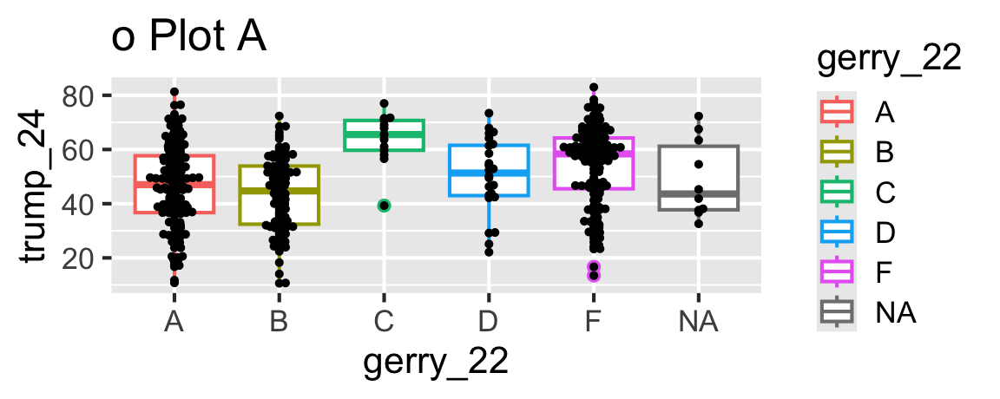](07-tidying-data_files/figure-revealjs/unnamed-chunk-4-1.png)

[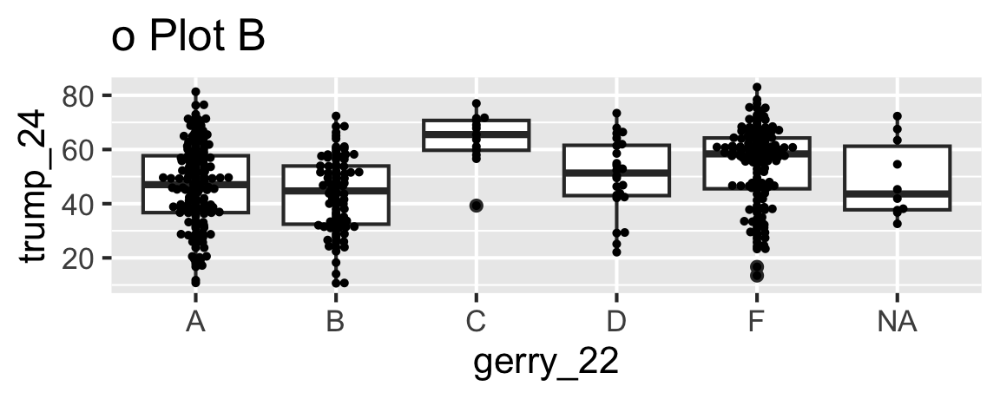](07-tidying-data_files/figure-revealjs/unnamed-chunk-4-2.png)

[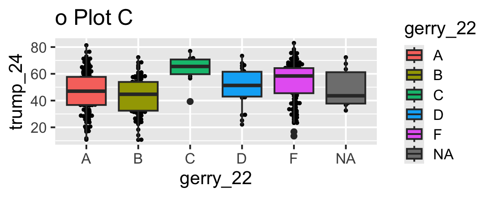](07-tidying-data_files/figure-revealjs/unnamed-chunk-4-3.png)

[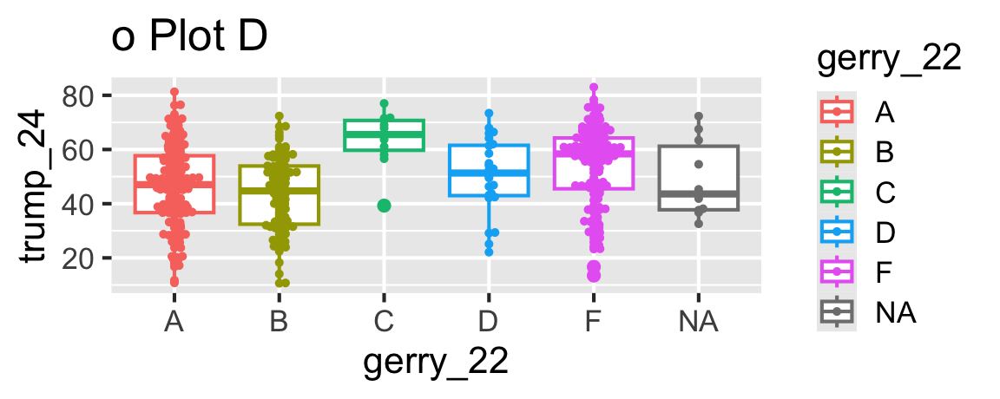](07-tidying-data_files/figure-revealjs/unnamed-chunk-4-4.png)

[](images/07/wooclap-qr.png)

Go to [wooclap.com](https://app.wooclap.com/ICNGKSL) and use the code ICNGKSL.

## Pause

Any questions before we get started?

## Recap: layering geoms

Update the following code to create the visualization on the right.

[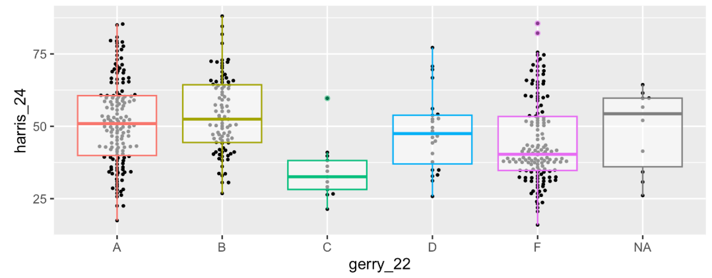](images/07/gerrymander-recreate.png)

``` downlit
ggplot(gerrymander_24, aes(x = gerry_22, y = harris_24)) +
  geom_boxplot(aes(color = gerry_22)) +
  geom_beeswarm()
```

[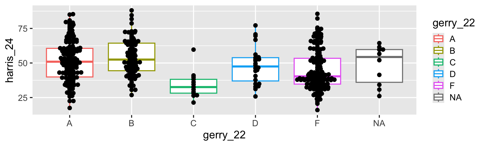](07-tidying-data_files/figure-revealjs/unnamed-chunk-5-1.png)

## Recap: layering geoms

0.  Original Code:

``` downlit
ggplot(gerrymander_24, aes(x = gerry_22, y = harris_24)) +
  geom_boxplot(aes(color = gerry_22)) +
  geom_beeswarm()
```

[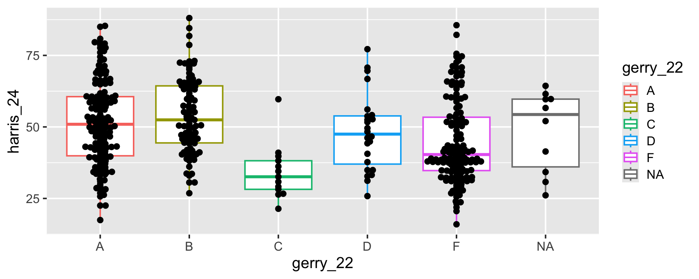](07-tidying-data_files/figure-revealjs/unnamed-chunk-6-1.png)


## Recap: layering geoms

1.  Swap the order of the two geoms.

``` downlit
ggplot(gerrymander_24, aes(x = gerry_22, y = harris_24)) +
  geom_beeswarm(size = 0.8) +
  geom_boxplot(aes(color = gerry_22))
```

[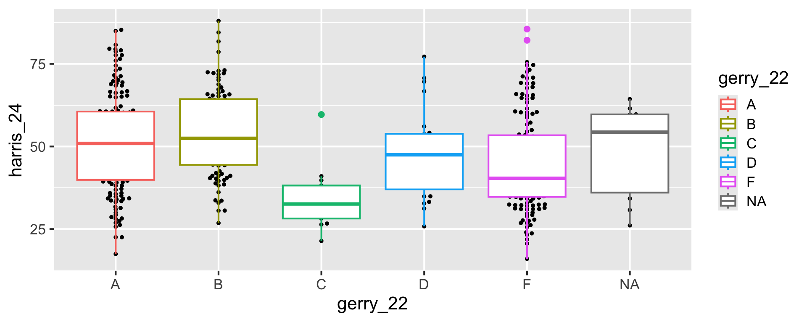](07-tidying-data_files/figure-revealjs/unnamed-chunk-7-1.png)


## Recap: layering geoms

2.  Make the boxplots semi-transparent.

``` downlit
ggplot(gerrymander_24, aes(x = gerry_22, y = harris_24)) +
  geom_beeswarm(size = 0.8) +
  geom_boxplot(aes(color = gerry_22), alpha = 0.5)
```

[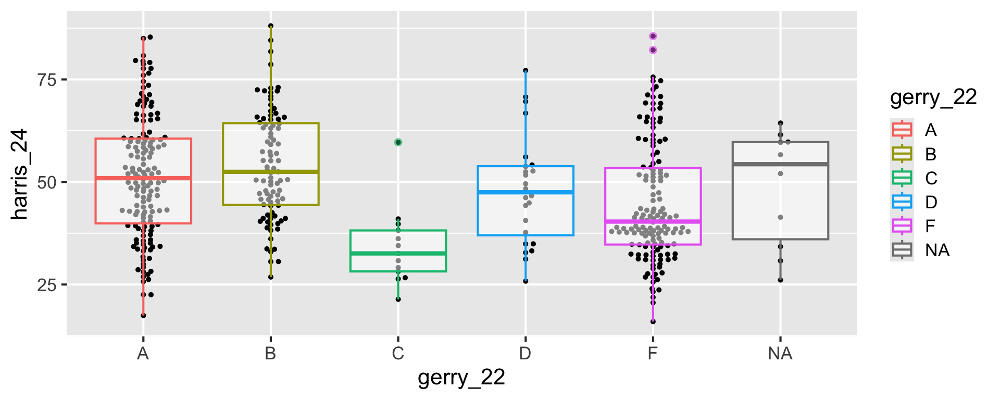](07-tidying-data_files/figure-revealjs/unnamed-chunk-8-1.png)


## Recap: layering geoms

3.  Remove the legend.

``` downlit
ggplot(gerrymander_24, aes(x = gerry_22, y = harris_24)) +
  geom_beeswarm(size = 0.8) +
  geom_boxplot(aes(color = gerry_22), alpha = 0.5, show.legend = FALSE)
```

[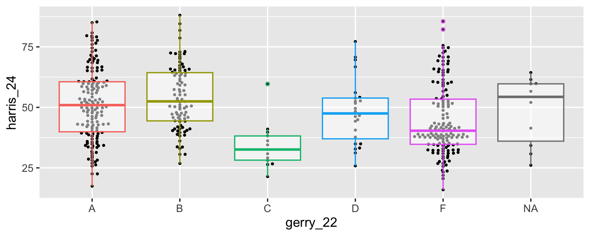](07-tidying-data_files/figure-revealjs/unnamed-chunk-9-1.png)


## Recap: logical operators

Generally useful in a [`filter()`](https://rdrr.io/r/stats/filter.html) but will come up in various other places as well…

| operator | definition       |
|:---------|:-----------------|
| `<`      | is less than?    |
| `>`      | is greater than? |

## Recap: Participate 📱💻

Match the following logical operators to their definitions.

- `<=`
- `>=`
- `==`
- `!=`

[](images/07/wooclap-qr.png)

Go to [wooclap.com](https://app.wooclap.com/ICNGKSL) and use the code ICNGKSL.

## Recap: Participate 📱💻

Match the following definitions to their logical operators.

- is x AND y?
- is x OR y?
- is x NA?
- is x not NA?

[](images/07/wooclap-qr.png)

Go to [wooclap.com](https://app.wooclap.com/ICNGKSL) and use the code ICNGKSL.

## Recap: logical operators (cont.)

Other useful logical operators:

| operator      | definition                                               |
|:--------------|:---------------------------------------------------------|
| `x %in% y`    | is x in y?                                               |
| `!(x %in% y)` | is x not in y?                                           |
| `!x`          | is not x? (only makes sense if `x` is `TRUE` or `FALSE`) |

## Recap: logical operators (cont.)

For which rows are the following true?

| Col1 | Col2 | Col3 |
|------|------|------|
| 1    | A    | 50   |
| 2    | B    | 40   |
| 3    | A    | 30   |
| 4    | B    | NA   |
| 5    | C    | 10   |

- `Col1 < 3 | Col3 < 20`

- `Col2 == "C"`

- `Col2 %in% c("C", "A")`

- `is.na(Col3)`

- `!is.na(Col3)`

# Data tidying

## Tidy data

> “Tidy datasets are easy to manipulate, model and visualise, and have a specific structure: each variable is a column, each observation is a row, and each type of observational unit is a table.”
>
> Tidy Data, <https://vita.had.co.nz/papers/tidy-data.pdf>

. . .

**Note:** “easy to manipulate” = “straightforward to manipulate”

## Goal

Visualize Statistical Science majors over the years!

[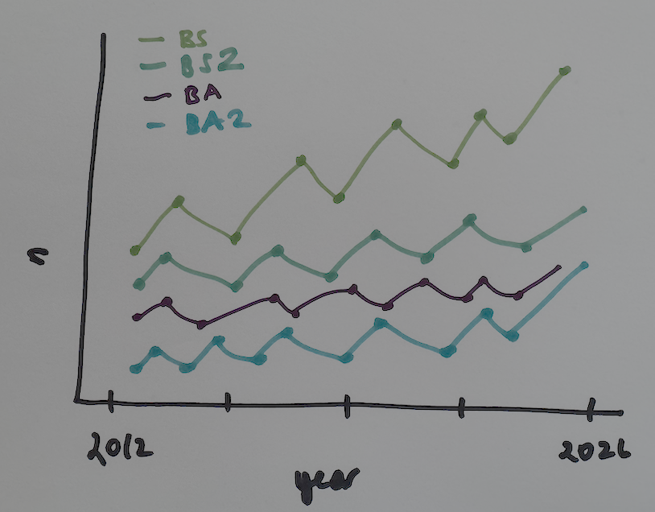](images/07/statsci-majors-sketch.png)

## Read data

``` downlit
majors <- read_csv("data/majors.csv")
```

    Rows: 33 Columns: 17
    ── Column specification ────────────────────────────────────────────────────────
    Delimiter: ","
    chr  (2): department, academic_plan
    dbl (15): 2026, 2025, 2024, 2023, 2022, 2021, 2020, 2019, 2018, 2017, 2016, ...

    ℹ Use `spec()` to retrieve the full column specification for this data.
    ℹ Specify the column types or set `show_col_types = FALSE` to quiet this message.

What does the message that prints when we read a CSV file in with `read_csv()` say? How carefully do you need to review this message before moving on?

## View data

``` downlit
majors
```

    # A tibble: 33 × 17
       department     academic_plan `2026` `2025` `2024` `2023` `2022` `2021` `2020`
       <chr>          <chr>          <dbl>  <dbl>  <dbl>  <dbl>  <dbl>  <dbl>  <dbl>
     1 Biology        BS               151    151    147    146    141    159    147
     2 Biology        BS2               13     13     11     11      5     11      4
     3 Biology        BA                10      5     11     11      6      6      8
     4 Biology        BA2                1      4      2      1      8      1      3
     5 Biology        Minor             54     59     51     65     70     68     50
     6 Computer Scie… BS               238    209    247    213    190    187    170
     7 Computer Scie… BS2              150    125    105     76     43     38     33
     8 Computer Scie… BA                24     29     27     36     20     32     45
     9 Computer Scie… BA2               44     30     43     34     27     32     21
    10 Computer Scie… Minor             53     78     72     75     62     58     57
    # ℹ 23 more rows
    # ℹ 8 more variables: `2019` <dbl>, `2018` <dbl>, `2017` <dbl>, `2016` <dbl>,
    #   `2015` <dbl>, `2014` <dbl>, `2013` <dbl>, `2012` <dbl>

## Data dictionary

| Variable | Description |
|:---|:---|
| `department` | Academic department offering the major or minor. |
| `academic_plan` | BS: Bachelor of Science; BS2: Bachelor of Science, second major; BA: Bachelor of Arts; BA2: Bachelor of Arts, second major; Minor: a minor in the department. |
| `2026`:`2012` | Each column gives the number of graduates completing that academic plan in the corresponding academic year. `NA` indicates no count recorded. |

What does each row in `majors` represent?

Each row represents a department and academic plan combination.

## Let’s plan!

Review the goal plot and sketch the data frame needed to create it. What would go inside `aes` when we call `ggplot`?

[](images/07/statsci-majors-sketch.png)

## First: `filter()`

``` downlit
statsci_majors <- majors |>
  filter(
    department == "Statistical Science",
    academic_plan != "Minor"
  )
```

\

``` downlit
statsci_majors
```

    # A tibble: 4 × 17
      department      academic_plan `2026` `2025` `2024` `2023` `2022` `2021` `2020`
      <chr>           <chr>          <dbl>  <dbl>  <dbl>  <dbl>  <dbl>  <dbl>  <dbl>
    1 Statistical Sc… BS                49     45     39     54     32     35     27
    2 Statistical Sc… BS2               28     23     20     27     16     17     17
    3 Statistical Sc… BA                 2     NA      1      2     NA     NA      1
    4 Statistical Sc… BA2                1     NA     NA     NA     NA      2      1
    # ℹ 8 more variables: `2019` <dbl>, `2018` <dbl>, `2017` <dbl>, `2016` <dbl>,
    #   `2015` <dbl>, `2014` <dbl>, `2013` <dbl>, `2012` <dbl>

## The Goal

We want to write code that starts something like this:

``` downlit
ggplot(statsci_majors, aes(x = year, y = n, color = academic_plan)) +
  ...
```

. . .

\

But the data are not organized in the appropriate columns :(

``` downlit
statsci_majors
```

    # A tibble: 4 × 17
      department      academic_plan `2026` `2025` `2024` `2023` `2022` `2021` `2020`
      <chr>           <chr>          <dbl>  <dbl>  <dbl>  <dbl>  <dbl>  <dbl>  <dbl>
    1 Statistical Sc… BS                49     45     39     54     32     35     27
    2 Statistical Sc… BS2               28     23     20     27     16     17     17
    3 Statistical Sc… BA                 2     NA      1      2     NA     NA      1
    4 Statistical Sc… BA2                1     NA     NA     NA     NA      2      1
    # ℹ 8 more variables: `2019` <dbl>, `2018` <dbl>, `2017` <dbl>, `2016` <dbl>,
    #   `2015` <dbl>, `2014` <dbl>, `2013` <dbl>, `2012` <dbl>

## The challenge

***How do we go from this ….***

    # A tibble: 4 × 17
      department      academic_plan `2026` `2025` `2024` `2023` `2022` `2021` `2020`
      <chr>           <chr>          <dbl>  <dbl>  <dbl>  <dbl>  <dbl>  <dbl>  <dbl>
    1 Statistical Sc… BS                49     45     39     54     32     35     27
    2 Statistical Sc… BS2               28     23     20     27     16     17     17
    3 Statistical Sc… BA                 2     NA      1      2     NA     NA      1
    4 Statistical Sc… BA2                1     NA     NA     NA     NA      2      1
    # ℹ 8 more variables: `2019` <dbl>, `2018` <dbl>, `2017` <dbl>, `2016` <dbl>,
    #   `2015` <dbl>, `2014` <dbl>, `2013` <dbl>, `2012` <dbl>

***…. to this??***

    # A tibble: 60 × 4
       department          academic_plan  year     n
       <chr>               <chr>         <dbl> <dbl>
     1 Statistical Science BS             2026    49
     2 Statistical Science BS             2025    45
     3 Statistical Science BS             2024    39
     4 Statistical Science BS             2023    54
     5 Statistical Science BS             2022    32
     6 Statistical Science BS             2021    35
     7 Statistical Science BS             2020    27
     8 Statistical Science BS             2019    26
     9 Statistical Science BS             2018    21
    10 Statistical Science BS             2017    24
    # ℹ 50 more rows

# Pivot

## `pivot_longer()`

    # A tibble: 4 × 17
      department      academic_plan `2026` `2025` `2024` `2023` `2022` `2021` `2020`
      <chr>           <chr>          <dbl>  <dbl>  <dbl>  <dbl>  <dbl>  <dbl>  <dbl>
    1 Statistical Sc… BS                49     45     39     54     32     35     27
    2 Statistical Sc… BS2               28     23     20     27     16     17     17
    3 Statistical Sc… BA                 2     NA      1      2     NA     NA      1
    4 Statistical Sc… BA2                1     NA     NA     NA     NA      2      1
    # ℹ 8 more variables: `2019` <dbl>, `2018` <dbl>, `2017` <dbl>, `2016` <dbl>,
    #   `2015` <dbl>, `2014` <dbl>, `2013` <dbl>, `2012` <dbl>

\

⬇️

Pivot the `statsci_majors` data frame *longer* such that each row represents a degree type / year combination. The new columns should be called `year` and `n` (for number of graduates for that year).

    # A tibble: 60 × 4
       department          academic_plan  year     n
       <chr>               <chr>         <dbl> <dbl>
     1 Statistical Science BS             2026    49
     2 Statistical Science BS             2025    45
     3 Statistical Science BS             2024    39
     4 Statistical Science BS             2023    54
     5 Statistical Science BS             2022    32
     6 Statistical Science BS             2021    35
     7 Statistical Science BS             2020    27
     8 Statistical Science BS             2019    26
     9 Statistical Science BS             2018    21
    10 Statistical Science BS             2017    24
    # ℹ 50 more rows

## `pivot_longer()`

    # A tibble: 4 × 17
      department      academic_plan `2026` `2025` `2024` `2023` `2022` `2021` `2020`
      <chr>           <chr>          <dbl>  <dbl>  <dbl>  <dbl>  <dbl>  <dbl>  <dbl>
    1 Statistical Sc… BS                49     45     39     54     32     35     27
    2 Statistical Sc… BS2               28     23     20     27     16     17     17
    3 Statistical Sc… BA                 2     NA      1      2     NA     NA      1
    4 Statistical Sc… BA2                1     NA     NA     NA     NA      2      1
    # ℹ 8 more variables: `2019` <dbl>, `2018` <dbl>, `2017` <dbl>, `2016` <dbl>,
    #   `2015` <dbl>, `2014` <dbl>, `2013` <dbl>, `2012` <dbl>

\
\

⬇️

``` r
statsci_majors |>
  pivot_longer(
    cols = ___________________,

    names_to = _______________,

    values_to = ______________
  )
```

    # A tibble: 60 × 4
       department          academic_plan  year     n
       <chr>               <chr>         <dbl> <dbl>
     1 Statistical Science BS             2026    49
     2 Statistical Science BS             2025    45
     3 Statistical Science BS             2024    39
     4 Statistical Science BS             2023    54
     5 Statistical Science BS             2022    32
     6 Statistical Science BS             2021    35
     7 Statistical Science BS             2020    27
     8 Statistical Science BS             2019    26
     9 Statistical Science BS             2018    21
    10 Statistical Science BS             2017    24
    # ℹ 50 more rows

## `pivot_longer()`

What goes in each of the blanks?

``` r
statsci_majors |>
  pivot_longer(
    cols = ___________________, # columns to pivot

    names_to = _______________, # what the new variable name should be

    values_to = ______________  # where the new variable name should come from
  )
```

## How did it go?

We started with:

    # A tibble: 4 × 17
      department      academic_plan `2026` `2025` `2024` `2023` `2022` `2021` `2020`
      <chr>           <chr>          <dbl>  <dbl>  <dbl>  <dbl>  <dbl>  <dbl>  <dbl>
    1 Statistical Sc… BS                49     45     39     54     32     35     27
    2 Statistical Sc… BS2               28     23     20     27     16     17     17
    3 Statistical Sc… BA                 2     NA      1      2     NA     NA      1
    4 Statistical Sc… BA2                1     NA     NA     NA     NA      2      1
    # ℹ 8 more variables: `2019` <dbl>, `2018` <dbl>, `2017` <dbl>, `2016` <dbl>,
    #   `2015` <dbl>, `2014` <dbl>, `2013` <dbl>, `2012` <dbl>

⬇️ Then we pivoted

We wanted:

    # A tibble: 60 × 4
       department          academic_plan  year     n
       <chr>               <chr>         <dbl> <dbl>
     1 Statistical Science BS             2026    49
     2 Statistical Science BS             2025    45
     3 Statistical Science BS             2024    39
     4 Statistical Science BS             2023    54
     5 Statistical Science BS             2022    32
     6 Statistical Science BS             2021    35
     7 Statistical Science BS             2020    27
     8 Statistical Science BS             2019    26
     9 Statistical Science BS             2018    21
    10 Statistical Science BS             2017    24
    # ℹ 50 more rows

But we got:

    # A tibble: 60 × 4
       department          academic_plan year      n
       <chr>               <chr>         <chr> <dbl>
     1 Statistical Science BS            2026     49
     2 Statistical Science BS            2025     45
     3 Statistical Science BS            2024     39
     4 Statistical Science BS            2023     54
     5 Statistical Science BS            2022     32
     6 Statistical Science BS            2021     35
     7 Statistical Science BS            2020     27
     8 Statistical Science BS            2019     26
     9 Statistical Science BS            2018     21
    10 Statistical Science BS            2017     24
    # ℹ 50 more rows

Can you spot the difference?

## `year`

What is the type of the `year` variable? Why? What should it be?

``` downlit
statsci_majors |>
  pivot_longer(
    cols = !c(department, academic_plan),
    values_to = "n",
    names_to = "year"
  )
```

    # A tibble: 60 × 4
       department          academic_plan year      n
       <chr>               <chr>         <chr> <dbl>
     1 Statistical Science BS            2026     49
     2 Statistical Science BS            2025     45
     3 Statistical Science BS            2024     39
     4 Statistical Science BS            2023     54
     5 Statistical Science BS            2022     32
     6 Statistical Science BS            2021     35
     7 Statistical Science BS            2020     27
     8 Statistical Science BS            2019     26
     9 Statistical Science BS            2018     21
    10 Statistical Science BS            2017     24
    # ℹ 50 more rows

- It’s a character (`chr`) variable since the information came from the column names of the original data frame.

- R cannot know that these character strings represent years.

- We need to tell R that the variable type of `year` should be numeric.

## `pivot_longer()` again

Let’s pivot again, this time making sure also that `year` is a numerical variable in the resulting data frame.

``` numberSource
statsci_majors |>
  pivot_longer(
    cols = !c(department, academic_plan),
    values_to = "n",
    names_to = "year",
    names_transform = as.numeric
  )
```

    # A tibble: 60 × 4
       department          academic_plan  year     n
       <chr>               <chr>         <dbl> <dbl>
     1 Statistical Science BS             2026    49
     2 Statistical Science BS             2025    45
     3 Statistical Science BS             2024    39
     4 Statistical Science BS             2023    54
     5 Statistical Science BS             2022    32
     6 Statistical Science BS             2021    35
     7 Statistical Science BS             2020    27
     8 Statistical Science BS             2019    26
     9 Statistical Science BS             2018    21
    10 Statistical Science BS             2017    24
    # ℹ 50 more rows

# Application exercise

## Goal: Make this plot

[](images/07/statsci-majors-sketch.png)

## `ae-03: StatSci majors`

- Go to your ae project in Positron.

- If you haven’t yet done so, make sure all of your changes up to this point are committed and pushed, i.e., there’s nothing left in your source control pane.

- Pull to get today’s application exercise file: `ae-03-statsci-majors.qmd`.

- Work through the application exercise in class, and render, commit, and push your edits by the end of class.

# Pivot wider

## We pivotted longer… what about wider?

    # A tibble: 4 × 17
      department      academic_plan `2026` `2025` `2024` `2023` `2022` `2021` `2020`
      <chr>           <chr>          <dbl>  <dbl>  <dbl>  <dbl>  <dbl>  <dbl>  <dbl>
    1 Statistical Sc… BS                49     45     39     54     32     35     27
    2 Statistical Sc… BS2               28     23     20     27     16     17     17
    3 Statistical Sc… BA                 2     NA      1      2     NA     NA      1
    4 Statistical Sc… BA2                1     NA     NA     NA     NA      2      1
    # ℹ 8 more variables: `2019` <dbl>, `2018` <dbl>, `2017` <dbl>, `2016` <dbl>,
    #   `2015` <dbl>, `2014` <dbl>, `2013` <dbl>, `2012` <dbl>

⬆️

Can we go the other direction?

    # A tibble: 60 × 4
       department          academic_plan  year     n
       <chr>               <chr>         <dbl> <dbl>
     1 Statistical Science BS             2026    49
     2 Statistical Science BS             2025    45
     3 Statistical Science BS             2024    39
     4 Statistical Science BS             2023    54
     5 Statistical Science BS             2022    32
     6 Statistical Science BS             2021    35
     7 Statistical Science BS             2020    27
     8 Statistical Science BS             2019    26
     9 Statistical Science BS             2018    21
    10 Statistical Science BS             2017    24
    # ℹ 50 more rows

## We pivotted longer… what about wider?

    # A tibble: 4 × 17
      department      academic_plan `2026` `2025` `2024` `2023` `2022` `2021` `2020`
      <chr>           <chr>          <dbl>  <dbl>  <dbl>  <dbl>  <dbl>  <dbl>  <dbl>
    1 Statistical Sc… BS                49     45     39     54     32     35     27
    2 Statistical Sc… BS2               28     23     20     27     16     17     17
    3 Statistical Sc… BA                 2     NA      1      2     NA     NA      1
    4 Statistical Sc… BA2                1     NA     NA     NA     NA      2      1
    # ℹ 8 more variables: `2019` <dbl>, `2018` <dbl>, `2017` <dbl>, `2016` <dbl>,
    #   `2015` <dbl>, `2014` <dbl>, `2013` <dbl>, `2012` <dbl>

\

⬆️

``` r
statsci_majors_longer |>
  pivot_wider(
    names_from = _______,

    values_from = ______________
  )
```

    # A tibble: 60 × 4
       department          academic_plan  year     n
       <chr>               <chr>         <dbl> <dbl>
     1 Statistical Science BS             2026    49
     2 Statistical Science BS             2025    45
     3 Statistical Science BS             2024    39
     4 Statistical Science BS             2023    54
     5 Statistical Science BS             2022    32
     6 Statistical Science BS             2021    35
     7 Statistical Science BS             2020    27
     8 Statistical Science BS             2019    26
     9 Statistical Science BS             2018    21
    10 Statistical Science BS             2017    24
    # ℹ 50 more rows

## `pivot_wider()`

``` downlit
statsci_majors_longer |>
  pivot_wider(
    names_from = year,
    values_from = n
  )
```

    # A tibble: 4 × 17
      department      academic_plan `2026` `2025` `2024` `2023` `2022` `2021` `2020`
      <chr>           <chr>          <dbl>  <dbl>  <dbl>  <dbl>  <dbl>  <dbl>  <dbl>
    1 Statistical Sc… BS                49     45     39     54     32     35     27
    2 Statistical Sc… BS2               28     23     20     27     16     17     17
    3 Statistical Sc… BA                 2     NA      1      2     NA     NA      1
    4 Statistical Sc… BA2                1     NA     NA     NA     NA      2      1
    # ℹ 8 more variables: `2019` <dbl>, `2018` <dbl>, `2017` <dbl>, `2016` <dbl>,
    #   `2015` <dbl>, `2014` <dbl>, `2013` <dbl>, `2012` <dbl>

## Recap: Pivoting

- ***When should you pivot?*** If all of the data you need is in your data frame, but the data are not organized in the columns you need, there is a good chance you need to pivot!

- ***Wide and long:*** Data sets can’t be labeled as *wide* or *long* but they can be made *wider* or *longer* for a certain analysis that requires a certain shape.

- ***Pivot longer - data type:*** When pivoting longer, variable names that turn into values are characters by default. If you need them to be in another format, you need to explicitly make that transformation, which you can do so within the `pivot_longer()` function.

## Recap: Plotting

- You can tweak a plot forever, but at some point the tweaks are likely not very productive.

- However, you should always be critical of defaultsand see if you can improve the plot to better portray your data / results / what you want to communicate.
