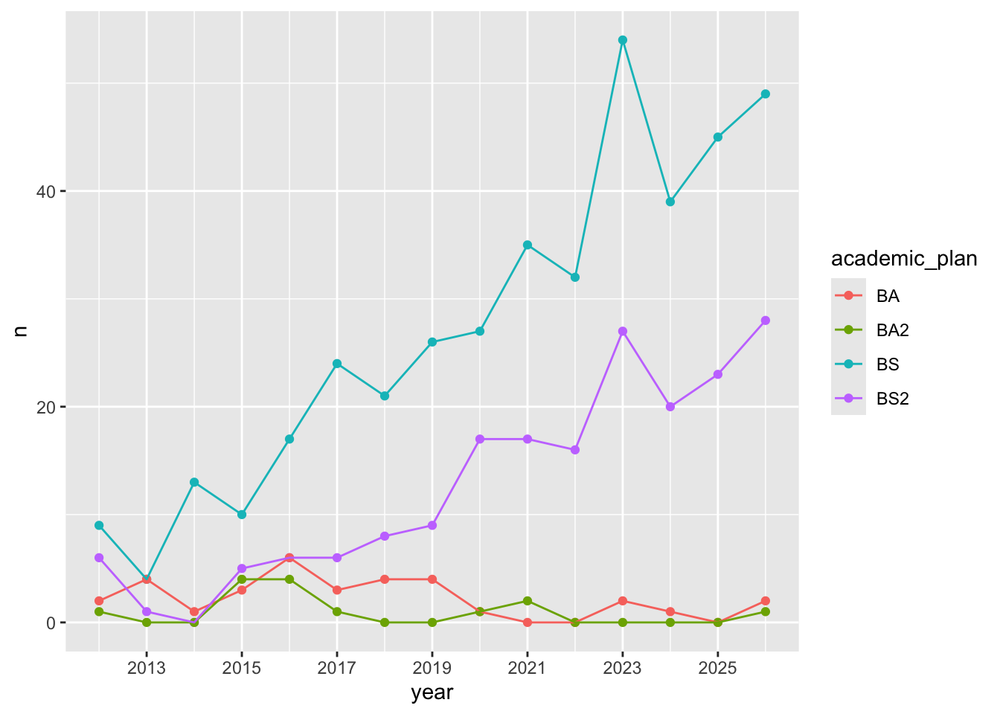
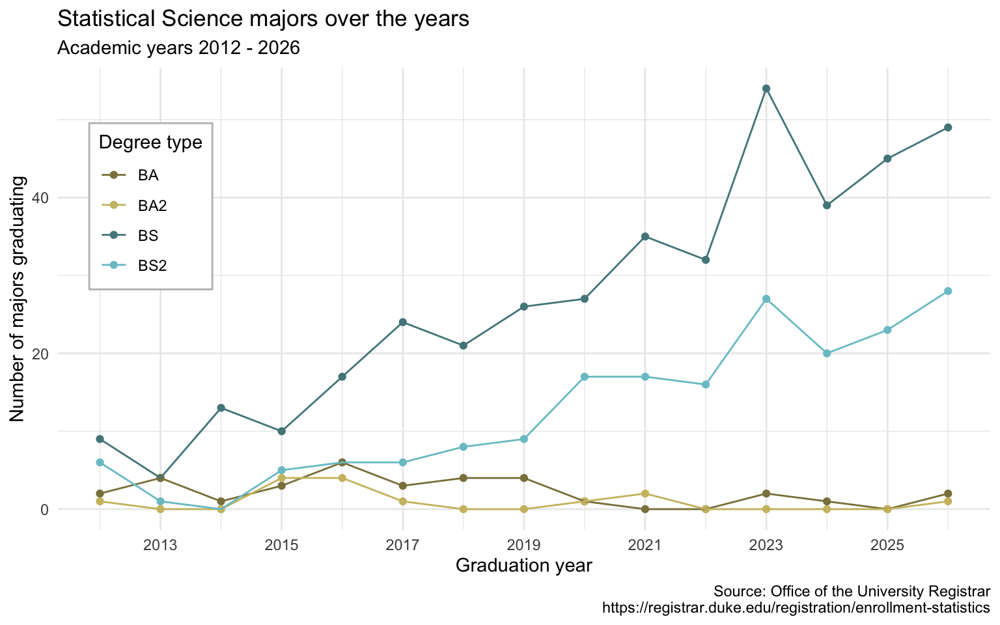
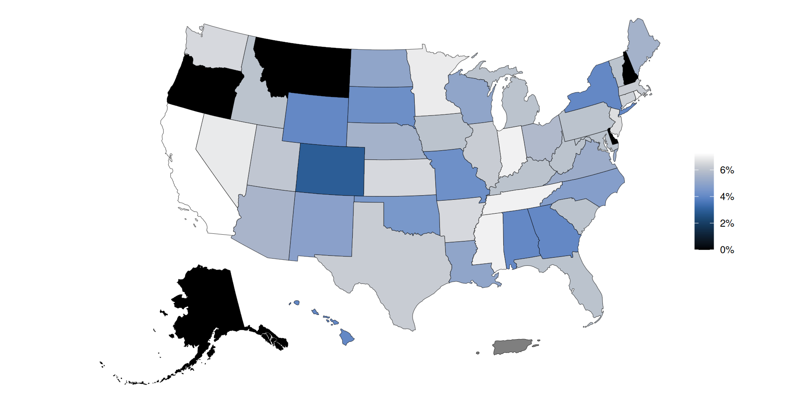
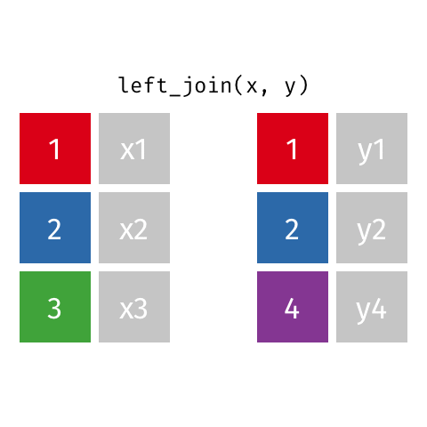
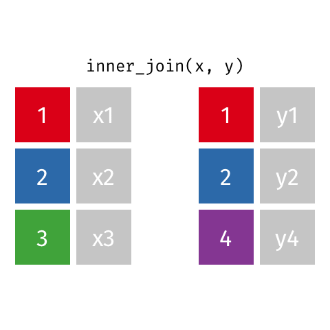
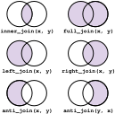

# Joining data

Lecture 8

Author

Affiliation

Dr. Mine Çetinkaya-Rundel

Duke University\
STA 199 - Fall 2026

Published

September 21, 2026

# Warm-up

## While you wait: Participate 📱💻

Can you guess the variable plotted here?

[](08-joining-data_files/figure-revealjs/tax-choropleth-1.png)

[](images/08/wooclap-qr.png)

Go to [wooclap.com](https://app.wooclap.com/PYDPUEI) and use the code PYDPUEI.

## Announcements

- If you have received an email from Dr. Knox about missing labs, HWs, commits, files on GitHub or Gradescope:
  - Step 1: Don’t panic – these emails are just to make sure you don’t repeatedly make the same errors throughout assignments
  - Step 2:
    - If you’re not sure how to address the issues, please write back ASAP so we can help you!
    - If you know how to address it, make sure to do so in your following assignment!

- If you’ve enjoyed working with classmates in your randomly assigned labs so far and/or if you have identified common interests, reach out to them to see if you might form a project team together. You’ll get a chance to share these preferences in lab on Thursday.

## Recap: from last AE

Any questions about how we left off last time to where AE-03 goes by the end? Or where to find the AE answers?

**Where we left off:**

[](images/08/statsci-majors-begin.png)

**Where the AE-03 ends:**

[](images/08/statsci-majors-end.png)

# Recoding data

## Let’s look at the results…

[](08-joining-data_files/figure-revealjs/unnamed-chunk-2-1.png)

## Sales taxes in US states

``` r
sales_taxes
```

    # A tibble: 51 × 7
       state       state_tax_rate state_tax_rank avg_local_tax_rate max_local
       <chr>                <dbl>          <dbl>              <dbl>     <dbl>
     1 Alabama               4                40               5.46     11   
     2 Alaska                0                46               1.82      7.85
     3 Arizona               5.6              28               2.92      5.3 
     4 Arkansas              6.5               9               2.96      6.12
     5 California            7.25              1               1.74      5.25
     6 Colorado              2.9              45               4.99      9.1 
     7 Connecticut           6.35             12               0         0   
     8 Delaware              0                46               0         0   
     9 Florida               6                17               0.98      2   
    10 Georgia               4                40               3.49      5   
    # ℹ 41 more rows
    # ℹ 2 more variables: combined_tax_rate <dbl>, combined_rank <dbl>

## Participate 📱💻

Put the following steps in order to compare the average state sales tax rates of swing states (Arizona, Georgia, Michigan, Nevada, North Carolina, Pennsylvania, and Wisconsin) vs. non-swing states:

- Group by `swing_state`
- Summarize to find the mean sales tax in each type of state
- Create a new variable called `swing_state` with levels `"Swing"` and `"Non-swing"`

[](images/08/wooclap-qr.png)

Go to [wooclap.com](https://app.wooclap.com/PYDPUEI) and use the code PYDPUEI.

## Participate 📱💻

First, create a vector called `list_of_swing_states` that contains the names of the swing states.

``` r
list_of_swing_states <- c(
  "Arizona", "Georgia", "Michigan", "Nevada", "North Carolina",
  "Pennsylvania", "Wisconsin"
)
```

Then, fill in the blanks to create a new variable called `swing_state` with levels `"Swing"` and `"Non-swing"`:

``` r
sales_taxes <- sales_taxes |>
  __BLANK_1__(
    swing_state = __BLANK_2__(
      state __BLANK_3__ list_of_swing_states, "Swing", "Non-swing"
    )
  )
```

[](images/08/wooclap-qr.png)

Go to [wooclap.com](https://app.wooclap.com/PYDPUEI) and use the code PYDPUEI.

## Recap: `if_else()`

``` r
if_else(
  x == y, #<1>
  "x is equal to y", #<2>
  "x is not equal to y" #<3>
)
```

1.  Condition
2.  Value if condition is `TRUE`
3.  Value if condition is `FALSE`

## Participate 📱💻

Fill in the blank to compare the average state sales tax rates of swing states vs. non-swing states.

``` r
sales_taxes |>
  __BLANK__ |>
  summarize(mean_state_tax = mean(state_tax_rate))
```

- `arrange(swing_state)`
- `filter(swing_state == "Swing")`
- `group_by(swing_state)`
- `group_by(list_of_swing_states)`

[](images/08/wooclap-qr.png)

Go to [wooclap.com](https://app.wooclap.com/PYDPUEI) and use the code PYDPUEI.

## Sales tax in swing states

``` r
sales_taxes |>
  group_by(swing_state) |>
  summarize(mean_state_tax = mean(state_tax_rate))
```

    # A tibble: 2 × 2
      swing_state mean_state_tax
      <chr>                <dbl>
    1 Non-swing             5.05
    2 Swing                 5.46

## Sales tax in coastal states

Suppose you’re tasked with the following:

> Compare the average state sales tax rates of states on the Pacific Coast, states on the Atlantic Coast, and the rest of the states.

How would you approach this task?

- Create a new variable called `coast` with levels `"Pacific"`, `"Atlantic"`, and `"Neither"`
- Group by `coast`
- Summarize to find the mean sales tax in each type of state

## Participate 📱💻

First, create two vectors called `pacific_coast` and `atlantic_coast` that contain the respective states.

``` r
pacific_coast <- c("Alaska", "Washington", "Oregon", "California", "Hawaii")

atlantic_coast <- c(
  "Connecticut", "Delaware", "Georgia", "Florida", "Maine", "Maryland", 
  "Massachusetts", "New Hampshire", "New Jersey", "New York", 
  "North Carolina", "Rhode Island", "South Carolina", "Virginia"
)
```

Then, fill in the blank to create a new variable called `coast`:

``` r
sales_taxes <- sales_taxes |>
  mutate(
    coast = __BLANK__(
      state %in% atlantic_coast ~ "Atlantic",
      state %in% pacific_coast ~ "Pacific",
      .default = "Neither"
    )
  )
```

[](images/08/wooclap-qr.png)

Go to [wooclap.com](https://app.wooclap.com/PYDPUEI) and use the code PYDPUEI.

## Recap: `case_when()`

``` r
case_when(
  x > y ~ "x is greater than y", #<1>
  x < y ~ "x is less than y", #<2>
  .default = "x is equal to y" #<3>
)
```

1.  Value if first condition is `TRUE`
2.  Value if second condition is `TRUE`
3.  Value if neither condition is `TRUE`, i.e., default value

## Sales tax in coastal states

Compare the average state sales tax rates of states on the Pacific Coast, states on the Atlantic Coast, and the rest of the states.

``` r
sales_taxes |>
  group_by(coast) |>
  summarize(mean_state_tax = mean(state_tax_rate))
```

    # A tibble: 3 × 2
      coast    mean_state_tax
      <chr>             <dbl>
    1 Atlantic           4.84
    2 Neither            5.46
    3 Pacific            3.55

## Sales tax in US regions

Suppose you’re tasked with the following:

> Compare the average state sales tax rates of states in various regions (Midwest - 12 states, Northeast - 9 states, South - 16 states, West - 13 states).

How would you approach this task?

. . .

- Create a new variable called `region` with levels `"Midwest"`, `"Northeast"`, `"South"`, and `"West"`.
- Group by `region`
- Summarize to find the mean sales tax in each type of state

## `mutate()` with `case_when()`

Who feels like filling in the blanks lists of states in each region? Who feels like it’s simply too tedious to write out names of all states?

``` r
list_of_midwest_states <- c(___)
list_of_northeast_states <- c(___)
list_of_south_states <- c(___)
list_of_west_states <- c(___)

sales_taxes <- sales_taxes |>
  mutate(
    region = case_when(
      state %in% list_of_midwest_states ~ "Midwest",
      state %in% list_of_northeast_states ~ "Northeast",
      state %in% list_of_south_states ~ "South",
      state %in% list_of_west_states ~ "West"
    )
  )
```

# Joining data

## Why join?

Suppose we want to answer questions like:

> Is there a relationship between\
> - number of QS courses taken\
> - having scored a 4 or 5 on the AP stats exam\
> - motivation for taking course\
> - …\
> and performance in this course?

. . .

Each of these would require *join*ing class performance data with an outside data source so we can have all relevant information (columns) in a single data frame.

## Why join?

Suppose we want to answer questions like:

> Compare the average state sales tax rates of states in various regions (Midwest - 12 states, Northeast - 9 states, South - 16 states, West - 13 states).

. . .

This can also be solved with *join*ing region information with the state-level sales tax data.

## Setup

For the next few slides…

``` r
x <- tibble(
  id = c(1, 2, 3),
  value_x = c("x1", "x2", "x3")
)

x
```

    # A tibble: 3 × 2
         id value_x
      <dbl> <chr>  
    1     1 x1     
    2     2 x2     
    3     3 x3     

``` r
y <- tibble(
  id = c(1, 2, 4),
  value_y = c("y1", "y2", "y4")
)

y
```

    # A tibble: 3 × 2
         id value_y
      <dbl> <chr>  
    1     1 y1     
    2     2 y2     
    3     4 y4     

## `left_join()`

[](images/08/left-join.gif)

``` r
left_join(x, y)
```

    Joining with `by = join_by(id)`

    # A tibble: 3 × 3
         id value_x value_y
      <dbl> <chr>   <chr>  
    1     1 x1      y1     
    2     2 x2      y2     
    3     3 x3      <NA>   

## `right_join()`

[](images/08/right-join.gif)

``` r
right_join(x, y)
```

    Joining with `by = join_by(id)`

    # A tibble: 3 × 3
         id value_x value_y
      <dbl> <chr>   <chr>  
    1     1 x1      y1     
    2     2 x2      y2     
    3     4 <NA>    y4     

## `full_join()`

[](images/08/full-join.gif)

``` r
full_join(x, y)
```

    Joining with `by = join_by(id)`

    # A tibble: 4 × 3
         id value_x value_y
      <dbl> <chr>   <chr>  
    1     1 x1      y1     
    2     2 x2      y2     
    3     3 x3      <NA>   
    4     4 <NA>    y4     

## `inner_join()`

[](images/08/inner-join.gif)

``` r
inner_join(x, y)
```

    Joining with `by = join_by(id)`

    # A tibble: 2 × 3
         id value_x value_y
      <dbl> <chr>   <chr>  
    1     1 x1      y1     
    2     2 x2      y2     

## `anti_join()`

[](images/08/anti-join.gif)

``` r
anti_join(x, y)
```

    Joining with `by = join_by(id)`

    # A tibble: 1 × 2
         id value_x
      <dbl> <chr>  
    1     3 x3     

## Summary of joins

[](images/08/joins-summary.svg)

# Application exercise

## Goal

Compare the average state sales tax rates of states in various regions (Midwest, Northeast, South, West), where the input data are:

1.  States and sales taxes: `sales-taxes-26.csv`
2.  States and regions: `us-regions.csv`

## `ae-04-taxes-join`

- Go to your ae project in Positron.

- If you haven’t yet done so, make sure all of your changes up to this point are committed and pushed, i.e., there’s nothing left in your source control pane.

- If you haven’t yet done so, pull to get today’s application exercise file: `ae-04-taxes-join.qmd`.

- Work through the application exercise in class, and render, commit, and push your edits by the end of class.
