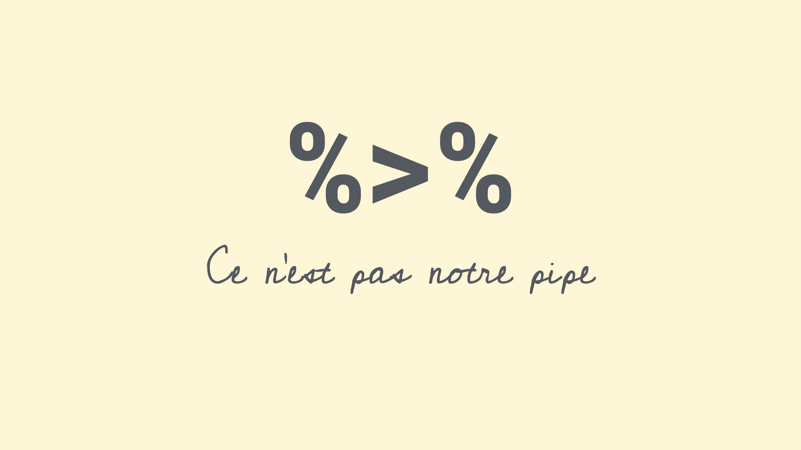
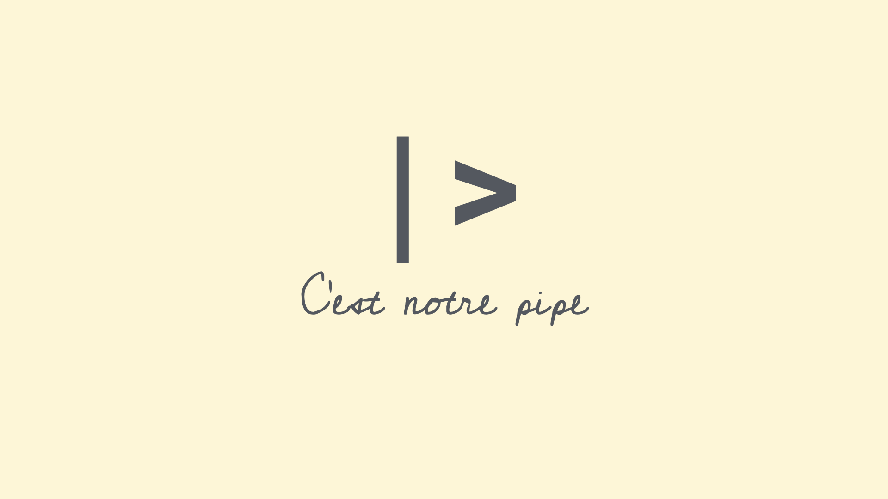
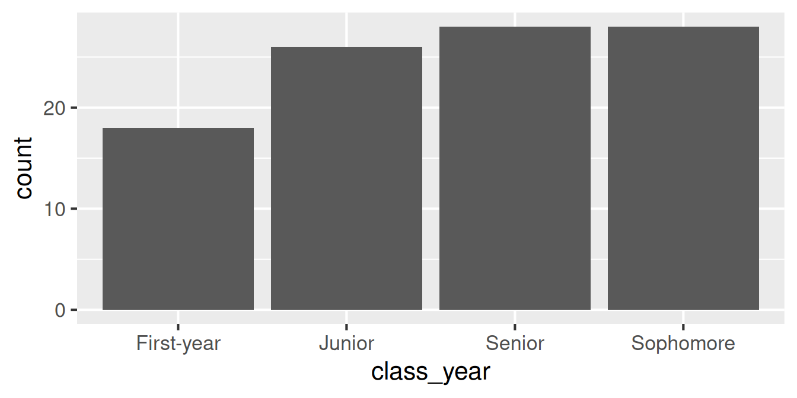
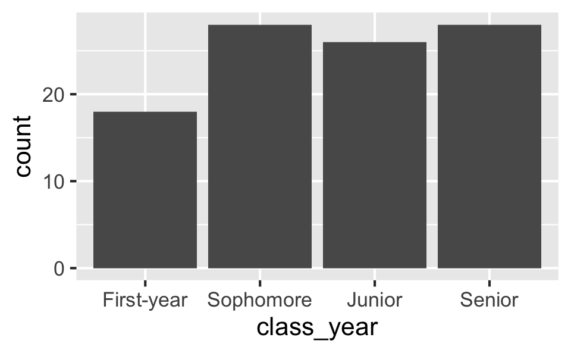

# Data types and classes

Lecture 9

Author

Affiliation

Dr. Mine Çetinkaya-Rundel

Duke University\
STA 199 - Fall 2026

Published

September 23, 2026

# Warm-up

## While you wait: Participate 📱💻

Fill in the blank:

On Wednesdays, I have `_____` class(es), including STA 199.

[](images/09/wooclap-qr.png)

Go to [wooclap.com](https://app.wooclap.com/TJEJAXK) and use the code TJEJAXK.

## Participate 📱💻

Which of the following best describes you?

- First-year
- Sophomore
- Junior
- Senior

[](images/09/wooclap-qr.png)

Go to [wooclap.com](https://app.wooclap.com/TJEJAXK) and use the code TJEJAXK.

## Announcements

- Team *preferences*:
  - Exactly 4 students per team
  - Let me know in my office hours today or at the end of lab to your TA tomorrow
  - All 4 members must be in attendance when submitting the preference
- No AI use in lab – work with your teammates and ask your TAs for help

## Recap: The tidyverse package

- When you load the **tidyverse** package, you get access to a suite of packages that work well together for data manipulation and visualization:

  ``` downlit
  library(tidyverse)
  ```

- You never need to load one of these packages individually after you load the tidyverse, e.g., [`library(dplyr)`](https://dplyr.tidyverse.org).

❌ **What not to do:**

```` markdown
```{r}
#| label: load-packages
#| message: false
library(tidyverse)
library(dplyr)
library(tidyr)
```
````

✅ **What to do:**

```` markdown
```{r}
#| label: load-packages
#| message: false
library(tidyverse)
```
````

## Recap: Loading packages

- Only need to load a package once per R session or Quarto document.

- Good practice: Load all packages you need at the start of your document, that’s why the templates I give you usually have a `load-packages` code cell at the top.

- Don’t load these packages again in the same document.

- If you discover that you need a new package, go back and add it to the `load-packages` cell.

## Recap: Loading packages

❌ **What not to do:**

```` markdown
```{r}
#| label: long-running-near-peak
library(dplyr)
spotify |>
    filter(weeks_on_chart > 275, positions_below_peak < 30) |>
    # and more code...
```

some content...

```{r}
#| label: most-streamed-song
library(dplyr)
spotify |>
    group_by(genre) |>
    filter(n() >= 10) |>
    # and more code...
```
````

✅ **What to do:**

```` markdown
```{r}
#| label: long-running-near-peak
library(tidyverse)
spotify |>
    filter(weeks_on_chart > 275, positions_below_peak < 30) |>
    # and more code...
```

some content...

```{r}
#| label: most-streamed-song
spotify |>
    group_by(genre) |>
    filter(n() >= 10) |>
    # and more code...
```
````

## Recap: Pipes

[](images/09/magritte-pipe.jpg)

This is not a pipe.

## Recap: Pipes

[](images/09/magrittr-pipe.png)

This is not our pipe \[operator\].

## Recap: Pipes

[](images/09/base-pipe.png)

**This is our a pipe \[operator\].**

## Recap: Pipes

**❌ What not to do:**

```` markdown
```{r}
#| label: family-sustaining-wage
nc_county %>%
    filter(p_family_sustaining_wage < 0.5) %>%
    count(county_type, name = "n_counties") %>%
    arrange(desc(n_counties))
```

some content...

```{r}
#| label: edu-he-create
nc_county <- nc_county |>
    mutate(
        p_edu_he = p_edu_assoc + p_edu_ba + p_edu_mapl
    )
```
````

✅ **What to do:**

```` markdown
```{r}
#| label: family-sustaining-wage
nc_county |>
    filter(p_family_sustaining_wage < 0.5) |>
    count(county_type, name = "n_counties") |>
    arrange(desc(n_counties))
```

some content...

```{r}
#| label: edu-he-create
nc_county <- nc_county |>
    mutate(
        p_edu_he = p_edu_assoc + p_edu_ba + p_edu_mapl
    )
```
````

## Aside: The Itsy Bitsy Spider

🕷️ Any volunteers to sing (or just recite) a bit of the **Itsy Bitsy Spider** for us?

## Recap: Data pipelines

Now that we all remember how **The Itsy Bitsy Spider** goes…

**Piped:** Read from top to bottom.

``` downlit
spider |>
  climb_spout() |>
  wash_down_in_rain() |>
  dry_in_sun() |>
  climb_again()
```

**Nested:** Read from the inside out.

``` downlit
climb_again(dry_in_sun(wash_down_in_rain(climb_spout(spider))))
```

The pipe `|>` passes the result of each step to the next function as its first argument.

## Recap: Data pipelines

❌ **What not to do:**

```` markdown
```{r}
#| label: q2-a
distinct(df_2, member, shift)
```
````

✅ **What to do:**

```` markdown
```{r}
#| label: q2-a
df_2 |>
  distinct(member, shift)
```
````

# Data types

## Data types in R

- **character**: `"First-year"` – Character strings
- **double**: `2.5` – Floating point numerical values (default numerical type)
- **integer**: `3L` – Integer numerical values (indicated with an `L`)
- **logical**: `TRUE` or `FALSE` – Boolean values
- and some more, but we won’t be focusing on those

## Vectors

Vectors can be constructed using the [`c()`](https://rdrr.io/r/base/c.html) function.

- Numeric vector:

``` downlit
c(1, 2, 3)
```

    [1] 1 2 3

. . .

- Character vector:

``` downlit
c("Hello", "World!")
```

    [1] "Hello"  "World!"

. . .

- Vector made of vectors:

``` downlit
c(c("hi", "hello"), c("bye", "jello"))
```

    [1] "hi"    "hello" "bye"   "jello"

## Vectors and their types

Why do we care about vectors and their types, especially when all we’ve worked with so far are data frames and their columns…

Each column of a data frame is (generally) a vector, and the type of that vector determines what operations can be performed on it or how it will behave when certain functions are applied to it. For example, you can’t take the mean of a character vector, but you can take the mean of a numeric vector.

## Making vectors from vectors

We have a vector, `x`, of type character:\
`x <- c("a", "b", "c")`

And another vector, `y`, of type double:\
`y <- c(1, 2, 3)`

What happens if we combine them into a new vector, `z <- c(x, y)`? What type will `z` be?

- character
- double
- integer
- logical

[](images/09/wooclap-qr.png)

Go to [wooclap.com](https://app.wooclap.com/TJEJAXK) and use the code TJEJAXK.

## Making vectors from vectors

``` downlit
x <- c("a", "b", "c")
typeof(x)
```

    [1] "character"

``` downlit
y <- c(1, 2, 3)
typeof(y)
```

    [1] "double"

``` downlit
z <- c(x, y)
z
```

    [1] "a" "b" "c" "1" "2" "3"

``` downlit
typeof(z)
```

    [1] "character"

## Converting between types

with intention…

``` downlit
x <- 1:3
x
```

    [1] 1 2 3

``` downlit
typeof(x)
```

    [1] "integer"

``` downlit
y <- as.character(x)
y
```

    [1] "1" "2" "3"

``` downlit
typeof(y)
```

    [1] "character"

## Converting between types

with intention…

``` downlit
x <- c(TRUE, FALSE)
x
```

    [1]  TRUE FALSE

``` downlit
typeof(x)
```

    [1] "logical"

``` downlit
y <- as.numeric(x)
y
```

    [1] 1 0

``` downlit
typeof(y)
```

    [1] "double"

## Converting between types

without intention…

``` downlit
c(2, "Just this one!")
```

    [1] "2"              "Just this one!"

. . .

R will happily convert between various types without complaint when different types of data are concatenated in a vector, and that’s not always a great thing!

## Converting between types

without intention…

``` downlit
c(FALSE, 3L)
```

    [1] 0 3

. . .

``` downlit
c(FALSE, 1.2)
```

    [1] 0.0 1.2

. . .

``` downlit
c(2L, "two")
```

    [1] "2"   "two"

. . .

``` downlit
c(TRUE, "two")
```

    [1] "TRUE" "two" 

## Participate 📱💻

What is the output of `typeof(c(1.2, 3L))`?

- `"character"`
- `"double"`
- `"integer"`
- `"logical"`

[](images/09/wooclap-qr.png)

Go to [wooclap.com](https://app.wooclap.com/TJEJAXK) and use the code TJEJAXK.

## Explicit vs. implicit coercion

**Explicit coercion:**

When you call a function like [`as.logical()`](https://rdrr.io/r/base/logical.html), [`as.numeric()`](https://rdrr.io/r/base/numeric.html), [`as.integer()`](https://rdrr.io/r/base/integer.html), [`as.double()`](https://rdrr.io/r/base/double.html), or [`as.character()`](https://rdrr.io/r/base/character.html).

**Implicit coercion:**

Happens when you use a vector in a specific context that expects a certain type of vector.

# Data classes

## Data classes

- Vectors are like Lego building blocks
- We stick them together to build more complicated constructs, e.g. *representations of data*
- The **class** attribute relates to the S3 class of an object which determines its behaviour
  - You don’t need to worry about what S3 classes really mean, but you can read more about it [here](https://adv-r.hadley.nz/s3.html#s3-classes) if you’re curious
- Examples: factors, dates, and data frames

## Factors

R uses factors to handle categorical variables, variables that have a fixed and known set of possible values

``` downlit
class_years <- factor(
  c(
    "First-year",
    "Sophomore",
    "Sophomore",
    "Senior",
    "Junior"
  )
)
class_years
```

    [1] First-year Sophomore  Sophomore  Senior     Junior    
    Levels: First-year Junior Senior Sophomore

``` downlit
typeof(class_years)
```

    [1] "integer"

``` downlit
class(class_years)
```

    [1] "factor"

## More on factors

We can think of factors like character (level labels) and an integer (level numbers) glued together

``` downlit
glimpse(class_years)
```

     Factor w/ 4 levels "First-year","Junior",..: 1 4 4 3 2

``` downlit
as.integer(class_years)
```

    [1] 1 4 4 3 2

## Dates

``` downlit
today <- as.Date("2026-09-23")
today
```

    [1] "2026-09-23"

``` downlit
typeof(today)
```

    [1] "double"

``` downlit
class(today)
```

    [1] "Date"

## More on dates

We can think of dates like an integer (the number of days since the origin, 1 Jan 1970) and an integer (the origin) glued together

``` downlit
as.integer(today)
```

    [1] 20719

``` downlit
as.integer(today) / 365 # roughly 56.8 yrs
```

    [1] 56.76438

## Data frames

We can think of data frames like like vectors of equal length glued together

``` downlit
df <- data.frame(x = 1:2, y = 3:4)
df
```

      x y
    1 1 3
    2 2 4

``` downlit
typeof(df)
```

    [1] "list"

``` downlit
class(df)
```

    [1] "data.frame"

## Lists

Lists are a generic vector container; vectors of any type can go in them

``` numberSource
l <- list(
  x = 1:4,
  y = c("hi", "hello", "jello"),
  z = c(TRUE, FALSE)
)
l
```

    $x
    [1] 1 2 3 4

    $y
    [1] "hi"    "hello" "jello"

    $z
    [1]  TRUE FALSE

## Lists and data frames

- A data frame is a special list containing vectors of equal length

``` downlit
df
```

      x y
    1 1 3
    2 2 4

- When we use the [`pull()`](https://dplyr.tidyverse.org/reference/pull.html) function, we extract a vector from the data frame

``` downlit
df |>
  pull(y)
```

    [1] 3 4

# Working with factors

## Read data in as character strings

``` downlit
fake_survey
```

    # A tibble: 100 × 2
       class_year n_wed_classes
       <chr>              <dbl>
     1 Sophomore              2
     2 Senior                 4
     3 Sophomore              2
     4 Sophomore              1
     5 Sophomore              1
     6 Junior                 4
     7 Senior                 2
     8 Senior                 4
     9 Sophomore              3
    10 First-year             4
    # ℹ 90 more rows

## But coerce when plotting

``` downlit
ggplot(fake_survey, mapping = aes(x = class_year)) +
  geom_bar()
```

[](09-data-types-classes_files/figure-revealjs/unnamed-chunk-37-1.png)

## Use forcats to reorder levels

``` downlit
fake_survey |>
  mutate(
    class_year = fct_relevel(
      class_year,
      "First-year",
      "Sophomore",
      "Junior",
      "Senior"
    )
  ) |>
  ggplot(mapping = aes(x = class_year)) +
  geom_bar()
```

[](09-data-types-classes_files/figure-revealjs/unnamed-chunk-38-1.png)

## A peek into forcats

Reordering levels by:

- [`fct_relevel()`](https://forcats.tidyverse.org/reference/fct_relevel.html): hand

- [`fct_infreq()`](https://forcats.tidyverse.org/reference/fct_inorder.html): frequency

- [`fct_reorder()`](https://forcats.tidyverse.org/reference/fct_reorder.html): sorting along another variable

- [`fct_rev()`](https://forcats.tidyverse.org/reference/fct_rev.html): reversing

…

Changing level values by:

- [`fct_lump()`](https://forcats.tidyverse.org/reference/fct_lump.html): lumping uncommon levels together into “other”

- [`fct_other()`](https://forcats.tidyverse.org/reference/fct_other.html): manually replacing some levels with “other”

…

More functions from the **forcats** package can be found [here](https://forcats.tidyverse.org/reference/index.html).

# Application exercise

## `ae-05-survey-types`

- Go to your ae project in Positron.

- If you haven’t yet done so, make sure all of your changes up to this point are committed and pushed, i.e., there’s nothing left in your source control pane.

- If you haven’t yet done so, pull to get today’s application exercise file: `ae-05-survey-types.qmd`.

- Work through the application exercise in class, and render, commit, and push your edits by the end of class.
