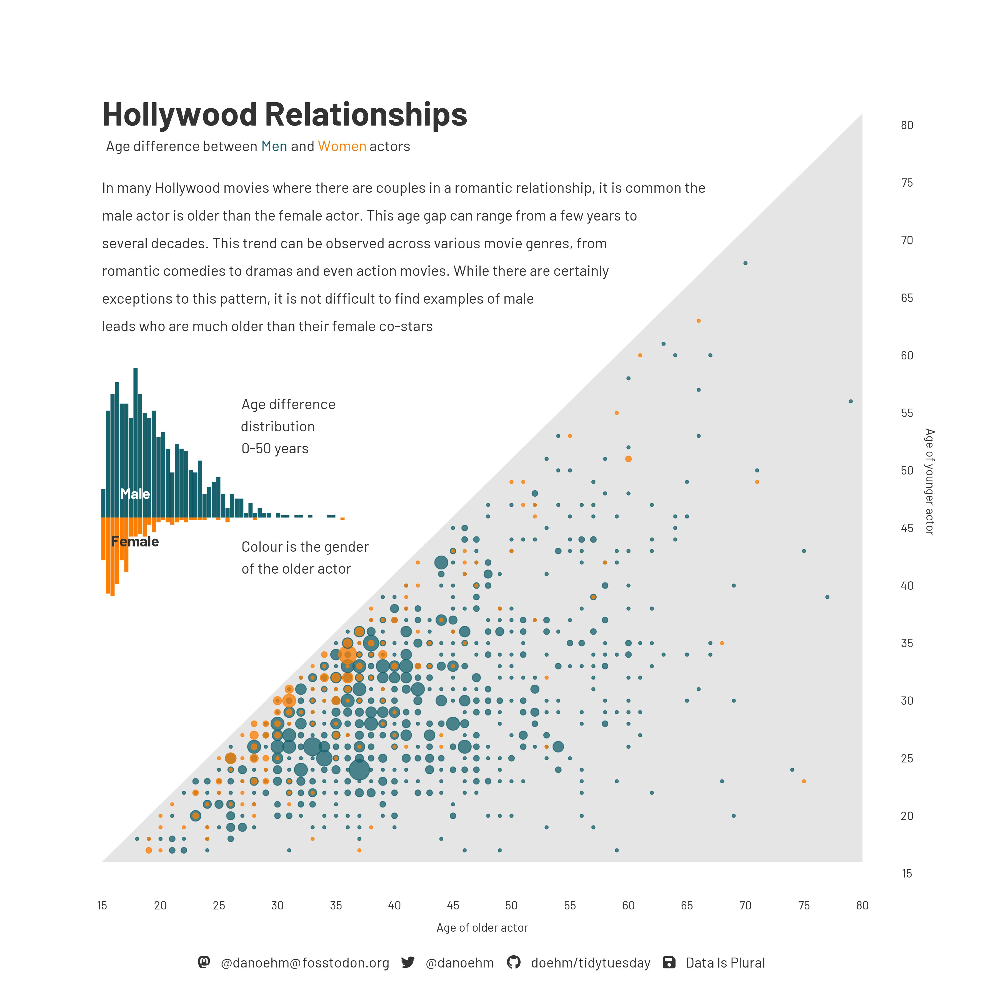

# Importing and recoding data

Lecture 9

Author

Affiliation

Prof. Mine Çetinkaya-Rundel

Duke University\
STA 199 - Fall 2026

Published

September 28, 2026

# Warm-up

## While you wait: Participate 📱💻

Did you get my Week 5 nudge email?

- Yes, I did! And I don’t have any questions.
- Yes, I did! And I have questions.
- I haven’t checked my email today yet, I will do so after class.
- What, you email us?!

[](images/10/wooclap-qr.png)

Go to [wooclap.com](https://app.wooclap.com/IQYBPOT) and use the code IQYBPOT.

## Announcements

- HW 4 due Wednesday – last homework before the exam

- Exam 1 covers everything up to and including the material in next Monday’s lecture, but Monday’s lecture is catch-up + review (so effectively up to and including the material in this Wednesday’s lecture)

# From last time

## `ae-05-survey-types`

- Go to your ae project in Positron.

- Continue working in last week’s application exercise file: `ae-05-survey-types.qmd`.

- Work through the application exercise in class, and render, commit, and push your edits by the end of class.

# Reading data into R

## Reading rectangular data

- Using [**readr**](https://readr.tidyverse.org/):
  - Most commonly: `read_csv()`
  - Maybe also: `read_tsv()`, `read_delim()`, etc.

. . .

- Using [**readxl**](https://readxl.tidyverse.org/): `read_excel()`

. . .

- Using [**googlesheets4**](https://googlesheets4.tidyverse.org/): `read_sheet()` – We haven’t covered this in the videos, but might be useful for your projects

## Close look at `read_csv()`

``` downlit
read_csv(
  file,
  na = c("", "NA"),
  quote = "\"",
  skip = 0,
  n_max = Inf,
  guess_max = min(1000, n_max),
  name_repair = "unique"
)
```

## Close look at `read_csv()` - `file`

``` numberSource
read_csv(
  file,
  na = c("", "NA"),
  quote = "\"",
  skip = 0,
  n_max = Inf,
  guess_max = min(1000, n_max),
  name_repair = "unique"
)
```

- Specifies where to read the CSV data from.
- Use a quoted file path, e.g., `file = "data/survey.csv"`, or a URL.
- Relative paths start from your working directory.
- Required: no default value.

## Close look at `read_csv()` - `na`

``` numberSource
read_csv(
  file,
  na = c("", "NA"),
  quote = "\"",
  skip = 0,
  n_max = Inf,
  guess_max = min(1000, n_max),
  name_repair = "unique"
)
```

- Specifies which strings represent missing values.
- Default: `c("", "NA")` treats empty fields and `"NA"` as missing.
- Example: `na = c("", "NA", "N/A")` also recognizes `"N/A"`.

## Close look at `read_csv()` - `quote`

``` numberSource
read_csv(
  file,
  na = c("", "NA"),
  quote = "\"",
  skip = 0,
  n_max = Inf,
  guess_max = min(1000, n_max),
  name_repair = "unique"
)
```

- Sets the character used to enclose fields.
- Default: a double quote (`"`), written as `"\""` in R.
- Quoting keeps a comma inside a field: `"Durham, NC"` is one value.

## Close look at `read_csv()` - `skip`

``` numberSource
read_csv(
  file,
  na = c("", "NA"),
  quote = "\"",
  skip = 0,
  n_max = Inf,
  guess_max = min(1000, n_max),
  name_repair = "unique"
)
```

- Skips lines at the beginning of the file.
- Default: `0` skips none.
- Example: `skip = 2` skips two introductory lines; the next line supplies column names by default.

## To `skip` or not to `skip`?

For example, `temperatures.csv` has a **metadata block** before the table:

``` text
Weather station: Durham, NC
Temperature units: Celsius
date,temperature
2026-09-21,24
2026-09-22,22
```

## To `skip` or not to `skip`?

``` downlit
read_csv("data/durham-temps.csv")
```

    Warning: One or more parsing issues, call `problems()` on your data frame for details,
    e.g.:
      dat <- vroom(...)
      problems(dat)

    Rows: 4 Columns: 2
    ── Column specification ────────────────────────────────────────────────────────
    Delimiter: ","
    chr (2): Weather station: Durham, NC

    ℹ Use `spec()` to retrieve the full column specification for this data.
    ℹ Specify the column types or set `show_col_types = FALSE` to quiet this message.

    # A tibble: 4 × 2
      `Weather station: Durham`  NC         
      <chr>                      <chr>      
    1 Temperature units: Celsius <NA>       
    2 date                       temperature
    3 2026-09-21                 24         
    4 2026-09-22                 22         

## To `skip` or not to `skip`?

``` downlit
read_csv("data/durham-temps.csv", skip = 2)
```

    Rows: 2 Columns: 2
    ── Column specification ────────────────────────────────────────────────────────
    Delimiter: ","
    dbl  (1): temperature
    date (1): date

    ℹ Use `spec()` to retrieve the full column specification for this data.
    ℹ Specify the column types or set `show_col_types = FALSE` to quiet this message.

    # A tibble: 2 × 2
      date       temperature
      <date>           <dbl>
    1 2026-09-21          24
    2 2026-09-22          22

## Close look at `read_csv()` - `n_max`

``` numberSource
read_csv(
  file,
  na = c("", "NA"),
  quote = "\"",
  skip = 0,
  n_max = Inf,
  guess_max = min(1000, n_max),
  name_repair = "unique"
)
```

- Maximum number of data rows to use for guessing column types.
- Default: `Inf` – reads all rows.
- Example: `n_max = 100` imports up to 100 data rows, excluding the header.

## Close look at `read_csv()` - `guess_max`

``` numberSource
read_csv(
  file,
  na = c("", "NA"),
  quote = "\"",
  skip = 0,
  n_max = Inf,
  guess_max = min(1000, n_max),
  name_repair = "unique"
)
```

- Limits the rows sampled to infer column types.
- Default: up to 1,000 rows.
- Increase it if types are guessed incorrectly, e.g., `guess_max = 10000`.

## Close look at `read_csv()` - `name_repair`

``` numberSource
read_csv(
  file,
  na = c("", "NA"),
  quote = "\"",
  skip = 0,
  n_max = Inf,
  guess_max = min(1000, n_max),
  name_repair = "unique"
)
```

- Controls how column names are repaired.
- Default: `"unique"` fixes empty or duplicated names.
- Example: two columns named `age` become `age...1` and `age...2`.
- `"universal"` also makes names valid without backticks.

# Application exercise

## Reading Excel files

- Read an Excel file, with all its Excel-ness

- Split it into subsets based on features of the data

- Write out subsets as CSV files

## Age gap in Hollywood relationships

Identify and articulate one feature of the data based on this visualization.

[](images/10/hollywood-ages.jpeg)

## `ae-06-age-gaps-import`

- Go to your ae project in Positron.

- If you haven’t yet done so, make sure all of your changes up to this point are committed and pushed, i.e., there’s nothing left in your source control pane.

- If you haven’t yet done so, pull to get today’s application exercise file: `ae-06-age-gaps-import.qmd`.

- Work through the application exercise in class, and render, commit, and push your edits by the end of class.
