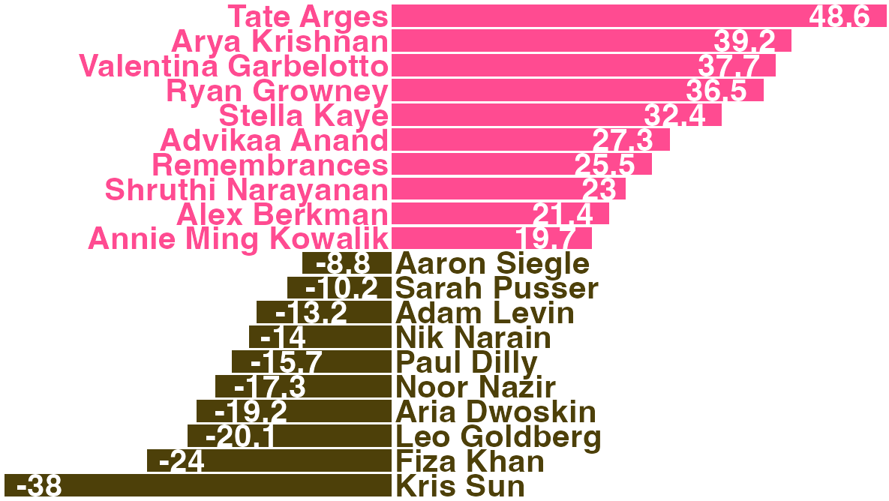
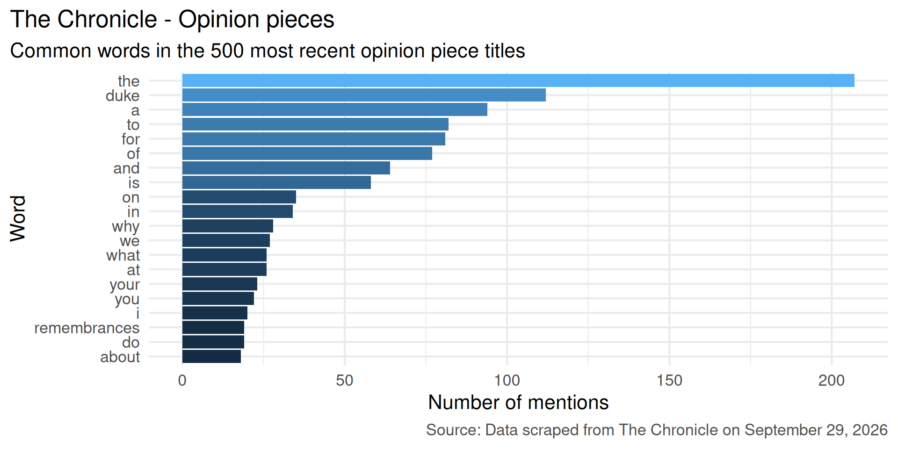
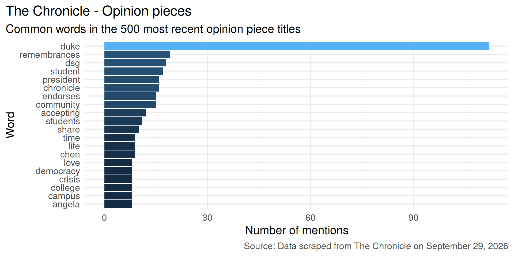
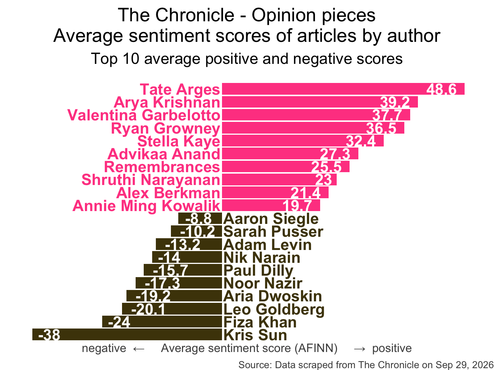
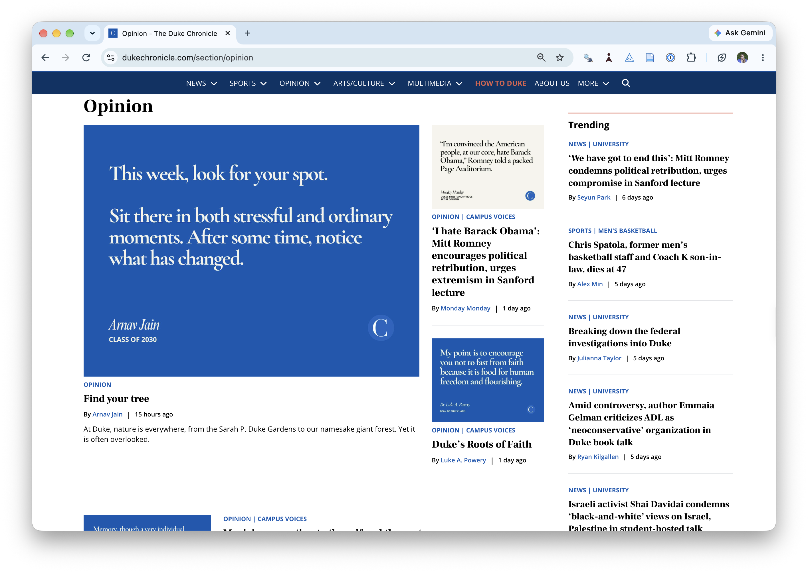
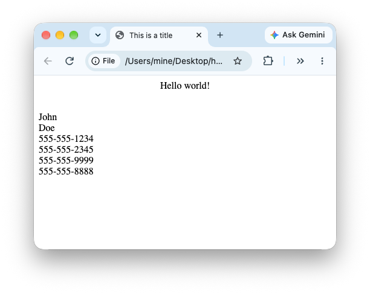
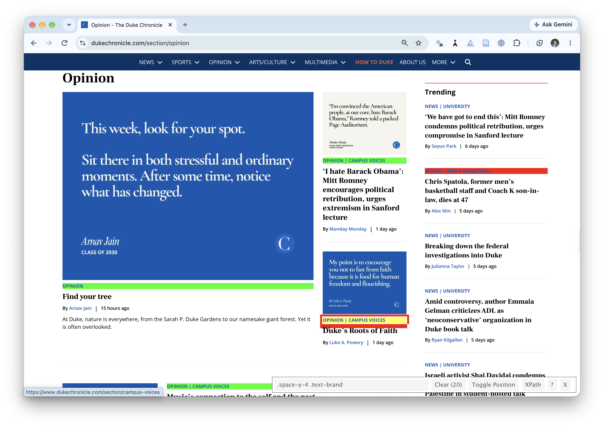
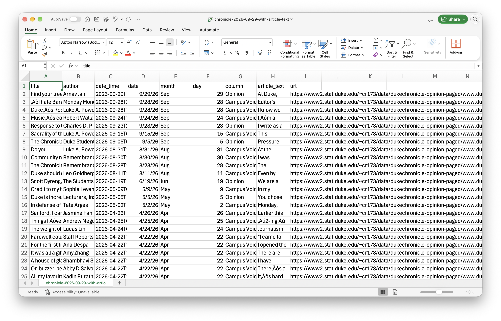

Web scraping\
a single page
=============

Lecture 11

Author

Affiliation

Prof. Mine Çetinkaya-Rundel

Duke University\
STA 199 - Fall 2026

Published

September 30, 2026

# Warm-up

## While you wait: Participate 📱💻

Guess: What is this plot about?

[](images/11/chronicle-sentiments-cropped.png)

**Then, make sure you have a Chrome browser and the SelectorGadget extension installed.**

[](images/11/wooclap-qr.png)

Go to [wooclap.com](https://app.wooclap.com/XSNFYKS) and use the code XSNFYKS.

## Announcements

- HW 4 due tonight at 11:59 pm

- Exam 1 is next Wednesday:

  - Covers all material up to and including today’s lecture
  - Sample exam posted (and open-ended questions will be added later this evening)
  - Exam will be in class, closed book, no calculators, no computers, just 1 notes sheet
  - Notes sheet: 8.5x11, both sides, hand written or typed, any content you want, must be prepared by you

## Project

<https://sta199-f26.github.io/project/description.html>

- Tomorrow in lab: Milestone 1
  - Start working in project teams, practice technical aspects of collaboration on data science projects
  - Write your team contract
  - Identify common interests
- Next week’s lab: Milestone 2 (proposal)
  - Start thinking about your project idea and potential data sources now so you can easily finish Milestone 2 in lab, before fall break

## From last time

Quick review of [`ae-06-age-gaps-import`](ae/ae-06-age-gaps-import-A.llms.md).

# Data on the web

## Participate 📱💻

How often do you read The Chronicle?

- Every day
- 3-5 times a week
- Once a week
- Rarely

[](images/11/wooclap-qr.png)

Go to [wooclap.com](https://app.wooclap.com/XSNFYKS) and use the code XSNFYKS.

## Reading The Chronicle

What do you think is the most common word in the titles of The Chronicle opinion pieces?

## Common words in The Chronicle titles

[](11-web-scraping-single-page_files/figure-revealjs/chronicle-common-words-with-stop-1.png)

## Common title words w/o stop words

[](11-web-scraping-single-page_files/figure-revealjs/chronicle-common-words-without-stop-1.png)

## Reading The Chronicle

How do you think the sentiments in opinion pieces in The Chronicle compare across authors? Roughly the same? Wildly different? Somewhere in between?

## Average sentiment scores

[](11-web-scraping-single-page_files/figure-revealjs/chronicle-sentiments-1.png)

## All of this analysis is done in R!

(mostly) with tools you already know!

## Common words in The Chronicle titles

Code for the earlier plot:

``` numberSource
chronicle |>
  tidytext::unnest_tokens(word, title, drop = FALSE) |>
  mutate(
    word = str_replace_all(word, "’", "'"),
    word = str_replace(word, "duke's", "duke")
  ) |>
  anti_join(stop_words) |>
  count(word, sort = TRUE) |>
  slice_head(n = 20) |>
  mutate(word = fct_reorder(word, n)) |>
  ggplot(aes(y = word, x = n, fill = log(n))) +
  geom_col(show.legend = FALSE) +
  theme_minimal(base_size = 16) +
  labs(
    x = "Number of mentions",
    y = "Word",
    title = "The Chronicle - Opinion pieces",
    subtitle = "Common words in the 500 most recent opinion piece titles",
    caption = "Source: Data scraped from The Chronicle on September 29, 2026"
  ) +
  theme(
    plot.title.position = "plot",
    plot.caption = element_text(color = "gray30")
  )
```

## Avg sentiment scores of articles

Code for the earlier plot:

``` numberSource
afinn_sentiments <- read_csv(here::here("slides", "data/afinn-sentiments.csv"))
chronicle_author_sentiments <- chronicle |>
  tidytext::unnest_tokens(word, article_text, drop = FALSE) |>
  mutate(word = str_replace_all(word, "’", "'")) |>
  anti_join(stop_words) |>
  left_join(afinn_sentiments) |>
  group_by(author, article_text) |>
  summarize(total_sentiment = sum(value, na.rm = TRUE), .groups = "drop") |>
  group_by(author) |>
  summarize(
    n_articles = n(),
    avg_sentiment = mean(total_sentiment, na.rm = TRUE),
  ) |>
  filter(n_articles > 2 & !is.na(author)) |>
  arrange(desc(avg_sentiment)) |>
  slice(c(1:10, 34:43)) |>
  mutate(
    author = fct_reorder(author, avg_sentiment),
    neg_pos = if_else(avg_sentiment < 0, "neg", "pos"),
    label_position = if_else(neg_pos == "neg", 0.25, -0.25)
  )

ggplot(chronicle_author_sentiments, aes(y = author, x = avg_sentiment)) +
  geom_col(aes(fill = neg_pos), show.legend = FALSE) +
  geom_text(
    aes(x = label_position, label = author, color = neg_pos),
    hjust = c(rep(1, 10), rep(0, 10)),
    show.legend = FALSE,
    fontface = "bold"
  ) +
  geom_text(
    aes(label = round(avg_sentiment, 1)),
    hjust = c(rep(1.25, 10), rep(-0.25, 10)),
    color = "white",
    fontface = "bold"
  ) +
  scale_fill_manual(values = c("neg" = "#4d4009", "pos" = "#FF4B91")) +
  scale_color_manual(values = c("neg" = "#4d4009", "pos" = "#FF4B91")) +
  coord_cartesian(xlim = c(-40, 50)) +
  labs(
    x = "negative  ←     Average sentiment score (AFINN)     →  positive",
    y = NULL,
    title = "The Chronicle - Opinion pieces\nAverage sentiment scores of articles by author",
    subtitle = "Top 10 average positive and negative scores",
    caption = "Source: Data scraped from The Chronicle on Sep 29, 2026"
  ) +
  theme_void(base_size = 16) +
  theme(
    plot.title = element_text(hjust = 0.5),
    plot.subtitle = element_text(
      hjust = 0.5,
      margin = margin(t = 0.5, r = 0, b = 1, l = 0, unit = "lines")
    ),
    axis.title.x = element_text(color = "gray30", size = 12),
    plot.caption = element_text(color = "gray30", size = 10)
  )
```

## Where is the data coming from?

<https://www.dukechronicle.com/section/opinion>

[](https://www.dukechronicle.com/section/opinion?page=1&per_page=500)

## Where is the data coming from?


``` downlit
chronicle
```

    # A tibble: 500 × 9
       title   author date_time           date       month   day column article_text
       <chr>   <chr>  <dttm>              <date>     <chr> <dbl> <chr>  <chr>       
     1 Find y… Arnav… 2026-09-29 12:00:00 2026-09-29 Sep      29 Opini… "At Duke, n…
     2 ‘I hat… Monda… 2026-09-28 21:42:00 2026-09-28 Sep      28 Campu… "Editor's n…
     3 Duke’s… Luke … 2026-09-28 14:36:00 2026-09-28 Sep      28 Campu… "I know we …
     4 Music’… Rober… 2026-09-24 10:00:00 2026-09-24 Sep      24 Campu… "I’m a nost…
     5 Respon… Charl… 2026-09-23 20:27:00 2026-09-23 Sep      23 Opini… "I write as…
     6 Sacral… Luke … 2026-09-15 02:19:00 2026-09-15 Sep      15 Campu… "This semes…
     7 The Ch… Duke … 2026-09-05 00:37:00 2026-09-05 Sep       5 Opini… "Pressure c…
     8 Do you  Luke … 2026-08-31 13:57:00 2026-08-31 Aug      31 Campu… "At the beg…
     9 Commun… Remem… 2026-08-30 16:29:00 2026-08-30 Aug      30 Campu… "I was coll…
    10 The Ch… Remem… 2026-08-28 12:00:00 2026-08-28 Aug      28 Campu… "The Chroni…
    # ℹ 490 more rows
    # ℹ 1 more variable: url <chr>

# Web scraping

## Scraping the web: what? why?

- Increasing amount of data is available on the web

- These data are provided in an unstructured format: you can always copy&paste, but it’s time-consuming and prone to errors

- Web scraping is the process of extracting this information automatically and transform it into a structured dataset

- Two different scenarios:

  - Screen scraping: extract data from source code of website, with html parser (easy) or regular expression matching (less easy).

  - Web APIs (application programming interface): website offers a set of structured http requests that return JSON or XML files.

## Hypertext Markup Language

Most of the data on the web is still largely available as HTML - while it is structured (hierarchical) it often is not available in a form useful for analysis (flat / tidy).

``` html
<html>
  <head>
    <title>This is a title</title>
  </head>
  <body>
    <p align="center">Hello world!</p>
    <br/>
    <div class="name" id="first">John</div>
    <div class="name" id="last">Doe</div>
    <div class="contact">
      <div class="home">555-555-1234</div>
      <div class="home">555-555-2345</div>
      <div class="work">555-555-9999</div>
      <div class="fax">555-555-8888</div>
    </div>
  </body>
</html>
```

## rvest

- The **rvest** package makes basic processing and manipulation of HTML data straight forward
- It’s designed to work with pipelines built with `|>`
- [rvest.tidyverse.org](https://rvest.tidyverse.org)

``` downlit
library(rvest)
```

[](https://rvest.tidyverse.org/)

## rvest

Core functions:

- [`read_html()`](http://xml2.r-lib.org/reference/read_xml.html) - read HTML data from a url or character string.

- [`html_elements()`](https://rvest.tidyverse.org/reference/html_element.html) - select specified elements from the HTML document using CSS selectors (or xpath).

- [`html_element()`](https://rvest.tidyverse.org/reference/html_element.html) - select a single element from the HTML document using CSS selectors (or xpath).

- [`html_table()`](https://rvest.tidyverse.org/reference/html_table.html) - parse an HTML table into a data frame.

- [`html_text()`](https://rvest.tidyverse.org/reference/html_text.html) / [`html_text2()`](https://rvest.tidyverse.org/reference/html_text.html) - extract tag’s text content.

- `html_name` - extract a tag/element’s name(s).

- `html_attrs` - extract all attributes.

- `html_attr` - extract attribute value(s) by name.

## A web page’s source code is HTML

[](images/11/html.png)

``` downlit
source_code_for_a_page <-
  '<html>
  <head>
    <title>This is a title</title>
  </head>
  <body>
    <p align="center">Hello world!</p>
    <br/>
    <div class="name" id="first">John</div>
    <div class="name" id="last">Doe</div>
    <div class="contact">
      <div class="home">555-555-1234</div>
      <div class="home">555-555-2345</div>
      <div class="work">555-555-9999</div>
      <div class="fax">555-555-8888</div>
    </div>
  </body>
</html>'
```

``` downlit
page <- read_html(source_code_for_a_page)
page
```

    {html_document}
    <html>
    [1] <head>\n<meta http-equiv="Content-Type" content="text/html; charset=UTF-8 ...
    [2] <body>\n    <p align="center">Hello world!</p>\n    <br><div class="name" ...

## Selecting elements from HTML

Give me all the elements tagged `p`:

``` downlit
page |> html_elements("p")
```

    {xml_nodeset (1)}
    [1] <p align="center">Hello world!</p>

\

Give me the human-readable text of all the elements tagged `p`:

``` downlit
page |> html_elements("p") |> html_text()
```

    [1] "Hello world!"

\

Give me the attributes of all the elements tagged `p`:

``` downlit
page |> html_elements("p") |> html_attrs()
```

    [[1]]
       align 
    "center" 

\

Give me the value of the `align` attribute of all the elements tagged `p`:

``` downlit
page |> html_elements("p") |> html_attr("align")
```

    [1] "center"

## Selecting elements from HTML

Give me all the elements tagged `div`:

``` downlit
page |> html_elements("div")
```

    {xml_nodeset (7)}
    [1] <div class="name" id="first">John</div>
    [2] <div class="name" id="last">Doe</div>
    [3] <div class="contact">\n      <div class="home">555-555-1234</div>\n       ...
    [4] <div class="home">555-555-1234</div>
    [5] <div class="home">555-555-2345</div>
    [6] <div class="work">555-555-9999</div>
    [7] <div class="fax">555-555-8888</div>

. . .

\

- Give me the human-readable text of all the elements tagged `div`:

``` downlit
page |> html_elements("div") |> html_text()
```

    [1] "John"                                                                                  
    [2] "Doe"                                                                                   
    [3] "\n      555-555-1234\n      555-555-2345\n      555-555-9999\n      555-555-8888\n    "
    [4] "555-555-1234"                                                                          
    [5] "555-555-2345"                                                                          
    [6] "555-555-9999"                                                                          
    [7] "555-555-8888"                                                                          

## Extracting text from selected elements

``` downlit
source_code_for_a_boring_page <- read_html(
  "<p>  
    This is the first sentence in the paragraph.
    This is the second sentence that should be on the same line as the first sentence.<br>This third sentence should start on a new line.
  </p>"
)
```

\

[`html_text()`](https://rvest.tidyverse.org/reference/html_text.html):

``` downlit
source_code_for_a_boring_page |>
  html_text()
```

    [1] "  \n    This is the first sentence in the paragraph.\n    This is the second sentence that should be on the same line as the first sentence.This third sentence should start on a new line.\n  "

[`html_text2()`](https://rvest.tidyverse.org/reference/html_text.html):

``` downlit
source_code_for_a_boring_page |>
  html_text2()
```

    [1] "This is the first sentence in the paragraph. This is the second sentence that should be on the same line as the first sentence.\nThis third sentence should start on a new line."

## Finding the elements to select

- Some examples of basic selector syntax is below:

| Selector | Example | Description |
|:---|:---|:---|
| .class | `.title` | Select all elements with class=“title” |
| \#id | `#name` | Select all elements with id=“name” |
| element | `p` | Select all \<p\> elements |
| element element | `div p` | Select all \<p\> elements inside a \<div\> element |
| element\>element | `div > p` | Select all \<p\> elements with \<div\> as a parent |
| \[attribute\] | `[class]` | Select all elements with a class attribute |
| \[attribute=value\] | `[class=title]` | Select all elements with class=“title” |

- Though, thankfully you don’t need to worry about these details as the SelectorGadget will just tell you what to grab!

## SelectorGadget

**SelectorGadget** ([selectorgadget.com](http://selectorgadget.com)) is a javascript based tool that helps you interactively build an appropriate CSS selector for the content you are interested in.

[](images/11/selectorgadget.png)

# Application exercise

## Opinion articles in The Chronicle

Go to [a cached copy of The Chronicle’s opinion page as of last night](https://www2.stat.duke.edu/~cr173/data/dukechronicle-opinion/www.dukechronicle.com/section/opinionabc4.html).

How many articles are on the page?

## Goal

- Scrape data and organize it in a tidy format in R
- Perform light text parsing to clean data
- Summarize and visualze the data

[](images/11/chronicle-data.png)

## `ae-07-chronicle-scrape-I`

- Go to your ae project in Positron.

- If you haven’t yet done so, make sure all of your changes up to this point are committed and pushed, i.e., there’s nothing left in your source control pane.

- If you haven’t yet done so, pull to get today’s application exercise file: `ae-07-chronicle-scrape-I.qmd`.

- Work through the application exercise in class, and render, commit, and push your edits by the end of class.
