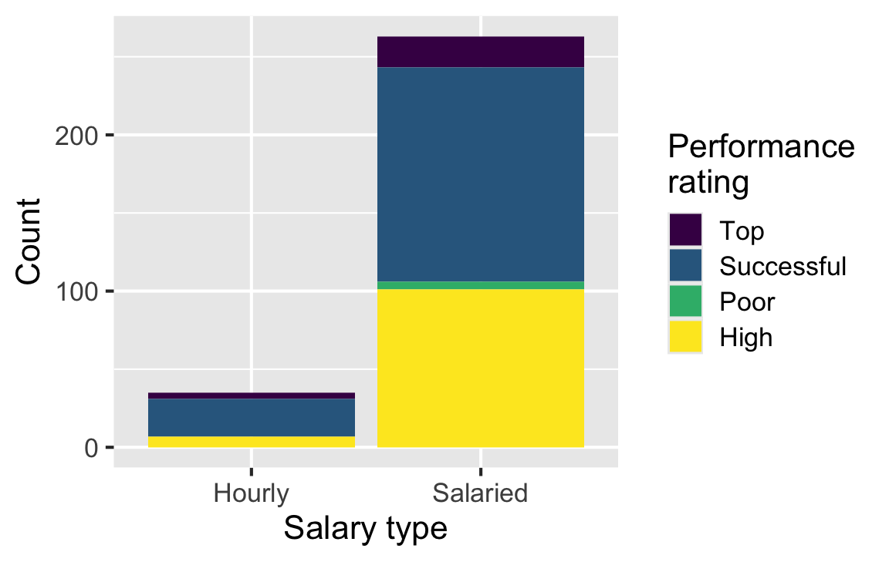
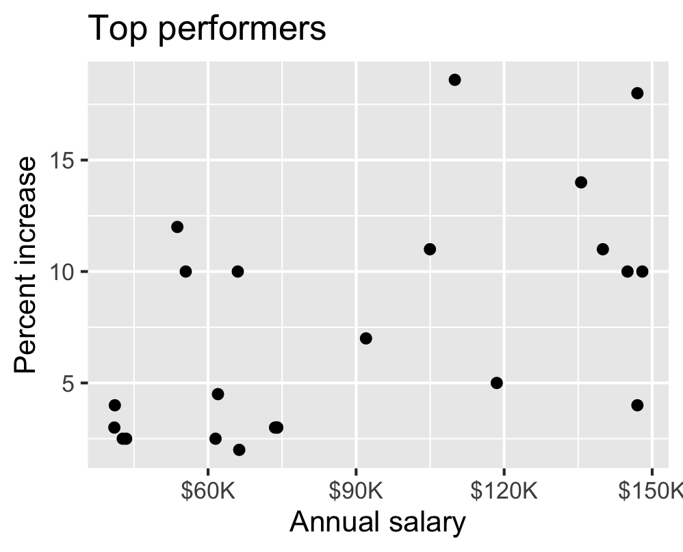
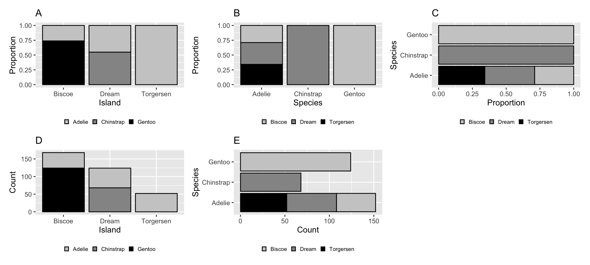

# Exam 1 Review

Lecture 12

Author

Affiliation

Prof. Mine Çetinkaya-Rundel

Duke University\
STA 199 - Fall 2026

Published

September 30, 2026

# Warm-up

## While you wait: Participate 📱💻

- Check your email (and your spam folder) for an email from TEAMMATES

- Fill out your peer evaluation for your team members

If you fail to submit your feedback, you’re not eligible to receive the points they give you.

## From last time

- Go to your ae project in Positron.

- If you haven’t yet done so, make sure all of your changes up to this point are committed and pushed, i.e., there’s nothing left in your source control pane.

- If you haven’t yet done so, pull to get today’s application exercise file: `ae-07-chronicle-scrape-I.qmd`.

- Work through the application exercise in class, and render, commit, and push your edits by the end of class.

# Exam 1 review

## Exam 1

Exam 1 is on Wednesday, starts promptly at 1:25 pm!

- Covers all material up to and including today’s lecture

- Sample exam + model solutions for select HW questions are posted

- Exam will be in class, closed book, no calculators, no computers, just 1 notes sheet

- Notes sheet: 8.5x11, both sides, hand written or typed, any content you want, must be prepared by you

- We’ll direct you to your seat so get here early to allow time to get settled and read the instructions

## Types of questions

- Multiple-choice:
  - Some will be single best answer, no partial credit
  - Some will be *at least one* correct answer, with partial credit, and clearly identified with “Select all that apply”
- Open-ended:
  - Short answer, show your work, justify your reasoning
  - With partial credit

## Q1: Variable types

`blizzard_salary` has **409 rows and 4 columns**. Each row is a worker who completed the spreadsheet. Which statements are correct? **Select all that apply.**

1.  The dataset has 399 rows.
2.  The dataset has 4 columns. **Correct**
3.  Each row represents a Blizzard Entertainment worker who filled out the spreadsheet. **Correct**
4.  `percent_incr` is numerical and discrete.
5.  `salary_type` is numerical.
6.  `annual_salary` is numerical. **Correct**
7.  `performance_rating` is categorical and ordinal. **Correct**

## Q9: Where did the observations go? — question

A friend notices that the total number of observations in this plot seems lower than the total in `blizzard_salary` (**409 workers**). What might be going on here? Explain your reasoning.

[](12-exam-I-review_files/figure-revealjs/q9-question-plot-1.png)

**Observations with missing values for both variables won’t be represented on the plot.**

## Q13: Reviewing an interpretation — question

For **Top performers**, a team writes: “The relationship is positive, having a higher salary results in a higher percent increase. There is one clear outlier.” Which peer review notes are accurate and helpful? **Select all that apply.**

[](12-exam-I-review_files/figure-revealjs/q13-top-plot-1.png)

1.  The interpretation is complete and perfect.
2.  It doesn’t mention the direction.
3.  It doesn’t mention the form, which is linear. **Correct.**
4.  It doesn’t mention the strength, which is somewhat strong. **Correct.**
5.  There isn’t a clear outlier; identify any potential outlier by its salary and/or percent increase. **Correct.**
6.  The interpretation is causal; observational data do not establish which variable causes the other or rule out other explanations. **Correct.**

## Q16: Which bar plot?

Which plot is produced by this code? **Correct: D.**

``` downlit
ggplot(penguins, aes(x = island, fill = species)) +
  geom_bar()
```

[](12-exam-I-review_files/figure-revealjs/q16-options-1.png)

## Q17: Reading a tibble

Based on this output, which statements **must be true**? **Select all that apply.**

    # A tibble: 336,776 × 19
        year month   day arr_delay carrier dep_time sched_dep_time
       <int> <int> <int>     <dbl> <chr>      <int>          <int>
     1  2013     1     1        11 UA           517            515
     2  2013     1     1        20 UA           533            529
     3  2013     1     1        33 AA           542            540
     4  2013     1     1       -18 B6           544            545
     5  2013     1     1       -25 DL           554            600
     6  2013     1     1        12 UA           554            558
     7  2013     1     1        19 B6           555            600
     8  2013     1     1       -14 EV           557            600
     9  2013     1     1        -8 B6           557            600
    10  2013     1     1         8 AA           558            600
    # ℹ 336,766 more rows
    # ℹ 12 more variables: dep_delay <dbl>, arr_time <int>,
    #   sched_arr_time <int>, flight <int>, tailnum <chr>,
    #   origin <chr>, dest <chr>, air_time <dbl>, distance <dbl>,
    #   hour <dbl>, minute <dbl>, time_hour <dttm>

1.  `flights` is a tibble. **Correct.**
2.  `flights` has 10 rows.
3.  `flights` has 8 columns.
4.  `carrier` is a character variable. **Correct.**
5.  There are no missing data in `flights`.

## Q27: Summing a condition

Which statements about the code and its result are true? **Select all that apply.**

``` downlit
movies |>
  summarize(sum(release_country == "United States"))
```

    # A tibble: 1 × 1
      `sum(release_country == "United States")`
                                          <int>
    1                                       435

1.  It evaluates whether each `release_country` equals `"United States"`, resulting in logical values. **Correct.**
2.  It filters out rows where `release_country` is not `"United States"` and counts the remaining rows.
3.  It sums the logical values, treating each `TRUE` as 1 and each `FALSE` as 0. **Correct.**
4.  It results in a character vector.
5.  The result shows 435 movies released in the United States. **Correct.**

## Q29: A 6 × 6 result

``` downlit
movies |>
  count(rating, genre) |>
  pivot_wider(names_from = genre, values_from = n, values_fill = 0)
```

    # A tibble: 6 × 6
      rating    Other Drama Action Comedy Horror
      <fct>     <int> <int>  <int>  <int>  <int>
    1 G             5     1      1      1      0
    2 PG           38    13     10     18      0
    3 PG-13        19    25     35     35      0
    4 R            45    50     57     96     21
    5 NC-17         1     2      0      1      0
    6 Not Rated     4    11      4      6      1

Which statements are true? **Select all that apply.**

1.  The code counts movies in each rating and genre combination. **Correct.**
2.  The code sorts the results in descending order.
3.  Each row of the output is a movie.
4.  The output shows six distinct ratings in the dataset. **Correct.**
5.  The code reduces the number of variables and observations in the `movies` data frame to six.

## Q31: Reshaping inflation data — question

`country_inflation` has **38 rows and 34 columns**: one row per country, a `country` column, and annual inflation columns for **1993–2025**.

``` downlit
country_inflation_long <- country_inflation |>
  pivot_longer(
    cols = !country,
    names_to = "year",
    names_transform = as.numeric,
    values_to = "inflation_rate"
  )
```

How many rows and columns does the result have? **Show where each number comes from.** What does each row represent, what did `pivot_longer()` do, and what does `names_transform = as.numeric` accomplish?

## Q31: Reshaping inflation data — answer

**Rows: 1,254. Columns: 3.** Each row represents **one country in one year**.

1.  **38** is the number of countries (the original rows).
2.  **34 − 1 = 33** columns are year columns: exclude the one `country` column. Equivalently, **2025 − 1993 + 1 = 33** years.
3.  Each country becomes **33 rows**, so the total is:

\\38 \times 33 = 38 \times 30 + 38 \times 3 = 1{,}140 + 114 = 1{,}254\\

The output columns are **`country` + `year` + `inflation_rate` = 3**:

- `country` is retained and repeated for each year.
- The 33 old column **names** become values in `year`.
- Their cell **values** become values in `inflation_rate`.

Missing inflation values still get rows; this code does not drop them.

## Q32: Ratios and the top five — question

``` downlit
country_inflation |>
  filter(!is.na(`1993`), !is.na(`2025`)) |>
  mutate(inf_ratio = `2025` / `1993`) |>
  select(country, inf_ratio) |>
  arrange(desc(inf_ratio)) |>
  slice_head(n = 5)
```

    # A tibble: 5 × 2
      country        inf_ratio
      <chr>              <dbl>
    1 New Zealand         2.20
    2 Australia           1.64
    3 Denmark             1.51
    4 Ireland             1.50
    5 United Kingdom      1.48

**Part 1:** What does the resulting data frame represent? What does New Zealand’s `inf_ratio` of 2.20 mean?

**Part 2:** What would change if the [`filter()`](https://rdrr.io/r/stats/filter.html) step were removed? Why could that be misleading?

## Q32: Ratios and the top five — answer

**Part 1:** These are the **five countries with the largest 2025-to-1993 inflation ratios**, in descending order.

- A ratio of **2.20** means New Zealand’s 2025 inflation rate was **2.20 times its 1993 rate** (120% higher). It does not mean the 2025 inflation rate was 2.20%.
- `arrange(desc(inf_ratio))` puts the largest ratios first. **`slice_head(n = 5)` keeps the first five rows in that order.**

**Part 2:** Without [`filter()`](https://rdrr.io/r/stats/filter.html), six countries would have `NA` ratios because at least one of their two rates is missing.

- `arrange()` puts these `NA`s last. **For these data, the same five countries would still be returned.**
- The top-five table cannot reveal whether an absent country has a smaller ratio or lacks data. Filtering makes the exclusion explicit; report that the ranking uses **32 of 38 countries**.

## Q32: What exactly does `slice_head()` do?

**It selects rows by their current positions. It does not sort or calculate a summary.**

| Stage                      | Rows | What happened?                          |
|:---------------------------|-----:|:----------------------------------------|
| Start                      |   38 | One row per country                     |
| `filter(...)`              |   32 | Keep countries with both endpoint rates |
| `mutate(...)`              |   32 | Add one ratio to each row               |
| `select(...)`              |   32 | Keep two columns                        |
| `arrange(desc(inf_ratio))` |   32 | Put largest ratios first                |
| `slice_head(n = 5)`        |    5 | Keep rows 1–5                           |

Removing **only `slice_head(n = 5)`** keeps all **32 eligible countries**. It does not restore the six countries excluded by [`filter()`](https://rdrr.io/r/stats/filter.html).

## Other questions

- [Q2](../exam-review/exam-1-review.llms.md#question-2)
- [Q4](../exam-review/exam-1-review.llms.md#question-4)
- [Q7](../exam-review/exam-1-review.llms.md#questions-6-and-7)
- [Q8](../exam-review/exam-1-review.llms.md#questions-8---10)
- [Q14](../exam-review/exam-1-review.llms.md#question-14)
- [Q23](../exam-review/exam-1-review.llms.md#question-23)
- [Q24](../exam-review/exam-1-review.llms.md#question-24)
- [Q28](../exam-review/exam-1-review.llms.md#question-28)
- [Q30](../exam-review/exam-1-review.llms.md#question-30)

[Exam review answers](../exam-review/exam-1-review-A.llms.md)
