# Data science ethics

Lecture 14

Author

Affiliation

Prof. Mine Çetinkaya-Rundel

Duke University\
STA 199 - Fall 2026

Published

October 19, 2026

# Warm-up

## While you wait: Participate 📱💻

1️⃣ First, fill out peer evaluations for your teammates on TEAMMATES. Check your email for a link to the survey. It’s due tonight at 11:59 pm.

2️⃣ Then, fill in the blank below:

> We will meet (or already met) as a team to make progress on our projects \_\_\_\_\_\_.

- earlier this morning
- later today
- tomorrow
- on Wednesday
- um… 🤷‍♀️ – I am messaging/emailing my teammates right now to set up a meeting before Thursday’s lab

Go to [wooclap.com](https://app.wooclap.com/UDHRUEH) and use the code UDHRUEH.

## Announcements

- Do not forget to fill out peer evaluations for your teammates on TEAMMATES!

- Make LOTS of progress on your project before Thursday’s lab, where you’ll provide (and receive) peer review to (from) another team in your lab.

- **Office hours change:** For this week only, my office hours will be on Friday, 2 - 3:30 pm (at my office – Old Chem 211C – as usual).

# Mid-semester course feedback

Thank you to the 66 of you who provided feedback! ♥️

## Course pace

[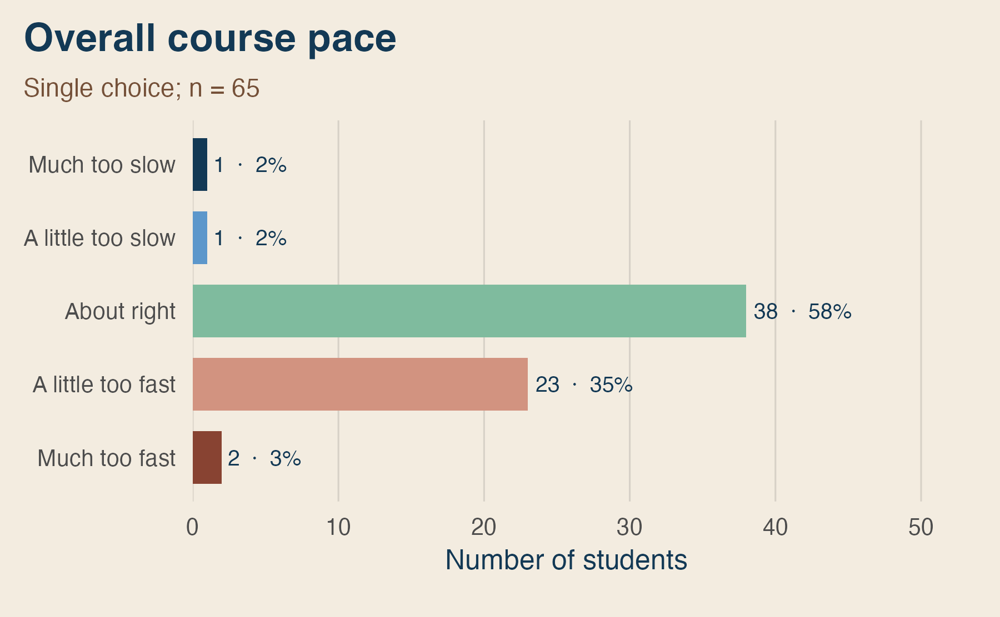](images/14/midsemester-feedback/figures/course-pace.png)

## Lecture pace

[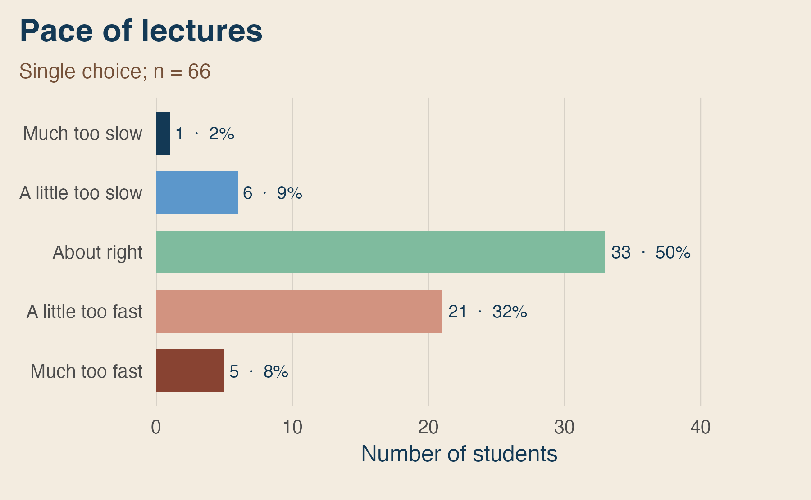](images/14/midsemester-feedback/figures/lecture-pace.png)

## Course engagement

[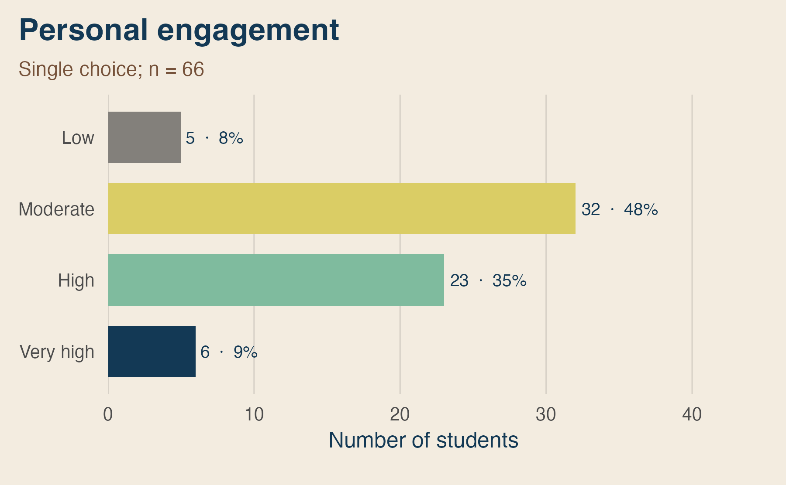](images/14/midsemester-feedback/figures/course-engagement.png)

## Learning resources

[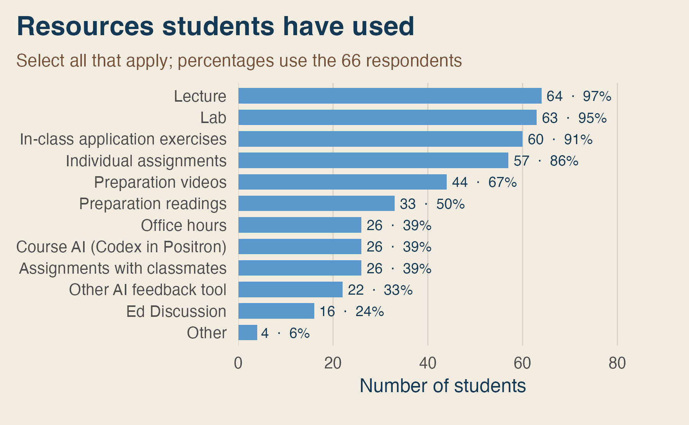](images/14/midsemester-feedback/figures/learning-resources.png)

## Best learning

[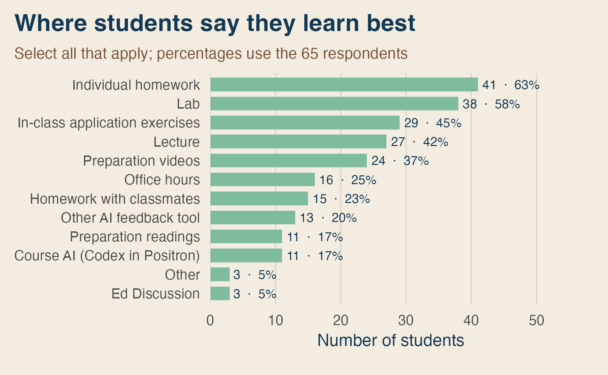](images/14/midsemester-feedback/figures/best-learning.png)

## Project teammates

[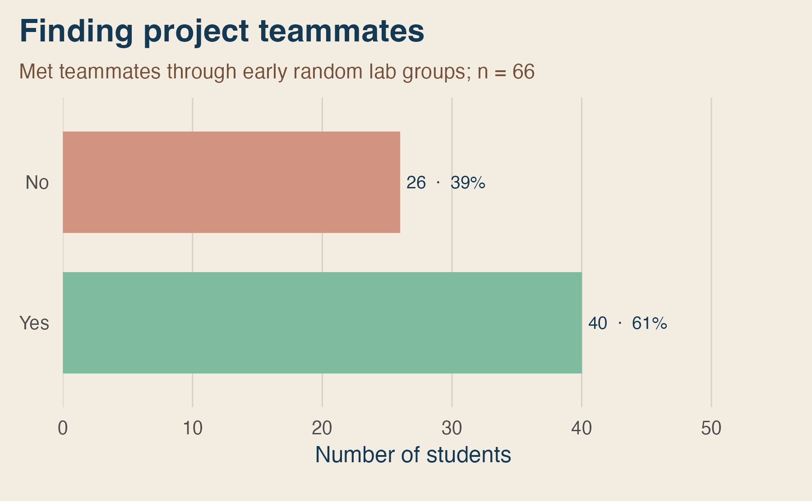](images/14/midsemester-feedback/figures/project-teammates.png)

## Lecture format

[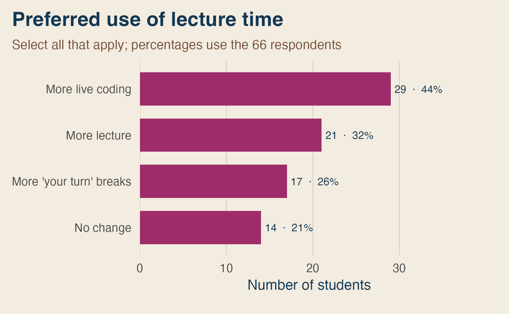](images/14/midsemester-feedback/figures/lecture-format.png)

## Course difficulty

[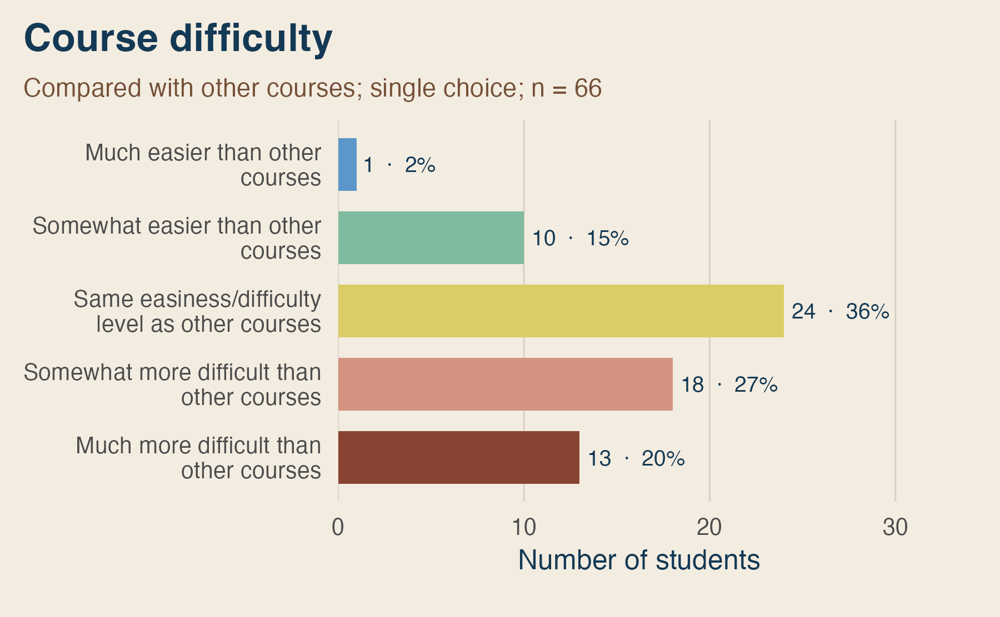](images/14/midsemester-feedback/figures/course-difficulty.png)

## Instructor feedback

*32 of 66 students entered text; this excludes entries such as no comment or N/A.*

- **Strongest theme:** Students frequently described the instructor as knowledgeable, clear, organized, warm, humorous, and approachable. Lecture notes, preparation videos, application exercises, and office hours were singled out as helpful.
- **Most common improvement request:** Slow down during live coding and spend more time explaining why particular functions, variables, and arguments are used. Several students want more time to reason through code rather than copy it.
- **Smaller recurring themes:** Multiple comments asked for clearer lecture structure or discussed how well class practice prepares students for exams.

These are aggregate, paraphrased themes; no individual response is quoted.

## TA feedback

*35 of 66 students entered text; this excludes entries such as no comment or N/A.*

- **Overall tone:** Feedback was overwhelmingly positive. Students repeatedly described the TAs as helpful, kind, encouraging, knowledgeable, and responsive in labs and office hours.
- **What students value:** Students repeatedly appreciated patient explanations, individual attention, and ready access to help during labs and office hours.
- **Improvement opportunity:** Multiple comments asked for more active guidance in lab and explanations that better account for students’ limited prior experience.

These are aggregate, paraphrased themes; no individual response is quoted.

## Confusing topics

[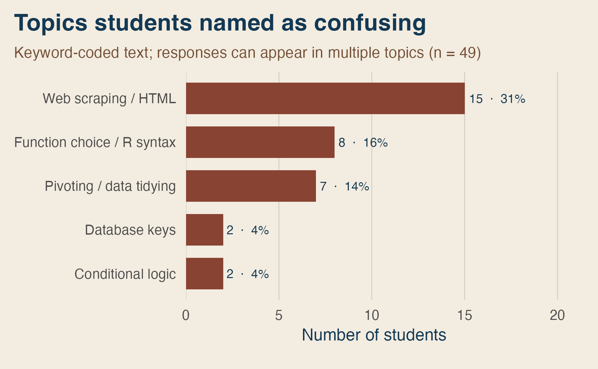](images/14/midsemester-feedback/figures/confusing-topics.png)

Several students said they were not confused about a particular topic.

## Engagement and stimulation

*49 of 66 students entered text; this excludes entries such as no comment or N/A.*

- **Hands-on work is the main source of engagement:** Application exercises, labs, live coding, homework, and the project were the most consistent positive themes.
- **Context matters:** Students valued real-world data, varied examples, collaboration, and the freedom to work with personally interesting project data.
- **Ways to increase engagement:** Suggestions included more active coding and interaction during lecture, clearer bridges from concepts to complete examples, and more in-class questions that resemble assessment tasks.
- **Sources of friction:** A smaller group described lectures as hard to follow or less efficient than independent review, and some found readings and videos repetitive.

These are aggregate, paraphrased themes; no individual response is quoted.

## Suggestions

*19 of 66 students entered text; this excludes entries such as no comment or N/A.*

- **Most repeated request:** Students want assessment preparation to align more closely with the exam. They asked for more exam-like questions, additional practice exams or study guides, clearer exam outlines, and targeted review of commonly missed ideas.
- **Exam format:** Several students objected to the difficulty or wording of the first exam, especially open-ended questions and writing code on paper.
- **Workload and pacing:** A few responses described homework as lengthy relative to its weight, preparation materials as too numerous, or the combined lab and homework load as limiting time to consolidate learning.
- **Instructional suggestions:** Two students suggested strengthening the connection between lecture explanations and hands-on coding.

These are aggregate, paraphrased themes; no individual response is quoted.

# Data science ethics

## Data science ethics

- Data do not speak for themselves. They require an interpretive lens, not all of which are created equal.

- The practice of data science is not ethically neutral or value-free.

# Privacy

## Pause…

What is your username on… GitHub, LinkedIn, Reddit, Instagram, TikTok, other social media platforms, online dating services, etc.?

## Pause…

Suppose you create a profile on a social media site and share your personal information on your profile. Who else gets to use that data – companies the social media company has a connection to? companies the social media company sells your data to? researchers?

## OkCupid

[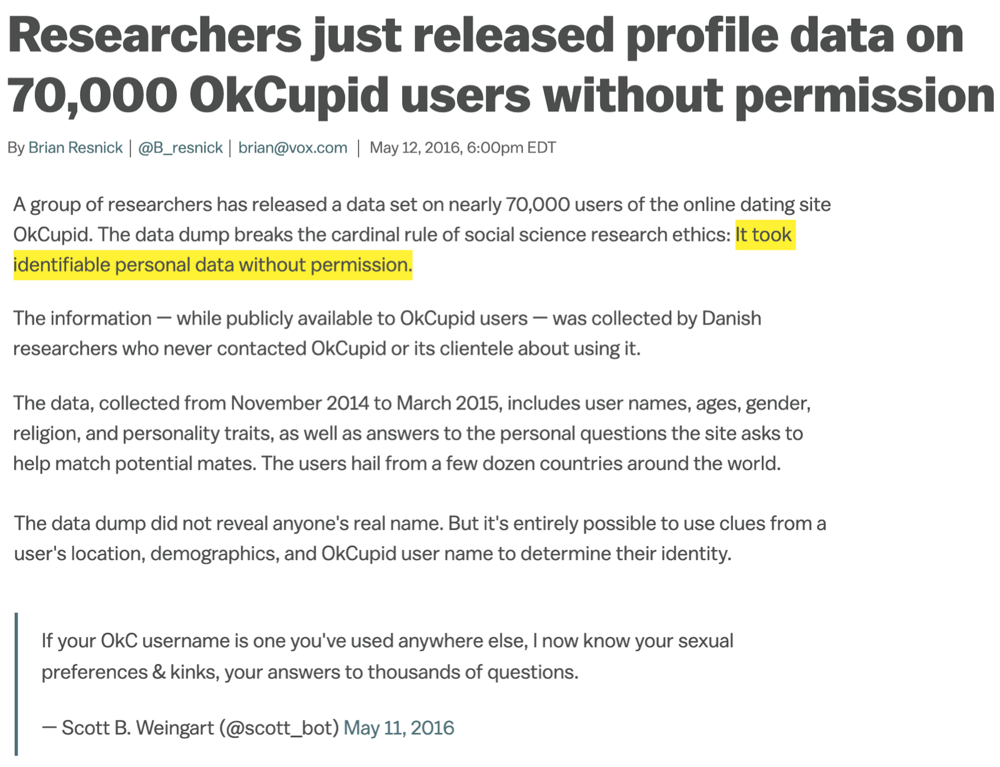](images/14/privacy-ok-cupid-vox.png)

- In 2016, researchers published data from roughly **70,000 OkCupid profiles**, including usernames, political views, drug use, and intimate sexual details.

- Names and photos were excluded, but usernames and other details made re-identification possible.

Does public availability imply consent to collect and republish data at scale?

Source: Brian Resnick, [Researchers just released profile data on 70,000 OkCupid users without permission](https://www.vox.com/2016/5/14/11666116/70000-okcupid-users-data-release). Vox. May 12, 2016.

## Pause…

What are some things you know about how car insurance rates are set?

## Pause…

Do you drive a car with “smart” features?

## GM OnStar

[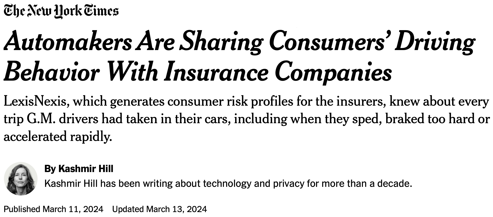](images/14/privacy-gm-onstar.png)

Source: Kashmir Hill, [Automakers Are Sharing Consumers’ Driving Behavior With Insurance Companies](https://www.nytimes.com/2024/03/11/technology/carmakers-driver-tracking-insurance.html). New York Times. March 11, 2024.

## GM OnStar

- According to an FTC complaint, GM and OnStar collected precise location and driving behavior data from millions of vehicles—sometimes as often as every three seconds.

- The data included hard braking, late-night driving, and speeding.

- GM sold the data to consumer reporting agencies, where insurers used it to deny coverage or set rates.

- The proposed order required affirmative consent, access and deletion rights, and an option to limit collection.

You activate a feature marketed as helping you assess your driving habits. What other uses of those data would require new consent?

Federal Trade Commission. [FTC Takes Action Against General Motors for Sharing Drivers’ Precise Location and Driving Behavior Data Without Consent](https://www.ftc.gov/news-events/news/press-releases/2025/01/ftc-takes-action-against-general-motors-sharing-drivers-precise-location-driving-behavior-data). 16 January 2025.

## Pause…

Have you ever done a direct-to-consumer DNA testing like 23andMe or AncestryDNA?

## 23andMe

- In 2023, attackers used credential stuffing—trying usernames and passwords stolen in unrelated breaches—to log into about 14,000 23andMe accounts. Since accounts were connected to many other users through DNA Relatives and Family Tree, the attackers could access profile information associated with approximately 6.9 million people.

- Exposed information varied but could include names, birth years, locations, ancestry or ethnicity, genetic relationships, family trees, and, for some users, health reports or raw genetic data.

- Genetic data is unusually sensitive, permanent, and shared: exposing one person’s information can also reveal information about relatives who never consented to the service.

NY Attorney General. [Attorney General James Secures \$18 Million From 23andMe for Failing to Protect Customers’ Genetic Data](https://ag.ny.gov/press-release/2026/attorney-general-james-secures-18-million-23andme-failing-protect-customers). July 14, 2026.

## NIH

[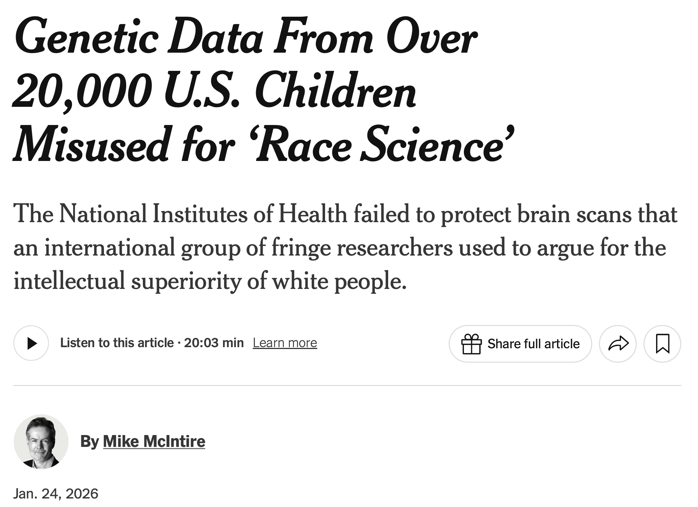](images/14/privacy-nih.png)

- Genetic, cognitive, and brain-imaging data from \>20,000 children enrolled in the federally funded Adolescent Brain Cognitive Development Study was obtained and misused by researchers promoting “race science”.

- They published at least 16 papers claiming biological differences in intelligence among racial groups – mainstream geneticists reject this work as biased and methodologically unsound.

Mike McIntire. [Genetic Data From Over 20,000 U.S. Children Misused for ‘Race Science’](https://www.nytimes.com/2026/01/24/us/children-genetics-race-science.html). New York Times. Jan. 24, 2026.

## Definition of “privacy”

- Removing names from a dataset, alone, does not prevent harm.

- Research can stigmatize entire communities even when no individual is reidentified, raising questions about informed consent, researcher vetting, monitoring secondary data use, participant notification, and whether institutions have obligations to prevent both individual and group-level harms.

- This is especially of concern since social media and AI systems can amplify claims based on pseudoscience.

## “Your” data

- Every time we use apps, websites, and devices, our data is being collected and used or sold to others.

- More importantly, decisions are made by law enforcement, financial institutions, and governments based on data that directly affect the lives of people.

## Participate 📱💻

What pieces of data have you left on the internet today?

Think through everything you’ve logged into, clicked on, checked in, either actively or automatically, that might be tracking you. Submit as many as you can think of.

Go to [wooclap.com](https://app.wooclap.com/UDHRUEH) and use the code UDHRUEH.

## Pause

Do you know where that data is stored? Who can access it? Whether it’s shared with others?

## Sharing your data

What are you OK with sharing?

- Name
- Age
- Email
- Phone Number
- List of every video you watch
- List of every video you comment on

- How you type: speed, accuracy
- How long you spend on different content
- List of all your private messages (date, time, person sent to)
- Info about your photos (how it was taken, where it was taken (GPS), when it was taken)

## What does Google think/know about you?

Have you ever thought about why you’re seeing an ad on Google?

\

**Homework:** Try to figure out if you have ad personalization on and how your ads are personalized.

## Your browsing history

Which of the following are you OK with your browsing history to be used towards?

- To predict your age for serving you targeted ads
- To predict your race/ethnicity for serving you targeted ads
- To score you as a candidate for a job

# Misrepresentation

## Misrepresenting data science results

Some common ways people do this, either intentionally or unintentionally, include:

- Claiming **causality** where it’s not in the scope of inference of the underlying study

- Distorting **axes and scales** or using selective **annotations** to make the data tell a different story

- Visualizing **spatial areas instead of human density** for issues that depend on and affect humans

- Omitting **uncertainty** in reporting

## Causality: Intermittent fasting

What conclusion might a reader draw from this headline?

> **8-hour time-restricted eating linked to a 91% higher risk of cardiovascular death**

What does **91% higher risk** mean?

American Heart Association. [8-hour time-restricted eating linked to a 91% higher risk of cardiovascular death](https://newsroom.heart.org/news/8-hour-time-restricted-eating-linked-to-a-91-higher-risk-of-cardiovascular-death). March 18, 2024.

## Causality: Intermittent fasting

The result came from a preliminary observational analysis of more than 20,000 US adults.

- Eating duration was estimated from two self-reported 24-hour dietary recalls.

- Participants were not randomly assigned to eating schedules.

- Diet quality and other possible explanations were not fully accounted for.

- The conference abstract had not undergone peer review.

- The American Heart Association explicitly cautioned that the association did **not** show that time-restricted eating caused cardiovascular death.

Sources: [American Heart Association news release and study limitations](https://newsroom.heart.org/news/8-hour-time-restricted-eating-linked-to-a-91-higher-risk-of-cardiovascular-death); British Heart Foundation, [The truth behind reports that intermittent fasting is bad for your heart](https://www.bhf.org.uk/informationsupport/heart-matters-magazine/news/behind-the-headlines/intermittent-fasting).

## Causality: Intermittent fasting

Important questions to ask:

- 91% higher than what absolute risk?

- Was eating duration assigned or observed?

- How was eating duration measured?

- What other differences between the groups might explain the association?

## Axes and scales: Tax cuts

What is the difference between these two pictures? Which presents a better way to represent these data?

[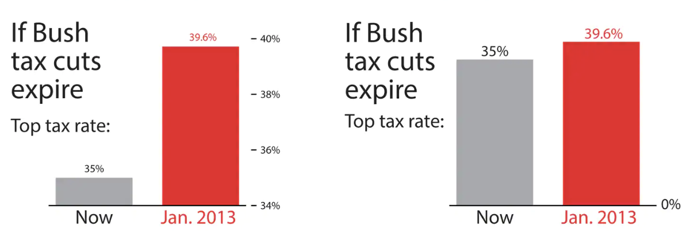](images/14/misrepresentation-tax-cuts.png)

Christopher Ingraham. [“You’ve been reading charts wrong. Here’s how a pro does it.”](https://www.washingtonpost.com/business/2019/10/14/youve-been-reading-charts-wrong-heres-how-pro-does-it/). The Washington Post. 14 October 2019.

## Axes and scales: Cost of gas

What is wrong with this picture? How would you correct it?

[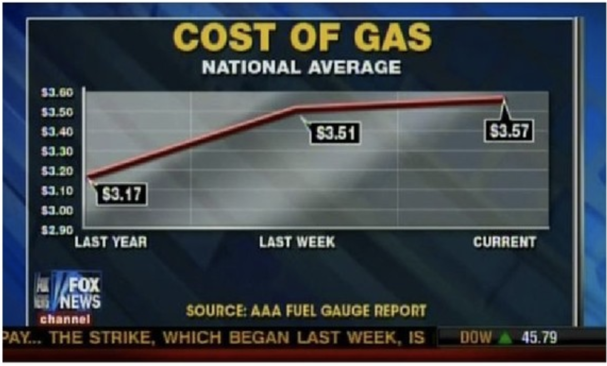](images/14/misrepresentation-cost-of-gas.png)

## Axes and scales: Cost of gas

> **IMPORTANT:**
>
> This redraw fixes spacing only; it does not show prices between observations.

[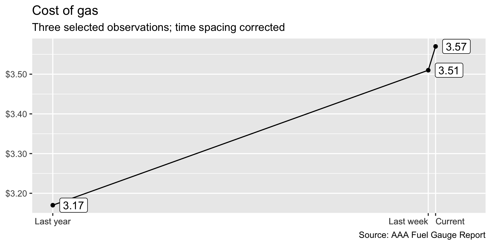](14-data-science-ethics_files/figure-revealjs/gas-prices-1.png)

## Annotations: Immigration

[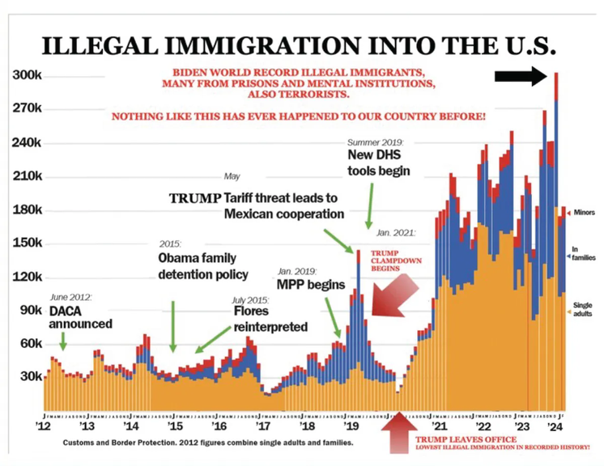](images/14/misrepresentation-immigration.png)

- Trump often campaigned in 2024 with a chart on border encounters.

- The data values are accurate, but the annotation is not.

- The arrow labeled “Trump leaves office, lowest illegal immigration in recorded history” points to April 2020, during the pandemic—not January 2021.

Which part creates the misleading story: the data, the annotation, the selected time point—or all three together?

Robert Farley, D’Angelo Gore, and Lori Robertson. [Donald Trump’s Closing Arguments](https://www.factcheck.org/2024/10/donald-trumps-closing-arguments/#immigration), FactCheck.org. 31 October 2024.

## Axes and scales: Planned Parenthood

What is this plot telling us?

[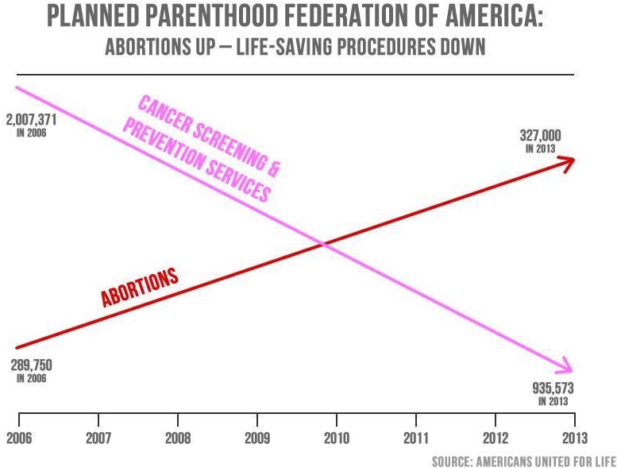](images/14/misrepresentation-pp.png)

Timothy B. Lee. [Whatever you think of Planned Parenthood, this is a terrible and dishonest chart](https://www.vox.com/2015/9/29/9417845/planned-parenthood-terrible-chart). Vox. September 29, 2015.

## Axes and scales: PP services

> **IMPORTANT:**
>
> This redraw fixes axes and scales only; it does not show counts between observations.

[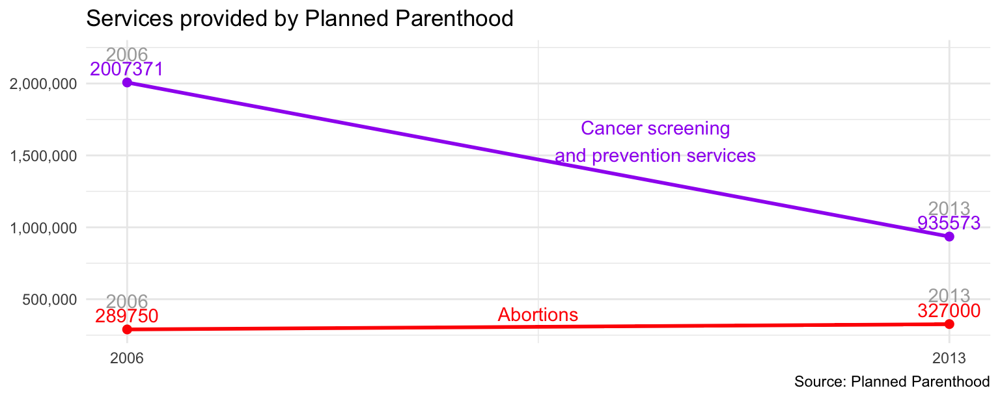](14-data-science-ethics_files/figure-revealjs/unnamed-chunk-6-1.png)

## Pause…

What does this map show?

[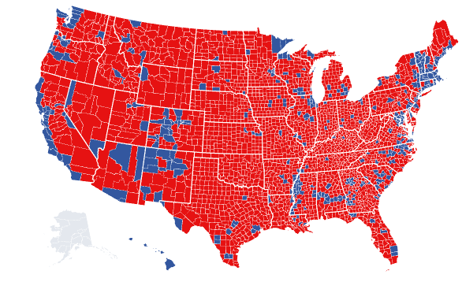](images/14/misrepresentation-2024-county-presidential.png)

2024 presidential election results by county: red = Trump, blue = Harris, gray = no data. Source: [BallotWire](https://www.ballotwire.com/electiondatavisualizations/2024-presidential-election-county-level-results-map).

## Maps and areas

[Let’s explore!](https://engaging-data.com/county-electoral-map-land-vs-population/)

Source: [US County Electoral Map – Land Area vs Population](https://engaging-data.com/county-electoral-map-land-vs-population/).

## Maps and areas

What information disappears when every county is assigned one color?

- A voting split of 50.1%–49.9% looks the same as a 90%–10% split.

- People who voted for the losing candidate disappear from the color encoding.

- Differences in turnout within counties also disappear.

- The apparent balance depends on whether area represents land, population, or something else.

## Pause…

Based on a poll by Cook Political Report, BSG, and GS Strategy Group conducted in July-August 2024, which candidate was ahead in seven swing states combined?

[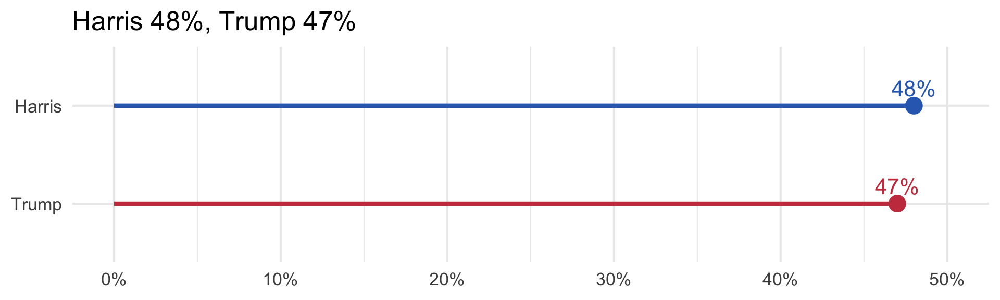](14-data-science-ethics_files/figure-revealjs/swing-state-poll-without-me-1.png)

Cook Political Report, BSG, and GS Strategy Group. [2024 Swing State Project - August 2024 Toplines](https://www.cookpolitical.com/survey-research/2024-swing-state-project). Survey of 2,867 likely voters, 26 July–2 August 2024.

## Uncertainty: 2024 swing-state poll

In seven swing states combined, is either candidate clearly ahead?

[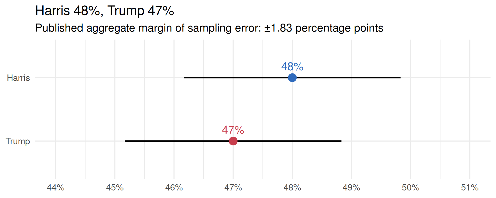](14-data-science-ethics_files/figure-revealjs/swing-state-poll-with-me-1.png)

Cook Political Report, BSG, and GS Strategy Group. [2024 Swing State Project - Methodology: August 2024](https://www.cookpolitical.com/survey-research/2024-swing-state-project/14Aug2024-methodology). Survey of 2,867 likely voters, 26 July–2 August 2024.

# Algorithmic bias

## Garbage in, garbage out

- In statistical modeling and inference we talk about “garbage in, garbage out” – if you don’t have good (random, representative) data, results of your analysis will not be reliable or generalizable.

- Corollary: Bias in, bias out.

## Pause…

For speakers of languages with grammatical gender (e.g., French, Spanish. etc.), what gender is a table?

What about a doctor?

## Google Translate

What might be the reason for Google’s gendered translation? How do ethics play into this situation?

[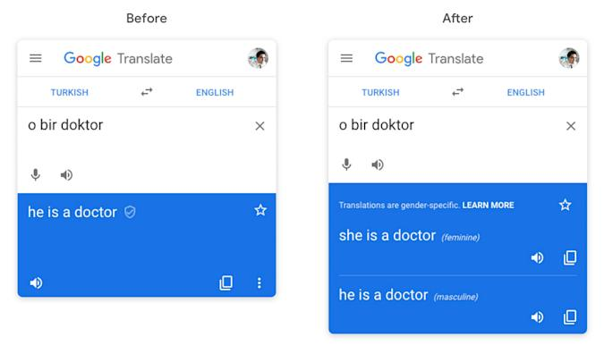](images/14/google-translate.png)

Source: Mallory Locklear. [Google is working to remove gender bias in its translations](https://www.engadget.com/2018-12-07-google-remove-gender-bias-translations.html). Engadget. December 7, 2018.

## COMPAS: What did ProPublica test?

- Correctional Offender Management Profiling for Alternative Sanctions (COMPAS)is a proprietary system used to estimate a defendant’s risk of being arrested again.

- ProPublica examined more than 7,000 people arrested in Broward County, Florida, and tracked new arrests over the following two years.

- COMPAS classified defendants as low, medium, or high risk using criminal records and answers to 137 questions. Race was not one of the questions.

- Broward County primarily used the scores for pretrial-release decisions; similar assessments were also used elsewhere for probation, parole, and sentencing.

Source: Julia Angwin, Jeff Larson, Surya Mattu and Lauren Kirchner. [Machine Bias](https://www.propublica.org/article/machine-bias-risk-assessments-in-criminal-sentencing). ProPublica. May 23, 2016.

## Similar performance, different errors

The scores performed similarly overall for Black and white defendants, but the errors fell differently:

|  | Black defendants | White defendants |
|----|---:|---:|
| Labeled Higher Risk, But Didn’t Re-Offend | **44.9%** | 23.5% |
| Labeled Lower Risk, Yet Did Re-Offend | 28.0% | **47.7%** |

“Rearrested” means a new arrest within two years, not necessarily a conviction.

\

Northpointe, the company that created COMPAS, disputed ProPublica’s analysis and defended the tool’s accuracy.

## Individual errors

What pattern do you notice in who was assigned a high or low risk score?

These cases illustrate classification errors; the aggregate data provide evidence of group-level disparity.

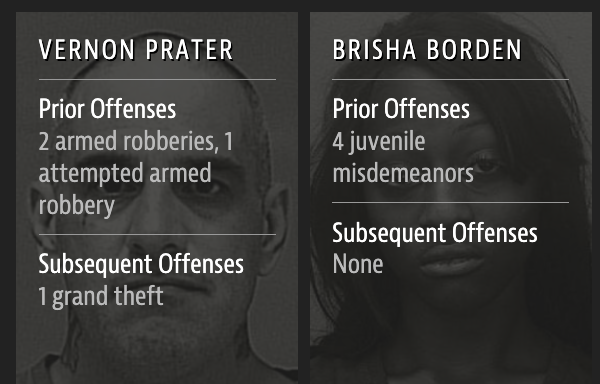

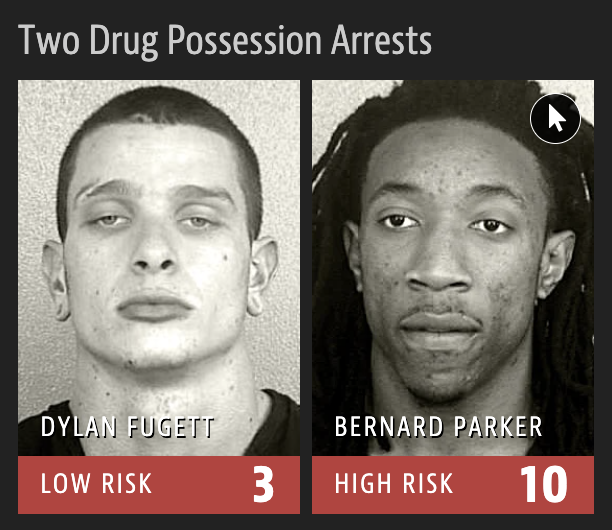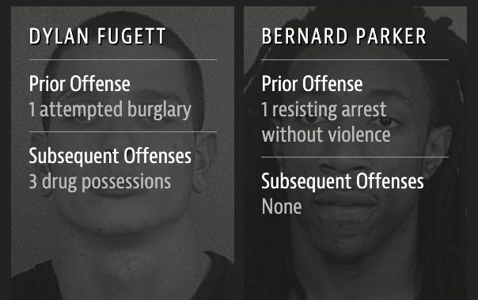

## Race is not an input, is the model neutral?

How can an algorithm produce racially unequal outcomes when race is not an input?

- Other variables can reflect structural inequalities and act as proxies.

- The target is a new arrest, which measures contact with the criminal-justice system—not crime directly.

- A proprietary model is difficult for defendants and the public to examine or challenge.

[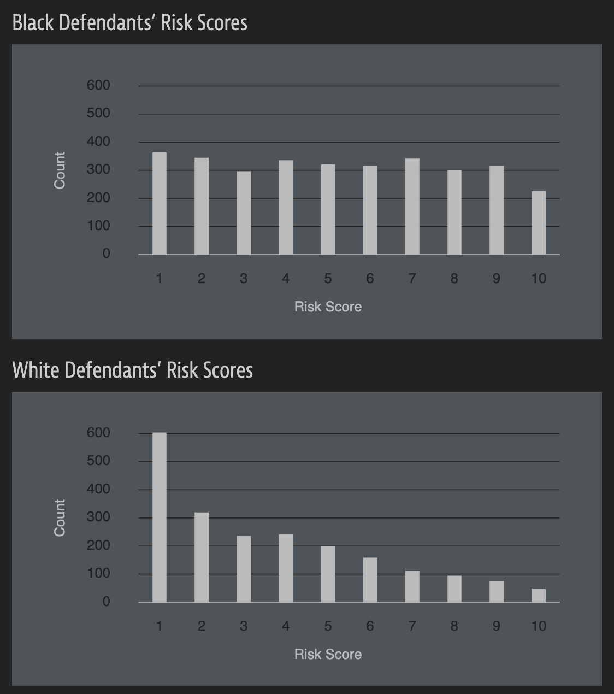](images/14/machine-bias-risk-scores.png)

A false positive can restrict someone’s freedom; a false negative can create a public-safety risk. Who should decide how these errors are valued—and who bears them?

## Parting thoughts

- At some point during your data science learning journey you will learn tools that can be used unethically.

- You might also be tempted to use your knowledge in a way that is ethically questionable either because of business goals or for the pursuit of further knowledge (or because your boss told you to do so).

How do you train yourself to make the right decisions (or reduce the likelihood of accidentally making the wrong decisions) at those points?
