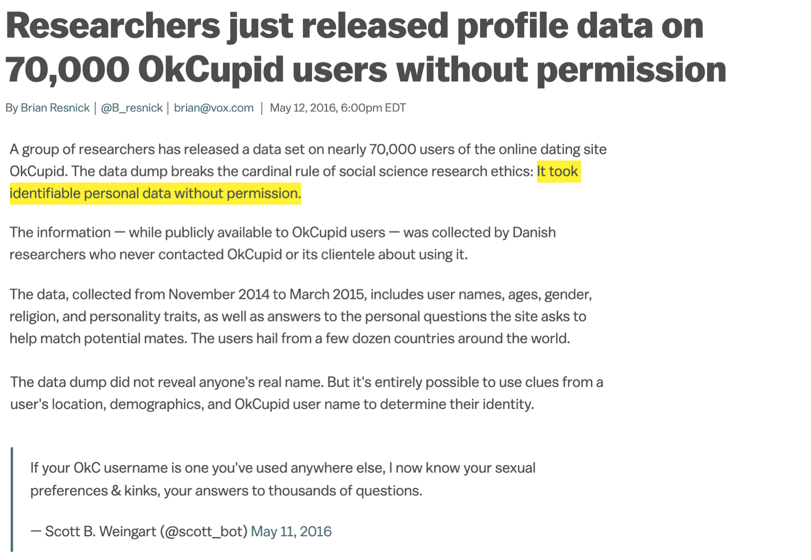
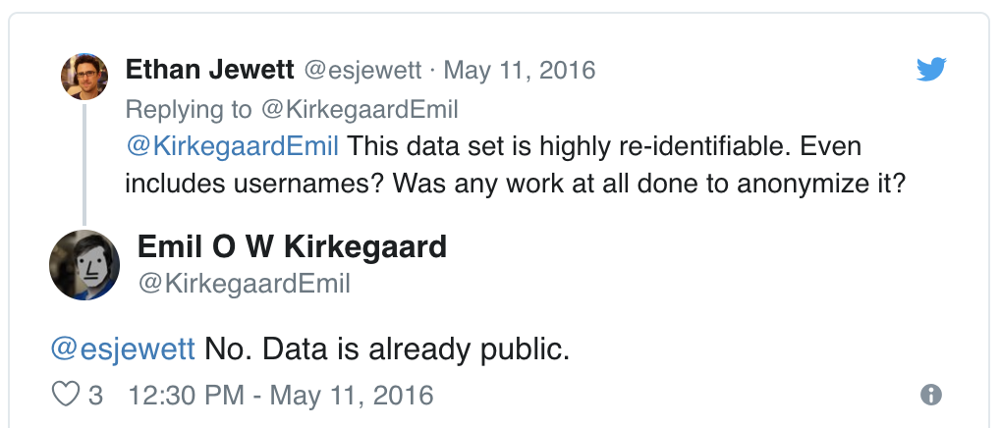
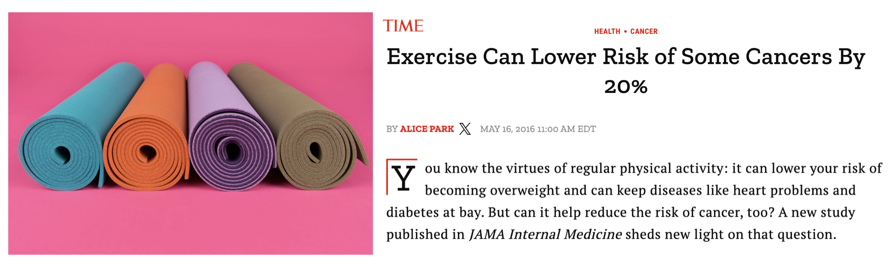
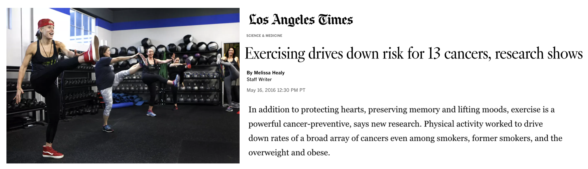
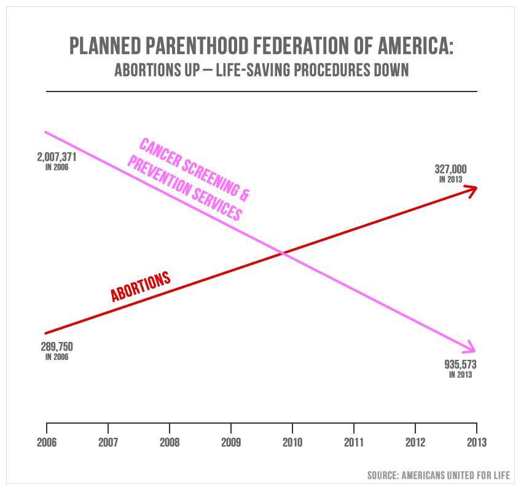
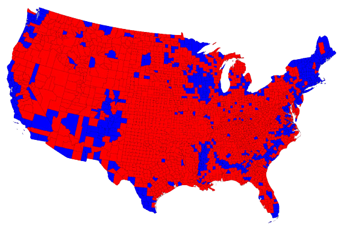
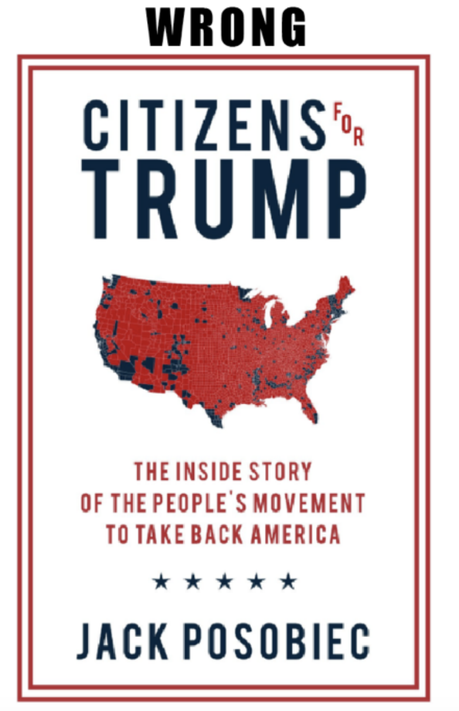
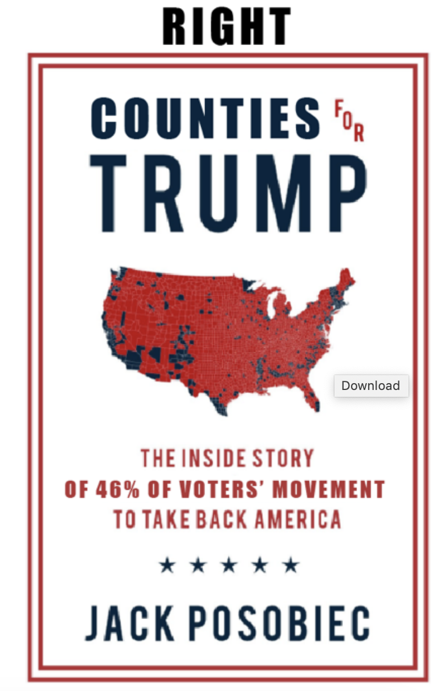
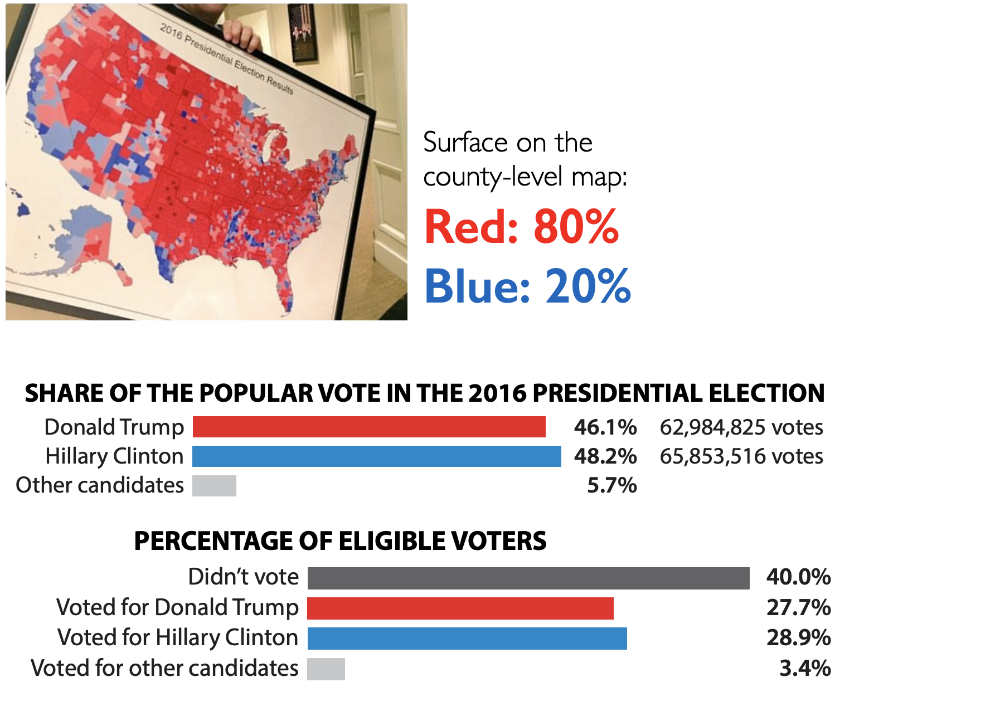
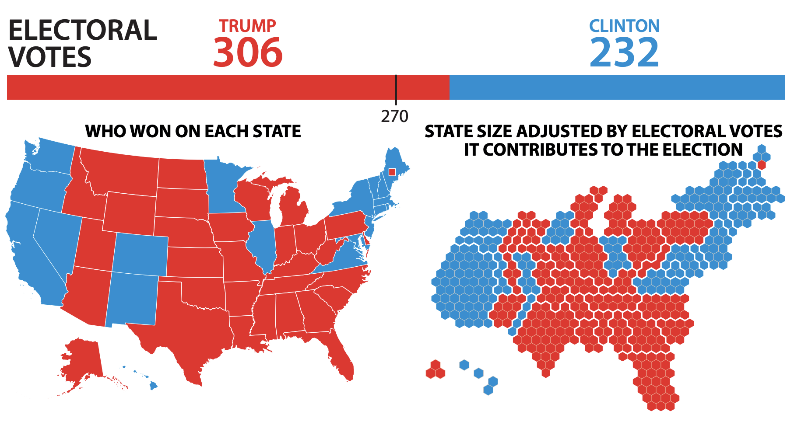

```{r}
#| label: setup
#| include: false
ggplot2::theme_set(ggplot2::theme_gray(base_size = 16))
```

```{r}
#| include: false
library(tidyverse)
```

# Warm-up

## While you wait: Participate 📱💻 {.xsmall}

::: columns

::: {.column width="70%"}

::: wooclap

Blah blah...

::: wooclap-choices
- Blah...
:::

:::

:::

::: {.column width="30%"}

{width="200" fig-align="center" fig-alt="QR code for Wooclap"}

Go to [wooclap.com](https://app.wooclap.com/CODECODE) and use the code CODECODE.

:::

:::

## Announcements {.smaller}

- Do not forget to fill out peer evaluations for your teammates on TEAMMATES!

- **Office hours change:** For this week only, my office hours will be on Friday, 2 - 3:30 pm (at my office -- Old Chem 211C -- as usual).

# Privacy

## Web scraping: "Can you?" vs "Should you?" {.smaller}

{fig-align="center" width="700"}

::: aside
Source: Brian Resnick, [Researchers just released profile data on 70,000 OkCupid users without permission](https://www.vox.com/2016/5/14/11666116/70000-okcupid-users-data-release), Vox.
:::

## "Your" data

-   Every time we use apps, websites, and devices, our data is being collected and used or sold to others.

-   More importantly, decisions are made by law enforcement, financial institutions, and governments based on data that directly affect the lives of people.

## Privacy of your data {.smaller}

Participate 📱💻 {.xsmall}

::: columns

::: {.column width="70%"}

::: wooclap

What pieces of data have you left on the internet today?
Think through everything you've logged into, clicked on, checked in, either actively or automatically, that might be tracking you.
Submit as many as you can think of.

:::

:::

::: {.column width="30%"}

:::

:::

## Privacy of your data {.smaller}

::: question
Do you know where that data is stored?
Who it can be accessed by?
Whether it's shared with others?
:::

## Sharing your data {.smaller}

::: question
What are you OK with sharing?
:::

::: columns
::: {.column width="50%"}
::: incremental
-   Name
-   Age
-   Email
-   Phone Number
-   List of every video you watch
-   List of every video you comment on
:::
:::

::: {.column width="50%"}
::: incremental
-   How you type: speed, accuracy
-   How long you spend on different content
-   List of all your private messages (date, time, person sent to)
-   Info about your photos (how it was taken, where it was taken (GPS), when it was taken)
:::
:::
:::

## What does Google think/know about you?

::: question
Have you ever thought about why you're seeing an ad on Google?
Google it!
Try to figure out if you have ad personalization on and how your ads are personalized.
:::

## Your browsing history

::: question
Which of the following are you OK with your browsing history to be used towards?
:::

::: incremental
-   To predict your age for serving you targeted ads
-   To predict your race/ethnicity for serving you targeted ads
-   To score you as a candidate for a job
:::

## Who else gets to use your data?

::: question
Suppose you create a profile on a social media site and share your personal information on your profile.
Who else gets to use that data?
:::

::: incremental
-   Companies the social media company has a connection to?
-   Companies the social media company sells your data to?
-   Researchers?
:::

## OK Cupid data breach

- In 2016, researchers published data of 70,000 OkCupid users—including usernames, political leanings, drug usage, and intimate sexual details

- Researchers didn't release the real names and pictures of OKCupid users, but their identities could easily be uncovered from the details provided, e.g. usernames

## OK Cupid data breach



## OK Cupid data breach

>Some may object to the ethics of gathering and releasing this data. However, all the data found in the dataset are or were already publicly available, so releasing this dataset merely presents it in a more useful form. 
>
>Researchers Emil Kirkegaard and Julius Daugbjerg Bjerrekær

# Misrepresentation

## Misrepresenting data science results {.smaller}

Some common ways people do this, either intentionally or unintentionally, include:

::: incremental
-   Claiming **causality** where it's not in the scope of inference of the underlying study

-   Distorting **axes and scales** to make the data tell a different story

-   Visualizing **spatial areas instead of human density** for issues that depend on and affect humans

-   Omitting **uncertainty** in reporting
:::

## Causality - TIME coverage

::: question
How plausible is the statement in the title of this article?
:::



::: aside
Alice Park.
[Exercise Can Lower Risk of Some Cancers By 20%](https://time.com/4330041/reduce-cancer-risk-exercise/).
Time Magazine.
16 May 2016.
:::

## Causality - LA Times coverage

::: question
What does "research shows" mean?
:::



::: aside
Melissa Healy.
[Exercising drives down risk for 13 cancers, research shows](https://www.latimes.com/science/sciencenow/la-sci-sn-exercising-cancer-20160516-story.html).\
Los Angeles Times.
16 May 2016.
:::

## Causality - Original study {.smaller}

Moore, Steven C., et al. [**"Association of leisure-time physical activity with risk of 26 types of cancer in 1.44 million adults."**](https://jamanetwork.com/journals/jamainternalmedicine/fullarticle/2521826) JAMA internal medicine 176.6 (2016): 816-825.

-   **Volunteers** were **asked** about their physical activity level over the preceding year.
-   Half exercised less than about 150 minutes per week, half exercised more.
-   Compared to the bottom 10% of exercisers, the top 10% had lower rates of esophageal, liver, lung, endometrial, colon, and breast cancer.
-   Researchers found no association between exercising and 13 other cancers (e.g. pancreatic, ovarian, and brain).

::: notes
Carl Bergstrom and Jevin West.
[Calling Bullshit: The art of skepticism in a data-driven world](https://www.callingbullshit.org/).\
Random House, 2020.\
Sharon Begley.
["Does exercise prevent cancer?"](https://www.statnews.com/2016/05/16/exercise-prevent-cancer/).
StatNews.
16 May 2016.
:::

## Axes and scales - Tax cuts {.smaller}

::: question
What is the difference between these two pictures?
Which presents a better way to represent these data?
:::


::: aside
Christopher Ingraham.
["You’ve been reading charts wrong. Here’s how a pro does it."](https://www.washingtonpost.com/business/2019/10/14/youve-been-reading-charts-wrong-heres-how-pro-does-it/).
The Washington Post.
14 October 2019.
:::

## Axes and scales - Cost of gas {.smaller}

::: question
What is wrong with this picture?
How would you correct it?
:::


## Axes and scales - Cost of gas {.scrollable}

```{r}
#| out-width: 100%
#| echo: false
#| message: false
#| fig-asp: 0.5
library(scales)

df <- tibble(
  date = ymd(c("2019-11-01", "2020-10-25", "2020-11-01")),
  cost = c(3.17, 3.51, 3.57)
)
ggplot(df, aes(x = date, y = cost, group = 1)) +
  geom_point() +
  geom_line() +
  geom_label(aes(label = cost), hjust = -0.25) +
  labs(
    title = "Cost of gas",
    subtitle = "National average",
    x = NULL,
    y = NULL,
    caption = "Source: AAA Fuel Gauge Report"
  ) +
  scale_x_continuous(
    breaks = ymd(c("2019-11-01", "2020-10-25", "2020-11-01")),
    labels = c("Last year", "Last week", "Current"),
    guide = guide_axis(angle = 90),
    limits = ymd(c("2019-11-01", "2020-11-29")),
    minor_breaks = ymd(c("2019-11-01", "2020-10-25", "2020-11-01"))
  ) +
  scale_y_continuous(labels = label_dollar())
```

## Axes and scales - PP services {.smaller}

::: columns
::: {.column width="40%"}
::: question
What is wrong with this picture?
How would you correct it?
:::

:::
::: {.column width="60%"}

:::
:::

::: aside
Timothy B. Lee.
[Whatever you think of Planned Parenthood, this is a terrible and dishonest chart](https://www.vox.com/2015/9/29/9417845/planned-parenthood-terrible-chart).
Vox.
29 September 2019.
:::

## Axes and scales - PP services {.scrollable}

```{r}
#| echo: false
#| fig-width: 8
#| out-width: 100%
#| fig-asp: 0.4
pp <- tibble(
  year = c(2006, 2006, 2013, 2013),
  service = c("Abortion", "Cancer", "Abortion", "Cancer"),
  n = c(289750, 2007371, 327000, 935573)
)

ggplot(pp, aes(x = year, y = n, color = service)) +
  geom_point(size = 2) +
  geom_line(linewidth = 1) +
  geom_text(aes(label = n), nudge_y = 100000) +
  geom_text(
    aes(label = year),
    nudge_y = 200000,
    color = "darkgray"
  ) +
  labs(
    title = "Services provided by Planned Parenthood",
    caption = "Source: Planned Parenthood",
    x = NULL,
    y = NULL
  ) +
  scale_x_continuous(breaks = c(2006, 2013)) +
  scale_y_continuous(labels = label_number(big.mark = ",")) +
  scale_color_manual(values = c("red", "purple")) +
  annotate(
    geom = "text",
    label = "Abortions",
    x = 2009.5,
    y = 400000,
    color = "red"
  ) +
  annotate(
    geom = "text",
    label = "Cancer screening\nand prevention services",
    x = 2010.5,
    y = 1600000,
    color = "purple"
  ) +
  theme_minimal() +
  theme(legend.position = "none")
```

## Maps and areas - Voting map

::: question
Do you recognize this map?
What does it show?
:::



::: aside
Lazaro Gamio.
["Election maps are telling you big lies about small things"](https://www.washingtonpost.com/graphics/politics/2016-election/how-election-maps-lie/).
The Washington Post.
1 Nov 2016.
:::

## Maps and areas - Two alternate tales

::::: columns
::: column
{width="350"}
:::

::: column
{width="350"}
:::
:::::

::: aside
Alberto Cairo.
[Visual Trumpery talk](https://visualtrumperytour.wordpress.com/).
:::

## Maps and areas - Voting percentages

{width="800"}

::: aside
Alberto Cairo.
[Visual Trumpery talk](https://visualtrumperytour.wordpress.com/).
:::

## Maps and areas - Voting percentages



::: aside
Alberto Cairo.
[Visual Trumpery talk](https://visualtrumperytour.wordpress.com/).
:::

## Uncertainty - Catalan independence {.smaller}

On December 19, 2014, the front page of Spanish national newspaper El País read *"Catalan public opinion swings toward 'no' for independence, says survey"*.

```{r}
#| label: catalan-misleading
#| echo: false
#| fig-asp: 0.4
#| out-width: 100%
catalan <- tibble(
  response = c("No", "Yes", "No answer"),
  rate = c(45.3, 44.5, 10.2)
) |>
  mutate(response = fct_relevel(response, "No", "Yes", "No answer"))

ggplot(
  catalan,
  aes(y = fct_rev(response), x = rate, color = response, group = response)
) +
  geom_point(size = 3) +
  geom_segment(
    aes(
      x = 0,
      xend = rate,
      y = fct_rev(response),
      yend = fct_rev(response)
    ),
    linewidth = 2
  ) +
  scale_color_manual(values = c("#5C8AA9", "#9D303A", "gray")) +
  scale_x_continuous(labels = label_percent(scale = 1)) +
  guides(color = "none") +
  theme_minimal(base_size = 16) +
  labs(
    title = "Do you want Catalonia to become an independent state?",
    caption = "Margin of error: +/-2.95% at 95% confidence level",
    x = NULL,
    y = NULL
  )
```

::: aside
Alberto Cairo.
[The truthful art: Data, charts, and maps for communication](http://www.thefunctionalart.com/p/the-truthful-art-book.html).
New Riders, 2016.
:::

## Uncertainty - Catalan independence {.smaller}

```{r}
#| label: catalan-corrected
#| echo: false
#| out-width: 100%
#| fig-asp: 0.4
catalan <- catalan |>
  mutate(
    low = rate - 2.95,
    high = rate + 2.95
  )
ggplot(
  catalan,
  aes(y = fct_rev(response), x = rate, color = response, group = response)
) +
  geom_segment(
    aes(
      x = low,
      xend = high,
      y = fct_rev(response),
      yend = fct_rev(response)
    ),
    linewidth = 0.8,
    color = "black"
  ) +
  geom_point(size = 4) +
  scale_color_manual(values = c("#5C8AA9", "#9D303A", "gray")) +
  scale_x_continuous(labels = label_percent(scale = 1)) +
  guides(color = "none") +
  theme_minimal(base_size = 16) +
  labs(
    title = "Do you want Catalonia to become an independent state?",
    caption = "The probability of the tiny difference between the\n'No' and 'Yes' being just due to random chance is very high.",
    x = NULL,
    y = NULL
  )
```

::: aside
Alberto Cairo.
["Uncertainty and Graphicacy: How Should Statisticians Journalists and Designers Reveal Uncertainty in Graphics for Public Consumption?"](https://ec.europa.eu/eurostat/cros/powerfromstatistics/OR/PfS-OutlookReport-Cairo.pdf), Power from Statistics: Data Information and Knowledge, 2017.
:::
