# Linear regression with a single predictor

Lecture 15

Author

Affiliation

Prof. Mine Çetinkaya-Rundel

Duke University\
STA 199 - Fall 2026

Published

October 21, 2026

# Warm-up

## While you wait: Participate 📱💻

What questions could a model help us answer about community health?

[](images/15/wooclap-qr.png)

Go to [wooclap.com](https://app.wooclap.com/BSAFXJG) and use the code BSAFXJG.

## Announcements

- Projects:
  - Peer review tomorrow: Make as much progress as you can before your
  - New project component: AI disclosure to be added overnight, pull when you get to lab

. . .

- HW 5 due next Wednesday at 11:59 pm

. . .

- My office hours this week: Friday 2-3:30 pm in Old Chem 211, come by if you
  - have questions on the homework
  - want to review your exam
  - want to discuss your project (and come with your teammates!)
  - can’t usually make it to my Wednesday OH and I haven’t yet had a chance to meet you

## Learning goals

By the end of today, you should be able to:

- identify the outcome and predictor in a regression model,
- fit a linear regression model with **tidymodels**,
- interpret the slope and intercept in context,
- use a fitted model to calculate predictions and residuals, and
- explain what makes a line the least squares regression line.

# Modeling

## Two main uses

- **Prediction:** Use known information to estimate an unknown outcome.

- **Description / explanation:** Summarize how an outcome tends to vary with a predictor.

\

What questions could a model help us answer about community health?

## CDC PLACES

**PLACES: Local Data for Better Health** is a free CDC resource providing consistently defined health and health-related estimates for communities across the US.

- Covers counties, places, census tracts, and ZIP Code Tabulation Areas.
- Includes measures of health outcomes, prevention, disability, health behaviors, health-related social needs, and community factors.
- Uses small area estimation with data from the Behavioral Risk Factor Surveillance System (BRFSS), the Census, and the American Community Survey (ACS).
- Helps communities identify local health concerns, disparities, and overlapping health and social needs.

Source: [CDC, About PLACES: Local Data for Better Health](https://www.cdc.gov/places/about/index.html)

## CDC PLACES

> **IMPORTANT:**
>
> These are **model-based local estimates**, not direct survey estimates for each county.

Source: [CDC, About PLACES: Local Data for Better Health](https://www.cdc.gov/places/about/index.html)

## County food insecurity and mental health

The [CDC PLACES 2025 release](https://data.cdc.gov/500-Cities-Places/PLACES-Local-Data-for-Better-Health-County-Data-20/swc5-untb) provides local health estimates for every U.S. county.

For North Carolina, we will explore:

- the estimated percentage of adults who experienced **food insecurity during the previous 12 months**, and
- the estimated percentage of adults who experienced **frequent mental distress**: at least 14 mentally unhealthy days during the previous 30 days.

Both are age-adjusted, model-based estimates derived from 2023 survey and population data.

Sources: [CDC PLACES release notes](https://www.cdc.gov/places/current-release-notes/), [measure definitions](https://www.cdc.gov/places/measure-definitions/)

## Other data sources

- [NC Department of Commerce county tiers](https://www.commerce.nc.gov/grants-incentives/county-distress-rankings-tiers): The 40 most distressed counties are designated as Tier 1, the next 40 as Tier 2 and the 20 least distressed as Tier 3

- [NC Office of State Archaeology regions](https://archaeology.ncdcr.gov/programs/education/climatechange/risks): Piedmont, Mountains, Coastal Plain

- [Appalachian Regional Commission counties](https://www.arc.gov/appalachian-counties-served-by-arc/): No, Yes

## How the data were put together

1.  Start with the CDC PLACES 2025 county release.
2.  Filter to North Carolina and age-adjusted prevalence estimates.
3.  Reshape to one row per county.
4.  Add 2026 development tier, geographic region, and Appalachian status.
5.  Write to a CSV file: `nc-places.csv`.

## Packages

- **tidyverse** for data wrangling and visualization

- **scales** for better axis labels

- **tidymodels** for modeling with tidyverse principles

- **maps** for county boundaries

``` downlit
library(tidyverse)
library(scales)
library(tidymodels)
library(maps)
```

## Load the data

``` downlit
nc_places <- read_csv(
  "data/nc-places.csv"
)
```

    Rows: 100 Columns: 46
    ── Column specification ────────────────────────────────────────────────────────
    Delimiter: ","
    chr  (4): county, development_tier, region, appalachian
    dbl (42): county_fips, food_insecurity, mental_distress, dental_visit, fair_...

    ℹ Use `spec()` to retrieve the full column specification for this data.
    ℹ Specify the column types or set `show_col_types = FALSE` to quiet this message.

## Our focus for today

- `food_insecurity` - Food insecurity: % of adults who experienced food insecurity during the previous 12 months.
- `mental_distress` - Frequent mental distress: % of adults who experienced at least 14 mentally unhealthy days during the previous 30 days.

## Geographic patterns

[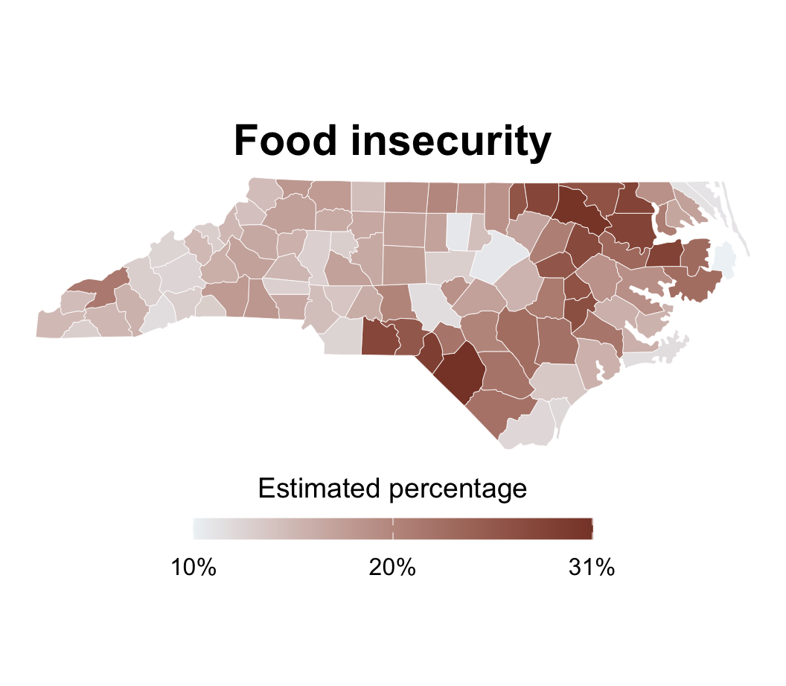](15-linear-regression-single-predictor_files/figure-revealjs/unnamed-chunk-4-1.png)

[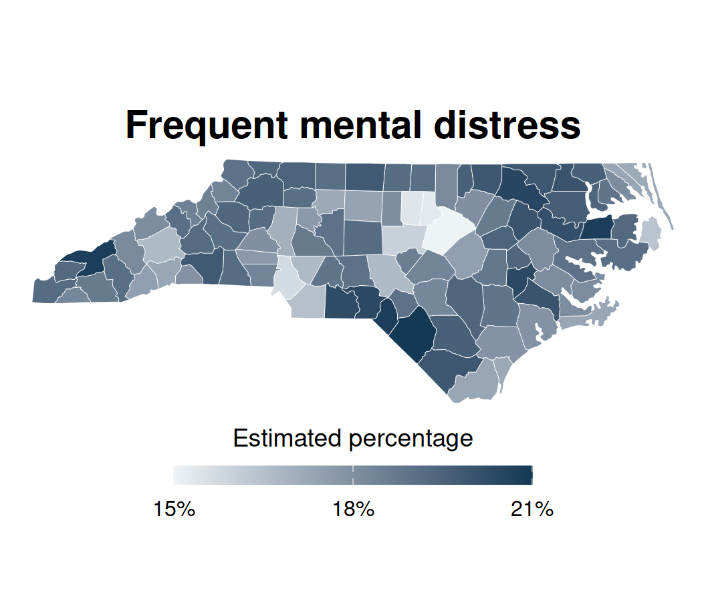](15-linear-regression-single-predictor_files/figure-revealjs/unnamed-chunk-4-2.png)

# Language of models

## Modeling North Carolina counties

- **Describe:** How is county-level food insecurity related to frequent mental distress?

- **Predict:** For a county where 20% of adults experience food insecurity, what percentage would we predict experience frequent mental distress?

[](15-linear-regression-single-predictor_files/figure-revealjs/unnamed-chunk-5-1.png)

## Modelling North Carolina counties

**Describe:** How is county-level food insecurity related to frequent mental distress?

[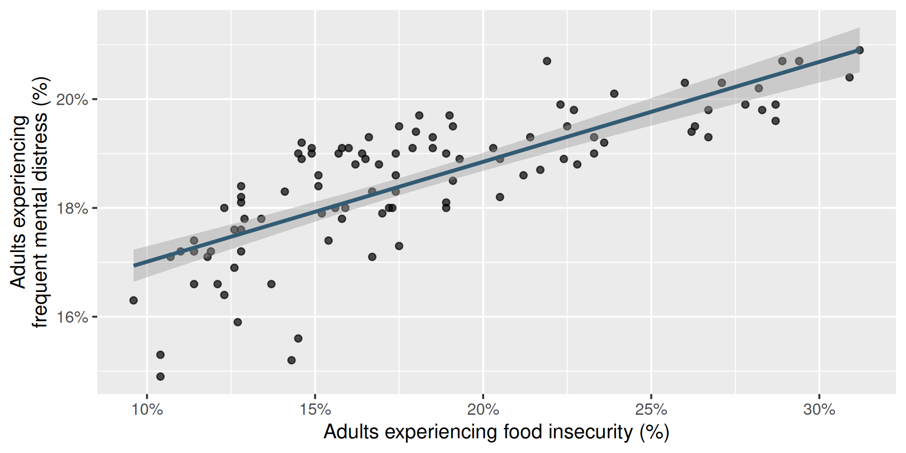](15-linear-regression-single-predictor_files/figure-revealjs/unnamed-chunk-6-1.png)

## Modelling North Carolina counties

**Predict:** For a county where 20% of adults experience food insecurity, what percentage would we predict experience frequent mental distress?

[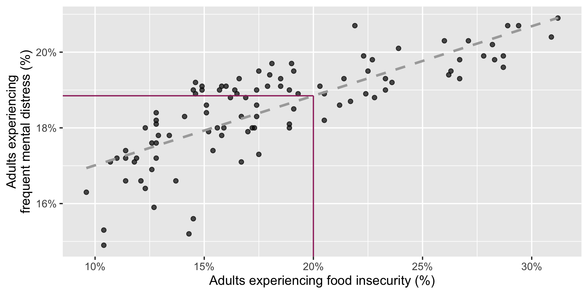](15-linear-regression-single-predictor_files/figure-revealjs/unnamed-chunk-7-1.png)

## Modelling

- Use models to describe relationships between variables and to make predictions.

- For now, we will focus on **linear** models—but there are many other types of models.

[](15-linear-regression-single-predictor_files/figure-revealjs/unnamed-chunk-8-1.png)

- A model is a useful simplification, not a complete description of reality.

## Modelling vocabulary

- Predictor (explanatory variable)
- Outcome (response variable)
- Regression line
  - Slope
  - Intercept
- Correlation

## Predictor (explanatory variable)

| county    | food_insecurity | mental_distress |
|-----------|-----------------|-----------------|
| Alamance  | 17.2            | 18              |
| Alexander | 15.8            | 19.1            |
| Alleghany | 18.5            | 19.3            |
| Anson     | 28.2            | 20.2            |
| Ashe      | 14.6            | 18.9            |
| Avery     | 15.1            | 18.4            |
| ...       | ...             | ...             |

[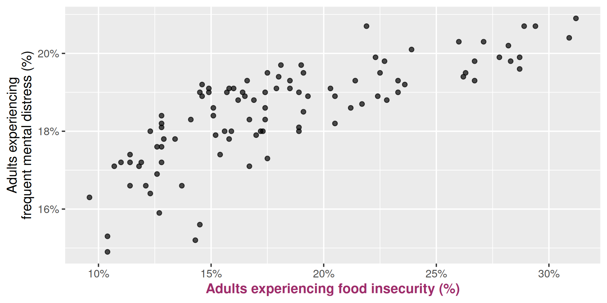](15-linear-regression-single-predictor_files/figure-revealjs/unnamed-chunk-10-1.png)

## Outcome (response variable)

| county    | food_insecurity | mental_distress |
|-----------|-----------------|-----------------|
| Alamance  | 17.2            | 18              |
| Alexander | 15.8            | 19.1            |
| Alleghany | 18.5            | 19.3            |
| Anson     | 28.2            | 20.2            |
| Ashe      | 14.6            | 18.9            |
| Avery     | 15.1            | 18.4            |
| ...       | ...             | ...             |

[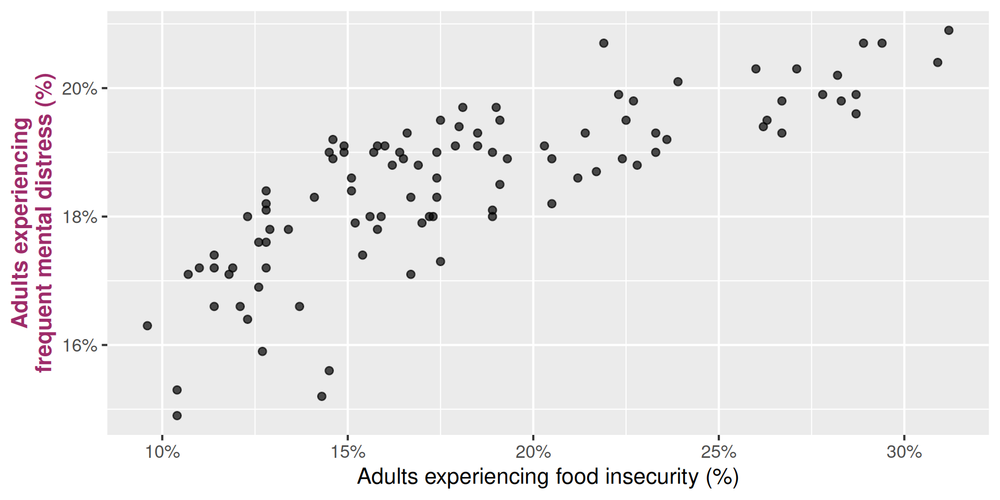](15-linear-regression-single-predictor_files/figure-revealjs/unnamed-chunk-12-1.png)

## Regression line

[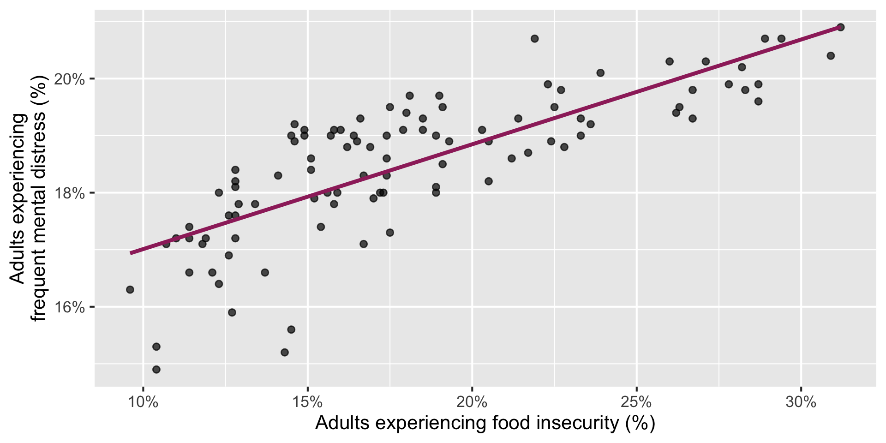](15-linear-regression-single-predictor_files/figure-revealjs/unnamed-chunk-13-1.png)

## Regression line: slope

[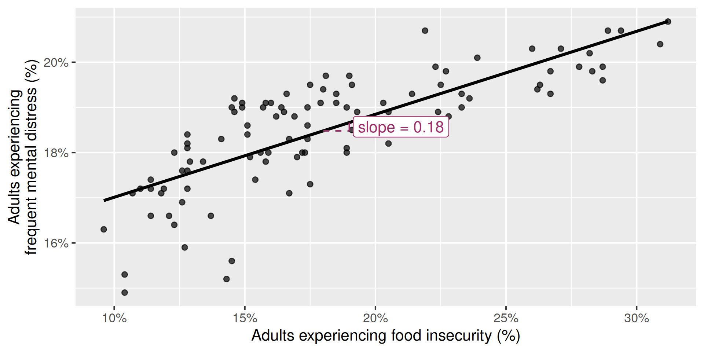](15-linear-regression-single-predictor_files/figure-revealjs/unnamed-chunk-14-1.png)

## Regression line: intercept

[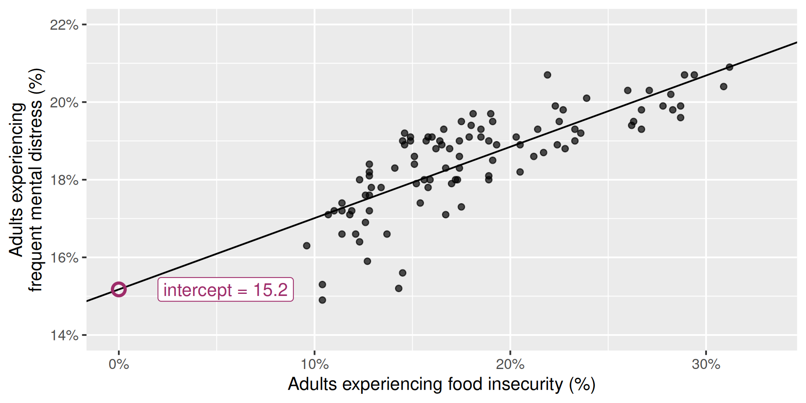](15-linear-regression-single-predictor_files/figure-revealjs/unnamed-chunk-15-1.png)

## Correlation

[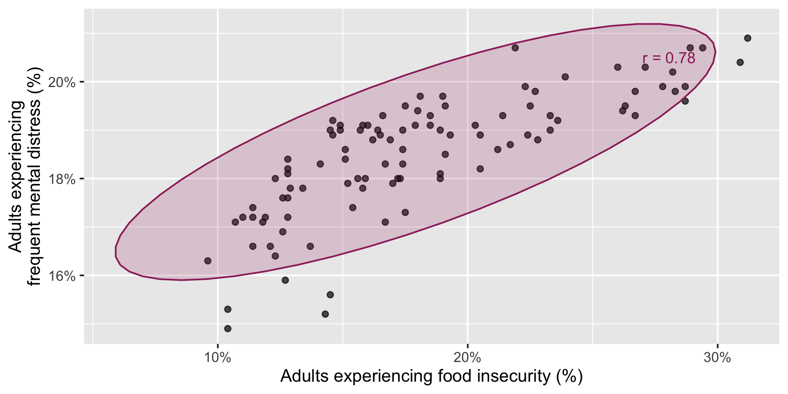](15-linear-regression-single-predictor_files/figure-revealjs/unnamed-chunk-16-1.png)

## Correlation

- Measures the **direction** and **strength** of a linear relationship.
- Ranges between -1 and 1.
- Has the same sign as the slope.
- Has no units.

[](15-linear-regression-single-predictor_files/figure-revealjs/unnamed-chunk-17-1.png)

## Participate 📱💻

Which of the following is the best guess for the correlation between the two variables below?

[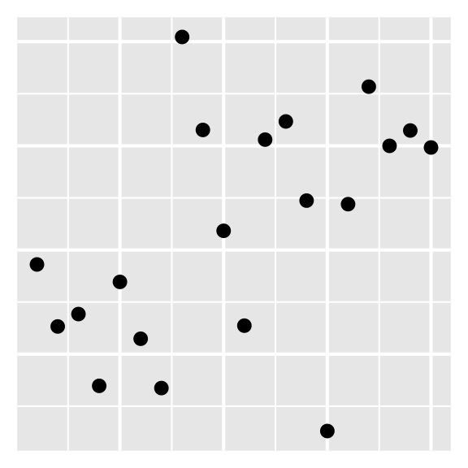](15-linear-regression-single-predictor_files/figure-revealjs/unnamed-chunk-18-1.png)

- -0.95
- -0.25
- 0.00
- 0.50
- 0.80

[](images/15/wooclap-qr.png)

Go to [wooclap.com](https://app.wooclap.com/BSAFXJG) and use the code BSAFXJG.

## Visualizing the model

Code

``` downlit
ggplot(
  nc_places,
  aes(x = food_insecurity, y = mental_distress)
) +
  geom_point() +
  geom_smooth(method = "lm", se = FALSE) +
  scale_x_continuous(labels = percent_label()) +
  scale_y_continuous(labels = percent_label()) +
  labs(
    x = "Adults experiencing food insecurity (%)",
    y = "Adults experiencing\nfrequent mental distress (%)"
  )
```

[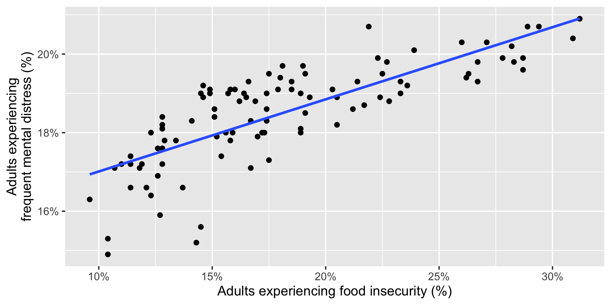](15-linear-regression-single-predictor_files/figure-revealjs/unnamed-chunk-19-1.png)

# Linear regression with a single predictor

## A regression model

A regression model separates an observed outcome into a systematic part and an unexplained part:

\\ \begin{aligned} Y &= \text{Model} + \text{Error} \\ &= f(X) + \epsilon \\ &= \mu\_{Y \mid X} + \epsilon \end{aligned} \\

- \\\mu\_{Y \mid X}\\ is the mean outcome for observations with predictor value \\X\\.
- \\\epsilon\\ is the deviation of an observed outcome from that mean.

## A linear regression model

A linear regression model describes the relationship between a quantitative outcome, \\Y\\, and a quantitative predictor, \\X\\:

\\ Y = \beta_0 + \beta_1 X + \epsilon \\

- \\\beta_0\\: population intercept
- \\\beta_1\\: population slope
- \\\epsilon\\: unexplained deviation from the line

## The fitted regression line

We use data to estimate the population relationship:

\\ \widehat{Y} = b_0 + b_1 X \\

- \\\widehat{Y}\\: predicted value of the outcome
- \\b_0\\: estimated intercept
- \\b_1\\: estimated slope

> **NOTE:**
>
> There is **no error term** in the fitted line: \\\widehat{Y}\\ is the model’s prediction, not an observed outcome.

## State the model

``` downlit
linear_reg()
```

    Linear Regression Model Specification (regression)

    Computational engine: lm 

## Fit the model

``` downlit
linear_reg() |>
  fit(
    mental_distress ~ food_insecurity,
    data = nc_places
  )
```

    parsnip model object


    Call:
    stats::lm(formula = mental_distress ~ food_insecurity, data = data)

    Coefficients:
        (Intercept)  food_insecurity  
            15.1742           0.1837  

## Fit the model, and save it

``` downlit
county_fit <- linear_reg() |>
  fit(
    mental_distress ~ food_insecurity,
    data = nc_places
  )
```

## Summarize the model

``` downlit
tidy(county_fit)
```

    # A tibble: 2 × 5
      term            estimate std.error statistic  p.value
      <chr>              <dbl>     <dbl>     <dbl>    <dbl>
    1 (Intercept)       15.2      0.278       54.5 3.96e-75
    2 food_insecurity    0.184    0.0147      12.5 5.24e-22

## Write the model equation

Using mathematical notation

\\ \widehat{\text{mental distress %}} = 15.2 + 0.184 \times \text{food insecurity %} \\

> **TIP:**
>
> Predicted mental-distress percentage is 15.2 plus 0.184 times the food insecurity percentage.

# Slope and intercept

## Participate 📱💻

The slope of the fitted model is 0.184. Which of the following is the best interpretation?

- Increasing food insecurity by one percentage point causes mental-distress prevalence to increase by 0.184 percentage points.
- For each percentage-point county food-insecurity prevalence is higher, mental-distress prevaence is expected to be higher, on average, by 0.184 percentage points.
- For each one percentage-point increase in mental-distress prevalence, predicted food-insecurity prevalence is 0.184 percentage points higher.
- Every adult experiencing food insecurity has 0.184 additional mentally unhealthy days.

[](images/15/wooclap-qr.png)

Go to [wooclap.com](https://app.wooclap.com/BSAFXJG) and use the code BSAFXJG.

## Participate 📱💻

The intercept of the fitted model is 15.2. Which is the best interpretation?

- For a county with 0% food-insecurity prevalence, the model predicts 15.2% mental-distress prevalence.
- For a county with 0% mental-distress prevalence, the model predicts 15.2% food-insecurity prevalence.
- A one percentage-point increase in food-insecurity prevalence predicts a 15.2 percentage-point increase in mental distress.
- The average North Carolina county has 15.2% mental-distress prevalence.

[](images/15/wooclap-qr.png)

Go to [wooclap.com](https://app.wooclap.com/BSAFXJG) and use the code BSAFXJG.

## Is the intercept meaningful?

The intercept is meaningful in context if:

- the predictor can feasibly equal or be near zero, and
- zero is reasonably close to the observed predictor values.

. . .

Here, observed food-insecurity prevalence ranges from 9.6% to 31.2%.

> **IMPORTANT:**
>
> The intercept is a mathematical part of the line, but it is **not meaningful in context**.

# Predictions and residuals

## Make a prediction

For a county where 20% of adults experience food insecurity:

\\ \begin{aligned} \widehat{\text{mental distress %}} &= 15.2 + 0.184 \times 20 \\ &= 18.9 \end{aligned} \\

We predict that approximately **18.9%** of adults experience frequent mental distress.

## Make a prediction with R

- Step 1: Make a new data frame with the predictor value(s) of interest with [`tibble()`](https://tibble.tidyverse.org/reference/tibble.html):

``` downlit
new_county <- tibble(food_insecurity = 20)
new_county
```

    # A tibble: 1 × 1
      food_insecurity
                <dbl>
    1              20

- Step 2: Make a prediction for the new dataset using the model with [`predict()`](https://rdrr.io/r/stats/predict.html):

``` downlit
predict(county_fit, new_data = new_county)
```

    # A tibble: 1 × 1
      .pred
      <dbl>
    1  18.8

## Residuals

A **residual** is the difference between an observed and predicted outcome:

\\ \text{residual} = \text{observed} - \text{predicted} = y - \widehat{y} \\

## Calculating residuals with R

Use `augment()` to add predictions and residuals to the original dataset.

``` downlit
county_aug <- augment(county_fit, new_data = nc_places)

county_aug
```

    # A tibble: 100 × 48
       .pred .resid county    county_fips development_tier region        appalachian
       <dbl>  <dbl> <chr>           <dbl> <chr>            <chr>         <chr>      
     1  18.3 -0.334 Alamance        37001 Tier 2           Piedmont      No         
     2  18.1  1.02  Alexander       37003 Tier 1           Piedmont      Yes        
     3  18.6  0.728 Alleghany       37005 Tier 2           Mountains     Yes        
     4  20.4 -0.154 Anson           37007 Tier 1           Piedmont      No         
     5  17.9  1.04  Ashe            37009 Tier 2           Mountains     Yes        
     6  17.9  0.452 Avery           37011 Tier 2           Mountains     Yes        
     7  18.7  0.181 Beaufort        37013 Tier 2           Coastal Plain No         
     8  20.4 -0.846 Bertie          37015 Tier 1           Coastal Plain No         
     9  19.3  0.193 Bladen          37017 Tier 1           Coastal Plain No         
    10  17.4 -0.160 Brunswick       37019 Tier 3           Coastal Plain No         
    # ℹ 90 more rows
    # ℹ 41 more variables: food_insecurity <dbl>, mental_distress <dbl>,
    #   dental_visit <dbl>, fair_or_poor_health <dbl>, all_teeth_lost <dbl>,
    #   annual_checkup <dbl>, any_disability <dbl>, arthritis <dbl>,
    #   binge_drinking <dbl>, cancer_non_skin_or_melanoma <dbl>,
    #   cholesterol_screening <dbl>, cognitive_disability <dbl>,
    #   colorectal_cancer_screening <dbl>, copd <dbl>, …

## Durham residual

``` downlit
county_aug |>
  select(county, mental_distress, .pred, .resid) |>
  filter(county == "Durham")
```

    # A tibble: 1 × 4
      county mental_distress .pred .resid
      <chr>            <dbl> <dbl>  <dbl>
    1 Durham            15.2  17.8  -2.60

## Visualizing a residual

[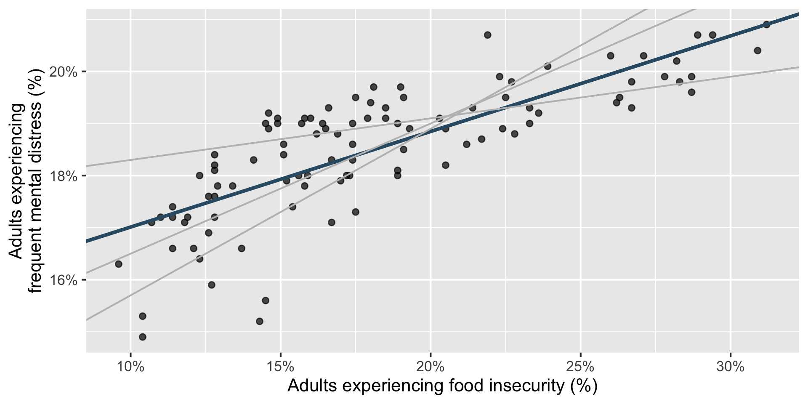](15-linear-regression-single-predictor_files/figure-revealjs/unnamed-chunk-28-1.png)

## Choosing values for \\b_1\\ and \\b_0\\

Which line fits the points best—and what do we mean by “best”?

[](15-linear-regression-single-predictor_files/figure-revealjs/unnamed-chunk-29-1.png)

## Least squares line

- The residual for the \\i^{th}\\ observation is

\\ e_i = y_i - \widehat{y}\_i \\

- Square every residual and add them:

\\ e_1^2 + e_2^2 + \cdots + e_n^2 \\

- The **least squares regression line** is the line that minimizes this sum.

## Properties of least-squares regression

For a least-squares line with one quantitative predictor and an intercept:

- The line passes through the point of means, \\(\bar{x}, \bar{y})\\: \\b_0 = \bar{y} - b_1\bar{x}\\

- The slope and correlation have the same sign: \\b_1 = r\frac{s_y}{s_x}\\

- The residuals sum to zero: \\\sum\_{i=1}^{n} e_i = 0\\

- The residuals and predictor values are uncorrelated.

# Interpreting responsibly

## Association is not causation

This model tells us that counties with greater estimated food-insecurity prevalence also tend to have greater estimated mental-distress prevalence.

It does **not** establish that food insecurity causes mental distress.

Possible explanations include:

- food insecurity contributing to chronic stress,
- mental distress affecting employment or income stability,
- shared social or economic conditions, and
- features of how the estimates were constructed.

## Counties are not individuals

Each point is a **county**, not a person.

An association between two county percentages does not, by itself, establish the same relationship among individuals. This is the **ecological fallacy**.

Also remember:

- PLACES values are model-based small-area estimates.
- The fitted line summarizes the 100 North Carolina counties in this dataset.
- Predictions far outside the observed food-insecurity range are extrapolations.

Learn more: [CDC PLACES methodology](https://www.cdc.gov/places/methodology/)

# Application exercise

## Dental visits and health

[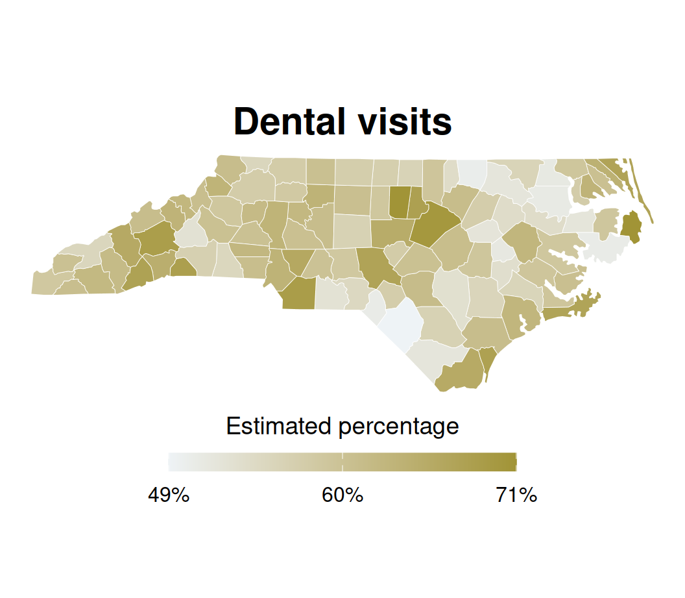](15-linear-regression-single-predictor_files/figure-revealjs/unnamed-chunk-30-1.png)

[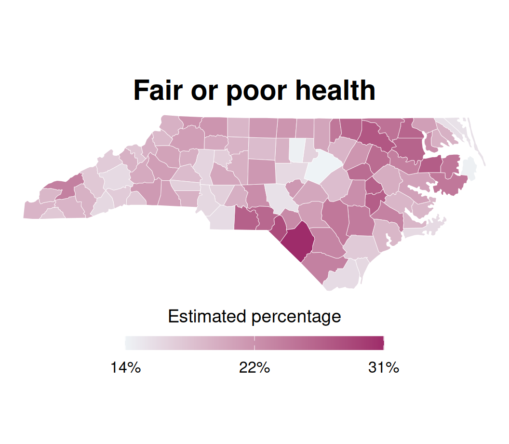](15-linear-regression-single-predictor_files/figure-revealjs/unnamed-chunk-30-2.png)

## Application exercise

- Go to your ae project in Positron.

- If you haven’t yet done so, make sure all of your changes up to this point are committed and pushed, i.e., there’s nothing left in your source control pane.

- If you haven’t yet done so, pull to get today’s application exercise file: `ae-09-nc-places-model.qmd`.

- Work through the application exercise in class, and render, commit, and push your edits by the end of class.
