# Linear regression with outliers and categorical predictors

Lecture 16

Author

Affiliation

Prof. Mine Çetinkaya-Rundel

Duke University\
STA 199 - Fall 2026

Published

October 26, 2026

# Warm-up

## While you wait: Participate 📱💻

In the previous class, we used food-insecurity prevalence to predict mental-distress prevalence. Durham County had a residual of -2.60 percentage points.

Which of the following best fill the blank below.

> The model \_\_\_\_\_\_\_ by 2.60 percentage points.

- overpredicted mental-distress prevalence
- underpredicted mental-distress prevalence
- overpredicted food-insecurity prevalence
- underpredicted food-insecurity prevalence

[](images/16/wooclap-qr.png)

Go to [wooclap.com](https://app.wooclap.com/QYNCEFD) and use the code QYNCEFD.

## Announcements

- Peer tutors through the ARC are available:\
  <https://sta199-f26.github.io/course-support.html#peer-tutors>

- Peer eval 3 is due tonight

- HW 5 is due Wednesday night

## What should progress on projects look like nowadays?

- Schedule meetings (at least one this week and at least two next week)

- This week:

  - Outline your presentation and start drafting slides and discussing who will present which slide (each team member must speak during the presentation)
  - Start drafting your writeup – you can structure it as the words you will say in your presentation (i.e., your script)

- Next week: Make sure at least one meeting is dedicated to practicing your presentation and timing yourself

- After next week: Write the reflection portion of your writeup

# From last time

## Dental visits and health

[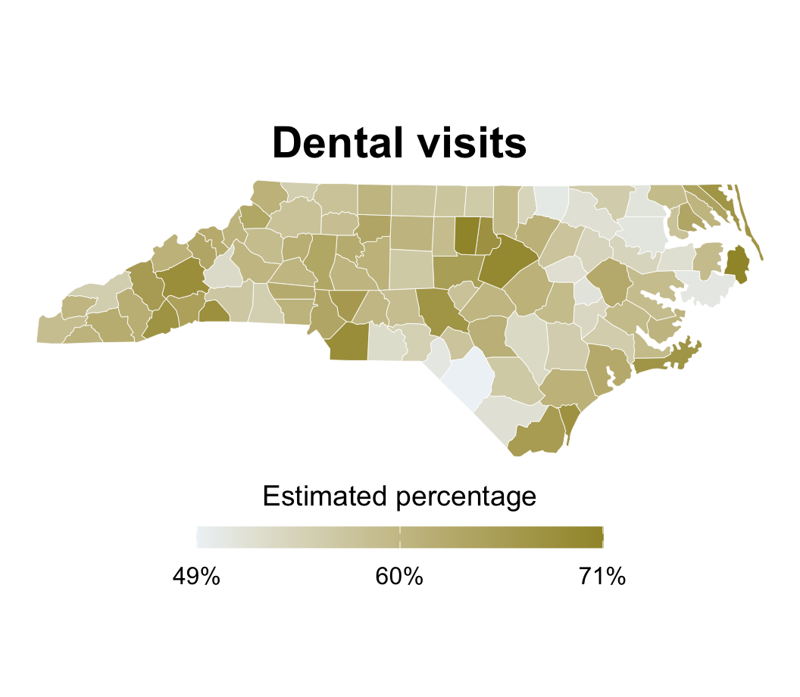](16-linear-regression-outliers-categorical_files/figure-revealjs/unnamed-chunk-1-1.png)

[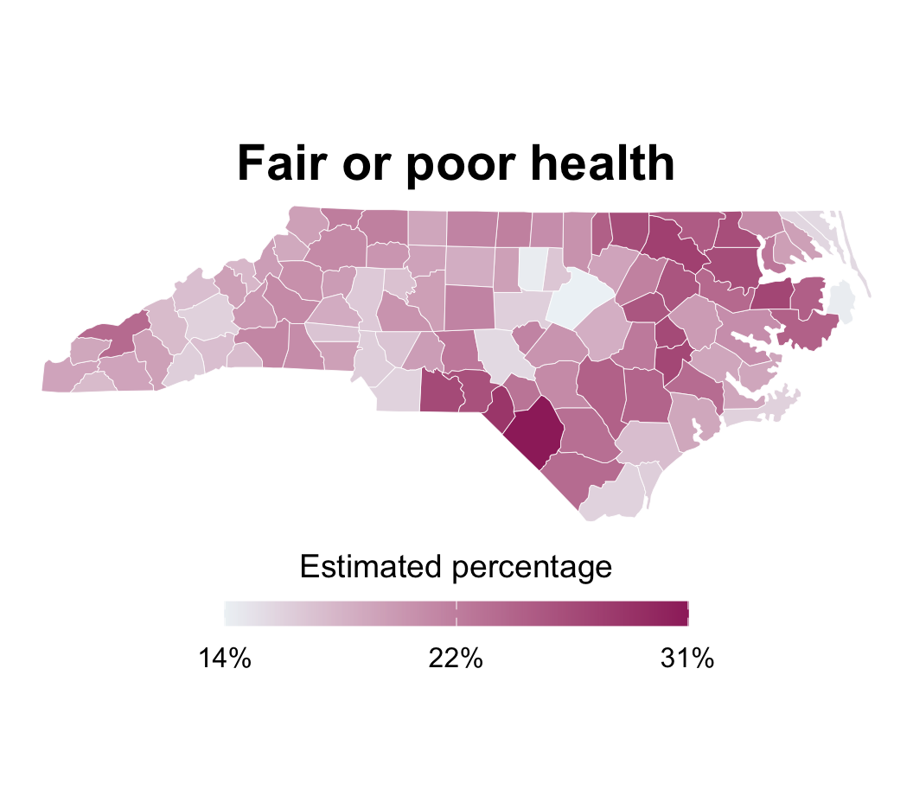](16-linear-regression-outliers-categorical_files/figure-revealjs/unnamed-chunk-1-2.png)

## Application exercise

- Go to your ae project in Positron.

- If you haven’t yet done so, make sure all of your changes up to this point are committed and pushed, i.e., there’s nothing left in your source control pane.

- If you haven’t yet done so, pull to get today’s application exercise file: `ae-09-nc-places-model.qmd`.

- Work through the application exercise in class, and render, commit, and push your edits by the end of class.

# Evaluating fit

## Is linear model appropriate?

In the residuals vs. fitted (predicted) plot, we look for a horizontal band of points with no clear pattern.

Code

``` downlit
health_dental_fit <- linear_reg() |>
  fit(fair_or_poor_health ~ dental_visit, data = nc_places)

health_dental_aug <- augment(
  health_dental_fit,
  new_data = nc_places
)

ggplot(
  health_dental_aug,
  aes(x = .pred, y = .resid)
) +
  geom_hline(
    yintercept = 0,
    color = "#9E2C6A",
    linetype = "dashed"
  ) +
  geom_point(alpha = 0.6) +
  scale_x_continuous(labels = label_percent(scale = 1)) +
  scale_y_continuous(labels = label_percent(scale = 1)) +
  labs(
    x = "Predicted fair or poor health (%)",
    y = "Residual (%)"
  )
```

[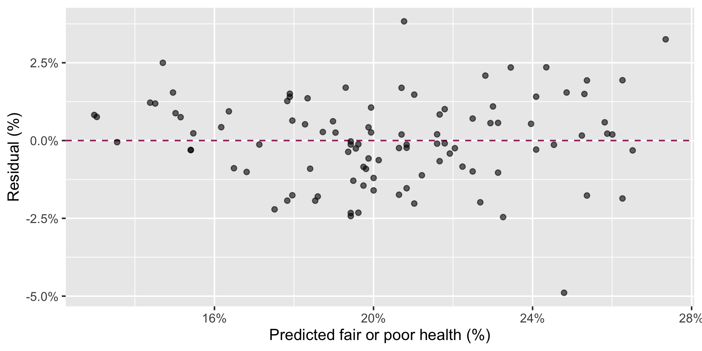](16-linear-regression-outliers-categorical_files/figure-revealjs/health-dental-res-plot-1.png)

## Does the model do a good job explaining the variability in the outcome?

The model (dental visits) explains 85% of the variability in fair or poor health percentage in NC counties.

``` downlit
glance(health_dental_fit)
```

    # A tibble: 1 × 12
      r.squared adj.r.squared sigma statistic  p.value    df logLik   AIC   BIC
          <dbl>         <dbl> <dbl>     <dbl>    <dbl> <dbl>  <dbl> <dbl> <dbl>
    1     0.850         0.849  1.42      556. 3.42e-42     1  -176.  357.  365.
    # ℹ 3 more variables: deviance <dbl>, df.residual <int>, nobs <int>

# Outliers

## Depression and hearing disability

What observations stand out from the main cloud of points? In what way do they stand out?

[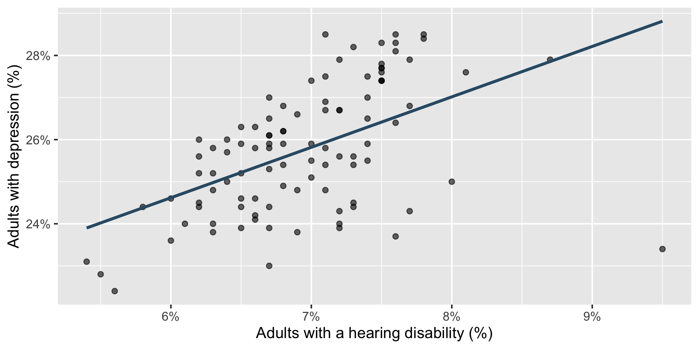](16-linear-regression-outliers-categorical_files/figure-revealjs/unnamed-chunk-2-1.png)

## Outliers in regression

- An **outlier** is a point—or group of points—that stands out from the rest of the data.

- A **leverage point** is horizontally far from the center of the cloud. It has the potential to pull harder on the fitted line.

- An **influential point** actually changes the slope or position of the fitted line substantially.

> **IMPORTANT:**
>
> These categories can overlap: a point can be an outlier, a leverage point, and an influential point.

## Three counties to investigate

How would you classify Greene, Swain, and Robeson counties?

[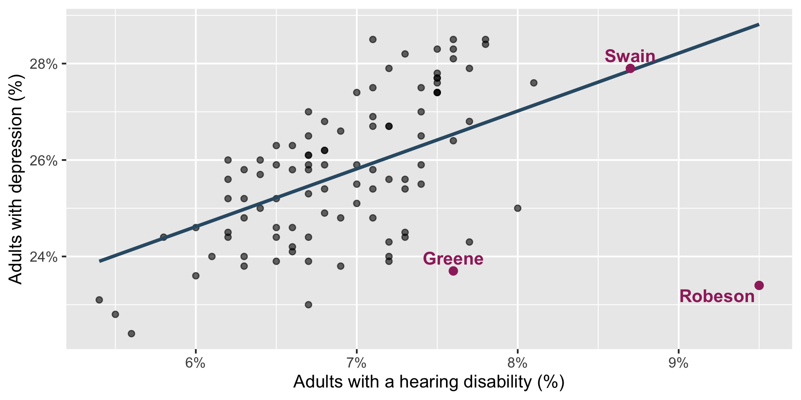](16-linear-regression-outliers-categorical_files/figure-revealjs/unnamed-chunk-3-1.png)

## Potential outlier: Greene County

Code

``` downlit
greene <- hearing_depression_aug |>
  filter(county == "Greene")

ggplot(
  nc_places,
  aes(x = hearing_disability, y = depression)
) +
  geom_point(alpha = 0.6) +
  geom_smooth(
    aes(color = "All counties", linetype = "All counties"),
    method = "lm",
    se = FALSE
  ) +
  geom_smooth(
    data = nc_places |> filter(county != "Greene"),
    aes(color = "Without Greene", linetype = "Without Greene"),
    method = "lm",
    se = FALSE
  ) +
  scale_color_manual(
    values = c(
      "All counties" = "#325b74",
      "Without Greene" = "#9E2C6A"
    )
  ) +
  scale_linetype_manual(
    values = c(
      "All counties" = "solid",
      "Without Greene" = "dashed"
    )
  ) +
  scale_x_continuous(labels = label_percent(scale = 1)) +
  scale_y_continuous(labels = label_percent(scale = 1)) +
  labs(
    x = "Adults with a hearing disability (%)",
    y = "Adults with depression (%)",
    color = NULL,
    linetype = NULL
  ) +
  geom_segment(
    data = greene,
    aes(
      x = hearing_disability,
      xend = hearing_disability,
      y = .pred,
      yend = depression
    ),
    color = "#9E2C6A",
    linewidth = 1.2,
    linetype = "dotted"
  ) +
  geom_point(data = greene, color = "#9E2C6A", size = 3) +
  geom_text(
    data = greene,
    aes(label = county),
    color = "#9E2C6A",
    fontface = "bold",
    nudge_y = 0.35
  ) +
  theme(legend.position = "bottom")
```

[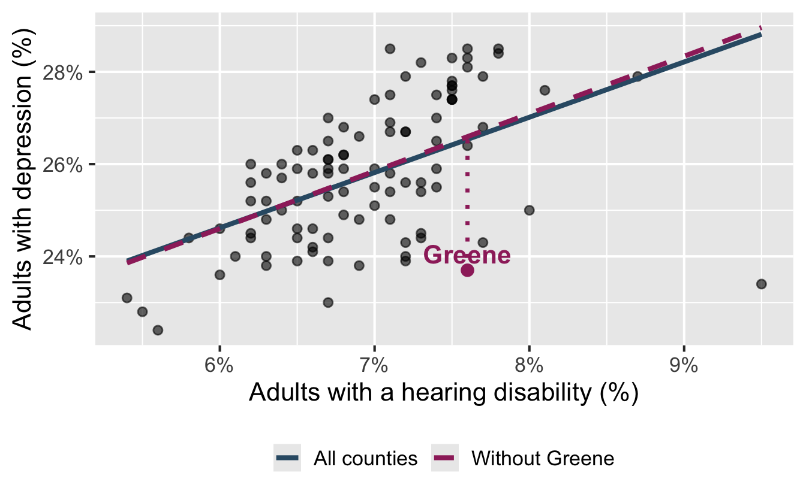](16-linear-regression-outliers-categorical_files/figure-revealjs/hearing-depression-greene-1.png)

- Greene is vertically far below the fitted line.

- Its hearing-disability prevalence is near the center of the observed values.

- Removing Greene barely changes the slope.

**Greene County is a potential outlier in this relationship, but not a leverage or influential point.**

## Leverage point: Swain County

Code

``` downlit
swain <- hearing_depression_aug |>
  filter(county == "Swain")

ggplot(
  nc_places,
  aes(x = hearing_disability, y = depression)
) +
  geom_point(alpha = 0.6) +
  geom_smooth(
    aes(color = "All counties", linetype = "All counties"),
    method = "lm",
    se = FALSE
  ) +
  geom_smooth(
    data = nc_places |> filter(county != "Swain"),
    aes(color = "Without Swain", linetype = "Without Swain"),
    method = "lm",
    se = FALSE
  ) +
  scale_color_manual(
    values = c(
      "All counties" = "#325b74",
      "Without Swain" = "#9E2C6A"
    )
  ) +
  scale_linetype_manual(
    values = c(
      "All counties" = "solid",
      "Without Swain" = "dashed"
    )
  ) +
  scale_x_continuous(labels = label_percent(scale = 1)) +
  scale_y_continuous(labels = label_percent(scale = 1)) +
  labs(
    x = "Adults with a hearing disability (%)",
    y = "Adults with depression (%)",
    color = NULL,
    linetype = NULL
  ) +
  geom_segment(
    data = swain,
    aes(
      x = hearing_disability,
      xend = hearing_disability,
      y = .pred,
      yend = depression
    ),
    color = "#9E2C6A",
    linewidth = 1.2,
    linetype = "dotted"
  ) +
  geom_point(data = swain, color = "#9E2C6A", size = 3) +
  geom_text(
    data = swain,
    aes(label = county),
    color = "#9E2C6A",
    fontface = "bold",
    nudge_y = 0.35
  ) +
  theme(legend.position = "bottom")
```

[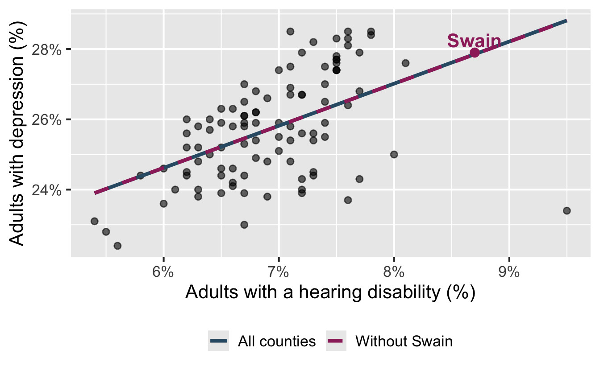](16-linear-regression-outliers-categorical_files/figure-revealjs/hearing-depression-swain-1.png)

- Swain is horizontally far from the center of the cloud.

- It lies almost exactly on the fitted line: its residual is tiny.

- Removing Swain barely changes the fitted line.

**Swain County is a high-leverage point in this relationship, but not an outlier or influential point.**

## Influential point: Robeson County

Code

``` downlit
robeson <- hearing_depression_aug |>
  filter(county == "Robeson")

ggplot(
  nc_places,
  aes(x = hearing_disability, y = depression)
) +
  geom_point(alpha = 0.6) +
  geom_smooth(
    aes(color = "All counties", linetype = "All counties"),
    method = "lm",
    se = FALSE
  ) +
  geom_smooth(
    data = nc_places |> filter(county != "Robeson"),
    aes(color = "Without Robeson", linetype = "Without Robeson"),
    method = "lm",
    se = FALSE
  ) +
  scale_color_manual(
    values = c(
      "All counties" = "#325b74",
      "Without Robeson" = "#9E2C6A"
    )
  ) +
  scale_linetype_manual(
    values = c(
      "All counties" = "solid",
      "Without Robeson" = "dashed"
    )
  ) +
  scale_x_continuous(labels = label_percent(scale = 1)) +
  scale_y_continuous(labels = label_percent(scale = 1)) +
  labs(
    x = "Adults with a hearing disability (%)",
    y = "Adults with depression (%)",
    color = NULL,
    linetype = NULL
  ) +
  geom_segment(
    data = robeson,
    aes(
      x = hearing_disability,
      xend = hearing_disability,
      y = .pred,
      yend = depression
    ),
    color = "#9E2C6A",
    linewidth = 1.2,
    linetype = "dotted"
  ) +
  geom_point(data = robeson, color = "#9E2C6A", size = 3) +
  geom_text(
    data = robeson,
    aes(label = county),
    color = "#9E2C6A",
    fontface = "bold",
    nudge_y = 0.35,
    hjust = 1.05
  ) +
  theme(legend.position = "bottom")
```

[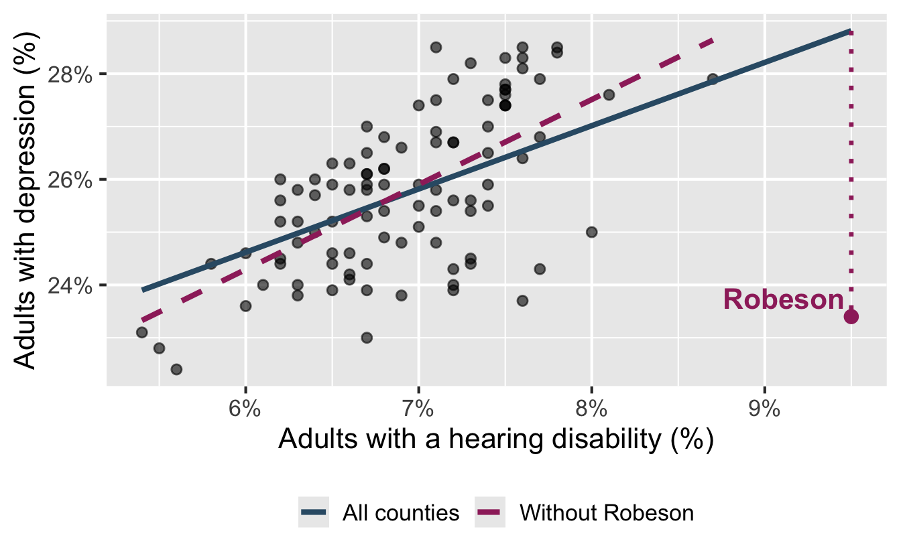](16-linear-regression-outliers-categorical_files/figure-revealjs/hearing-depression-robeson-1.png)

**Robeson County is an influential point with high-leverage.**

- Robeson is horizontally far from the center of the cloud.

- It also falls far below the fitted relationship: its residual has a high magnitude compared to other counties in the data.

- This combination pulls the right side of the fitted line downward – the slope of the model is 1.199 with all counties and 1.609 without Robeson County.

## Working with outliers

- Investigate why the observation is unusual:
  - Is it a data or measurement error?
  - Is it a genuine but exceptional case?
  - Does it reveal a subgroup or a missing variable?

. . .

- Fit the model **with and without** the observation and compare the results.

. . .

- Do not remove an outlier solely because it is unusual. Report and justify any decision to exclude data.

# Categorical predictor

## Development tiers

The North Carolina Department of Commerce ranks all 100 counties by economic well-being each year. The tiers are used in state programs that aim to encourage economic activity in less prosperous areas.

- **Tier 1:** 40 most economically distressed counties
- **Tier 2:** next 40 counties
- **Tier 3:** 20 least economically distressed counties

The ranking combines four equally weighted measures: unemployment, median household income, 36-month population growth, and adjusted property tax base per capita.

Sources: [N.C. Department of Commerce, County Distress Rankings](https://www.commerce.nc.gov/grants-incentives/county-distress-rankings-tiers) and [N.C. General Statute § 143B-437.08](https://www3.ncleg.gov/EnactedLegislation/Statutes/HTML/BySection/Chapter_143B/GS_143B-437.08.html)

## A new question

How does estimated frequent mental-distress prevalence vary by county development tier?

How are the variables in this analysis different from those in our model from last time?

. . .

- outcome: frequent mental-distress prevalence (numerical)

- predictor: county development tier (categorical; Tier 1 is most economically distressed and Tier 3 is least economically distressed)

## Visualize

Determine whether each of the following plot types would be an appropriate choice for visualizing the relationship between mental-distress prevalence and development tier.

- Scatterplot ❌

- Box plot ✅

- Violin plot ✅

- Density plot ✅

- Bar plot ❌

- Stacked bar plot ❌

## Boxplot

Code

``` downlit
ggplot(
  nc_places,
  aes(x = development_tier, y = mental_distress)
) +
  geom_boxplot() +
  scale_y_continuous(labels = label_percent(scale = 1)) +
  labs(
    x = "Development tier",
    y = "Adults experiencing\nfrequent mental distress (%)",
    title = "Mental distress by county development tier"
  )
```

[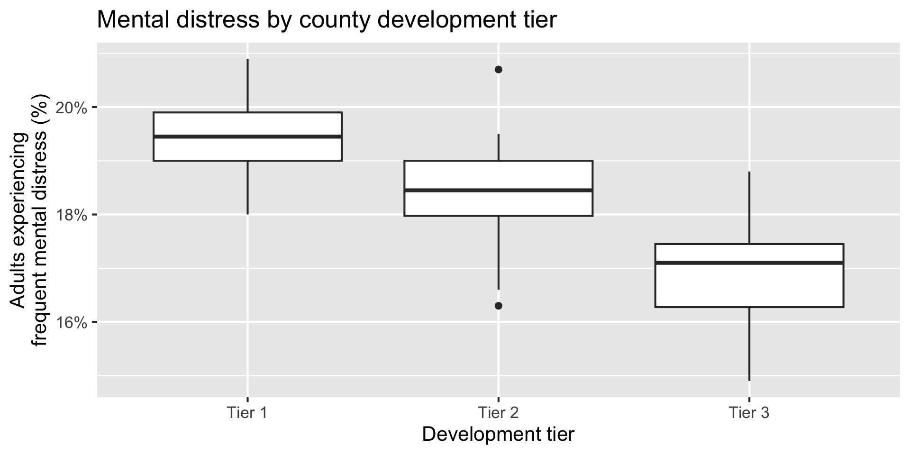](16-linear-regression-outliers-categorical_files/figure-revealjs/unnamed-chunk-4-1.png)

## Violin plot

Code

``` downlit
ggplot(
  nc_places,
  aes(x = development_tier, y = mental_distress)
) +
  geom_violin() +
  scale_y_continuous(labels = label_percent(scale = 1)) +
  labs(
    x = "Development tier",
    y = "Adults experiencing\nfrequent mental distress (%)",
    title = "Mental distress by county development tier"
  )
```

[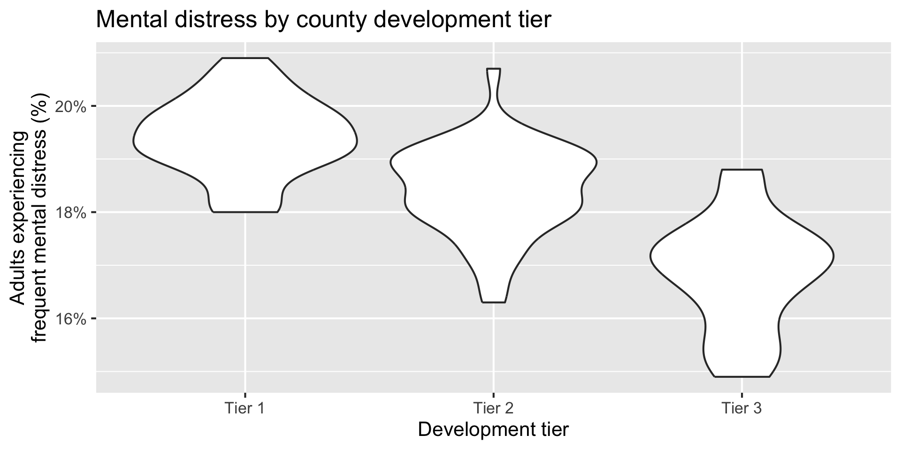](16-linear-regression-outliers-categorical_files/figure-revealjs/unnamed-chunk-5-1.png)

## Density plot

Code

``` downlit
ggplot(
  nc_places,
  aes(
    x = mental_distress,
    color = development_tier,
    fill = development_tier
  )
) +
  geom_density(alpha = 0.5) +
  scale_x_continuous(labels = label_percent(scale = 1)) +
  scale_color_viridis_d(end = 0.85) +
  scale_fill_viridis_d(end = 0.85) +
  labs(
    x = "Adults experiencing frequent mental distress (%)",
    y = "Density",
    color = "Development\ntier",
    fill = "Development\ntier",
    title = "Mental distress by county development tier"
  )
```

[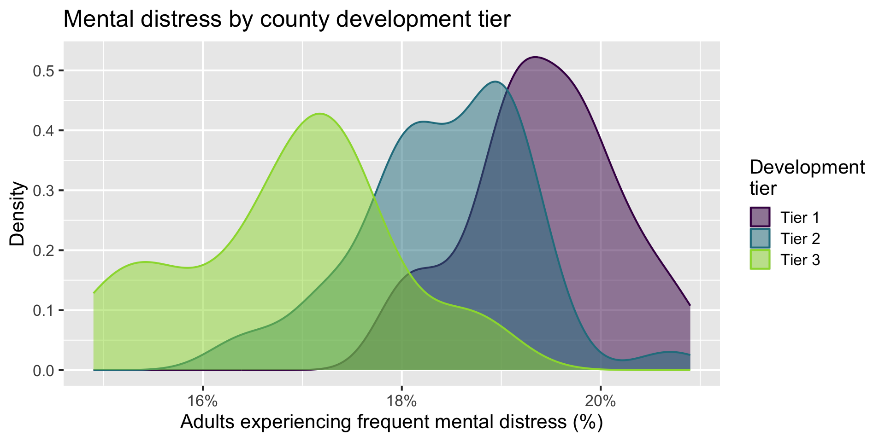](16-linear-regression-outliers-categorical_files/figure-revealjs/unnamed-chunk-6-1.png)

## Multiple geoms

Code

``` downlit
ggplot(
  nc_places,
  aes(x = development_tier, y = mental_distress)
) +
  geom_boxplot(outlier.shape = NA) +
  geom_jitter(width = 0.12, height = 0, size = 2, alpha = 0.5) +
  scale_y_continuous(labels = label_percent(scale = 1)) +
  labs(
    x = "Development tier",
    y = "Adults experiencing\nfrequent mental distress (%)",
    title = "Mental distress by county development tier"
  )
```

[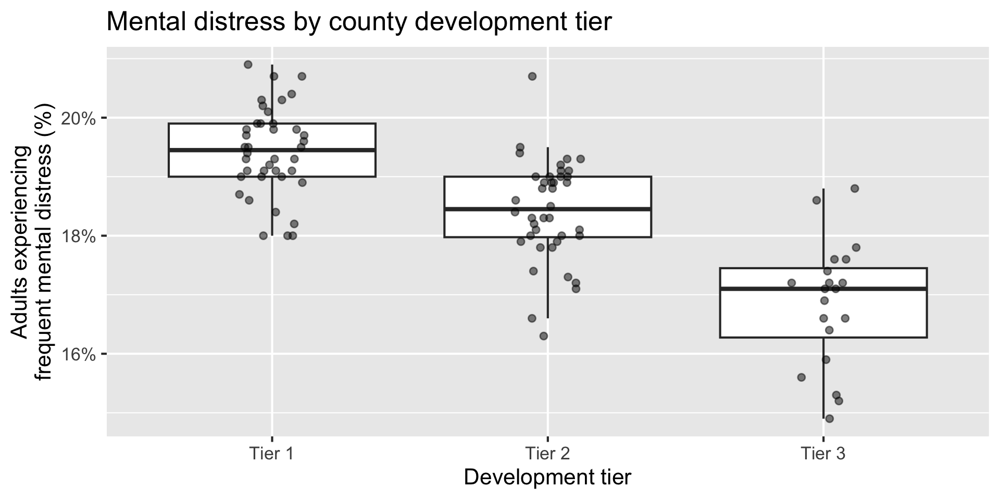](16-linear-regression-outliers-categorical_files/figure-revealjs/unnamed-chunk-7-1.png)

## Summarize

Calculate the average mental-distress prevalence for counties in each development tier. How do the averages compare across tiers?

``` downlit
nc_places |>
  group_by(development_tier) |>
  summarize(mean_mental_distress = mean(mental_distress))
```

    # A tibble: 3 × 2
      development_tier mean_mental_distress
      <chr>                           <dbl>
    1 Tier 1                           19.4
    2 Tier 2                           18.4
    3 Tier 3                           16.8

## Model - fit

Fit a linear regression model predicting mental-distress prevalence from development tier and display the results.

Why is Tier 1 not in the output?

``` downlit
mental_distress_tier_fit <- linear_reg() |>
  fit(mental_distress ~ development_tier, data = nc_places)

tidy(mental_distress_tier_fit)
```

    # A tibble: 3 × 5
      term                   estimate std.error statistic   p.value
      <chr>                     <dbl>     <dbl>     <dbl>     <dbl>
    1 (Intercept)               19.4      0.136    143.   1.06e-114
    2 development_tierTier 2    -1        0.192     -5.22 1.04e-  6
    3 development_tierTier 3    -2.57     0.235    -11.0  1.18e- 18

\\ \widehat{\text{mental distress %}} = 19.4 - 1 \times \text{Tier 2} - 2.57 \times \text{Tier 3} \\

## Model - interpret, Tier 2

\\ \widehat{\text{mental distress %}} = 19.4 \color{#9E2C6A}{- 1 \times \text{Tier 2}} - 2.57 \times \text{Tier 3} \\

Tier 2 counties are predicted to have, on average, a mental-distress prevalence 1 percentage point lower than Tier 1 counties.

## Model - interpret, Tier 3

\\ \widehat{\text{mental distress %}} = 19.4 - 1 \times \text{Tier 2} \color{#9E2C6A}{- 2.57 \times \text{Tier 3}} \\

Tier 3 counties are predicted to have, on average, a mental-distress prevalence 2.57 percentage points lower than Tier 1 counties.

## Model - interpret, Intercept

\\ \widehat{\text{mental distress %}} = \color{#9E2C6A}{19.4} - 1 \times \text{Tier 2} - 2.57 \times \text{Tier 3} \\

The predicted average mental-distress prevalence among Tier 1 counties is 19.4%.

## Model - predict

What is the predicted mental-distress prevalence for a Tier 1 county? What are the predicted values for Tier 2 and Tier 3 counties? Where have we seen these values before?

``` downlit
new_counties <- tibble(
  county = c("County A", "County B", "County C"),
  development_tier = c("Tier 1", "Tier 2", "Tier 3")
)

augment(mental_distress_tier_fit, new_data = new_counties)
```

    # A tibble: 3 × 3
      .pred county   development_tier
      <dbl> <chr>    <chr>           
    1  19.4 County A Tier 1          
    2  18.4 County B Tier 2          
    3  16.8 County C Tier 3          

## Model - predict

Calculate the predicted mental-distress prevalence for counties in each development tier *by hand*.

\\ \widehat{\text{mental distress %}} = 19.42 - 1.00 \times \text{Tier 2} - 2.57 \times \text{Tier 3} \\

. . .

- Tier 1: \\\widehat{\text{mental distress %}} = 19.42 - 1.00 \times \color{#9E2C6A}{0} - 2.57 \times \color{#9E2C6A}{0} = 19.42\\

. . .

- Tier 2: \\\widehat{\text{mental distress %}} = 19.42 - 1.00 \times 1 - 2.57 \times \color{#9E2C6A}{0} = 18.42\\

. . .

- Tier 3: \\\widehat{\text{mental distress %}} = 19.42 - 1.00 \times \color{#9E2C6A}{0} - 2.57 \times 1 = 16.85\\

## Models with categorical predictors

- A categorical predictor is encoded using **dummy variables**. A predictor with \\k\\ levels requires \\k - 1\\ dummy variables.

- The first level of the categorical variable is the **baseline level**. In a model with one categorical predictor, the intercept is the predicted value of the outcome for the baseline level (when all dummy variables equal 0).

- Each slope coefficient describes the difference between the predicted value of the outcome for that level of the categorical variable compared to the baseline level.

## Changing the baseline level

- By default, R uses the first level of a categorical variable as the baseline level.

- We can change the baseline level by reordering the levels of the categorical variable.

## Participate 📱💻

What function goes in the blank to make Tier 3 the baseline level in the `development_tier` variable?

``` r
nc_places |>
  mutate(
    development_tier = ___(development_tier, "Tier 3")
  )
```

- `level_reorder`
- `fct_relevel`
- `fct_reorder`
- `str_relevel`

[](images/16/wooclap-qr.png)

Go to [wooclap.com](https://app.wooclap.com/QYNCEFD) and use the code QYNCEFD.

## Participate 📱💻

What is the baseline level of `development_tier` in the following model?

``` downlit
linear_reg() |>
  fit(
    mental_distress ~ development_tier,
    data = nc_places_tier_2
  ) |>
  tidy()
```

    # A tibble: 3 × 5
      term                   estimate std.error statistic   p.value
      <chr>                     <dbl>     <dbl>     <dbl>     <dbl>
    1 (Intercept)               18.4      0.136    136.   1.75e-112
    2 development_tierTier 1     1.00     0.192      5.22 1.04e-  6
    3 development_tierTier 3    -1.57     0.235     -6.70 1.40e-  9

- Tier 1
- Tier 2
- Tier 3
- Cannot tell from the output

[](images/16/wooclap-qr.png)

Go to [wooclap.com](https://app.wooclap.com/QYNCEFD) and use the code QYNCEFD.
