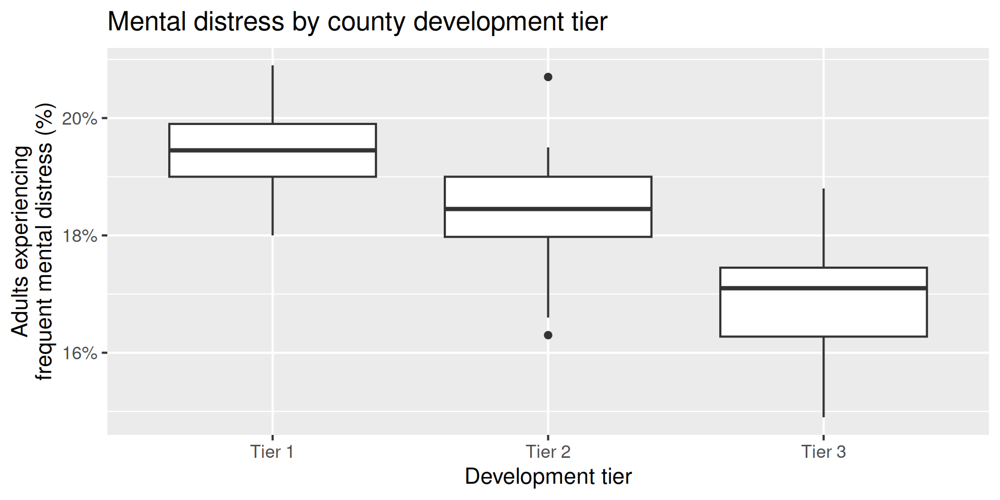
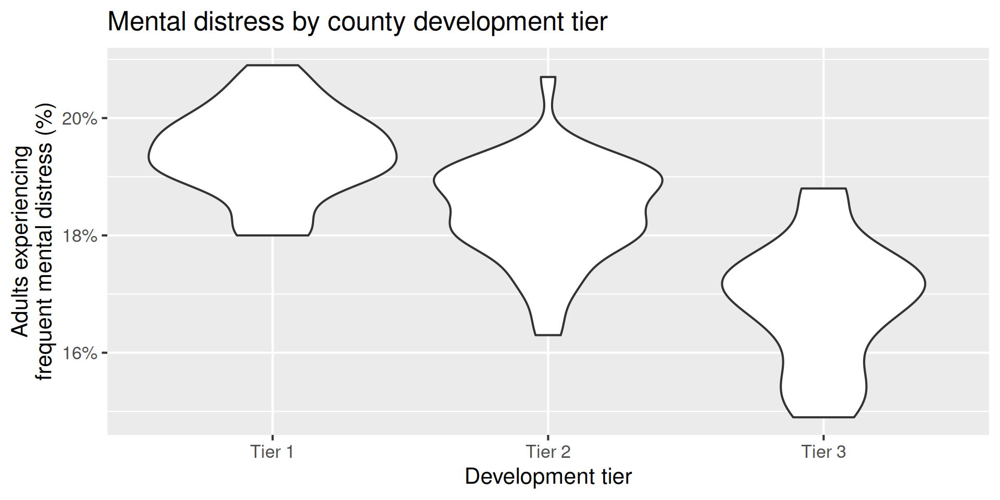
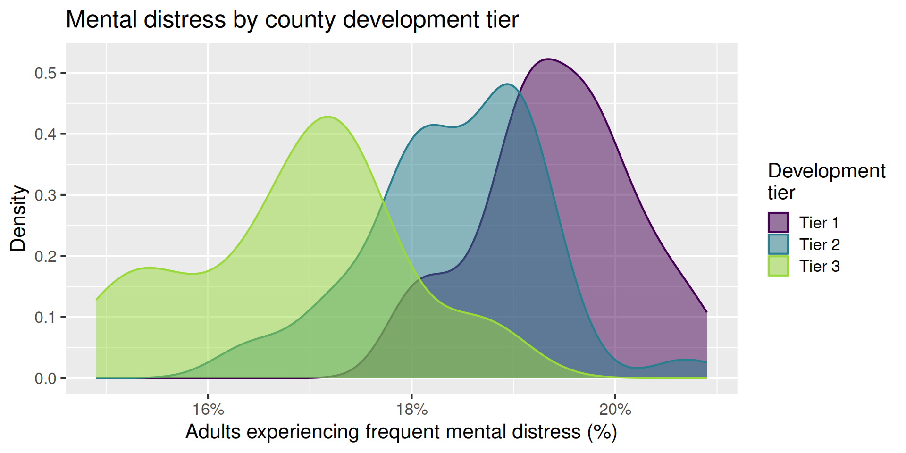
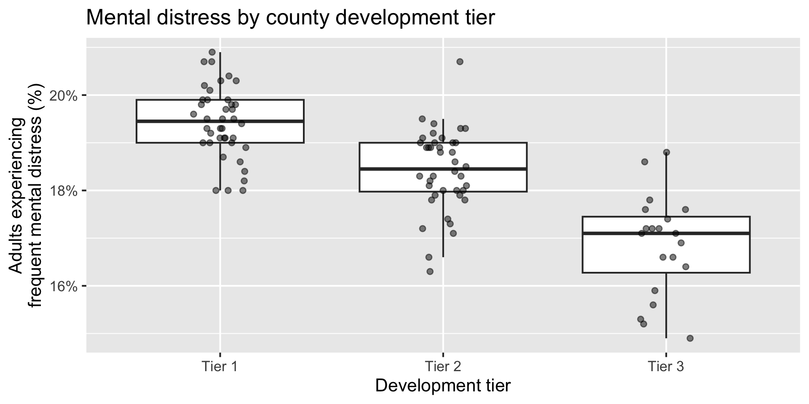
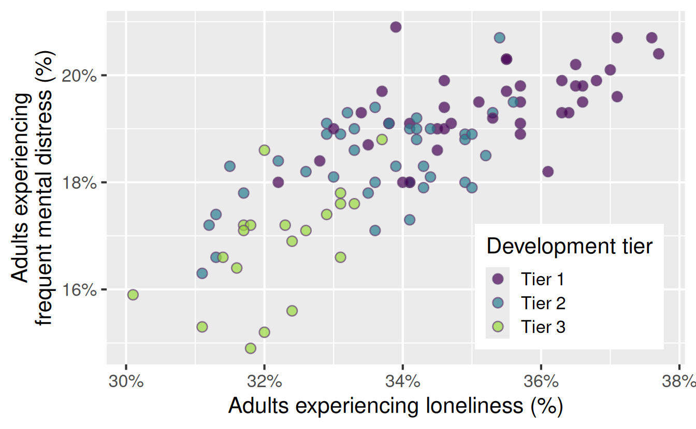
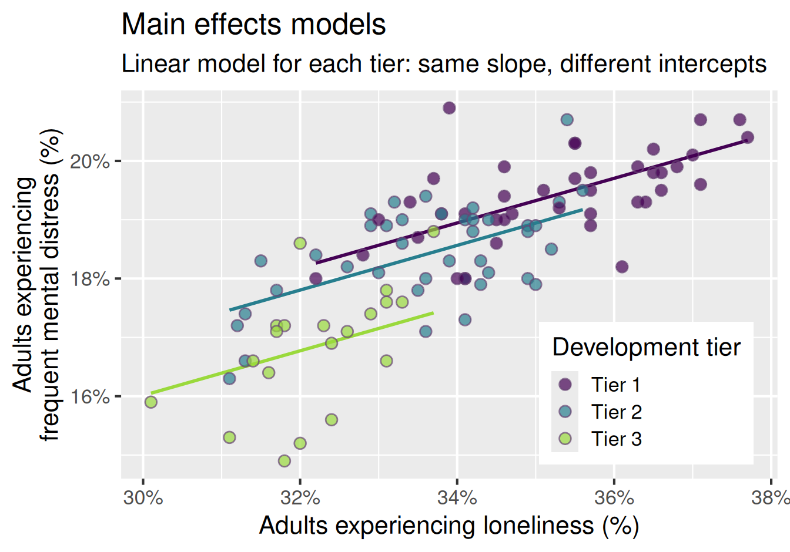
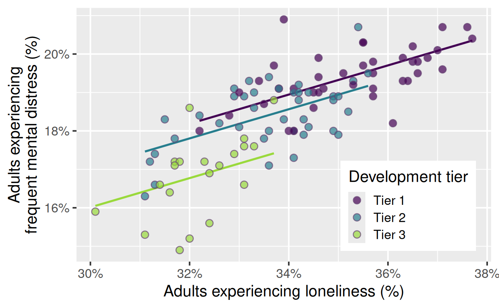

# Linear regression with multiple predictors

Lecture 17

Author

Affiliation

Prof. Mine Çetinkaya-Rundel

Duke University\
STA 199 - Fall 2026

Published

October 26, 2026

# Warm-up

## While you wait: Participate 📱💻

Which of the following is true about linear regression models?

- The regression line always passes through the origin (x = 0, y = 0).
- The slope indicates the average change in the outcome for a one-unit increase in the predictor.
- The intercept indicates the average value of the predictor when the outcome is 0.
- Least squares regression line minimizes the sum of the vertical distances between the observed and predicted values of the outcome.

[](images/17/wooclap-qr.png)

Go to [wooclap.com](https://app.wooclap.com/YJMSXJE) and use the code YJMSXJE.

## Announcements

- HW 5 due tonight and I have office hours 3:30 - 5 pm

- Lab 5 in lab tomorrow:

  - You’ll work on a non-project task, primarily
  - But you’ll work with your project teams
  - And you’ll be asked to share plans for next steps for your project as well

- **Extra credit opportunity:** Come to office hours **AS A FULL TEAM** with me or any of the TAs before the final project deadline, share your project progress, and get feedback on next steps. Each team that does this will get **1 extra credit point** on the project.

## Project

**Getting your presentation on your project website:**

- Create your presentation wherever you want (PowerPoint, Google Slides, Keynote, etc.)

- Export as a PDF

- Rename the PDF as `presentation.pdf` (case sensitive)

- Place the PDF in your project folder, overwriting the existing, placeholder `presentation.pdf` file

# From last time: Categorical predictors

## Mental-distress prevalence by county development tier

How does estimated frequent mental-distress prevalence vary by county development tier?

- outcome: frequent mental-distress prevalence (numerical)

- predictor: county development tier (categorical; Tier 1 is most economically distressed and Tier 3 is least economically distressed)

## Boxplot

Code

``` downlit
ggplot(
  nc_places,
  aes(x = development_tier, y = mental_distress)
) +
  geom_boxplot() +
  scale_y_continuous(labels = label_percent(scale = 1)) +
  labs(
    x = "Development tier",
    y = "Adults experiencing\nfrequent mental distress (%)",
    title = "Mental distress by county development tier"
  )
```

[](17-linear-regression-multiple-predictors_files/figure-revealjs/unnamed-chunk-1-1.png)

## Violin plot

Code

``` downlit
ggplot(
  nc_places,
  aes(x = development_tier, y = mental_distress)
) +
  geom_violin() +
  scale_y_continuous(labels = label_percent(scale = 1)) +
  labs(
    x = "Development tier",
    y = "Adults experiencing\nfrequent mental distress (%)",
    title = "Mental distress by county development tier"
  )
```

[](17-linear-regression-multiple-predictors_files/figure-revealjs/unnamed-chunk-2-1.png)

## Density plot

Code

``` downlit
ggplot(
  nc_places,
  aes(
    x = mental_distress,
    color = development_tier,
    fill = development_tier
  )
) +
  geom_density(alpha = 0.5) +
  scale_x_continuous(labels = label_percent(scale = 1)) +
  scale_color_viridis_d(end = 0.85) +
  scale_fill_viridis_d(end = 0.85) +
  labs(
    x = "Adults experiencing frequent mental distress (%)",
    y = "Density",
    color = "Development\ntier",
    fill = "Development\ntier",
    title = "Mental distress by county development tier"
  )
```

[](17-linear-regression-multiple-predictors_files/figure-revealjs/unnamed-chunk-3-1.png)

## Multiple geoms

Code

``` downlit
ggplot(
  nc_places,
  aes(x = development_tier, y = mental_distress)
) +
  geom_boxplot(outlier.shape = NA) +
  geom_jitter(width = 0.12, height = 0, size = 2, alpha = 0.5) +
  scale_y_continuous(labels = label_percent(scale = 1)) +
  labs(
    x = "Development tier",
    y = "Adults experiencing\nfrequent mental distress (%)",
    title = "Mental distress by county development tier"
  )
```

[](17-linear-regression-multiple-predictors_files/figure-revealjs/unnamed-chunk-4-1.png)

## Summarize

Calculate the average mental-distress prevalence for counties in each development tier. How do the averages compare across tiers?

``` downlit
nc_places |>
  group_by(development_tier) |>
  summarize(mean_mental_distress = mean(mental_distress))
```

    # A tibble: 3 × 2
      development_tier mean_mental_distress
      <chr>                           <dbl>
    1 Tier 1                           19.4
    2 Tier 2                           18.4
    3 Tier 3                           16.8

## Model - fit

Fit a linear regression model predicting mental-distress prevalence from development tier and display the results.

Why is Tier 1 not in the output?

``` downlit
md_tier_fit <- linear_reg() |>
  fit(mental_distress ~ development_tier, data = nc_places)

tidy(md_tier_fit)
```

    # A tibble: 3 × 5
      term                   estimate std.error statistic   p.value
      <chr>                     <dbl>     <dbl>     <dbl>     <dbl>
    1 (Intercept)               19.4      0.136    143.   1.06e-114
    2 development_tierTier 2    -1        0.192     -5.22 1.04e-  6
    3 development_tierTier 3    -2.57     0.235    -11.0  1.18e- 18

\\ \widehat{\text{mental distress %}} = 19.4 - 1 \times \text{Tier 2} - 2.57 \times \text{Tier 3} \\

## Model - interpret, Tier 2

\\ \widehat{\text{mental distress %}} = 19.4 \color{#9E2C6A}{- 1 \times \text{Tier 2}} - 2.57 \times \text{Tier 3} \\

Tier 2 counties are predicted to have, on average, a mental-distress prevalence 1 percentage point lower than Tier 1 counties.

## Model - interpret, Tier 3

\\ \widehat{\text{mental distress %}} = 19.4 - 1 \times \text{Tier 2} \color{#9E2C6A}{- 2.57 \times \text{Tier 3}} \\

Tier 3 counties are predicted to have, on average, a mental-distress prevalence 2.57 percentage points lower than Tier 1 counties.

## Model - interpret, Intercept

\\ \widehat{\text{mental distress %}} = \color{#9E2C6A}{19.4} - 1 \times \text{Tier 2} - 2.57 \times \text{Tier 3} \\

The predicted average mental-distress prevalence among Tier 1 counties is 19.4%.

## Model - predict

What is the predicted mental-distress prevalence for a Tier 1 county? What are the predicted values for Tier 2 and Tier 3 counties? Where have we seen these values before?

``` downlit
new_counties <- tibble(
  county = c("County A", "County B", "County C"),
  development_tier = c("Tier 1", "Tier 2", "Tier 3")
)

augment(md_tier_fit, new_data = new_counties)
```

    # A tibble: 3 × 3
      .pred county   development_tier
      <dbl> <chr>    <chr>           
    1  19.4 County A Tier 1          
    2  18.4 County B Tier 2          
    3  16.8 County C Tier 3          

## Model - predict

Calculate the predicted mental-distress prevalence for counties in each development tier *by hand*.

\\ \widehat{\text{mental distress %}} = 19.42 - 1.00 \times \text{Tier 2} - 2.57 \times \text{Tier 3} \\

. . .

- Tier 1: \\\widehat{\text{mental distress %}} = 19.42 - 1.00 \times \color{#9E2C6A}{0} - 2.57 \times \color{#9E2C6A}{0} = 19.42\\

. . .

- Tier 2: \\\widehat{\text{mental distress %}} = 19.42 - 1.00 \times 1 - 2.57 \times \color{#9E2C6A}{0} = 18.42\\

. . .

- Tier 3: \\\widehat{\text{mental distress %}} = 19.42 - 1.00 \times \color{#9E2C6A}{0} - 2.57 \times 1 = 16.85\\

## Models with categorical predictors

- A categorical predictor is encoded using **dummy variables**. A predictor with \\k\\ levels requires \\k - 1\\ dummy variables.

- The first level of the categorical variable is the **baseline level**. In a model with one categorical predictor, the intercept is the predicted value of the outcome for the baseline level (when all dummy variables equal 0).

- Each slope coefficient describes the difference between the predicted value of the outcome for that level of the categorical variable compared to the baseline level.

## Changing the baseline level

- By default, R uses the first level of a categorical variable as the baseline level.

- We can change the baseline level by reordering the levels of the categorical variable.

## Participate 📱💻

What function goes in the blank to make Tier 3 the baseline level in the `development_tier` variable?

``` r
nc_places |>
  mutate(
    development_tier = ___(development_tier, "Tier 3")
  )
```

- `level_reorder`
- `fct_relevel`
- `fct_reorder`
- `str_relevel`

[](images/17/wooclap-qr.png)

Go to [wooclap.com](https://app.wooclap.com/YJMSXJE) and use the code YJMSXJE.

## Participate 📱💻

What is the baseline level of `development_tier` in the following model?

``` downlit
linear_reg() |>
  fit(
    mental_distress ~ development_tier,
    data = nc_places_tier_2
  ) |>
  tidy()
```

    # A tibble: 3 × 5
      term                   estimate std.error statistic   p.value
      <chr>                     <dbl>     <dbl>     <dbl>     <dbl>
    1 (Intercept)               18.4      0.136    136.   1.75e-112
    2 development_tierTier 1     1.00     0.192      5.22 1.04e-  6
    3 development_tierTier 3    -1.57     0.235     -6.70 1.40e-  9

- Tier 1
- Tier 2
- Tier 3
- Cannot tell from the output

[](images/17/wooclap-qr.png)

Go to [wooclap.com](https://app.wooclap.com/YJMSXJE) and use the code YJMSXJE.

# Multiple predictors

## A new question

How does estimated frequent mental-distress prevalence vary by county development tier as well as loneliness prevalence?

- outcome: frequent mental-distress prevalence (numerical)

- predictor**s**:

  - development tier (categorical)
  - loneliness prevalence (numerical)

## Visualize

Code

``` downlit
ggplot(
  nc_places,
  aes(x = loneliness, y = mental_distress, fill = development_tier)
) +
  geom_point(
    alpha = 0.7,
    size = 3,
    shape = "circle filled",
    color = "#674574"
  ) +
  scale_x_continuous(labels = label_percent(scale = 1)) +
  scale_y_continuous(labels = label_percent(scale = 1)) +
  scale_fill_viridis_d(end = 0.85) +
  labs(
    x = "Adults experiencing loneliness (%)",
    y = "Adults experiencing\nfrequent mental distress (%)",
    fill = "Development tier",
  ) +
  theme(
    legend.position = "inside",
    legend.position.inside = c(0.8, 0.22)
  )
```

[](17-linear-regression-multiple-predictors_files/figure-revealjs/mental-distress-tier-loneliness-1.png)

## Model - fit

``` downlit
md_tier_lone_fit <- linear_reg() |>
  fit(
    mental_distress ~ development_tier + loneliness,
    data = nc_places
  )
```

## Model - output and formula

``` downlit
tidy(md_tier_lone_fit)
```

    # A tibble: 4 × 5
      term                   estimate std.error statistic       p.value
      <chr>                     <dbl>     <dbl>     <dbl>         <dbl>
    1 (Intercept)               6.04     2.06        2.93 0.00420      
    2 development_tierTier 2   -0.381    0.187      -2.04 0.0437       
    3 development_tierTier 3   -1.41     0.265      -5.33 0.000000651  
    4 loneliness                0.379    0.0583      6.50 0.00000000352

\\ \begin{aligned} \widehat{\text{mental distress %}} &= 6.04 \\ &- 0.381 \times \text{Tier 2} \\ &- 1.41 \times \text{Tier 3} \\ &+ 0.379 \times \text{loneliness %} \end{aligned} \\

## Model - formula, deconstructed

**Tier 1:** \\\text{Tier 2} = \color{#5C97CB}{\mathbf{0}}\\ and \\\text{Tier 3} = \color{#5C97CB}{\mathbf{0}}\\

\\ \begin{aligned} \widehat{\text{mental distress %}} &= 6.04 - 0.381 \times \color{#5C97CB}{\mathbf{0}} - 1.41 \times \color{#5C97CB}{\mathbf{0}} + 0.379 \times \text{loneliness %} \\ &= 6.04 + 0.379 \times \text{loneliness %} \end{aligned} \\

**Tier 2:** \\\text{Tier 2} = \color{#9E2C6A}{\mathbf{1}}\\ and \\\text{Tier 3} = \color{#5C97CB}{\mathbf{0}}\\

\\ \begin{aligned} \widehat{\text{mental distress %}} &= 6.04 - 0.381 \times \color{#9E2C6A}{\mathbf{1}} - 1.41 \times \color{#5C97CB}{\mathbf{0}} + 0.379 \times \text{loneliness %} \\ &= 5.66 + 0.379 \times \text{loneliness %} \end{aligned} \\

**Tier 3:** \\\text{Tier 2} = \color{#5C97CB}{\mathbf{0}}\\ and \\\text{Tier 3} = \color{#9E2C6A}{\mathbf{1}}\\

\\ \begin{aligned} \widehat{\text{mental distress %}} &= 6.04 - 0.381 \times \color{#5C97CB}{\mathbf{0}} - 1.41 \times \color{#9E2C6A}{\mathbf{1}} + 0.379 \times \text{loneliness %} \\ &= 4.63 + 0.379 \times \text{loneliness %} \end{aligned} \\

## Participate 📱💻

What do the following look like on a scatterplot?

- **Tier 1:** \\\widehat{\text{mental distress %}} = 6.04 + 0.379 \times \text{loneliness %}\\

- **Tier 2:** \\\widehat{\text{mental distress %}} = 5.66 + 0.379 \times \text{loneliness %}\\

- **Tier 3:** \\\widehat{\text{mental distress %}} = 4.63 + 0.379 \times \text{loneliness %}\\

- Parallel lines with different intercepts
- Parallel lines with the same intercept
- Lines with different slopes and different intercepts
- Lines with different slopes and the same intercept

[](images/17/wooclap-qr.png)

Go to [wooclap.com](https://app.wooclap.com/YJMSXJE) and use the code YJMSXJE.

## Model - visualize

Code

``` downlit
md_tier_lone_aug <- augment(
  md_tier_lone_fit,
  new_data = nc_places
)

ggplot(
  md_tier_lone_aug,
  aes(x = loneliness, y = mental_distress, fill = development_tier)
) +
  geom_line(
    aes(y = .pred, color = development_tier),
    linewidth = 1
  ) +
  geom_point(
    alpha = 0.7,
    size = 3,
    shape = "circle filled",
    color = "#674574"
  ) +
  scale_x_continuous(labels = label_percent(scale = 1)) +
  scale_y_continuous(labels = label_percent(scale = 1)) +
  scale_color_viridis_d(end = 0.85, guide = "none") +
  scale_fill_viridis_d(end = 0.85) +
  labs(
    x = "Adults experiencing loneliness (%)",
    y = "Adults experiencing\nfrequent mental distress (%)",
    fill = "Development tier",
    title = "Main effects models",
    subtitle = "Linear model for each tier: same slope, different intercepts"
  ) +
  theme(
    legend.position = "inside",
    legend.position.inside = c(0.8, 0.22)
  )
```

[](17-linear-regression-multiple-predictors_files/figure-revealjs/mental-distress-tier-loneliness-lm-main-1.png)

## Model - interpret, slope (numerical)

\\ \begin{aligned} \widehat{\text{mental distress %}} &= 6.04 \\ &- 0.381 \times \text{Tier 2} \\ &- 1.41 \times \text{Tier 3} \\ &+ 0.379 \times \text{loneliness %} \end{aligned} \\

**Loneliness:** For each additional percentage point in loneliness prevalence, the model predicts mental distress prevalence to be higher, on average, by 0.381 percentage points, all else held constant (i.e., for counties in the same development tier).

## Model - interpret, slope (categorical)

\\ \begin{aligned} \widehat{\text{mental distress %}} &= 6.04 \\ &- 0.381 \times \text{Tier 2} \\ &- 1.41 \times \text{Tier 3} \\ &+ 0.379 \times \text{loneliness %} \end{aligned} \\

**Tier 2:** For Tier 2 counties, the model predicts mental distress prevalence to be lower, on average, by 0.38 percentage points than for Tier 1 counties, all else held constant (i.e., for counties with the same loneliness prevalence).

## Model - interpret, slope (categorical)

\\ \begin{aligned} \widehat{\text{mental distress %}} &= 6.04 \\ &- 0.381 \times \text{Tier 2} \\ &- 1.41 \times \text{Tier 3} \\ &+ 0.379 \times \text{loneliness %} \end{aligned} \\

**Tier 3:** For Tier 3 counties, the model predicts mental distress prevalence to be lower, on average, by 1.41 percentage points than for Tier 1 counties, all else held constant (i.e., for counties with the same loneliness prevalence).

## Model - interpret, intercept

\\ \begin{aligned} \widehat{\text{mental distress %}} &= 6.04 \\ &- 0.381 \times \text{Tier 2} \\ &- 1.41 \times \text{Tier 3} \\ &+ 0.379 \times \text{loneliness %} \end{aligned} \\

**Intercept:** For Tier 1 counties with 0% loneliness prevalence, the model predicts mental distress prevalence to be 6.04%. However, 0% loneliness is outside the range of the observed data, so the intercept is not meaningful in context.

## \\R^2\\: Variability explained

How much of the variability in mental-distress prevalence is explained by…

**tier alone:**

``` downlit
glance(md_tier_fit) |>
  select(r.squared)
```

    # A tibble: 1 × 1
      r.squared
          <dbl>
    1     0.554

The model with tier alone as predictor explains approximately **55.4%** of the variability in mental-distress prevalence among North Carolina counties.

**tier + loneliness prevalence:**

``` downlit
glance(md_tier_lone_fit) |>
  select(r.squared)
```

    # A tibble: 1 × 1
      r.squared
          <dbl>
    1     0.691

The model with tier and loneliness prevalence as predictors explains approximately **69.1%** of the variability in mental-distress prevalence among North Carolina counties.

What does this say about which model is better for predicting mental distress prevalence?

## Adjusted \\R^2\\: Fit and complexity

- \\R^2\\:
  - measures the proportion of variability explained by the model
  - increases as more predictors are added to the model, even if the new predictors are not meaningful
- Adjusted \\R^2\\:
  - measures the proportion of variability explained by the model, with a penalty for the number of predictor coefficients in the model
  - penalizes the model for adding unnecessary predictors, therefore does not automatically increase when another predictor is added

## Adjusted \\R^2\\: Fit and complexity

**tier alone:**

``` downlit
glance(md_tier_fit) |>
  select(adj.r.squared)
```

    # A tibble: 1 × 1
      adj.r.squared
              <dbl>
    1         0.545

**tier + loneliness prevalence:**

``` downlit
glance(md_tier_lone_fit) |>
  select(adj.r.squared)
```

    # A tibble: 1 × 1
      adj.r.squared
              <dbl>
    1         0.681

\

What does this say about which model is better for predicting mental distress prevalence?

## Other explanations?

Current model: Mental distress prevalence is higher by the same amount for each additional percentage point in loneliness prevalence, regardless of development tier.

Could there be a different reality?

Code

``` downlit
md_tier_lone_aug <- augment(
  md_tier_lone_fit,
  new_data = nc_places
)

ggplot(
  md_tier_lone_aug,
  aes(x = loneliness, y = mental_distress, fill = development_tier)
) +
  geom_line(
    aes(y = .pred, color = development_tier),
    linewidth = 1
  ) +
  geom_point(
    alpha = 0.7,
    size = 3,
    shape = "circle filled",
    color = "#674574"
  ) +
  scale_x_continuous(labels = label_percent(scale = 1)) +
  scale_y_continuous(labels = label_percent(scale = 1)) +
  scale_color_viridis_d(end = 0.85, guide = "none") +
  scale_fill_viridis_d(end = 0.85) +
  labs(
    x = "Adults experiencing loneliness (%)",
    y = "Adults experiencing\nfrequent mental distress (%)",
    fill = "Development tier",
  ) +
  theme(
    legend.position = "inside",
    legend.position.inside = c(0.8, 0.22)
  )
```

[](17-linear-regression-multiple-predictors_files/figure-revealjs/mental-distress-tier-loneliness-lm-revisit-1.png)

## Application exercise

- Go to your ae project in Positron.

- If you haven’t yet done so, make sure all of your changes up to this point are committed and pushed, i.e., there’s nothing left in your source control pane.

- If you haven’t yet done so, pull to get today’s application exercise file: `ae-10-nc-places-multi-model.qmd`.

- Work through the application exercise in class, and render, commit, and push your edits by the end of class.
