# Logistic regression

Lecture 19

Author

Affiliation

Prof. Mine Çetinkaya-Rundel

Duke University\
STA 199 - Fall 2026

Published

November 4, 2026

# Warm-up

## Announcement: House course in Statistical Science

Register for a fun House Course to learn more about statistics and research! No experience required.

**Statistical Methods in Research**\
Spring 2027 House Course (0.5 credit, S/U)\
Instructors: Liane Ma (<lm487@duke.edu>), Cooper Ruffing (<ctr22@duke.edu>)\

Faculty Sponsor: Dr. John Zito\
Time/Location: Mondays 7:00-8:30 PM, Old Chemistry 123\
Course Code: HOUSECS 59 - 28\

In this course, students will explore the statistical fundamentals necessary for understanding and conducting research in a variety of fields. Students will engage with real-world research papers and datasets across disciplines, exploring how statistics are used (and sometimes misused) in published work. Instead of focusing solely on technical skills, this course emphasizes interpretation, critique, and application of basic statistical tools in research. From misused methods to research bias, Statistical Methods in Research aims to provide students with a deeper understanding of when, why, and how to best utilize statistical methods in their future storytelling. The course culminates in student-led discussion, applying concepts from class. No previous experience is required in statistical science or research.\

# Project: Technical writing with Quarto

## Your project write-up with Quarto

- Figure sizing: `fig-width`, `fig-asp`, etc. in code cells. [\[example\]](https://github.com/sta199-f26/project-teaching-team/blob/main/index.qmd#L207-L208)

- Figure layout:

  - `layout-ncol` for placing multiple figures in a chunk. [\[example\]](https://github.com/sta199-f26/project-teaching-team/blob/main/index.qmd#L163)
  - Further control over figure layout with the [**patchwork**](https://patchwork.data-imaginist.com/articles/patchwork.html) package.

- Cell options for what makes it in your final report: `message`, `echo`, etc. [\[example\]](https://github.com/sta199-f26/project-teaching-team/blob/main/index.qmd#L6-L7)

- Noting outside resources and formal citations:

  - AI Disclosure [\[example\]](https://github.com/sta199-f26/project-teaching-team/blob/main/ai-disclosure.qmd)
  - Citations [\[example\]](https://github.com/sta199-f26/project-teaching-team/blob/main/index.qmd#L119)

- Finalizing your report with `echo: false`. [\[example\]](https://github.com/sta199-f26/project-teaching-team/blob/main/index.qmd#L5)

## Building your project website with Quarto

- The `docs` folder.

- Making sure your website reflects your latest changes.

- Customizing the look of your website.

  - Quarto themes: Learn more at <https://quarto.org/docs/output-formats/html-themes.html>. [\[example\]](https://github.com/sta199-f26/project-teaching-team/blob/3417f86ae9e42a2f793da3c935f009506a2a866d/_quarto.yml#L41-L43)
  - For the adventurous: Customizing your website with `_brand.yml`, learn more at <https://quarto.org/docs/authoring/brand.html>.

## Slides

- **Option 1:** Make your slides not in Quarto but make sure they’re available in your Quarto project website.

> **IMPORTANT:**
>
> Make sure the presentation is called `presentation.pdf`.

- **Option 2:** Make your slides with Quarto.

# Project: Code smell and style

## Code smell

> One way to look at smells is with respect to principles and quality: “Smells are certain structures in the code that indicate violation of fundamental design principles and negatively impact design quality”. Code smells are usually not bugs; they are not technically incorrect and do not prevent the program from functioning. Instead, they indicate weaknesses in design that may slow down development or increase the risk of bugs or failures in the future.

Source: [Code smell on Wikipedia](https://en.wikipedia.org/wiki/Code_smell)

## Code style

Follow the [Tidyverse style guide](https://style.tidyverse.org/):

- Spaces before and line breaks after each `+` when building a ggplot

- Spaces before and line breaks after each `|>` in a data transformation pipeline,

- Proper indentation

- Spaces around `=` signs and spaces after commas

- Lines should not span more than 80 characters, long lines should be broken up with each argument on its own line

# Logistic regression

## Packages

``` downlit
library(tidyverse) # data wrangling and visualization
library(tidymodels) # modeling
library(ggthemes) # accessible color palettes
```

## Thus far…

We have been studying regression:

- What combinations of data types have we seen?

- What did the picture look like?

## Recap: Simple linear regression

Numerical outcome and one numerical predictor:

[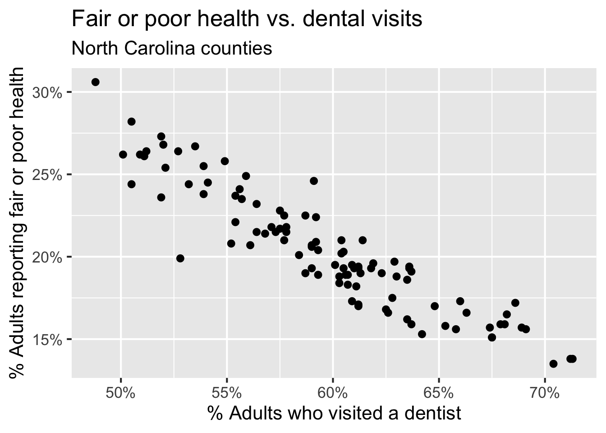](19-logistic-regression-I_files/figure-html/dental-visits-1.png)

## Recap: Simple linear regression

Numerical outcome and one categorical predictor (two levels):

[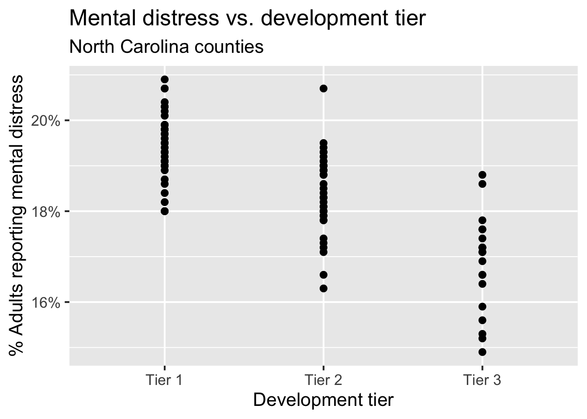](19-logistic-regression-I_files/figure-html/card-krueger-1.png)

## Recap: Multiple linear regression

Numerical outcome, numerical and categorical predictors:

[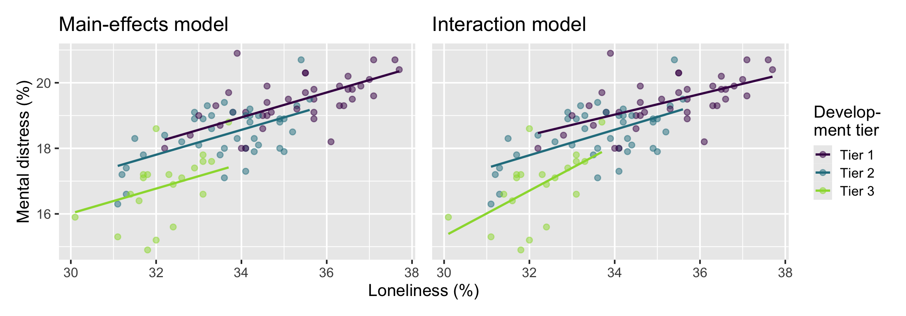](19-logistic-regression-I_files/figure-html/md-tiers-loneliness-1.png)

## Today: a *binary* outcome

\\ y = \begin{cases} 1 & &&\text{eg. Yes, Win, True, Heads, Success}\\ 0 & &&\text{eg. No, Lose, False, Tails, Failure}. \end{cases} \\

[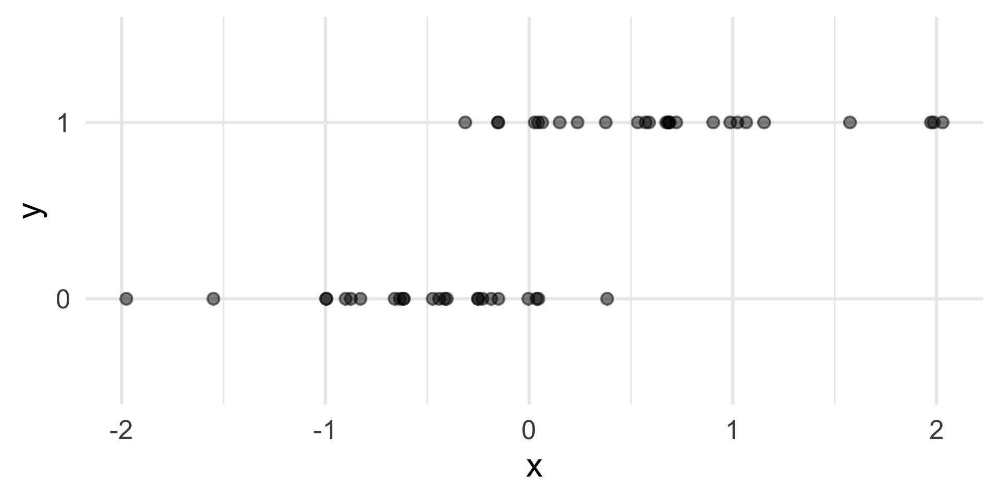](19-logistic-regression-I_files/figure-html/binary-outcome-scatter-1.png)

## Who cares?

If we can model the relationship between predictors (\\x\\) and a binary outcome (\\y\\), we can use the model to do a special kind of prediction called *classification*.

## Example: Is the e-mail spam or not?

\\ \mathbf{x}: \text{word and character counts in an e-mail.} \\

[](images/19/spam.png)

\\ y = \begin{cases} 1 & \text{it's spam}\\ 0 & \text{it's legit} \end{cases} \\

## Example: Is it cancer or not?

\\ \mathbf{x}: \text{features in a medical image.} \\

[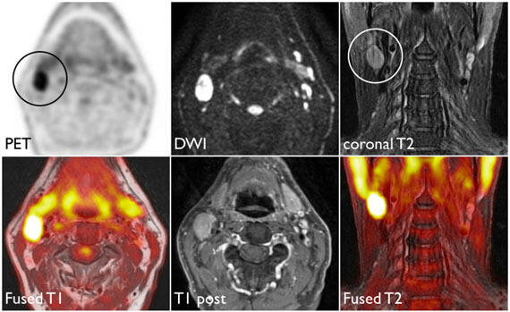](images/19/head-neck.jpg)

\\ y = \begin{cases} 1 & \text{it's cancer}\\ 0 & \text{it's healthy} \end{cases} \\

## Example: Will they default?

\\ \mathbf{x}: \text{financial and demographic info about a loan applicant.} \\

[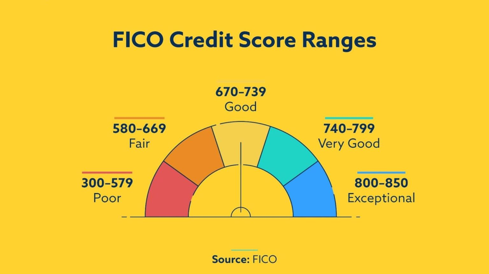](images/19/fico.jpg)

\\ y = \begin{cases} 1 & \text{applicant is at risk of defaulting on loan}\\ 0 & \text{applicant is safe} \end{cases} \\

## Example: Did the House seat flip to Democrat or not?

\\ \mathbf{x}: \text{Trump's 2024 vote share in the congressional district.} \\

[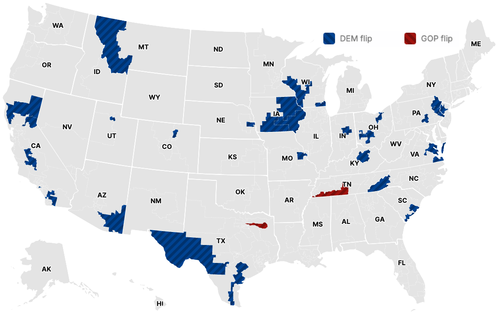](images/19/dem-flip.png)

\\ y = \begin{cases} 1 & \text{the seat flipped to Democrat from 2024 to 2026}\\ 0 & \text{it didn't} \end{cases} \\

## How do we model this type of data?

[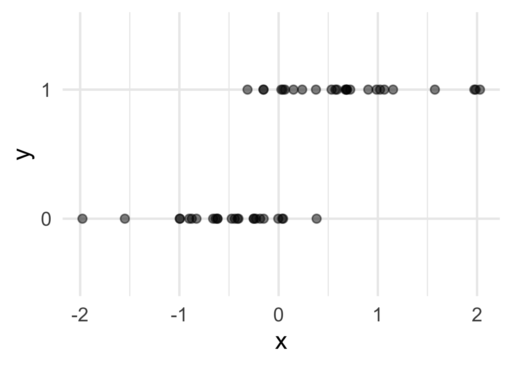](19-logistic-regression-I_files/figure-html/unnamed-chunk-1-1.png)

## Straight line of best fit is a little silly

[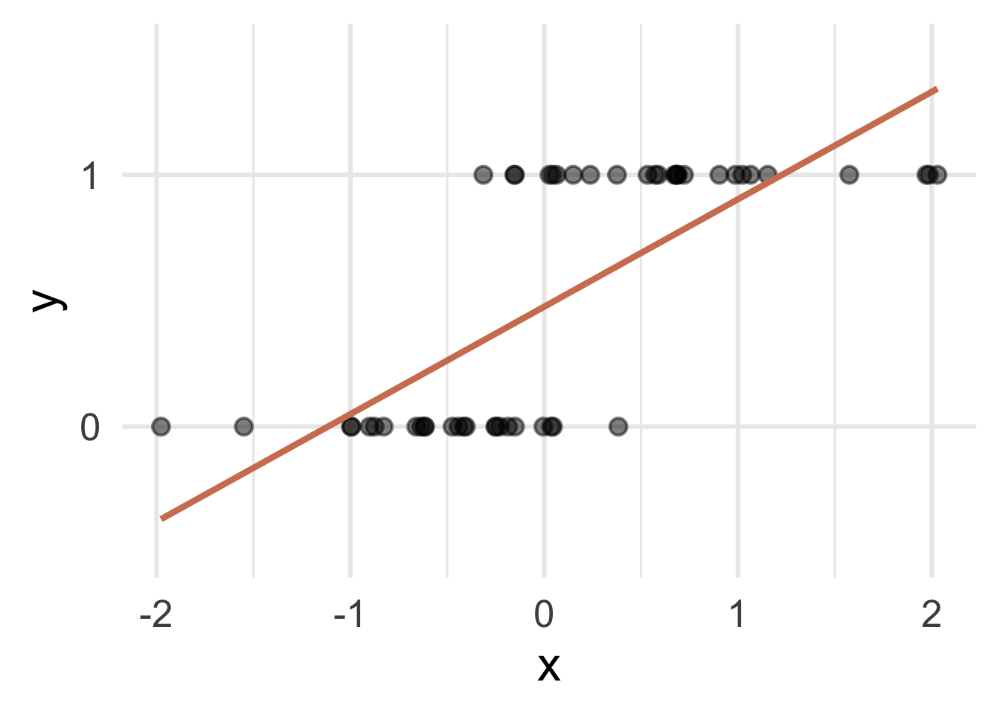](19-logistic-regression-I_files/figure-html/unnamed-chunk-2-1.png)

## Instead: S-curve of best fit

Instead of modeling \\y\\ directly, we model the probability that \\y=1\\:

[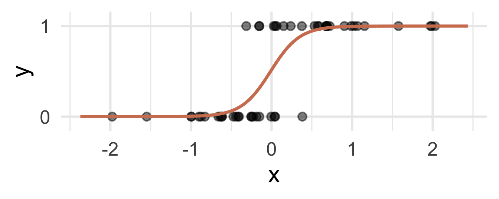](19-logistic-regression-I_files/figure-html/unnamed-chunk-3-1.png)

- “Given new email, what’s the probability that it’s spam?”
- “Given new image, what’s the probability that it’s cancer?’’
- “Given new loan application, what’s the probability that they default?’’
- “Given an uncalled House seat, what’s the probability that it flips to Democrat?’’

## Why don’t we model y directly?

- **Recall regression with a numerical outcome:** Our models do not output *guarantees* for \\y\\, they output predictions that describe behavior *on average*

- **Similar when modeling a binary outcome:** Our models cannot directly guarantee that \\y\\ will be zero or one. The correct analog to “on average” for a 0/1 outcome is “what’s the probability?”

## So, what is this S-curve, anyway?

It’s the *logistic function*:

\\ \text{Prob}(y = 1) = \frac{e^{\beta_0+\beta_1x}}{1+e^{\beta_0+\beta_1x}}. \\

If you set \\p = \text{Prob}(y = 1)\\ and do some algebra, you get the simple linear model for the *log-odds*:

\\ \log\left(\frac{p}{1-p}\right) = \beta_0+\beta_1x. \\

This is called the *logistic regression* model.

## Log-odds?

- \\p = \text{Prob}(y = 1)\\ is a probability. A number between 0 and 1

- \\p / (1 - p)\\ is the odds. A number between 0 and \\\infty\\

> “The odds of this lecture going well are 10 to 1.”

- The log odds \\\log(p / (1 - p))\\ is a number between \\-\infty\\ and \\\infty\\, which is suitable for the linear model.

## Probability to odds

[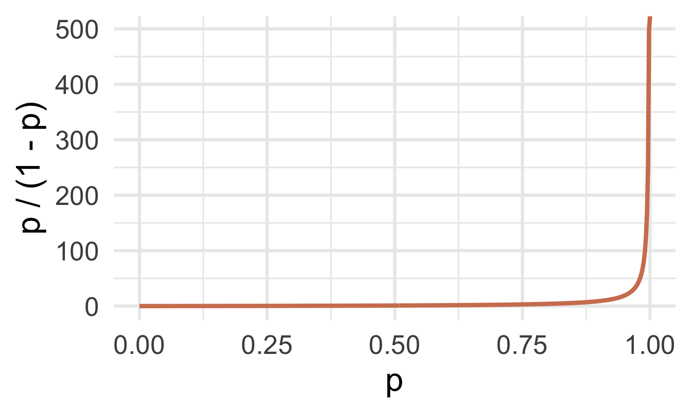](19-logistic-regression-I_files/figure-html/unnamed-chunk-4-1.png)

## Odds to log odds

[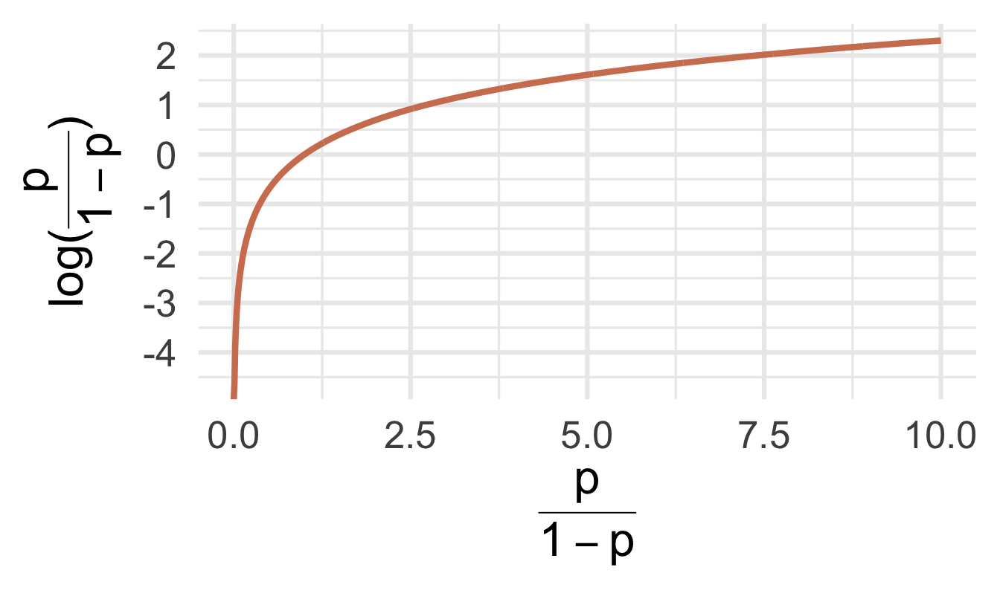](19-logistic-regression-I_files/figure-html/unnamed-chunk-5-1.png)

## Participate 📱💻

If \\p\\ is the probability of success, what is the following called:

\\ \frac{p}{1-p} \\

- Probability of failure
- Odds of failure
- Odds of success
- Log-odds of success

[](images/19/wooclap-qr.png)

Go to [wooclap.com](https://app.wooclap.com/TCGEJHI) and use the code TCGEJHI.

## Logistic regression

\\ \log\left(\frac{p}{1-p}\right) = \beta_0+\beta_1x. \\

- The *logit* function \\\log(p / (1-p))\\ is an example of a *link function* that transforms the linear model to have an appropriate range

- This is an example of a *generalized linear model*

## Estimation

- We estimate the parameters \\\beta_0\\ (intercept) and \\\beta_1\\ (slope) using *maximum likelihood* (don’t worry about it) to get the “best fitting” S-curve

- The fitted model is

\\ \log\left(\frac{\widehat{p}}{1-\widehat{p}}\right) = b_0+b_1x. \\

# Dem flips

## Today’s data

2026 House results and projections from Decision Desk HQ (as of 2026-11-04, 11:14 am), merged with 2024 results (from the `gerrymander` dataset we worked with earlier in the semester):

``` downlit
midterm_26_raw <- read_csv("data/midterm-2026-11-04-11-14.csv")
```

``` downlit
glimpse(midterm_26_raw)
```

    Rows: 443
    Columns: 18
    $ district       <chr> "AK-00", "AL-01", "AL-02", "AL-03", "AL-04", "AL-05", "…
    $ state_abb      <chr> "AK", "AL", "AL", "AL", "AL", "AL", "AL", "AL", "AR", "…
    $ state          <chr> "Alaska", "Alabama", "Alabama", "Alabama", "Alabama", "…
    $ house_rep_20   <chr> "Don Young", "Jerry Carl", "Barry Moore", "Mike Rogers"…
    $ house_party_20 <chr> "Republican", "Republican", "Republican", "Republican",…
    $ house_rep_22   <chr> "Mary Sattler Peltola", "Jerry L Carl", "Barry Moore", …
    $ house_party_22 <chr> "Democrat", "Republican", "Republican", "Republican", "…
    $ house_rep_24   <chr> "Nick Begich", "Barry Moore", "Shomari Figures", "Mike …
    $ house_party_24 <chr> "Republican", "Republican", "Democrat", "Republican", "…
    $ harris_24      <dbl> 41.41, 21.89, 53.52, 26.18, 15.96, 34.20, 29.68, 61.45,…
    $ trump_24       <dbl> 54.54, 76.94, 45.31, 72.71, 83.02, 64.02, 68.47, 37.50,…
    $ gerry_22       <chr> NA, "F", "F", "F", "F", "F", "F", "F", "C", "C", "C", "…
    $ gerry_24       <chr> NA, "B", "B", "B", "B", "B", "B", "B", "C", "C", "C", "…
    $ gerry_26       <chr> NA, "B", "B", "B", "B", "B", "B", "B", "C", "C", "C", "…
    $ rating_26      <chr> "Lean R", "Safe R", "Lean R", "Safe R", "Safe R", "Safe…
    $ leader_26      <chr> "Republican", "Republican", "Democrat", "Republican", "…
    $ margin_26      <dbl> 9.00, 18.00, 8.00, 28.00, 50.00, 7.00, 15.00, 39.00, 35…
    $ called_26      <chr> "uncalled", "called", "called", "called", "called", "ca…

## What’s a Dem flip?

A seat flips to Democrat if it was held by a Republican after 2024 and a Democrat leads in 2026:

``` downlit
midterm_26 <- midterm_26_raw |>
  mutate(
    flip_dem_24_26 = case_when(
      called_26 == "uncalled" ~ NA,
      called_26 == "called" & house_party_24 == "Republican" & leader_26 == "Democrat" ~ "1",
      called_26 == "called" & house_party_24 == "Republican" & leader_26 == "Republican" ~ "0",
      called_26 == "called" & house_party_24 == "Democrat" ~ "0",
    ),
    flip_dem_24_26 = as.factor(flip_dem_24_26)
  ) |>
  filter(!is.na(called_26))
```

> **TIP:**
>
> Let’s check that we ended up with 435 seats:
>
> ``` downlit
> nrow(midterm_26)
> ```
>
>     [1] 435

## Data summary based on called/uncalled

As of 11:14 am today by Decision Desk HQ:

Code

``` downlit
midterm_26 |>
  count(called_26, house_party_24, leader_26, flip_dem_24_26) |>
  pivot_wider(names_from = called_26, values_from = n, values_fill = 0) |>
  adorn_totals(where = c("row", "col"))
```

     house_party_24  leader_26 flip_dem_24_26 called uncalled Total
           Democrat   Democrat              0    201        0   201
           Democrat Republican              0      2        0     2
           Democrat       <NA>              0      3        0     3
         Republican   Democrat              1     38        0    38
         Republican Republican              0    147        0   147
           Democrat   Democrat           <NA>      0        8     8
           Democrat Republican           <NA>      0        1     1
         Republican   Democrat           <NA>      0       12    12
         Republican Republican           <NA>      0       23    23
              Total          -              -    391       44   435

## Visualizing the data

Code

``` downlit
ggplot(
  midterm_26,
  aes(x = trump_24, y = flip_dem_24_26, fill = flip_dem_24_26)
) +
  geom_jitter(
    shape = "circle filled",
    height = 0.2,
    alpha = 0.7,
    size = 3,
    show.legend = FALSE,
    color = "white"
  ) +
  scale_fill_manual(
    values = c("0" = "darkgray", "1" = "#0015BC"),
    na.value = "#A3B18A"
  ) +
  scale_x_continuous(
    limits = c(10, 90),
    breaks = seq(0, 100, 10),
    labels = label_percent(scale = 1)
  ) +
  labs(
    x = "Trump's 2024 vote share (%)",
    y = "Flipped to Democrat",
    title = "2026 House elections",
    caption = "Data from Decision Desk HQ, as of 2026-11-04 at 11:14 am"
  ) +
  facet_wrap(~called_26, nrow = 2, scales = "free_y")
```

[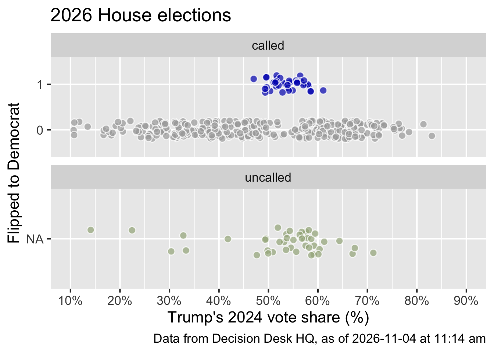](19-logistic-regression-I_files/figure-html/flip-plot-1.png)

**Goal:** Predict whether a seat flips to Democrat based on Trump’s 2024 vote share for uncalled seats, using data from called seats.

## The data

``` downlit
midterm_26_called <- midterm_26 |> filter(called_26 == "called")
midterm_26_uncalled <- midterm_26 |> filter(called_26 == "uncalled")
```

``` downlit
midterm_26_called |>
  select(district, house_party_24, called_26, leader_26, flip_dem_24_26, trump_24)
```

    # A tibble: 391 × 6
       district house_party_24 called_26 leader_26  flip_dem_24_26 trump_24
       <chr>    <chr>          <chr>     <chr>      <fct>             <dbl>
     1 AL-01    Republican     called    Republican 0                  76.9
     2 AL-02    Democrat       called    Democrat   0                  45.3
     3 AL-03    Republican     called    Republican 0                  72.7
     4 AL-04    Republican     called    Republican 0                  83.0
     5 AL-05    Republican     called    Republican 0                  64.0
     6 AL-06    Republican     called    Republican 0                  68.5
     7 AL-07    Democrat       called    Democrat   0                  37.5
     8 AR-01    Republican     called    Republican 0                  71.7
     9 AR-02    Republican     called    Republican 0                  56.6
    10 AR-03    Republican     called    Republican 0                  61.1
    # ℹ 381 more rows

## Fitting a logistic model

``` downlit
flip_fit <- logistic_reg() |>
  fit(flip_dem_24_26 ~ trump_24, data = midterm_26_called)

tidy(flip_fit)
```

    # A tibble: 2 × 5
      term        estimate std.error statistic      p.value
      <chr>          <dbl>     <dbl>     <dbl>        <dbl>
    1 (Intercept)  -3.48      0.648      -5.37 0.0000000805
    2 trump_24      0.0244    0.0117      2.08 0.0372      

. . .

Fitted equation for the log-odds:

\\ \log\left(\frac{\hat{p}}{1-\hat{p}}\right) = -3.48 + 0.0244\times trump\\24 \\

## Interpreting the intercept

If `trump_24 = 0`, then

\\ \hat{p}=\widehat{P(y=1)}=\frac{e^{-3.48}}{1+e^{-3.48}}\approx 0.03. \\

So, a seat where Trump got 0% of the vote in 2024 is predicted to have a 3% chance of flipping to Democrat.

. . .

But Trump’s vote share in called seats ranges from 10.6% to 83%, so this is an extrapolation and not meaningful.

## Interpreting the slope is tricky

Recall:

\\ \frac{\widehat{p}}{1-\widehat{p}} = e^{b_0}e^{b_1x} \\

A one unit increase in \\x\\ is associated with a change in odds by a factor of \\e^{b_1}\\.

## Back to the example…

\\ \log\left(\frac{\hat{p}}{1-\hat{p}}\right) = -3.48 + 0.0244\times trump\\24 \\

Seats where Trump’s 2024 vote share was one percentage point higher are predicted to have odds of flipping to Democrat that are **higher** by a factor of \\e^{0.0244}\approx 1.02\\, on average.

. . .

> **NOTE:**
>
> Higher Trump vote share, *more* likely to flip to Democrat?! 🤔 Hold that thought…

Classification\
(prediction by another name…)
=============================

## Predict

How well did our model do for predicting already called house seats?

``` downlit
midterm_26_called_aug <- augment(flip_fit, new_data = midterm_26_called)

midterm_26_called_aug |>
  count(flip_dem_24_26, .pred_class)
```

    # A tibble: 2 × 3
      flip_dem_24_26 .pred_class     n
      <fct>          <fct>       <int>
    1 0              0             353
    2 1              0              38

Terrible!

Is that surprising?

## Predict for uncalled seats

``` downlit
midterm_26_uncalled_aug <- augment(flip_fit, new_data = midterm_26_uncalled)
```

``` downlit
midterm_26_uncalled_aug |>
  select(district, trump_24, house_party_24, starts_with(".pred_"), leader_26) |>
  print(n = 44)
```

    # A tibble: 44 × 7
       district trump_24 house_party_24 .pred_class .pred_0 .pred_1 leader_26 
       <chr>       <dbl> <chr>          <fct>         <dbl>   <dbl> <chr>     
     1 AK-00        54.5 Republican     0             0.895  0.105  Republican
     2 AZ-01        50.9 Republican     0             0.903  0.0967 Democrat  
     3 AZ-02        56.9 Republican     0             0.890  0.110  Democrat  
     4 AZ-05        59.2 Republican     0             0.884  0.116  Republican
     5 AZ-08        57.5 Republican     0             0.888  0.112  Republican
     6 CA-04        32.8 Democrat       0             0.936  0.0645 Democrat  
     7 CA-05        57.6 Republican     0             0.888  0.112  Republican
     8 CA-07        33.4 Democrat       0             0.935  0.0652 Democrat  
     9 CA-11        14.1 Democrat       0             0.958  0.0418 Democrat  
    10 CA-14        30.4 Democrat       0             0.939  0.0609 Democrat  
    11 CA-23        57.1 Republican     0             0.889  0.111  Republican
    12 CA-34        22.4 Democrat       0             0.949  0.0508 Democrat  
    13 CA-40        49.5 Republican     0             0.906  0.0938 Republican
    14 CO-03        53.6 Republican     0             0.897  0.103  Republican
    15 CO-04        57.9 Republican     0             0.887  0.113  Democrat  
    16 CO-05        53.2 Republican     0             0.898  0.102  Democrat  
    17 FL-07        55.6 Republican     0             0.893  0.107  Republican
    18 FL-09        47.6 Democrat       0             0.910  0.0900 Democrat  
    19 FL-26        67.0 Republican     0             0.863  0.137  Republican
    20 FL-27        56.7 Republican     0             0.890  0.110  Republican
    21 LA-05        67.4 Republican     0             0.862  0.138  Democrat  
    22 LA-06        41.8 Democrat       0             0.921  0.0790 Democrat  
    23 ME-02        53.8 Democrat       0             0.897  0.103  Republican
    24 MI-04        51.9 Republican     0             0.901  0.0989 Democrat  
    25 MI-07        49.8 Republican     0             0.906  0.0945 Democrat  
    26 MI-10        52.2 Republican     0             0.900  0.0996 Democrat  
    27 MN-01        55.1 Republican     0             0.894  0.106  Democrat  
    28 NC-03        60.3 Republican     0             0.881  0.119  Republican
    29 NC-05        58.2 Republican     0             0.886  0.114  Democrat  
    30 NC-07        56.3 Republican     0             0.891  0.109  Republican
    31 NC-08        59.1 Republican     0             0.884  0.116  Republican
    32 NC-10        58.2 Republican     0             0.887  0.113  Republican
    33 NY-01        54.3 Republican     0             0.896  0.104  Republican
    34 NY-02        56.8 Republican     0             0.890  0.110  Republican
    35 NY-17        49.4 Republican     0             0.907  0.0935 Democrat  
    36 NY-21        60.1 Republican     0             0.882  0.118  Republican
    37 TN-04        71.2 Republican     0             0.851  0.149  Democrat  
    38 TX-02        61.3 Republican     0             0.879  0.121  Republican
    39 TX-22        58.7 Republican     0             0.885  0.115  Republican
    40 TX-27        64.4 Republican     0             0.871  0.129  Republican
    41 TX-38        59.4 Republican     0             0.883  0.117  Republican
    42 WA-03        50.0 Democrat       0             0.905  0.0947 Democrat  
    43 WA-04        58.7 Republican     0             0.885  0.115  Republican
    44 WA-05        53.6 Republican     0             0.897  0.103  Republican
