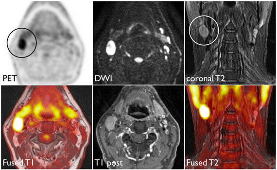
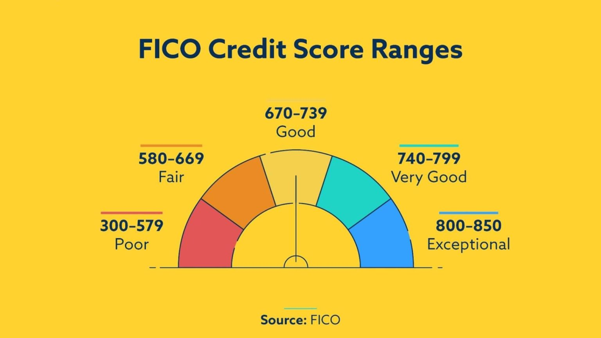
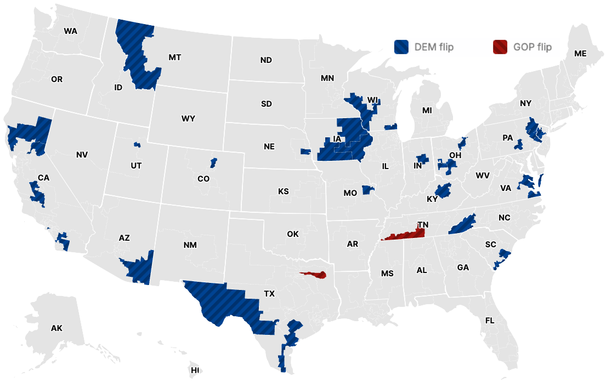

```{r}
#| label: setup
#| include: false
library(tidyverse)
library(tidymodels)
library(patchwork)
library(scales)
library(janitor)

conflicted::conflict_prefer("select", "dplyr")
conflicted::conflict_prefer("filter", "dplyr")

ggplot2::theme_set(ggplot2::theme_gray(base_size = 16))

nc_places <- read_csv(
  here::here("slides", "data/nc-places.csv"),
  show_col_types = FALSE
)
```

# Warm-up

## Announcement: House course in Statistical Science {.smaller}

Register for a fun House Course to learn more about statistics and research! No experience required.

**Statistical Methods in Research** \
Spring 2027 House Course (0.5 credit, S/U) \
Instructors: Liane Ma ([lm487@duke.edu](mailto:lm487@duke.edu)), Cooper Ruffing ([ctr22@duke.edu](mailto:ctr22@duke.edu)) \

::: xsmall
Faculty Sponsor: Dr. John Zito \
Time/Location: Mondays 7:00-8:30 PM, Old Chemistry 123 \
Course Code: HOUSECS 59 - 28 \
:::

::: small
In this course, students will explore the statistical fundamentals necessary for understanding and conducting research in a variety of fields. Students will engage with real-world research papers and datasets across disciplines, exploring how statistics are used (and sometimes misused) in published work. Instead of focusing solely on technical skills, this course emphasizes interpretation, critique, and application of basic statistical tools in research. From misused methods to research bias, Statistical Methods in Research aims to provide students with a deeper understanding of when, why, and how to best utilize statistical methods in their future storytelling. The course culminates in student-led discussion, applying concepts from class. No previous experience is required in statistical science or research. \
:::

# Project: Technical writing with Quarto

## Your project write-up with Quarto {.smaller}

::: incremental

-   Figure sizing: `fig-width`, `fig-asp`, etc. in code cells. [[example]](https://github.com/sta199-f26/project-teaching-team/blob/main/index.qmd#L207-L208)

-   Figure layout: 
    - `layout-ncol` for placing multiple figures in a chunk. [[example]](https://github.com/sta199-f26/project-teaching-team/blob/main/index.qmd#L163)
    - Further control over figure layout with the [**patchwork**](https://patchwork.data-imaginist.com/articles/patchwork.html) package.

-   Cell options for what makes it in your final report: `message`, `echo`, etc. [[example]](https://github.com/sta199-f26/project-teaching-team/blob/main/index.qmd#L6-L7)

-   Noting outside resources and formal citations:
    - AI Disclosure [[example]](https://github.com/sta199-f26/project-teaching-team/blob/main/ai-disclosure.qmd)
    - Citations [[example]](https://github.com/sta199-f26/project-teaching-team/blob/main/index.qmd#L119)

-   Finalizing your report with `echo: false`. [[example]](https://github.com/sta199-f26/project-teaching-team/blob/main/index.qmd#L5)

:::

## Building your project website with Quarto {.smaller}

-   The `docs` folder.

-   Making sure your website reflects your latest changes.

-   Customizing the look of your website. 
    - Quarto themes: Learn more at <https://quarto.org/docs/output-formats/html-themes.html>. [[example]](https://github.com/sta199-f26/project-teaching-team/blob/3417f86ae9e42a2f793da3c935f009506a2a866d/_quarto.yml#L41-L43)
    - For the adventurous: Customizing your website with `_brand.yml`, learn more at <https://quarto.org/docs/authoring/brand.html>.

## Slides {.smaller}

-   **Option 1:** Make your slides not in Quarto but make sure they’re available in your Quarto project website.

::: callout-important
Make sure the presentation is called `presentation.pdf`.
:::

-   **Option 2:** Make your slides with Quarto.

# Project: Code smell and style

## Code smell {.smaller}

> One way to look at smells is with respect to principles and quality: "Smells are certain structures in the code that indicate violation of fundamental design principles and negatively impact design quality".
> Code smells are usually not bugs; they are not technically incorrect and do not prevent the program from functioning.
> Instead, they indicate weaknesses in design that may slow down development or increase the risk of bugs or failures in the future.

::: aside
Source: [Code smell on Wikipedia](https://en.wikipedia.org/wiki/Code_smell)
:::

## Code style {.smaller}

Follow the [Tidyverse style guide](https://style.tidyverse.org/):

-   Spaces before and line breaks after each `+` when building a ggplot

-   Spaces before and line breaks after each `|>` in a data transformation pipeline,

-   Proper indentation

-   Spaces around `=` signs and spaces after commas

-   Lines should not span more than 80 characters, long lines should be broken up with each argument on its own line

# Logistic regression

## Packages

```{r}
#| label: load-packages
#| message: false
library(tidyverse) # data wrangling and visualization
library(tidymodels) # modeling
library(ggthemes) # accessible color palettes
```

## Thus far...

We have been studying regression:

-   What combinations of data types have we seen?

-   What did the picture look like?

## Recap: Simple linear regression

Numerical outcome and one numerical predictor:

```{r}
#| label: dental-visits
#| message: false
#| echo: false
ggplot(
  nc_places,
  aes(x = dental_visit, y = fair_or_poor_health)
) +
  geom_point() +
  scale_x_continuous(labels = label_percent(scale = 1)) +
  scale_y_continuous(labels = label_percent(scale = 1)) +
  labs(
    x = "% Adults who visited a dentist",
    y = "% Adults reporting fair or poor health",
    title = "Fair or poor health vs. dental visits",
    subtitle = "North Carolina counties"
  )
```

## Recap: Simple linear regression

Numerical outcome and one categorical predictor (two levels):

```{r}
#| label: card-krueger
#| echo: false
#| message: false
#| warning: false
ggplot(
  nc_places,
  aes(x = development_tier, y = mental_distress)
) +
  geom_point() +
  scale_y_continuous(labels = label_percent(scale = 1)) +
  labs(
    x = "Development tier",
    y = "% Adults reporting mental distress",
    title = "Mental distress vs. development tier",
    subtitle = "North Carolina counties"
  )
```

## Recap: Multiple linear regression

Numerical outcome, numerical and categorical predictors:

```{r}
#| label: md-tiers-loneliness
#| echo: false
#| message: false
#| warning: false
#| fig-width: 12
#| fig-asp: 0.35
md_tier_lone_main_fit <- linear_reg() |>
  fit(
    mental_distress ~ development_tier + loneliness,
    data = nc_places
  )

md_tier_lone_main_aug <- augment(
  md_tier_lone_main_fit,
  new_data = nc_places
)

p_main <- ggplot(
  md_tier_lone_main_aug,
  aes(x = loneliness, color = development_tier)
) +
  geom_point(aes(y = mental_distress), alpha = 0.5) +
  geom_line(aes(y = .pred), linewidth = 1) +
  scale_color_viridis_d(end = 0.85) +
  labs(
    x = "Loneliness (%)",
    y = "Mental distress (%)",
    color = "Develop-\nment tier",
    title = "Main-effects model"
  )

md_tier_lone_int_fit <- linear_reg() |>
  fit(
    mental_distress ~ development_tier * loneliness,
    data = nc_places
  )

md_tier_lone_int_aug <- augment(
  md_tier_lone_int_fit,
  new_data = nc_places
)

p_int <- ggplot(
  md_tier_lone_int_aug,
  aes(x = loneliness, color = development_tier)
) +
  geom_point(aes(y = mental_distress), alpha = 0.5) +
  geom_line(aes(y = .pred), linewidth = 1) +
  scale_color_viridis_d(end = 0.85) +
  labs(
    x = "Loneliness (%)",
    y = "Mental distress (%)",
    color = "Develop-\nment tier",
    title = "Interaction model"
  )

p_main +
  p_int +
  plot_layout(guides = "collect", axes = "collect") &
  theme(legend.position = "right")
```

## Today: a *binary* outcome {.smaller}

```{r}
#| label: cartoon-settings
#| message: false
#| echo: false
set.seed(8675309)
n <- 50
x <- rnorm(n, mean = 0, sd = 1)
b0 <- 0
b1 <- 5
prob <- 1 / (1 + exp(-(b0 + b1 * x)))
y <- rbinom(n, 1, prob)
df <- tibble(x = x, y = as.factor(y))

df_fit <- logistic_reg() |>
  fit(y ~ x, data = df)

new_df_aug <- augment(
  df_fit,
  new_data = tibble(x = seq(1.2 * min(x), 1.2 * max(x), length.out = 500))
)
```

$$
y = 
\begin{cases}
1 & &&\text{eg. Yes, Win, True, Heads, Success}\\
0 & &&\text{eg. No, Lose, False, Tails, Failure}.
\end{cases}
$$

```{r}
#| label: binary-outcome-scatter
#| message: false
#| echo: false
#| fig-width: 10
ggplot(df, aes(x = x, y = y)) +
  geom_point(alpha = 0.5) +
  theme_minimal(base_size = 24)
```

## Who cares?

If we can model the relationship between predictors ($x$) and a binary outcome ($y$), we can use the model to do a special kind of prediction called *classification*.

## Example: Is the e-mail spam or not? {.smaller}

$$
\mathbf{x}: \text{word and character counts in an e-mail.}
$$

{fig-align="center" width="70%"}

$$
y
= 
\begin{cases}
1 & \text{it's spam}\\
0 & \text{it's legit}
\end{cases}
$$

## Example: Is it cancer or not? {.smaller}

$$
\mathbf{x}: \text{features in a medical image.}
$$

{fig-align="center"}

$$
y
= 
\begin{cases}
1 & \text{it's cancer}\\
0 & \text{it's healthy}
\end{cases}
$$

## Example: Will they default? {.smaller}

$$
\mathbf{x}: \text{financial and demographic info about a loan applicant.}
$$

{fig-align="center" width="60%"}

$$
y
= 
\begin{cases}
1 & \text{applicant is at risk of defaulting on loan}\\
0 & \text{applicant is safe}
\end{cases}
$$

## Example: Did the House seat flip to Democrat or not? {.smaller}

$$
\mathbf{x}: \text{Trump's 2024 vote share in the congressional district.}
$$

{fig-align="center" width="70%"}

$$
y
=
\begin{cases}
1 & \text{the seat flipped to Democrat from 2024 to 2026}\\
0 & \text{it didn't}
\end{cases}
$$


## How do we model this type of data?

```{r}
#| ref-label: binary-outcome-scatter
#| message: false
#| warning: false
#| echo: false
```

## Straight line of best fit is a little silly

```{r}
#| message: false
#| echo: false
ggplot(df, aes(x = x, y = y)) +
  geom_point(alpha = 0.5) +
  geom_smooth(
    aes(y = as.numeric(y)),
    method = "lm",
    se = FALSE,
    color = "#d1805f",
    linewidth = 1.5
  ) +
  theme_minimal(base_size = 24)
```

## Instead: S-curve of best fit {.smaller}

Instead of modeling $y$ directly, we model the probability that $y=1$:

```{r}
#| message: false
#| echo: false
#| fig-asp: 0.4
ggplot(df, aes(x = x, y = as.numeric(y) - 1)) +
  geom_point(alpha = 0.5) +
  geom_line(
    data = new_df_aug,
    aes(y = .pred_1),
    color = "#d1805f",
    linewidth = 1.5
  ) +
  theme_minimal(base_size = 24) +
  scale_y_continuous(
    limits = c(-0.1, 1.1),
    breaks = c(0, 1),
    minor_breaks = NULL
  ) +
  labs(y = "y")
```

-   "Given new email, what's the probability that it's spam?"
-   "Given new image, what's the probability that it's cancer?''
-   "Given new loan application, what's the probability that they default?''
-   "Given an uncalled House seat, what's the probability that it flips to Democrat?''

## Why don't we model y directly?

-   **Recall regression with a numerical outcome:** Our models do not output *guarantees* for $y$, they output predictions that describe behavior *on average*

-   **Similar when modeling a binary outcome:** Our models cannot directly guarantee that $y$ will be zero or one. The correct analog to "on average" for a 0/1 outcome is "what's the probability?"

## So, what is this S-curve, anyway?

It's the *logistic function*:

$$
\text{Prob}(y = 1)
=
\frac{e^{\beta_0+\beta_1x}}{1+e^{\beta_0+\beta_1x}}.
$$

If you set $p = \text{Prob}(y = 1)$ and do some algebra, you get the simple linear model for the *log-odds*:

$$
\log\left(\frac{p}{1-p}\right)
=
\beta_0+\beta_1x.
$$

This is called the *logistic regression* model.

## Log-odds?

-   $p = \text{Prob}(y = 1)$ is a probability. A number between 0 and 1

-   $p / (1 - p)$ is the odds. A number between 0 and $\infty$

> "The odds of this lecture going well are 10 to 1."

-   The log odds $\log(p / (1 - p))$ is a number between $-\infty$ and $\infty$, which is suitable for the linear model.

## Probability to odds

```{r}
#| echo: false
#| fig-asp: 0.6
df_logit <- tibble(
  x = seq(0, 1, length.out = 500),
  y = x / (1 - x)
)

ggplot(df_logit, aes(x = x, y = y)) +
  geom_line(col = "#d1805f", linewidth = 1.5) +
  theme_minimal(base_size = 24) +
  labs(x = "p", y = "p / (1 - p)")
```

## Odds to log odds

```{r}
#| echo: false
#| fig-asp: 0.6
df_log <- tibble(
  x = seq(0, 10, length.out = 1000),
  y = log(x)
)

ggplot(df_log, aes(x = x, y = y)) +
  geom_line(col = "#d1805f", linewidth = 1.5) +
  theme_minimal(base_size = 24) +
  labs(
    x = expression(frac(p, 1 - p)),
    y = expression(paste("log(", frac(p, 1 - p), ")"))
  ) +
  scale_y_continuous(breaks = c(-4:2))
```

## Participate 📱💻 {.xsmall}

:::::: columns
:::: {.column width="70%"}
::: wooclap

If $p$ is the probability of success, what is the following called: 

$$ \frac{p}{1-p} $$

::: wooclap-choices
- Probability of failure
- Odds of failure
- Odds of success
- Log-odds of success
:::

:::
::::

::: {.column width="30%"}

{width="200" fig-align="center" fig-alt="QR code for Wooclap"}

Go to [wooclap.com](https://app.wooclap.com/TCGEJHI) and use the code TCGEJHI.

:::
::::::

## Logistic regression

$$
\log\left(\frac{p}{1-p}\right)
=
\beta_0+\beta_1x.
$$

-   The *logit* function $\log(p / (1-p))$ is an example of a *link function* that transforms the linear model to have an appropriate range

-   This is an example of a *generalized linear model*

## Estimation

-   We estimate the parameters $\beta_0$ (intercept) and $\beta_1$ (slope) using *maximum likelihood* (don't worry about it) to get the "best fitting" S-curve

-   The fitted model is

$$
\log\left(\frac{\widehat{p}}{1-\widehat{p}}\right)
=
b_0+b_1x.
$$

# Dem flips

## Today's data {.smaller}

2026 House results and projections from Decision Desk HQ (as of 2026-11-04, 11:14 am), merged with 2024 results (from the `gerrymander` dataset we worked with earlier in the semester):

```{r}
#| label: load-midterm-show
#| eval: false
midterm_26_raw <- read_csv("data/midterm-2026-11-04-11-14.csv")
```

```{r}
#| label: load-midterm-hide
#| include: false
midterm_26_raw <- read_csv(
  here::here("slides", "data/midterm-2026-11-04-11-14.csv")
)
```

```{r}
#| label: glimpse-midterm
glimpse(midterm_26_raw)
```

## What's a Dem flip? {.smaller}

A seat flips to Democrat if it was held by a Republican after 2024 and a Democrat leads in 2026:

```{r}
#| label: dem-flip
# fmt: skip
midterm_26 <- midterm_26_raw |>
  mutate(
    flip_dem_24_26 = case_when(
      called_26 == "uncalled" ~ NA,
      called_26 == "called" & house_party_24 == "Republican" & leader_26 == "Democrat" ~ "1",
      called_26 == "called" & house_party_24 == "Republican" & leader_26 == "Republican" ~ "0",
      called_26 == "called" & house_party_24 == "Democrat" ~ "0",
    ),
    flip_dem_24_26 = as.factor(flip_dem_24_26)
  ) |>
  filter(!is.na(called_26))
```

::: {.callout-tip appearance="simple" .fragment}

Let's check that we ended up with 435 seats:

```{r}
nrow(midterm_26)
```

:::

```{r}
#| include: false
write_csv(midterm_26, here::here("ae", "data/midterm-26.csv"))
```

## Data summary based on called/uncalled {.smaller}

As of 11:14 am today by Decision Desk HQ:

```{r}
#| code-fold: true
midterm_26 |>
  count(called_26, house_party_24, leader_26, flip_dem_24_26) |>
  pivot_wider(names_from = called_26, values_from = n, values_fill = 0) |>
  adorn_totals(where = c("row", "col"))
```

## Visualizing the data {.smaller}

```{r}
#| label: flip-plot
#| code-fold: true
ggplot(
  midterm_26,
  aes(x = trump_24, y = flip_dem_24_26, fill = flip_dem_24_26)
) +
  geom_jitter(
    shape = "circle filled",
    height = 0.2,
    alpha = 0.7,
    size = 3,
    show.legend = FALSE,
    color = "white"
  ) +
  scale_fill_manual(
    values = c("0" = "darkgray", "1" = "#0015BC"),
    na.value = "#A3B18A"
  ) +
  scale_x_continuous(
    limits = c(10, 90),
    breaks = seq(0, 100, 10),
    labels = label_percent(scale = 1)
  ) +
  labs(
    x = "Trump's 2024 vote share (%)",
    y = "Flipped to Democrat",
    title = "2026 House elections",
    caption = "Data from Decision Desk HQ, as of 2026-11-04 at 11:14 am"
  ) +
  facet_wrap(~called_26, nrow = 2, scales = "free_y")
```

::: {.task .fragment}

**Goal:** Predict whether a seat flips to Democrat based on Trump's 2024 vote share for uncalled seats, using data from called seats.

:::

## The data {.smaller}

```{r}
midterm_26_called <- midterm_26 |> filter(called_26 == "called")
midterm_26_uncalled <- midterm_26 |> filter(called_26 == "uncalled")
```

```{r}
# fmt: skip
midterm_26_called |>
  select(district, house_party_24, called_26, leader_26, flip_dem_24_26, trump_24)
```

## Fitting a logistic model

```{r}
#| label: flip-fit
flip_fit <- logistic_reg() |>
  fit(flip_dem_24_26 ~ trump_24, data = midterm_26_called)

tidy(flip_fit)
```

. . .

Fitted equation for the log-odds:

$$
\log\left(\frac{\hat{p}}{1-\hat{p}}\right)
=
-3.48
+
0.0244\times trump\_24
$$

## Interpreting the intercept {.smaller}

If `trump_24 = 0`, then

$$
\hat{p}=\widehat{P(y=1)}=\frac{e^{-3.48}}{1+e^{-3.48}}\approx 0.03.
$$

So, a seat where Trump got 0% of the vote in 2024 is predicted to have a 3% chance of flipping to Democrat.

. . .

But Trump's vote share in called seats ranges from `r round(min(midterm_26_called$trump_24), 1)`% to `r round(max(midterm_26_called$trump_24), 1)`%, so this is an extrapolation and not meaningful.

## Interpreting the slope is tricky

Recall:

$$
\frac{\widehat{p}}{1-\widehat{p}}
=
e^{b_0}e^{b_1x}
$$

A one unit increase in $x$ is associated with a change in odds by a factor of $e^{b_1}$.

## Back to the example...

$$
\log\left(\frac{\hat{p}}{1-\hat{p}}\right)
=
-3.48
+
0.0244\times trump\_24
$$

Seats where Trump's 2024 vote share was one percentage point higher are predicted to have odds of flipping to Democrat that are **higher** by a factor of $e^{0.0244}\approx 1.02$, on average.

. . .

::: callout-note
Higher Trump vote share, *more* likely to flip to Democrat?! 🤔 Hold that thought...
:::

# Classification <br> (prediction by another name...)

## Predict {.smaller}

::: question

How well did our model do for predicting already called house seats?

:::

::: fragment

```{r}
midterm_26_called_aug <- augment(flip_fit, new_data = midterm_26_called)

midterm_26_called_aug |>
  count(flip_dem_24_26, .pred_class)
```

Terrible!

:::

::: {.question .fragment}

 Is that surprising?

:::

## Predict for uncalled seats {.smaller .scrollable}

```{r}
midterm_26_uncalled_aug <- augment(flip_fit, new_data = midterm_26_uncalled)
```

```{r}
# fmt: skip
midterm_26_uncalled_aug |>
  select(district, trump_24, house_party_24, starts_with(".pred_"), leader_26) |>
  print(n = 44)
```
