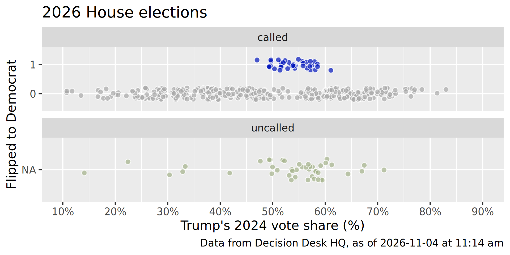
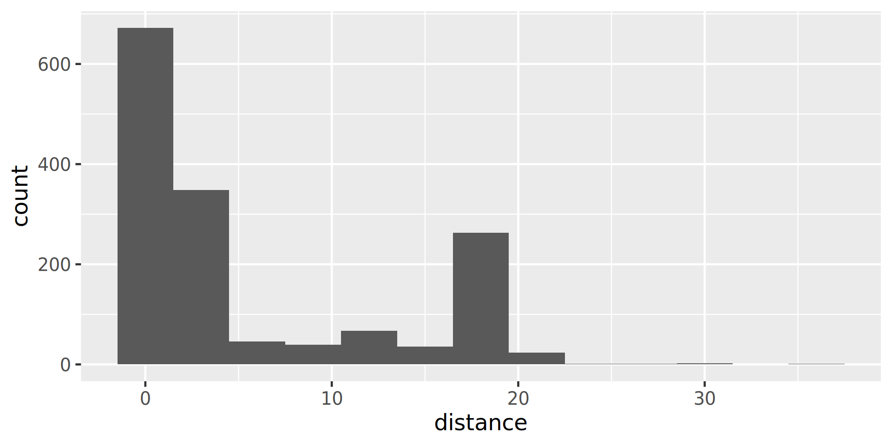
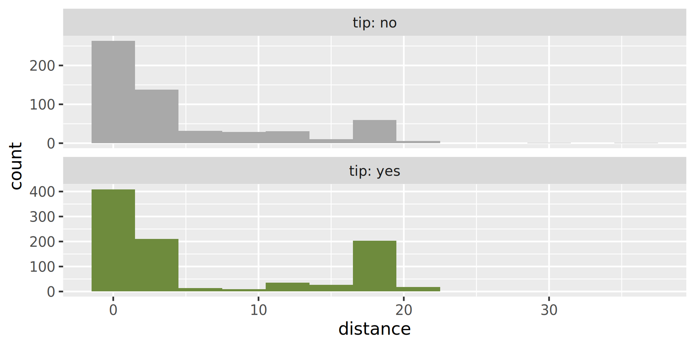
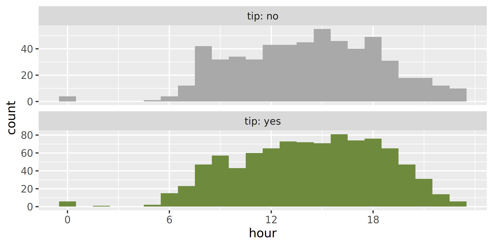
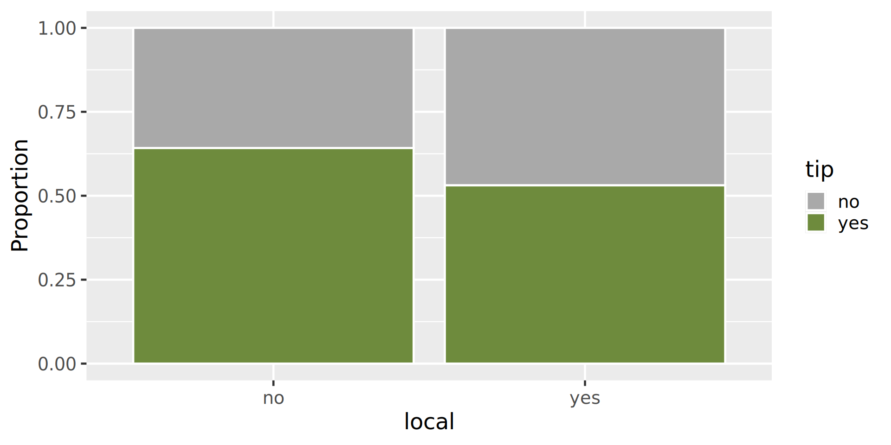
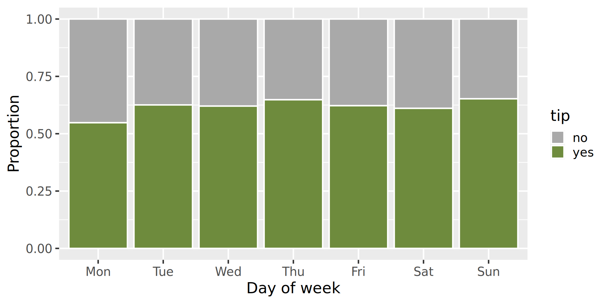
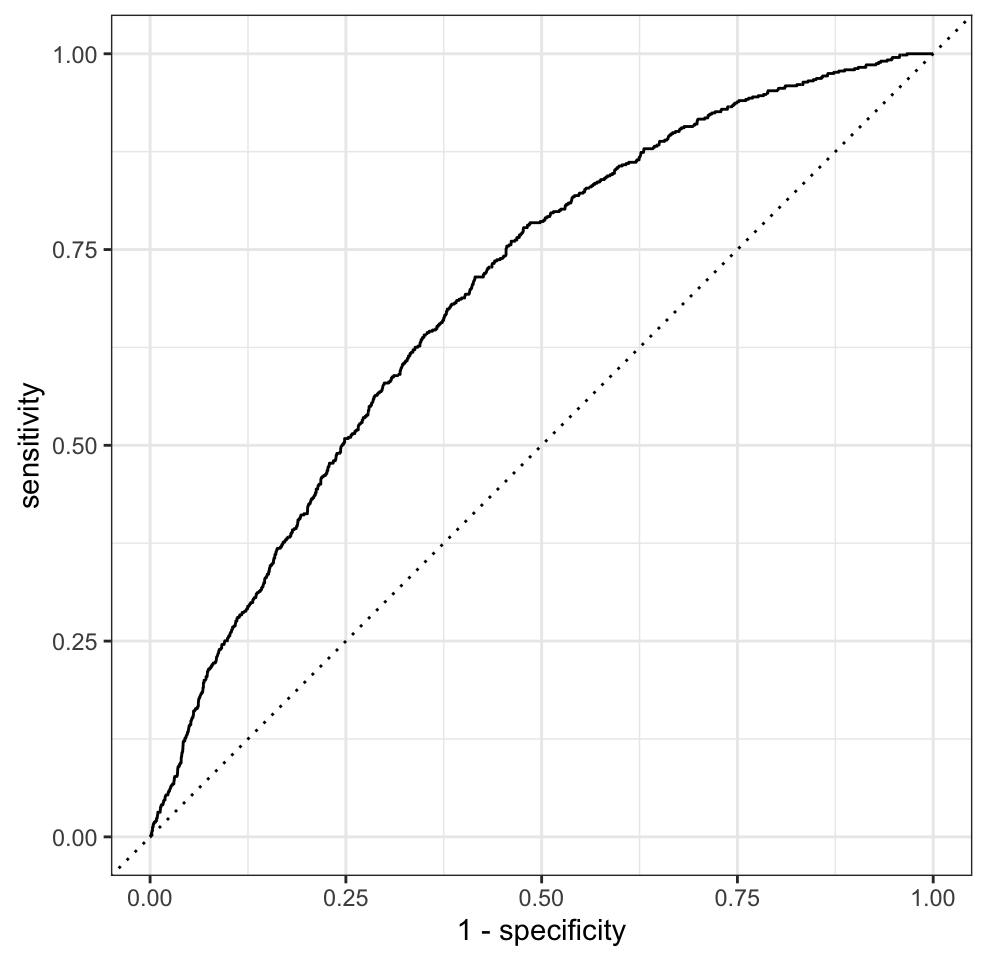
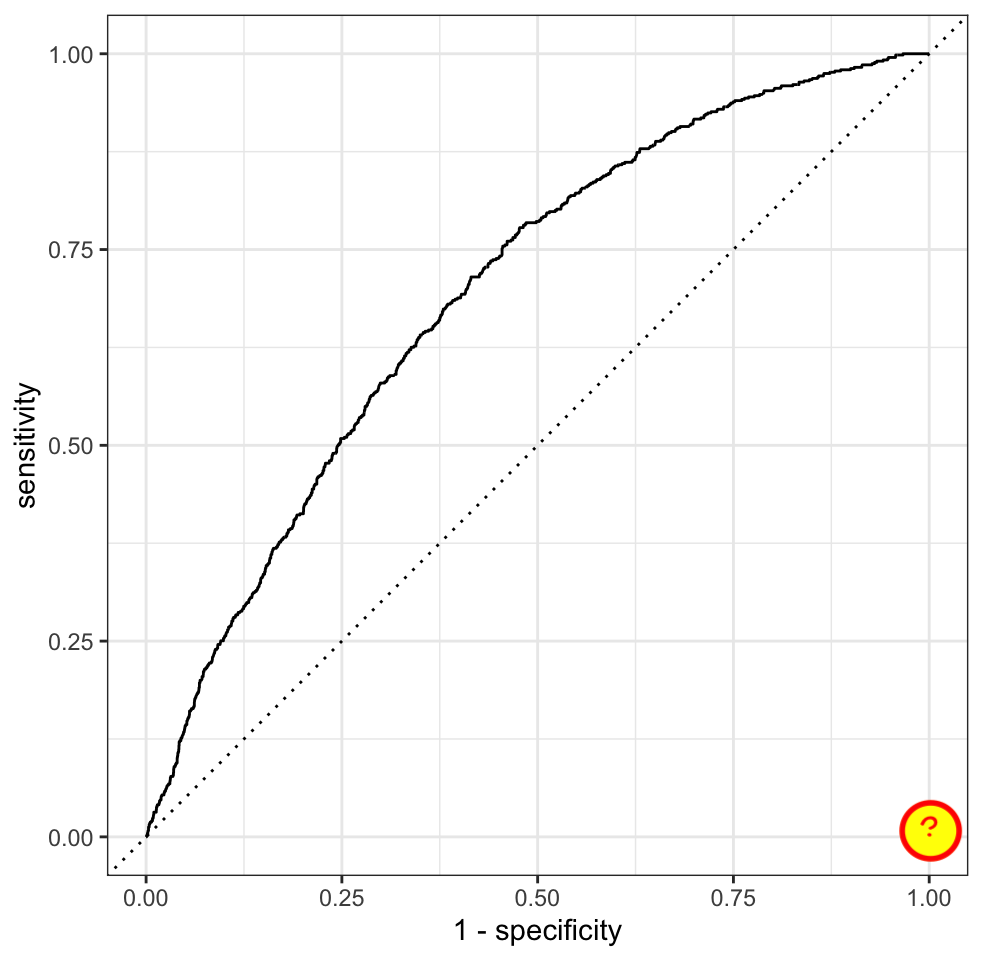

# Spending your data

Lecture 20

Author

Affiliation

Prof. Mine Çetinkaya-Rundel

Duke University\
STA 199 - Fall 2026

Published

November 4, 2026

# Warm-up

## While you wait: Participate 📱💻

Describe logistic regression and identify one aspect of it you are confused about / would like more clarity on.

[](images/20/wooclap-qr.png)

Go to [wooclap.com](https://app.wooclap.com/OMEXALN) and use the code OMEXALN.

## Announcements

- My office hours moved to Tuesday, Josh’s office hours are also updated:
  - Josh: Tuesday 2-3 pm + Wednesday 4-5 pm
  - Mine: Tuesday 3-4:30 pm

# From last time: Dem flips

## Packages

``` downlit
library(tidyverse) # data wrangling and visualization
library(tidymodels) # modeling
```

## Today’s data

2026 House results and projections from Decision Desk HQ (as of 2026-11-04, 11:14 am), merged with 2024 results (from the `gerrymander` dataset we worked with earlier in the semester):

``` downlit
midterm_26_raw <- read_csv("data/midterm-2026-11-04-11-14.csv")
```

``` downlit
glimpse(midterm_26_raw)
```

    Rows: 443
    Columns: 18
    $ district       <chr> "AK-00", "AL-01", "AL-02", "AL-03", "AL-04", "AL-05", "…
    $ state_abb      <chr> "AK", "AL", "AL", "AL", "AL", "AL", "AL", "AL", "AR", "…
    $ state          <chr> "Alaska", "Alabama", "Alabama", "Alabama", "Alabama", "…
    $ house_rep_20   <chr> "Don Young", "Jerry Carl", "Barry Moore", "Mike Rogers"…
    $ house_party_20 <chr> "Republican", "Republican", "Republican", "Republican",…
    $ house_rep_22   <chr> "Mary Sattler Peltola", "Jerry L Carl", "Barry Moore", …
    $ house_party_22 <chr> "Democrat", "Republican", "Republican", "Republican", "…
    $ house_rep_24   <chr> "Nick Begich", "Barry Moore", "Shomari Figures", "Mike …
    $ house_party_24 <chr> "Republican", "Republican", "Democrat", "Republican", "…
    $ harris_24      <dbl> 41.41, 21.89, 53.52, 26.18, 15.96, 34.20, 29.68, 61.45,…
    $ trump_24       <dbl> 54.54, 76.94, 45.31, 72.71, 83.02, 64.02, 68.47, 37.50,…
    $ gerry_22       <chr> NA, "F", "F", "F", "F", "F", "F", "F", "C", "C", "C", "…
    $ gerry_24       <chr> NA, "B", "B", "B", "B", "B", "B", "B", "C", "C", "C", "…
    $ gerry_26       <chr> NA, "B", "B", "B", "B", "B", "B", "B", "C", "C", "C", "…
    $ rating_26      <chr> "Lean R", "Safe R", "Lean R", "Safe R", "Safe R", "Safe…
    $ leader_26      <chr> "Republican", "Republican", "Democrat", "Republican", "…
    $ margin_26      <dbl> 9.00, 18.00, 8.00, 28.00, 50.00, 7.00, 15.00, 39.00, 35…
    $ called_26      <chr> "uncalled", "called", "called", "called", "called", "ca…

## Data prep

- A seat flips to Democrat if it was held by a Republican after 2024 and a Democrat leads in 2026:

``` downlit
midterm_26 <- midterm_26_raw |>
  mutate(
    flip_dem_24_26 = case_when(
      called_26 == "uncalled" ~ NA,
      called_26 == "called" & house_party_24 == "Republican" & leader_26 == "Democrat" ~ "1",
      called_26 == "called" & house_party_24 == "Republican" & leader_26 == "Republican" ~ "0",
      called_26 == "called" & house_party_24 == "Democrat" ~ "0",
    ),
    flip_dem_24_26 = as.factor(flip_dem_24_26)
  ) |>
  filter(!is.na(called_26))
```

- Data split:

``` downlit
midterm_26_called <- midterm_26 |> filter(called_26 == "called")
midterm_26_uncalled <- midterm_26 |> filter(called_26 == "uncalled")
```

## Goal

Predict whether a seat flips to Democrat based on Trump’s 2024 vote share for uncalled seats, using data from called seats.

Code

``` downlit
ggplot(
  midterm_26,
  aes(x = trump_24, y = flip_dem_24_26, fill = flip_dem_24_26)
) +
  geom_jitter(
    shape = "circle filled",
    height = 0.2,
    alpha = 0.7,
    size = 3,
    show.legend = FALSE,
    color = "white"
  ) +
  scale_fill_manual(
    values = c("0" = "darkgray", "1" = "#0015BC"),
    na.value = "#A3B18A"
  ) +
  scale_x_continuous(
    limits = c(10, 90),
    breaks = seq(0, 100, 10),
    labels = label_percent(scale = 1)
  ) +
  labs(
    x = "Trump's 2024 vote share (%)",
    y = "Flipped to Democrat",
    title = "2026 House elections",
    caption = "Data from Decision Desk HQ, as of 2026-11-04 at 11:14 am"
  ) +
  facet_wrap(~called_26, nrow = 2, scales = "free_y")
```

[](20-spending-your-data_files/figure-revealjs/flip-plot-1.png)

## Fitting a logistic model

``` downlit
flip_fit <- logistic_reg() |>
  fit(flip_dem_24_26 ~ trump_24, data = midterm_26_called)

tidy(flip_fit)
```

    # A tibble: 2 × 5
      term        estimate std.error statistic      p.value
      <chr>          <dbl>     <dbl>     <dbl>        <dbl>
    1 (Intercept)  -3.48      0.648      -5.37 0.0000000805
    2 trump_24      0.0244    0.0117      2.08 0.0372      

> **NOTE:**
>
> In logistic regression, we predict the log odds of the probability of success, \\\log\left(\frac{\hat{p}}{1-\hat{p}}\right)\\.

## Output \\\rightarrow\\ model

- Output

``` downlit
tidy(flip_fit)
```

    # A tibble: 2 × 5
      term        estimate std.error statistic      p.value
      <chr>          <dbl>     <dbl>     <dbl>        <dbl>
    1 (Intercept)  -3.48      0.648      -5.37 0.0000000805
    2 trump_24      0.0244    0.0117      2.08 0.0372      

. . .

- Fitted model:

\\ \log\left(\frac{\hat{p}}{1-\hat{p}}\right) = -3.48 + 0.0244\times trump\\24 \\

## The intercept

- If `trump_24 = 0`, then

\\ \begin{aligned} \log\left(\frac{\hat{p}}{1-\hat{p}}\right) &= b_0 + b_1 \times 0 \\ &= b_0 \\ \end{aligned} \\

. . .

- Exponentiating both sides:

\\ \begin{aligned} e^{\log\left(\frac{\hat{p}}{1-\hat{p}}\right)} &= e^{b_0} \\ \frac{\hat{p}}{1-\hat{p}} &= e^{b_0} \end{aligned} \\

## Interpreting the intercept

\\ \log\left(\frac{\hat{p}}{1-\hat{p}}\right) = -3.48 + 0.0244\times trump\\24 \\

------------------------------------------------------------------------

. . .

\\ e^{-3.48} = 0.03 \\

. . .

- Seats where Trump got 0% of the vote in 2024 are predicted, on average, to have a 3% odds of flipping to Democrat.

- Since Trump’s vote share in called seats ranges from 10.6% to 83%, so this is an extrapolation and not meaningful.

## The slope I

1.  Find log odds when the predictor is equal to \\x\\:

\\ log(odds_1) = {b_0} + {b_1x} \\

. . .

2.  Increase \\x\\ by one unit and find log odds when the predictor is equal to \\x + 1\\:

\\ log(odds_2) = {b_0} + {b_1(x + 1)} \\

## The slope II

Difference between the two log odds:

\\ \begin{aligned} log(odds_2) - log(odds_1) &= ({b_0} + {b_1 (x + 1)}) - ({b_0} + {b_1x}) \\ log\Big(\frac{odds_2}{odds_1}\Big) &= b_0 + b_1x + b_1 - b_0 - b_1x \\ log\Big(\frac{odds_2}{odds_1}\Big) &= b_1 \end{aligned} \\

## The slope III

Difference between the odds, by exponentiating both sides:

\\ \begin{aligned} log\Big(\frac{odds_2}{odds_1}\Big) &= b_1 \\ \frac{odds_2}{odds_1} &= e^{b_1} \end{aligned} \\

## Interpreting the slope

\\ \log\left(\frac{\hat{p}}{1-\hat{p}}\right) = -3.48 + 0.0244\times trump\\24 \\

------------------------------------------------------------------------

. . .

\\ e^{0.0244} \approx 1.02 \\

. . .

Seats where Trump’s 2024 vote share was one percentage point higher are predicted to have **odds** of flipping to Democrat that are **higher** by a factor of \\e^{0.0244}\approx 1.02\\, on average.

Classification\
(prediction by another name…)
=============================

## Predict

How well did our model do for predicting already called house seats?

``` downlit
midterm_26_called_aug <- augment(flip_fit, new_data = midterm_26_called)

midterm_26_called_aug |>
  count(flip_dem_24_26, .pred_class)
```

    # A tibble: 2 × 3
      flip_dem_24_26 .pred_class     n
      <fct>          <fct>       <int>
    1 0              0             353
    2 1              0              38

Terrible!

Is that surprising?

## Predict for uncalled seats

``` downlit
midterm_26_uncalled_aug <- augment(flip_fit, new_data = midterm_26_uncalled)
```

``` downlit
midterm_26_uncalled_aug |>
  select(district, trump_24, house_party_24, starts_with(".pred_"), leader_26) |>
  print(n = 44)
```

    # A tibble: 44 × 7
       district trump_24 house_party_24 .pred_class .pred_0 .pred_1 leader_26 
       <chr>       <dbl> <chr>          <fct>         <dbl>   <dbl> <chr>     
     1 AK-00        54.5 Republican     0             0.895  0.105  Republican
     2 AZ-01        50.9 Republican     0             0.903  0.0967 Democrat  
     3 AZ-02        56.9 Republican     0             0.890  0.110  Democrat  
     4 AZ-05        59.2 Republican     0             0.884  0.116  Republican
     5 AZ-08        57.5 Republican     0             0.888  0.112  Republican
     6 CA-04        32.8 Democrat       0             0.936  0.0645 Democrat  
     7 CA-05        57.6 Republican     0             0.888  0.112  Republican
     8 CA-07        33.4 Democrat       0             0.935  0.0652 Democrat  
     9 CA-11        14.1 Democrat       0             0.958  0.0418 Democrat  
    10 CA-14        30.4 Democrat       0             0.939  0.0609 Democrat  
    11 CA-23        57.1 Republican     0             0.889  0.111  Republican
    12 CA-34        22.4 Democrat       0             0.949  0.0508 Democrat  
    13 CA-40        49.5 Republican     0             0.906  0.0938 Republican
    14 CO-03        53.6 Republican     0             0.897  0.103  Republican
    15 CO-04        57.9 Republican     0             0.887  0.113  Democrat  
    16 CO-05        53.2 Republican     0             0.898  0.102  Democrat  
    17 FL-07        55.6 Republican     0             0.893  0.107  Republican
    18 FL-09        47.6 Democrat       0             0.910  0.0900 Democrat  
    19 FL-26        67.0 Republican     0             0.863  0.137  Republican
    20 FL-27        56.7 Republican     0             0.890  0.110  Republican
    21 LA-05        67.4 Republican     0             0.862  0.138  Democrat  
    22 LA-06        41.8 Democrat       0             0.921  0.0790 Democrat  
    23 ME-02        53.8 Democrat       0             0.897  0.103  Republican
    24 MI-04        51.9 Republican     0             0.901  0.0989 Democrat  
    25 MI-07        49.8 Republican     0             0.906  0.0945 Democrat  
    26 MI-10        52.2 Republican     0             0.900  0.0996 Democrat  
    27 MN-01        55.1 Republican     0             0.894  0.106  Democrat  
    28 NC-03        60.3 Republican     0             0.881  0.119  Republican
    29 NC-05        58.2 Republican     0             0.886  0.114  Democrat  
    30 NC-07        56.3 Republican     0             0.891  0.109  Republican
    31 NC-08        59.1 Republican     0             0.884  0.116  Republican
    32 NC-10        58.2 Republican     0             0.887  0.113  Republican
    33 NY-01        54.3 Republican     0             0.896  0.104  Republican
    34 NY-02        56.8 Republican     0             0.890  0.110  Republican
    35 NY-17        49.4 Republican     0             0.907  0.0935 Democrat  
    36 NY-21        60.1 Republican     0             0.882  0.118  Republican
    37 TN-04        71.2 Republican     0             0.851  0.149  Democrat  
    38 TX-02        61.3 Republican     0             0.879  0.121  Republican
    39 TX-22        58.7 Republican     0             0.885  0.115  Republican
    40 TX-27        64.4 Republican     0             0.871  0.129  Republican
    41 TX-38        59.4 Republican     0             0.883  0.117  Republican
    42 WA-03        50.0 Democrat       0             0.905  0.0947 Democrat  
    43 WA-04        58.7 Republican     0             0.885  0.115  Republican
    44 WA-05        53.6 Republican     0             0.897  0.103  Republican

## Application exercise

- Go to your ae project in Positron.

- If you haven’t yet done so, make sure all of your changes up to this point are committed and pushed, i.e., there’s nothing left in your source control pane.

- If you haven’t yet done so, pull to get today’s application exercise file: `ae-11-dem-flips-logistic.qmd`.

- Work through the application exercise in class, and render, commit, and push your edits by the end of class.

# Spending your data

## Data

- Taxi trips in Chicago, IL in 2022

- Data from [Chicago Data Portal](https://data.cityofchicago.org/Transportation/Taxi-Trips/wrvz-psew)

## Data: `chicago_taxi`

``` downlit
chicago_taxi <- read_csv("data/chicago-taxi.csv")
```

``` downlit
chicago_taxi
```

    # A tibble: 2,000 × 7
       tip   distance company                      local dow   month  hour
       <chr>    <dbl> <chr>                        <chr> <chr> <chr> <dbl>
     1 no        0.4  other                        yes   Fri   Mar      17
     2 no        0.96 Taxicab Insurance Agency Llc no    Mon   Apr       8
     3 no        1.07 Sun Taxi                     no    Fri   Feb      15
     4 no        1.13 other                        no    Sat   Feb      14
     5 no       10.8  Sun Taxi                     no    Sat   Apr      14
     6 no        3.6  Chicago Independents         no    Wed   Mar      12
     7 no        1.08 Flash Cab                    yes   Wed   Mar      13
     8 no        0.85 Taxicab Insurance Agency Llc no    Tue   Mar       8
     9 no       17.9  City Service                 no    Tue   Jan      20
    10 no        0    City Service                 yes   Sun   Apr      16
    # ℹ 1,990 more rows

## Data: `chicago_taxi`

``` downlit
glimpse(chicago_taxi)
```

    Rows: 2,000
    Columns: 7
    $ tip      <chr> "no", "no", "no", "no", "no", "no", "no", "no", "no", "no", "…
    $ distance <dbl> 0.40, 0.96, 1.07, 1.13, 10.81, 3.60, 1.08, 0.85, 17.92, 0.00,…
    $ company  <chr> "other", "Taxicab Insurance Agency Llc", "Sun Taxi", "other",…
    $ local    <chr> "yes", "no", "no", "no", "no", "no", "yes", "no", "no", "yes"…
    $ dow      <chr> "Fri", "Mon", "Fri", "Sat", "Sat", "Wed", "Wed", "Tue", "Tue"…
    $ month    <chr> "Mar", "Apr", "Feb", "Feb", "Apr", "Mar", "Mar", "Mar", "Jan"…
    $ hour     <dbl> 17, 8, 15, 14, 14, 12, 13, 8, 20, 16, 20, 8, 15, 15, 12, 0, 1…

## Data prep

``` downlit
chicago_taxi <- chicago_taxi |>
  mutate(
    tip = fct_relevel(tip, "no", "yes"),
    local = fct_relevel(local, "no", "yes"),
    dow = fct_relevel(dow, "Mon", "Tue", "Wed", "Thu", "Fri", "Sat", "Sun"),
    month = fct_relevel(month, "Jan", "Feb", "Mar", "Apr")
  )
```

## Outcome and predictors

- Outcome - `tip`: Whether rider left a tip – a factor w/ levels “yes” and “no”
- (Potential) predictors:
  - Numerical:
    - `distance`: The trip distance, in odometer miles.
    - `hour`: The hour of the day in which the trip began.
  - Categorical:
    - `company`: The taxi company – companies that occurred few times were binned as “other”.
    - `local`: Whether the trip started in the same community area as it began.
    - `dow`: The day of the week in which the trip began.
    - `month`: The month in which the trip began.

## Should we include a predictor?

To determine whether we should include a predictor in a model, we should start by asking:

- Is it ethical to use this variable? (Or even legal?)

- Will this variable be available at prediction time?

- Does this variable contribute to explainability?

# Data splitting and spending

## We’ve been cheating!

- So far, we’ve been using all the data we have for building models. In predictive contexts, this would be considered *cheating*.

- Evaluating model performance for predicting outcomes that were used when building the models is like evaluating your learning with questions whose answers you’ve already seen.

## Spending your data

For predictive models (used primarily in machine learning), we typically split data into training and test sets:

[](images/20/test-train-split-1.svg)

- The **training set** is used to estimate model parameters.

- The **test set** is used to find an independent assessment of model performance.

. . .

> **WARNING:**
>
> Do not use, or even peek at, the test set during training.

## How much to spend?

- The more data we spend (use in training), the better estimates we’ll get.

- Spending too much data in training prevents us from computing a good assessment of predictive performance.

- Spending too much data in testing prevents us from computing a good estimate of model parameters.

## The initial split

``` downlit
set.seed(20261108)
chicago_taxi_split <- initial_split(chicago_taxi)
chicago_taxi_split
```

    <Training/Testing/Total>
    <1500/500/2000>

## Setting a seed

What does [`set.seed()`](https://rdrr.io/r/base/Random.html) do?

- To create that split of the data, R generates “pseudo-random” numbers: while they are made to behave like random numbers, their generation is deterministic given a “seed”.

- This allows us to reproduce results by setting that seed.

- Which seed you pick doesn’t matter, as long as you don’t try a bunch of seeds and pick the one that gives you the best performance.

## Accessing the data

``` downlit
chicago_taxi_train <- training(chicago_taxi_split)
chicago_taxi_test <- testing(chicago_taxi_split)
```

## The training set

``` downlit
chicago_taxi_train
```

    # A tibble: 1,500 × 7
       tip   distance company      local dow   month  hour
       <fct>    <dbl> <chr>        <fct> <fct> <fct> <dbl>
     1 yes      12.0  Flash Cab    no    Tue   Jan      13
     2 no        0.03 City Service yes   Sat   Apr      22
     3 no        7.66 Sun Taxi     no    Thu   Feb      14
     4 yes       1.57 other        no    Thu   Feb      18
     5 no        6.26 Flash Cab    no    Wed   Feb       9
     6 yes      18.0  City Service no    Thu   Mar      19
     7 yes       0.75 Sun Taxi     no    Mon   Feb      10
     8 yes       1.31 Sun Taxi     no    Sun   Feb      14
     9 yes      17.5  City Service no    Wed   Feb       7
    10 yes       9.95 City Service no    Sun   Jan      19
    # ℹ 1,490 more rows

## The testing data

. . .

🙈

# Exploratory data analysis

## Initial questions

- What’s the distribution of the outcome, `tip`?

- What’s the distribution of numeric variables like `distance` or `hour`?

- How does the distribution of `tip` differ across the categorical and numerical variables?

## Participate 📱💻

Which dataset should we use for the exploration?

- The entire data `chicago_taxi`
- The training data `chicago_taxi_train`
- The testing data `chicago_taxi_test`

[](images/20/wooclap-qr.png)

Go to [wooclap.com](https://app.wooclap.com/OMEXALN) and use the code OMEXALN.

## `tip`

What’s the distribution of the outcome, `tip`?

Code

``` downlit
chicago_taxi_train |>
  count(tip) |>
  mutate(prop = n / sum(n))
```

    # A tibble: 2 × 3
      tip       n  prop
      <fct> <int> <dbl>
    1 no      571 0.381
    2 yes     929 0.619

## `distance`

What’s the distribution of `distance`?

Code

``` downlit
ggplot(chicago_taxi_train, aes(x = distance)) +
  geom_histogram(binwidth = 3)
```

[](20-spending-your-data_files/figure-revealjs/unnamed-chunk-13-1.png)

## `tip` and `distance`

Code

``` downlit
ggplot(chicago_taxi_train, aes(x = distance, fill = tip, group = tip)) +
  geom_histogram(binwidth = 3, show.legend = FALSE) +
  scale_fill_manual(values = c("yes" = "darkolivegreen4", "no" = "darkgray")) +
  facet_wrap(~tip, ncol = 1, labeller = label_both, scales = "free_y")
```

[](20-spending-your-data_files/figure-revealjs/unnamed-chunk-14-1.png)

## `tip` and `hour`

Code

``` downlit
ggplot(chicago_taxi_train, aes(x = hour, fill = tip, group = tip)) +
  geom_histogram(binwidth = 1, show.legend = FALSE) +
  scale_fill_manual(values = c("yes" = "darkolivegreen4", "no" = "darkgray")) +
  scale_x_continuous(breaks = seq(0, 18, by = 6)) +
  facet_wrap(~tip, ncol = 1, labeller = label_both, scales = "free_y")
```

[](20-spending-your-data_files/figure-revealjs/unnamed-chunk-15-1.png)

## `tip` and `local`

``` numberSource
ggplot(chicago_taxi_train, aes(x = local, fill = tip)) +
  geom_bar(position = "fill", color = "white") +
  scale_fill_manual(values = c("yes" = "darkolivegreen4", "no" = "darkgray")) +
  labs(y = "Proportion")
```

[](20-spending-your-data_files/figure-revealjs/unnamed-chunk-16-1.png)

## `tip` and `dow`

Code

``` downlit
ggplot(chicago_taxi_train, aes(x = dow, fill = tip)) +
  geom_bar(position = "fill", color = "white") +
  scale_fill_manual(values = c("yes" = "darkolivegreen4", "no" = "darkgray")) +
  labs(y = "Proportion", x = "Day of week")
```

[](20-spending-your-data_files/figure-revealjs/unnamed-chunk-17-1.png)

# Terminology

## False negative and positive

- **False negative rate** is the proportion of actual positives that were classified as negatives.

- **False positive rate** is the proportion of actual negatives that were classified as positives.

## Sensitivity

**Sensitivity** is the proportion of actual positives that were correctly classified as positive.

- Also known as **true positive rate** and **recall**

- Sensitivity = 1 − False negative rate

- Useful when false negatives are more “expensive” than false positives

## Specificity

**Specificity** is the proportion of actual negatives that were correctly classified as negative

- Also known as **true negative rate**

- Specificity = 1 − False positive rate

## ROC curve

The **receiver operating characteristic (ROC) curve** allows to assess the model performance across a range of thresholds.

[](images/20/roc-curve.png)

## Participate 📱💻

Which of the following best describes the area annotated on the ROC curve?

[](images/20/roc-curve-annotated-question.png)

- Where all positives classified as positive, all negatives classified as negative
- Where true positive rate = false positive rate
- Where all positives classified as negative, all negatives classified as positive

[](images/20/wooclap-qr.png)

Go to [wooclap.com](https://app.wooclap.com/OMEXALN) and use the code OMEXALN.
