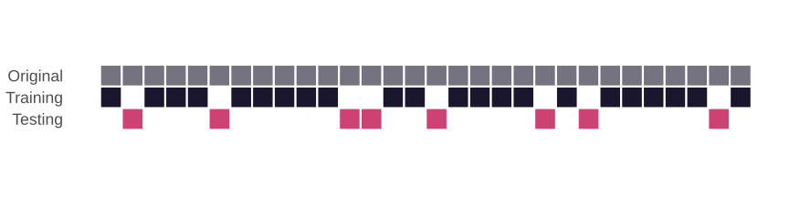
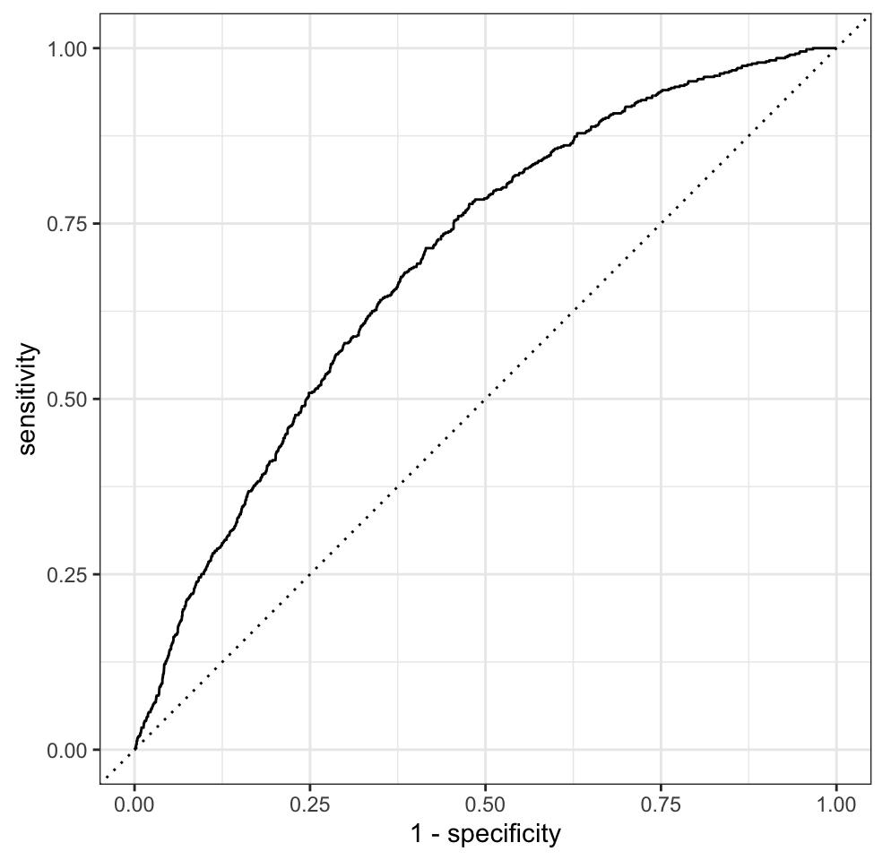
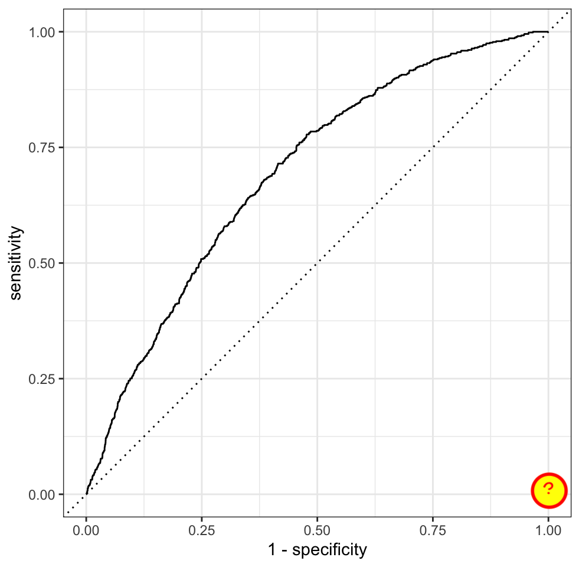
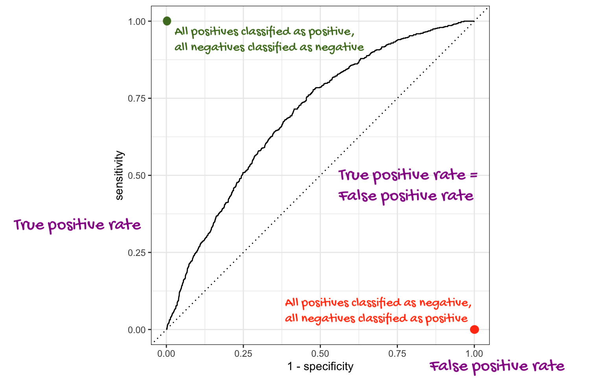

```{r}
#| label: setup
#| include: false
library(tidyverse)
library(tidymodels)
library(patchwork)
library(scales)
library(janitor)

conflicted::conflict_prefer("select", "dplyr")
conflicted::conflict_prefer("filter", "dplyr")

ggplot2::theme_set(ggplot2::theme_gray(base_size = 18))

nc_places <- read_csv(
  here::here("slides", "data/nc-places.csv"),
  show_col_types = FALSE
)
```

# Warm-up

## While you wait: Participate 📱💻 {.xsmall}

::: columns

::: {.column width="70%"}

::: wooclap

What does `set.seed()` do?

::: wooclap-choices
- It generates a random number each time it is called.
- It seeds the data randomly.
- It sets the random number generator to a specific state so results are reproducible.
- It avoids skewness in results.
:::

:::

:::

::: {.column width="30%"}

{width="200" fig-align="center" fig-alt="QR code for Wooclap"}

Go to [wooclap.com](https://app.wooclap.com/ZUDFZMY) and use the code ZUDFZMY.

:::

:::

## Announcements {.smaller}

- HW 6 due tonight 11:59 pm

- Project write-up due Friday 11:59 pm -- any questions?

- Exam 2 review will be posted tomorrow and over the weekend I'll ask you to submit questions for Monday's review

- Exam 2 is on Wednesday -- get here on time please!

# Spending your data

## Data

-   Taxi trips in Chicago, IL in 2022

-   Data from [Chicago Data Portal](https://data.cityofchicago.org/Transportation/Taxi-Trips/wrvz-psew)

## Data: `chicago_taxi` {.smaller}

```{r}
#| include: false
chicago_taxi <- read_csv(here::here("slides", "data/chicago-taxi.csv"))
```

```{r}
#| eval: false
chicago_taxi <- read_csv("data/chicago-taxi.csv")
```

```{r}
chicago_taxi
```

## Data: `chicago_taxi` {.smaller}

```{r}
glimpse(chicago_taxi)
```

## Data prep

```{r}
chicago_taxi <- chicago_taxi |>
  mutate(
    tip = fct_relevel(tip, "no", "yes"),
    local = fct_relevel(local, "no", "yes"),
    dow = fct_relevel(dow, "Mon", "Tue", "Wed", "Thu", "Fri", "Sat", "Sun"),
    month = fct_relevel(month, "Jan", "Feb", "Mar", "Apr")
  )
```

## Outcome and predictors {.smaller}

- Outcome - `tip`: Whether rider left a tip -- a factor w/ levels "yes" and "no"
- (Potential) predictors:
  - Numerical:
    - `distance`: The trip distance, in odometer miles.
    - `hour`: The hour of the day in which the trip began.
  - Categorical:
    - `company`: The taxi company -- companies that occurred few times were binned as "other".
    - `local`: Whether the trip started in the same community area as it began.
    - `dow`: The day of the week in which the trip began.
    - `month`: The month in which the trip began.

## Should we include a predictor?

To determine whether we should include a predictor in a model, we should start by asking:

::: incremental
-   Is it ethical to use this variable?
    (Or even legal?)

-   Will this variable be available at prediction time?

-   Does this variable contribute to explainability?
:::

# Data splitting and spending

## We've been cheating!

::: incremental
-   So far, we've been using all the data we have for building models.
    In predictive contexts, this would be considered *cheating*.

-   Evaluating model performance for predicting outcomes that were used when building the models is like evaluating your learning with questions whose answers you've already seen.
:::

## Spending your data {.smaller}

For predictive models (used primarily in machine learning), we typically split data into training and test sets:

{fig-align="center"}

-   The **training set** is used to estimate model parameters.

-   The **test set** is used to find an independent assessment of model performance.

. . .

::: callout-warning
Do not use, or even peek at, the test set during training.
:::

## How much to spend?

::: incremental

-   The more data we spend (use in training), the better estimates we’ll get.

-   Spending too much data in training prevents us from computing a good assessment of predictive performance.

-   Spending too much data in testing prevents us from computing a good estimate of model parameters.

:::

## The initial split

```{r}
#| label: initial-split
set.seed(20261108)
chicago_taxi_split <- initial_split(chicago_taxi)
chicago_taxi_split
```

## Setting a seed {.smaller}

::: task
What does `set.seed()` do?
:::

::: incremental
-   To create that split of the data, R generates “pseudo-random” numbers: while they are made to behave like random numbers, their generation is deterministic given a “seed”.

-   This allows us to reproduce results by setting that seed.

-   Which seed you pick doesn’t matter, as long as you don’t try a bunch of seeds and pick the one that gives you the best performance.
:::

## Accessing the data

```{r}
#| label: access-data
chicago_taxi_train <- training(chicago_taxi_split)
chicago_taxi_test <- testing(chicago_taxi_split)
```

## The training set {.smaller}

```{r}
chicago_taxi_train
```

## The testing data

. . .

::: huge
🙈
:::

# Exploratory data analysis

## Initial questions {.smaller}

-   What's the distribution of the outcome, `tip`?

-   What's the distribution of numeric variables like `distance` or `hour`?

-   How does the distribution of `tip` differ across the categorical and numerical variables?

## Participate 📱💻 {.xsmall}

::: columns

::: {.column width="70%"}

::: wooclap

Which dataset should we use for the exploration?

::: wooclap-choices
- The entire data `chicago_taxi`
- The training data `chicago_taxi_train`
- The testing data `chicago_taxi_test`
:::

:::

:::

::: {.column width="30%"}

{width="200" fig-align="center" fig-alt="QR code for Wooclap"}

Go to [wooclap.com](https://app.wooclap.com/ZUDFZMY) and use the code ZUDFZMY.

:::

:::

## `tip`

What’s the distribution of the outcome, `tip`?

```{r}
#| code-fold: true
chicago_taxi_train |>
  count(tip) |>
  mutate(prop = n / sum(n))
```

## `distance`

What’s the distribution of `distance`?

```{r}
#| code-fold: true
ggplot(chicago_taxi_train, aes(x = distance)) +
  geom_histogram(binwidth = 3)
```

## `tip` and `distance` {.smaller}

```{r}
#| code-fold: true
ggplot(chicago_taxi_train, aes(x = distance, fill = tip, group = tip)) +
  geom_histogram(binwidth = 3, show.legend = FALSE) +
  scale_fill_manual(values = c("yes" = "darkolivegreen4", "no" = "darkgray")) +
  facet_wrap(~tip, ncol = 1, labeller = label_both, scales = "free_y")
```

## `tip` and `hour`

```{r}
#| code-fold: true
ggplot(chicago_taxi_train, aes(x = hour, fill = tip, group = tip)) +
  geom_histogram(binwidth = 1, show.legend = FALSE) +
  scale_fill_manual(values = c("yes" = "darkolivegreen4", "no" = "darkgray")) +
  scale_x_continuous(breaks = seq(0, 18, by = 6)) +
  facet_wrap(~tip, ncol = 1, labeller = label_both, scales = "free_y")
```

## `tip` and `local` {.smaller}

```{r}
#| code-line-numbers: "|2"
ggplot(chicago_taxi_train, aes(x = local, fill = tip)) +
  geom_bar(position = "fill", color = "white") +
  scale_fill_manual(values = c("yes" = "darkolivegreen4", "no" = "darkgray")) +
  labs(y = "Proportion")
```

## `tip` and `dow` {.smaller}

```{r}
#| code-fold: true
ggplot(chicago_taxi_train, aes(x = dow, fill = tip)) +
  geom_bar(position = "fill", color = "white") +
  scale_fill_manual(values = c("yes" = "darkolivegreen4", "no" = "darkgray")) +
  labs(y = "Proportion", x = "Day of week")
```

# Terminology

## False negative and positive

-   **False negative rate** is the proportion of actual positives that were classified as negatives.

-   **False positive rate** is the proportion of actual negatives that were classified as positives.

## Sensitivity

**Sensitivity** is the proportion of actual positives that were correctly classified as positive.

-   Also known as **true positive rate** and **recall**

-   Sensitivity = 1 − False negative rate

-   Useful when false negatives are more "expensive" than false positives

## Specificity

**Specificity** is the proportion of actual negatives that were correctly classified as negative

-   Also known as **true negative rate**

-   Specificity = 1 − False positive rate

## ROC curve

::: {.columns}

::: {.column width="40%"}

The **receiver operating characteristic (ROC) curve** allows to assess the model performance across a range of thresholds.

:::

::: {.column width="60%"}



:::

:::


## Participate 📱💻 {.xsmall}

::: columns

::: {.column width="70%"}

::: wooclap

Which of the following best describes the area annotated on the ROC curve?

{width="350" fig-align="center"}

::: wooclap-choices
- Where all positives classified as positive, all negatives classified as negative
- Where true positive rate = false positive rate
- Where all positives classified as negative, all negatives classified as positive
:::

:::

:::

::: {.column width="30%"}

{width="200" fig-align="center" fig-alt="QR code for Wooclap"}

Go to [wooclap.com](https://app.wooclap.com/ZUDFZMY) and use the code ZUDFZMY.

:::

:::

## ROC curve {.smaller}

::: task
Which corner of the plot indicates the best model performance?
:::



# Next steps

## Application exercise {.smaller}

::: appex
-   Go to your ae project in Positron.

-   If you haven't yet done so, make sure all of your changes up to this point are committed and pushed, i.e., there's nothing left in your source control pane.

-   If you haven't yet done so, pull to get today's application exercise file: `ae-12-chicago-taxi-classification.qmd`.

-   Work through the application exercise in class, and render, commit, and push your edits by the end of class.
:::

## Recap {.smaller}

::: incremental
- Split data into training and testing sets (generally 75/25)

- Fit models on training data and reduce to a few candidate models

- Make predictions on testing data

- Evaluate predictions on testing data using appropriate predictive performance metrics
  - Linear models: Adjusted R-squared, AIC, etc.
  - Logistic models: False negative and positive rates, AUC (area under the curve), etc.

- Don't forget to also consider explainability and domain knowledge when selecting a final model

- In a future machine learning course: Cross-validation (partitioning training data into training and validation sets and repeating this many times to evaluate model predictive performance before using the testing data), feature engineering,  hyperparameter tuning, more complex models (random forests, gradient boosting machines, neural networks, etc.)
:::

. . .

::: callout-note
We will only learn about a subset of these in this course, but you can go further into these ideas in STA 210 or STA 221 as well as in various machine learning courses.
:::
