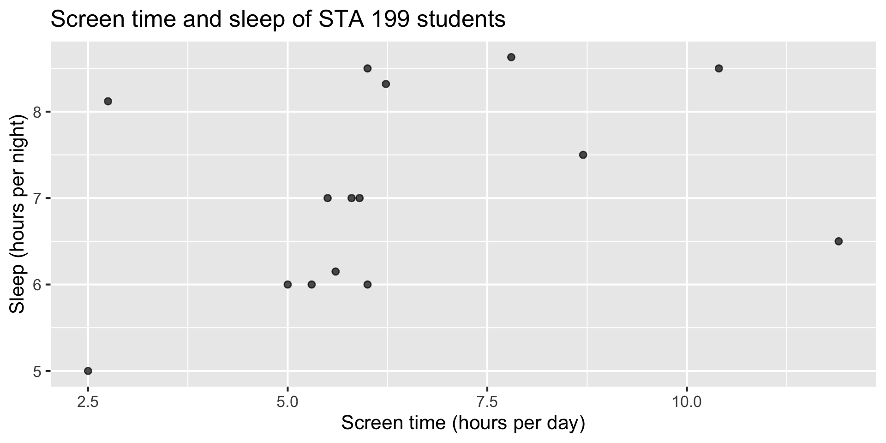
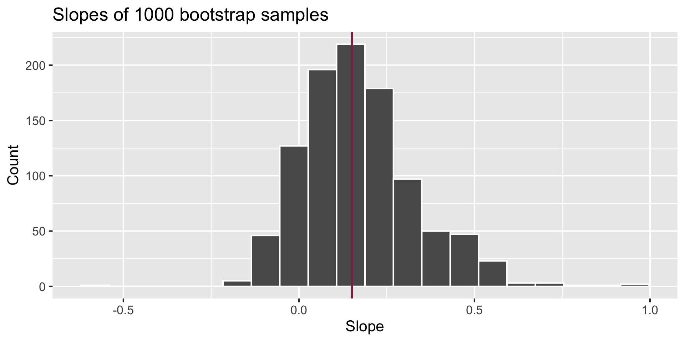

# Quantifying uncertainty

Lecture 23

Author

Affiliation

Prof. Mine Çetinkaya-Rundel

Duke University\
STA 199 - Fall 2026

Published

November 16, 2026

# Warm-up

## Participate 📱💻

How many people do you think will be in class today?

[](images/23/wooclap-qr.png)

Go to [wooclap.com](https://app.wooclap.com/SAXPGIL) and use the code SAXPGIL.

## Announcements

- HW 7 will be posted tomorrow, due Wednesday Dec 2

- Final exam week:

  - Review session (optional): Monday, Dec 7, 10 am - 11:15 am
  - Office hours schedule will look different (to provide more timely help + accommodate TAs’ final exam schedules), to be posted next week

# Quantifying uncertainty

## Goal

Find range of plausible values for the slope using bootstrap confidence intervals.

## Packages

``` downlit
# load packages
library(tidyverse) # for data wrangling and visualization
library(tidymodels) # for modeling
library(scales) # for pretty axis labels
library(knitr) # for neatly formatted tables
```

## Statistical inference

- **Statistical inference** provide methods and tools so we can use the single observed sample to make valid statements (inferences) about the population it comes from

- For our inferences to be valid, the sample should be random and representative of the population we’re interested in

[](images/23/soup.png)

## Inference for simple linear regression

- Calculate a confidence interval for the slope, \\\beta_1\\ (today)

- Conduct a hypothesis test for the slope,\\\beta_1\\ (next week)

# Confidence interval for the slope

## Confidence interval

- A plausible range of values for a population parameter is called a **confidence interval**
- Using only a single point estimate is like fishing in a murky lake with a spear, and using a confidence interval is like fishing with a net
  - We can throw a spear where we saw a fish but we will probably miss, if we toss a net in that area, we have a good chance of catching the fish
  - Similarly, if we report a point estimate, we probably will not hit the exact population parameter, but if we report a range of plausible values we have a good shot at capturing the parameter

## Quantify the variability of the slope

**for estimation**

- Two approaches:
  1.  Via simulation (what we’ll do in this course)
  2.  Via mathematical models (what you can learn about in future courses)
- **Bootstrapping** to quantify the variability of the slope for the purpose of estimation:
  - Bootstrap new samples from the original sample
  - Fit models to each of the samples and estimate the slope
  - Use features of the distribution of the bootstrapped slopes to construct a confidence interval

# Example: Screen time and sleep

## Participate 📱💻

Do you think there’s a relationship between screen time and sleep duration? If so, in which direction?

- Yes, positive: more screen time, more sleep
- Yes, negative: more screen time, less sleep
- No, there’s no relationship
- Not sure

[](images/23/wooclap-qr.png)

Go to [wooclap.com](https://app.wooclap.com/SAXPGIL) and use the code SAXPGIL.

## Screen use at bedtime and sleep

> Among 79 youths (ages 11-14) in New Zealand whose bedtime screen use was recorded on video, screen use in the 2 hours before bed was not associated with most sleep measures, but every additional 10 minutes of screen time *once in bed* was associated with about 3 minutes less total sleep.

\

Brosnan B, Haszard JJ, Meredith-Jones KA, Wickham S, Galland BC, Taylor RW. Screen use at bedtime and sleep duration and quality among youths. *JAMA Pediatrics*. 2024;178(11):1147-1154. doi:[10.1001/jamapediatrics.2024.2914](https://jamanetwork.com/journals/jamapediatrics/fullarticle/2822859)

## Smartphone screen time and sleep

> Among 653 adults whose smartphone screen time was measured directly by an app over 30 days, longer average screen time was associated with shorter sleep duration and worse sleep efficiency, and screen time around bedtime was associated with poorer sleep quality and taking longer to fall asleep.

\

Christensen MA, Bettencourt L, Kaye L, Moturu ST, Nguyen KT, Olgin JE, Pletcher MJ, Marcus GM. Direct measurements of smartphone screen-time: Relationships with demographics and sleep. *PLOS ONE*. 2016;11(11):e0165331. doi:[10.1371/journal.pone.0165331](https://journals.plos.org/plosone/article?id=10.1371/journal.pone.0165331)

## Bedtime screen use behaviors and sleep

> Among 10,280 early adolescents (ages 10-14) in the Adolescent Brain Cognitive Development (ABCD) Study, several bedtime screen behaviors, such as leaving a phone ringer on overnight, streaming movies, playing video games, texting, and using social media, were associated with trouble falling or staying asleep.

\

Nagata JM, Singh G, Yang JH, Smith N, Kiss O, Ganson KT, Testa A, Jackson DB, Baker FC. Bedtime screen use behaviors and sleep outcomes: Findings from the Adolescent Brain Cognitive Development (ABCD) Study. *Sleep Health*. 2023;9(4):497-502. doi:[10.1016/j.sleh.2023.02.005](https://www.sciencedirect.com/science/article/pii/S2352721823000347)

## Goal

What is the relationship between screen time and sleep among Duke students?

- Data: **you!** We’ve collected overnight, from some of you, with a Google Form.
- **Population:** All Duke undergrads this semester.
- **Sample:** The students in this class who fill out the form.

. . .

Is this a random sample of Duke undergrads? What, if any, reservations do you have about the representativeness of this sample for all Duke undergrads?

## Survey

Loading…

## The data

Code

``` downlit
ggplot(screen_sleep, aes(x = screen, y = sleep)) +
  geom_point(alpha = 0.7) +
  labs(
    x = "Screen time (hours per day)",
    y = "Sleep (hours per night)",
    title = "Screen time and sleep of STA 199 students"
  )
```

[](23-quantifying-uncertainty_files/figure-revealjs/screen-sleep-eda-1.png)

## Modeling

``` downlit
screen_sleep_fit <- linear_reg() |>
  fit(sleep ~ screen, data = screen_sleep)

tidy(screen_sleep_fit) |>
  kable(digits = 2)
```

| term        | estimate | std.error | statistic | p.value |
|:------------|---------:|----------:|----------:|--------:|
| (Intercept) |     6.12 |      0.81 |      7.53 |    0.00 |
| screen      |     0.15 |      0.12 |      1.26 |    0.23 |

. . .

Interpret the slope in context of the data.

. . .

> For each additional hour of daily screen time, the model predicts students’ nightly sleep to be higher by 0.15 hours, on average.

## Bootstrapping a single sample

``` js
bagWidget = {
  const data = transpose(screen_sleep_data).map((d, i) => ({...d, id: i + 1}));
  const n = data.length;
  const navy = "#133955", maroon = "#8F2D56", blue = "steelblue";
  const tokenFill = "#f4f1e8", hiFill = "#ffd54f";
  const wrap = html`<div style="font-size: 0.75em;"></div>`;


  const fit = (pts) => {
    const mx = d3.mean(pts, d => d.screen), my = d3.mean(pts, d => d.sleep);
    const sxx = d3.sum(pts, d => (d.screen - mx) ** 2);
    if (sxx === 0) return null;
    const b1 = d3.sum(pts, d => (d.screen - mx) * (d.sleep - my)) / sxx;
    return {b0: my - b1 * mx, b1};
  };
  const obs = fit(data);
  const fmt = d3.format(".1f"), fmt2 = d3.format(".2f");

  // ---- layout ----
  const W = 1000, H = 450;
  const svg = d3.create("svg").attr("viewBox", [0, 0, W, H])
    .style("width", "100%").style("height", "auto").style("font-family", "inherit");

  // bag
  const bagX = 165;
  svg.append("text").attr("x", bagX).attr("y", 40).attr("text-anchor", "middle")
    .attr("font-size", 20).attr("font-weight", "bold").attr("fill", navy).text(`The bag: ${n} students`);
  // bag drawing, scaled up around (bagX, 280) so everyone fits inside
  const bagG = svg.append("g").attr("transform", `translate(${bagX},280) scale(1.1) translate(${-bagX},-280)`);
  const sack = "#d8bf8f", sackDark = "#8b6b3a", sackMid = "#b89660";
  // ruffled top above the tie
  bagG.append("path")
    .attr("d", "M128,160 C105,145 92,122 104,104 Q120,116 134,98 Q150,114 165,96 Q180,114 196,98 Q210,116 226,104 C238,122 225,145 202,160 Z")
    .attr("fill", sack).attr("stroke", sackDark).attr("stroke-width", 3).attr("stroke-linejoin", "round");
  // body, cinched at the neck
  bagG.append("path")
    .attr("d", "M130,168 C40,185 18,270 24,340 C30,410 95,430 165,430 C235,430 300,410 306,340 C312,270 290,185 200,168 Z")
    .attr("fill", sack).attr("stroke", sackDark).attr("stroke-width", 3).attr("stroke-linejoin", "round");
  // folds gathering into the neck
  bagG.append("g").attr("fill", "none").attr("stroke", sackMid).attr("stroke-width", 2).attr("stroke-linecap", "round")
    .selectAll("path").data([
      "M140,172 C110,195 85,215 78,240",
      "M155,174 C148,190 140,200 136,212",
      "M175,174 C182,190 190,200 194,212",
      "M190,172 C220,195 245,215 252,240"
    ]).join("path").attr("d", d => d);
  // drawstring tie and bow
  bagG.append("rect").attr("x", 122).attr("y", 157).attr("width", 86).attr("height", 14).attr("rx", 7)
    .attr("fill", "#7a5a2e").attr("stroke", "#5c421f").attr("stroke-width", 2);
  bagG.append("g").attr("fill", "none").attr("stroke", "#7a5a2e").attr("stroke-width", 4).attr("stroke-linecap", "round")
    .selectAll("path").data([
      "M206,164 C226,146 248,150 242,166 C238,176 220,170 206,164",
      "M206,164 C228,170 246,182 236,192 C226,200 214,184 206,164",
      "M208,166 C220,190 226,205 222,220",
      "M208,166 C232,186 248,196 256,212"
    ]).join("path").attr("d", d => d);

  const bagCols = 5, bagRows = Math.ceil(n / bagCols);
  const bagPos = data.map((d, i) => {
    const r = Math.floor(i / bagCols), c = i % bagCols;
    return {
      x: bagX + (c - 2) * 44 + (r % 2 ? 10 : -10),
      y: 245 + (bagRows > 1 ? (145 / (bagRows - 1)) * r : 75)
    };
  });
  // a person: head + shoulders, with the student number on the shirt
  const token = (g, d, r) => {
    g.append("circle").attr("class", "fig").attr("cy", -0.5 * r).attr("r", 0.4 * r)
      .attr("fill", tokenFill).attr("stroke", navy).attr("stroke-width", 2);
    g.append("path").attr("class", "fig")
      .attr("d", `M${-0.85 * r},${r} L${-0.85 * r},${0.35 * r} Q${-0.85 * r},${-0.02 * r} 0,${-0.02 * r} ` +
                 `Q${0.85 * r},${-0.02 * r} ${0.85 * r},${0.35 * r} L${0.85 * r},${r} Z`)
      .attr("fill", tokenFill).attr("stroke", navy).attr("stroke-width", 2).attr("stroke-linejoin", "round");
    g.append("text").attr("text-anchor", "middle").attr("y", 0.55 * r).attr("dy", "0.35em")
      .attr("font-size", r * 0.62).attr("font-weight", "bold").attr("fill", navy).text(d.id);
  };
  const bagTokens = svg.append("g").selectAll("g").data(data).join("g")
    .attr("transform", (d, i) => `translate(${bagPos[i].x},${bagPos[i].y})`)
    .each(function (d) { token(d3.select(this), d, 22); });

  // bootstrap sample slots
  const slotCols = 3, slotRows = Math.ceil(n / slotCols);
  const slotH = Math.min(62, 330 / slotRows), slotW = 100;
  const slotPos = d3.range(n).map(k => ({x: 345 + 108 * (k % slotCols), y: 80 + slotH * Math.floor(k / slotCols)}));
  svg.append("text").attr("x", 507).attr("y", 40).attr("text-anchor", "middle")
    .attr("font-size", 20).attr("font-weight", "bold").attr("fill", navy).text("Bootstrap sample");
  svg.append("text").attr("x", 507).attr("y", 64).attr("text-anchor", "middle")
    .attr("font-size", 13).attr("fill", "#555").text("student: (screen time, sleep)");
  svg.append("g").selectAll("rect").data(slotPos).join("rect")
    .attr("x", d => d.x).attr("y", d => d.y).attr("width", slotW).attr("height", slotH - 8).attr("rx", 6)
    .attr("fill", "none").attr("stroke", "#bbb").attr("stroke-dasharray", "4,3");
  const tokR = Math.min(19, (slotH - 12) / 2);
  const slotTok = (k) => ({x: slotPos[k].x + tokR + 4, y: slotPos[k].y + (slotH - 8) / 2});
  const gSlots = svg.append("g");

  // scatterplot
  const pad = ([lo, hi], p = 0.08) => { const w = (hi - lo) || 1; return [lo - p * w, hi + p * w]; };
  const sx = d3.scaleLinear(pad(d3.extent(data, d => d.screen)), [715, 985]);
  const sy = d3.scaleLinear(pad(d3.extent(data, d => d.sleep)), [385, 85]);
  svg.append("text").attr("x", 850).attr("y", 40).attr("text-anchor", "middle")
    .attr("font-size", 20).attr("font-weight", "bold").attr("fill", navy).text("Fit to the sample");
  svg.append("g").attr("transform", "translate(0,385)").call(d3.axisBottom(sx).ticks(5))
    .call(g => g.selectAll("text").attr("font-size", 12));
  svg.append("g").attr("transform", "translate(715,0)").call(d3.axisLeft(sy).ticks(5))
    .call(g => g.selectAll("text").attr("font-size", 12));
  svg.append("text").attr("x", 850).attr("y", 420).attr("text-anchor", "middle")
    .attr("font-size", 13).text("Screen time (hours/day)");
  svg.append("text").attr("transform", "translate(675,235) rotate(-90)").attr("text-anchor", "middle")
    .attr("font-size", 13).text("Sleep (hours/night)");
  const clipId = DOM.uid("bagclip");
  svg.append("clipPath").attr("id", clipId.id).append("rect")
    .attr("x", 715).attr("y", 85).attr("width", 270).attr("height", 300);
  const gLines = svg.append("g").attr("clip-path", clipId);
  const lineAt = (sel, f) => sel
    .attr("x1", sx.range()[0]).attr("x2", sx.range()[1])
    .attr("y1", sy(f.b0 + f.b1 * sx.domain()[0])).attr("y2", sy(f.b0 + f.b1 * sx.domain()[1]));
  lineAt(gLines.append("line"), obs).attr("stroke", maroon).attr("stroke-width", 2.5).attr("stroke-dasharray", "6,4");
  const sampleLine = gLines.append("line").attr("stroke", blue).attr("stroke-width", 3).attr("opacity", 0);
  const gPts = svg.append("g");
  const gFly = svg.append("g");

  // ---- controls ----
  const btn = (label) => html`<button style="font-size: 1em; margin-right: 0.3em; padding: 0.15em 0.6em; cursor: pointer;">${label}</button>`;
  const bOne = btn("Draw 1"), bAll = btn("Draw all"), bNew = btn("New sample");
  const speed = html`<input type="range" min="0" max="1000" value="500" style="width: 7em; vertical-align: middle;">`;
  const status = html`<div style="margin-top: 0.3em; font-size: 0.9em; min-height: 1.4em;"></div>`;
  const history = html`<div style="font-size: 0.85em; color: #555;"></div>`;
  const legend = html`<div style="font-size: 0.85em; color: #555;">
    <span style="color: ${maroon};">━ ━</span> all ${n} students &nbsp;
    <span style="color: ${blue};">━━</span> this bootstrap sample &nbsp;
    ● size = times drawn (○ = not drawn) &nbsp;
    <span style="background: #fde7a9; padding: 0 0.3em; border-radius: 3px;">gold</span> = repeat
  </div>`;
  wrap.append(
    html`<div>${[bOne, bAll, bNew]} <span style="margin-left: 0.5em;">slow</span> ${speed} <span>fast</span></div>`,
    status, svg.node(), legend, history
  );

  // ---- state ----
  let draws = [], counts = new Array(n).fill(0), slopes = [], busy = false, run = 0;
  const dur = () => 1300 - speed.value;

  function updatePoints() {
    gPts.selectAll("circle").data(data).join("circle")
      .attr("cx", d => sx(d.screen)).attr("cy", d => sy(d.sleep))
      .attr("stroke", navy).attr("stroke-width", 1.5)
      .attr("fill", (d, i) => counts[i] ? navy : "none").attr("fill-opacity", 0.5)
      .transition().duration(200)
      .attr("r", (d, i) => counts[i] ? 4 + 3 * counts[i] : 4);
    gPts.selectAll("text").data(data.filter((d, i) => counts[i] > 1)).join("text")
      .attr("x", d => sx(d.screen) + 12).attr("y", d => sy(d.sleep) - 10)
      .attr("font-size", 12).attr("fill", navy).text(d => `×${counts[d.id - 1]}`);
  }
  function updateHistory() {
    history.innerHTML = slopes.length
      ? `Bootstrap slopes so far (${slopes.length}): ${slopes.map(fmt2).join(", ")}`
      : `Observed slope (all ${n} students): <b style="color: ${maroon};">${fmt2(obs.b1)}</b>`;
  }

  function newSample() {
    run++;
    gFly.selectAll("*").interrupt().remove();
    bagTokens.selectAll(".fig").interrupt().attr("fill", tokenFill);
    gSlots.selectAll("*").remove();
    draws = []; counts = new Array(n).fill(0);
    sampleLine.attr("opacity", 0);
    status.innerHTML = `Draw ${n} students <b>with replacement</b>.`;
    updatePoints();
  }

  async function drawOne() {
    if (draws.length >= n) newSample();
    const myRun = run;
    const i = Math.floor(Math.random() * n);
    const k = draws.length;
    draws.push(i);
    const d = data[i];
    const already = counts[i];
    status.innerHTML = `Draw ${k + 1} of ${n}: student <b>#${d.id}</b>` +
      (already ? ` (again! drawn ${already + 1} times)` : "") + ` → record → <b>put back in the bag</b>`;

    bagTokens.filter((_, j) => j === i).selectAll(".fig")
      .transition().duration(dur() * 0.4).attr("fill", hiFill)
      .transition().duration(dur() * 0.6).attr("fill", tokenFill);

    const fly = gFly.append("g").attr("transform", `translate(${bagPos[i].x},${bagPos[i].y})`);
    token(fly, d, 22);
    fly.selectAll(".fig").attr("fill", hiFill);
    const t = slotTok(k);
    try {
      await fly.transition().duration(dur()).ease(d3.easeCubicInOut)
        .attr("transform", `translate(${t.x},${t.y}) scale(${tokR / 22})`).end();
    } catch (e) { return; }
    fly.remove();
    if (myRun !== run) return;

    const g = gSlots.append("g");
    const tg = g.append("g").attr("transform", `translate(${t.x},${t.y})`);
    token(tg, d, tokR);
    if (already) tg.selectAll(".fig").attr("fill", "#fde7a9");
    g.append("text").attr("x", t.x + tokR + 5).attr("y", t.y).attr("dy", "0.35em")
      .attr("font-size", 13).attr("fill", "#222")
      .text(`(${fmt(d.screen)}, ${fmt(d.sleep)})`);
    counts[i]++;
    updatePoints();

    if (draws.length === n) {
      const f = fit(draws.map(j => data[j]));
      if (f) {
        lineAt(sampleLine, f).attr("opacity", 1);
        slopes.push(f.b1);
        status.innerHTML = `Done! Slope of this bootstrap sample: <b style="color: ${blue};">${fmt2(f.b1)}</b>` +
          ` &nbsp;(observed: <span style="color: ${maroon};">${fmt2(obs.b1)}</span>) · ` +
          `${n - counts.filter(c => c > 0).length} students never drawn`;
      } else {
        status.innerHTML = `All drawn students have the same screen time, so no slope can be fit. Draw a new sample!`;
      }
      updateHistory();
    }
  }

  async function guarded(fn) {
    if (busy) return;
    busy = true;
    try { await fn(); } finally { busy = false; }
  }
  bOne.onclick = () => guarded(drawOne);
  bAll.onclick = () => guarded(async () => {
    if (draws.length >= n) newSample();
    const myRun = run;
    while (draws.length < n && myRun === run) await drawOne();
  });
  bNew.onclick = () => newSample();
  invalidation.then(() => { run++; gFly.selectAll("*").interrupt(); });

  newSample();
  updateHistory();
  return wrap;
}
```

## Bootstrapping many samples

``` js
bootWidget = {
  const data = transpose(screen_sleep_data);
  const n = data.length;
  const navy = "#133955", maroon = "#8F2D56", blue = "steelblue";
  const wrap = html`<div style="font-size: 0.75em;"></div>`;


  // least squares fit
  const fit = (pts) => {
    const mx = d3.mean(pts, d => d.screen), my = d3.mean(pts, d => d.sleep);
    const sxx = d3.sum(pts, d => (d.screen - mx) ** 2);
    if (sxx === 0) return null;
    const b1 = d3.sum(pts, d => (d.screen - mx) * (d.sleep - my)) / sxx;
    return {b0: my - b1 * mx, b1};
  };

  // one bootstrap sample: n draws with replacement, recorded as counts per student
  const resample = () => {
    const counts = new Array(n).fill(0);
    for (let k = 0; k < n; k++) counts[Math.floor(Math.random() * n)]++;
    const f = fit(data.flatMap((d, i) => Array(counts[i]).fill(d)));
    return f ? {counts, ...f} : resample();
  };

  const obs = fit(data);
  const pad = ([lo, hi], p = 0.05) => { const w = (hi - lo) || 1; return [lo - p * w, hi + p * w]; };
  const xDom = pad(d3.extent(data, d => d.screen));
  const yDom = pad(d3.extent(data, d => d.sleep));
  // fix the slope axis up front so it doesn't jump around during the animation
  const preview = d3.range(1000).map(() => resample().b1);
  const sDom = pad([
    Math.min(obs.b1, d3.quantile(preview, 0.001)),
    Math.max(obs.b1, d3.quantile(preview, 0.999))
  ], 0.15);
  const sStep = (sDom[1] - sDom[0]) / 30;
  const thresholds = d3.range(sDom[0], sDom[1] + sStep, sStep);

  let current = null, slopes = [], lines = [], timer = null;

  const btn = (label) => html`<button style="font-size: 1em; margin-right: 0.3em; padding: 0.15em 0.6em; cursor: pointer;">${label}</button>`;
  const bOne = btn("Draw 1 sample"), bTen = btn("+ 10"), bHundred = btn("+ 100"),
        bPlay = btn("▶ Play"), bReset = btn("Reset");
  const speed = html`<input type="range" min="10" max="1000" value="500" style="width: 7em; vertical-align: middle;">`;
  const status = html`<div style="margin-top: 0.3em; font-size: 0.85em;"></div>`;
  const plots = html`<div style="display: flex; gap: 1em; flex-wrap: wrap;"></div>`;
  const legend = html`<div style="font-size: 0.85em; color: #555;">
    <span style="color: ${maroon};">━ ━</span> observed fit &nbsp;
    <span style="color: ${blue};">━━</span> current bootstrap fit &nbsp;
    <span style="color: #999;">━━</span> previous bootstrap fits &nbsp;
    ● size = times drawn (○ = not drawn) &nbsp;
    <span style="color: ${blue}; font-weight: bold;">- -</span> middle 95% of bootstrap slopes
  </div>`;
  wrap.append(
    html`<div>${[bOne, bTen, bHundred, bPlay, bReset]} <span style="margin-left: 0.5em;">slow</span> ${speed} <span>fast</span></div>`,
    status, plots, legend
  );

  const lineMark = (arr, opts) => Plot.link(arr, {
    x1: () => xDom[0], x2: () => xDom[1],
    y1: d => d.b0 + d.b1 * xDom[0], y2: d => d.b0 + d.b1 * xDom[1],
    clip: true, ...opts
  });

  function draw() {
    const pts = data.map((d, i) => ({...d, count: current ? current.counts[i] : 1}));
    const ci = slopes.length >= 20 ? [d3.quantile(slopes, 0.025), d3.quantile(slopes, 0.975)] : null;

    const scatter = Plot.plot({
      width: 460, height: 360, style: {fontSize: "13px"},
      x: {domain: xDom, label: "Screen time (hours/day)"},
      y: {domain: yDom, label: "Sleep (hours/night)"},
      r: {type: "identity"},
      marks: [
        Plot.frame({stroke: "#ddd"}),
        lineMark(lines.slice(0, -1), {stroke: "#999", strokeOpacity: 0.2}),
        Plot.dot(pts, {
          x: "screen", y: "sleep",
          r: d => d.count === 0 ? 3 : 2 + 2.5 * d.count,
          fill: d => d.count > 0 ? navy : "none", fillOpacity: 0.5, stroke: navy
        }),
        Plot.text(pts.filter(d => d.count > 1), {
          x: "screen", y: "sleep", text: d => `×${d.count}`,
          dx: 14, dy: -8, fill: navy, fontSize: 11
        }),
        lineMark([obs], {stroke: maroon, strokeWidth: 2.5, strokeDasharray: "6,4"}),
        current ? lineMark([current], {stroke: blue, strokeWidth: 3}) : null
      ].filter(Boolean)
    });

    const hist = Plot.plot({
      width: 460, height: 360, style: {fontSize: "13px"},
      x: {domain: sDom, label: "Bootstrap slope"},
      y: {label: "Count", grid: true},
      marks: [
        Plot.rectY(slopes, Plot.binX({y: "count"}, {x: d => d, thresholds, fill: "#999", inset: 0.5})),
        Plot.ruleY([0]),
        Plot.ruleX([obs.b1], {stroke: maroon, strokeWidth: 2.5}),
        ci ? Plot.ruleX(ci, {stroke: blue, strokeWidth: 2, strokeDasharray: "6,4"}) : null,
        current ? Plot.ruleX([current.b1], {stroke: blue, strokeWidth: 2, strokeOpacity: 0.7}) : null
      ].filter(Boolean)
    });

    plots.replaceChildren(scatter, hist);
    status.innerHTML =
      `n = ${n} · <b>${slopes.length}</b> bootstrap samples · observed slope = ${obs.b1.toFixed(2)}` +
      (current ? ` · current slope = ${current.b1.toFixed(2)}` : "") +
      (ci ? ` · middle 95%: <b>(${ci[0].toFixed(2)}, ${ci[1].toFixed(2)})</b>` : "");
  }

  const add = (k) => {
    for (let j = 0; j < k; j++) {
      current = resample();
      slopes.push(current.b1);
      lines.push(current);
    }
    if (lines.length > 200) lines = lines.slice(-200);
    draw();
  };
  const stop = () => { clearTimeout(timer); timer = null; bPlay.textContent = "▶ Play"; };
  const tick = () => { add(1); timer = setTimeout(tick, 1010 - speed.value); };

  bOne.onclick = () => add(1);
  bTen.onclick = () => add(10);
  bHundred.onclick = () => add(100);
  bPlay.onclick = () => {
    if (timer) stop();
    else { bPlay.textContent = "⏸ Pause"; tick(); }
  };
  bReset.onclick = () => { stop(); current = null; slopes = []; lines = []; draw(); };
  invalidation.then(stop);

  draw();
  return wrap;
}
```

## Bootstrap distribution of the slope

``` downlit
set.seed(1116)

# observed slope
obs_fit <- screen_sleep |>
  specify(sleep ~ screen) |>
  fit()

# slopes of 1000 bootstrap samples
boot_fits <- screen_sleep |>
  specify(sleep ~ screen) |>
  generate(reps = 1000, type = "bootstrap") |>
  fit()
```

[](23-quantifying-uncertainty_files/figure-revealjs/screen-sleep-boot-hist-1.png)

## 95% confidence interval

``` downlit
boot_fits |>
  get_confidence_interval(
    point_estimate = obs_fit,
    level = 0.95,
    type = "percentile"
  ) |>
  kable(digits = 2)
```

| term      | lower_ci | upper_ci |
|:----------|---------:|---------:|
| intercept |     3.80 |     7.86 |
| screen    |    -0.09 |     0.53 |

. . .

**Fill in the blanks:** We are 95% confident that for each additional hour of daily screen time, the model predicts students’ nightly sleep to be \_\_\_ to \_\_\_ hours, on average.

## Participate 📱💻

The interval includes 0, what does that tell us?

[](images/23/wooclap-qr.png)

Go to [wooclap.com](https://app.wooclap.com/SAXPGIL) and use the code SAXPGIL.

## Application exercise

- Go to your ae project in Positron.

- If you haven’t yet done so, make sure all of your changes up to this point are committed and pushed, i.e., there’s nothing left in your source control pane.

- If you haven’t yet done so, pull to get today’s application exercise file: `ae-XX-???.qmd`.

- Work through the application exercise in class, and render, commit, and push your edits by the end of class.
