# Quantifying uncertainty

Lecture 23

Author

Affiliation

Prof. Mine Çetinkaya-Rundel

Duke University\
STA 199 - Fall 2026

Published

November 16, 2026

# Warm-up

## While you wait: Participate 📱💻

Given that HW 6 will be assigned on Monday, Dec 1, what day should HW 5 be due? It will be due at 11:59 pm on the deadline we decide on.

- Sunday, Nov 30 - no change
- Monday, Dec 1 - postponed by 1 day
- Tuesday, Dec 2 - postponed by 2 days
- Wednesday, Dec 3 - postponed by 3 days

[](images/wooclap-qr.png)

Scan the QR code or go to [wooclap.com](https://wooclap.com). Log in with your Duke NetID and enter the code **OQPLQEK**.

## Announcements

- HW:
  - HW 5 due \[whichever date we decided on in the previous slide\]
  - HW 6 due at 11:59 pm on Fri, Dec 6, but will be accepted until Sun, Dec 7 at 11:59 pm without penalty
- Final exam:
  - In-class only, “cheat sheet” with same specs as usual allowed
  - Cumulative – will definitely have material since Exam 2, but there’s so little of it that it won’t be a huge portion of the exam
  - Final exam review during reading period – date/time/location TBA
  - Office hours during reading period + final exam week – schedule TBA
- Grades:
  - Exam 2 in-class grades posted – can review questions in my office hours anytime before the final
  - Exam 2 take-home + project grades to be posted after Thanksgiving break

# Quantifying uncertainty

## Goal

Find range of plausible values for the slope using bootstrap confidence intervals.

## Packages

``` downlit
# load packages
library(tidyverse) # for data wrangling and visualization
library(tidymodels) # for modeling
library(openintro) # for Duke Forest dataset
library(scales) # for pretty axis labels
library(glue) # for constructing character strings
library(knitr) # for neatly formatted tables
```

## Data: Houses in Duke Forest

- Data on houses that were sold in the Duke Forest neighborhood of Durham, NC around November 2020
- Scraped from Zillow
- Source: [`openintro::duke_forest`](http://openintrostat.github.io/openintro/reference/duke_forest.html)

[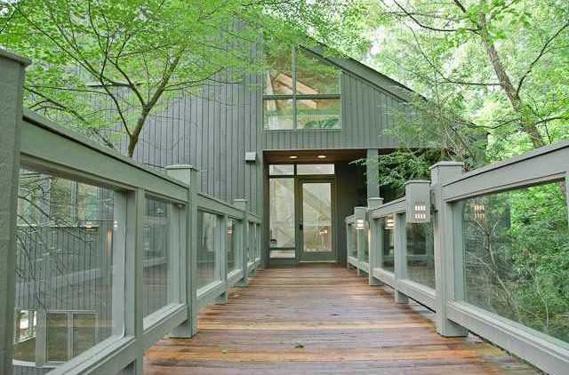](images/23/duke_forest_home.jpg)

**Goal**: Use the area (in square feet) to understand variability in the price of houses in Duke Forest.

## Exploratory data analysis

Code

``` downlit
ggplot(duke_forest, aes(x = area, y = price)) +
  geom_point(alpha = 0.7) +
  labs(
    x = "Area (square feet)",
    y = "Sale price (USD)",
    title = "Price and area of houses in Duke Forest"
  ) +
  scale_y_continuous(labels = label_dollar())
```

[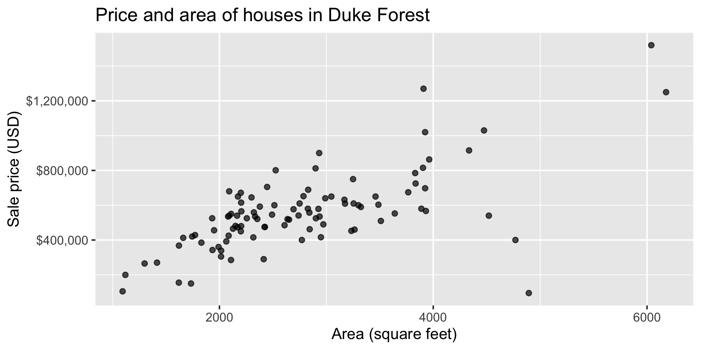](23-quantifying-uncertainty_files/figure-revealjs/unnamed-chunk-1-1.png)

## Modeling

``` downlit
df_fit <- linear_reg() |>
  fit(price ~ area, data = duke_forest)

tidy(df_fit) |>
  kable(digits = 2) # neatly format table to 2 digits
```

| term        |  estimate | std.error | statistic | p.value |
|:------------|----------:|----------:|----------:|--------:|
| (Intercept) | 116652.33 |  53302.46 |      2.19 |    0.03 |
| area        |    159.48 |     18.17 |      8.78 |    0.00 |

## Participate 📱💻

Which of the following is the correct interpretation of the **intercept**?

| term        | estimate | std.error | statistic | p.value |
|:------------|---------:|----------:|----------:|--------:|
| (Intercept) |   116652 |     53302 |         2 |       0 |
| area        |      159 |        18 |         9 |       0 |

- For each additional square foot, the model predicts the sale price of Duke Forest houses to be higher by \$116,652, on average.
- Duke Forest houses that are 0 square feet are predicted to sell, for \$116,652, on average.
- For each additional square foot, the model predicts the sale price of Duke Forest houses to be lower by \$15,900, on average.
- Duke Forest houses that are 0 square feet are predicted to sell, for \$15,900, on average.

[](images/wooclap-qr.png)

Scan the QR code or go to [wooclap.com](https://wooclap.com). Log in with your Duke NetID and enter the code **OQPLQEK**.

## Participate 📱💻

Which of the following is the correct interpretation of the **slope**?

| term        | estimate | std.error | statistic | p.value |
|:------------|---------:|----------:|----------:|--------:|
| (Intercept) |   116652 |     53302 |         2 |       0 |
| area        |      159 |        18 |         9 |       0 |

- For each additional square foot, the model predicts the sale price of Duke Forest houses to be higher by \$159, on average.
- Duke Forest houses that are 0 square feet are predicted to sell, for \$116,652, on average.
- For each additional square foot, the model predicts the sale price of Duke Forest houses to be lower by \$15,900, on average.
- Duke Forest houses that are 0 square feet are predicted to sell, for \$159, on average.

[](images/wooclap-qr.png)

Scan the QR code or go to [wooclap.com](https://wooclap.com). Log in with your Duke NetID and enter the code **OQPLQEK**.

## From sample to population

> For each additional square foot, we expect the sale price of Duke Forest houses to be higher by \$159, on average.

\

- This estimate is valid for the single sample of 98 houses.
- But what if we’re not interested quantifying the relationship between the size and price of a house in this single sample?
- What if we want to say something about the relationship between these variables for all houses in Duke Forest?

## Statistical inference

- **Statistical inference** provide methods and tools so we can use the single observed sample to make valid statements (inferences) about the population it comes from

- For our inferences to be valid, the sample should be random and representative of the population we’re interested in

[](images/23/soup.png)

## Inference for simple linear regression

- Calculate a confidence interval for the slope, \\\beta_1\\ (today)

- Conduct a hypothesis test for the slope,\\\beta_1\\ (next week)

# Confidence interval for the slope

## Confidence interval

- A plausible range of values for a population parameter is called a **confidence interval**
- Using only a single point estimate is like fishing in a murky lake with a spear, and using a confidence interval is like fishing with a net
  - We can throw a spear where we saw a fish but we will probably miss, if we toss a net in that area, we have a good chance of catching the fish
  - Similarly, if we report a point estimate, we probably will not hit the exact population parameter, but if we report a range of plausible values we have a good shot at capturing the parameter

## Confidence interval for the slope

A confidence interval will allow us to make a statement like “*For each additional square foot, the model predicts the sale price of Duke Forest houses to be higher, on average, by \$159, plus or minus X dollars.*”

. . .

- Should X be \$10? \$100? \$1000?

- If we were to take another sample of 98 would we expect the slope calculated based on that sample to be exactly \$159? Off by \$10? \$100? \$1000?

- The answer depends on how variable (from one sample to another sample) the sample statistic (the slope) is

- We need a way to quantify the variability of the sample statistic

## Quantify the variability of the slope

**for estimation**

- Two approaches:
  1.  Via simulation (what we’ll do in this course)
  2.  Via mathematical models (what you can learn about in future courses)
- **Bootstrapping** to quantify the variability of the slope for the purpose of estimation:
  - Bootstrap new samples from the original sample
  - Fit models to each of the samples and estimate the slope
  - Use features of the distribution of the bootstrapped slopes to construct a confidence interval

## Bootstrap sample 1

[](23-quantifying-uncertainty_files/figure-revealjs/unnamed-chunk-7-1.png)

[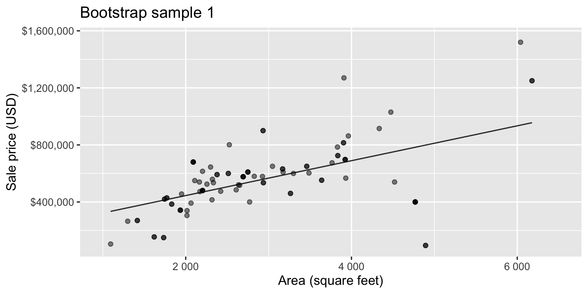](23-quantifying-uncertainty_files/figure-revealjs/unnamed-chunk-8-1.png)

## Bootstrap sample 2

[](23-quantifying-uncertainty_files/figure-revealjs/unnamed-chunk-9-1.png)

[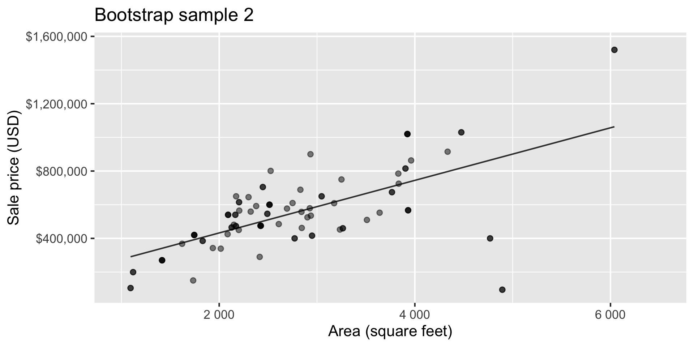](23-quantifying-uncertainty_files/figure-revealjs/unnamed-chunk-10-1.png)

## Bootstrap sample 3

[](23-quantifying-uncertainty_files/figure-revealjs/unnamed-chunk-11-1.png)

[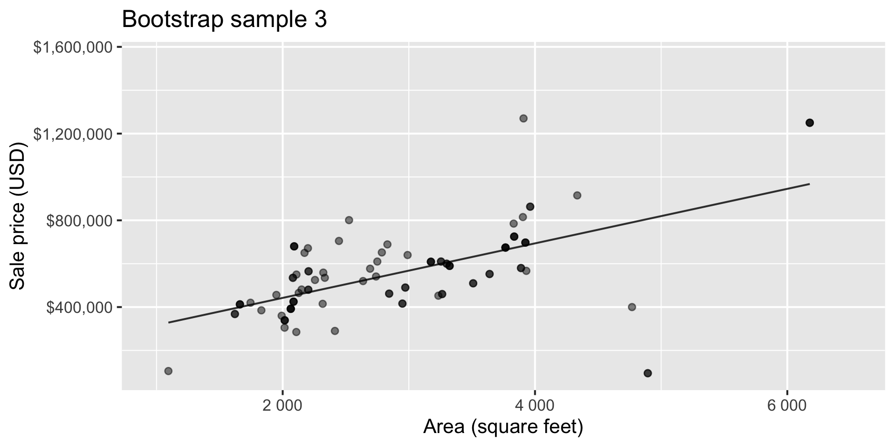](23-quantifying-uncertainty_files/figure-revealjs/unnamed-chunk-12-1.png)

## Bootstrap sample 4

[](23-quantifying-uncertainty_files/figure-revealjs/unnamed-chunk-13-1.png)

[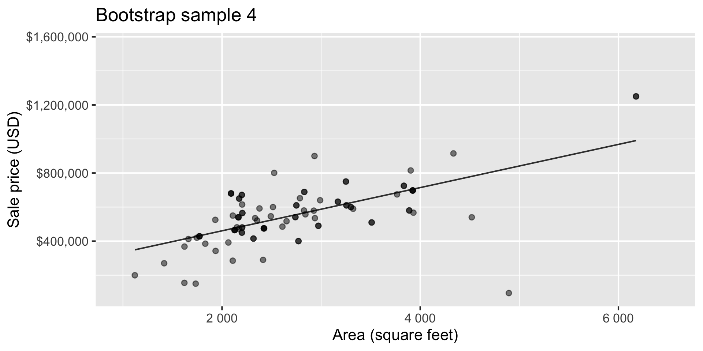](23-quantifying-uncertainty_files/figure-revealjs/unnamed-chunk-14-1.png)

## Bootstrap sample 5

[](23-quantifying-uncertainty_files/figure-revealjs/unnamed-chunk-15-1.png)

[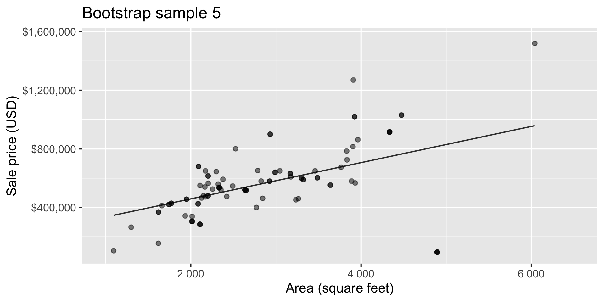](23-quantifying-uncertainty_files/figure-revealjs/unnamed-chunk-16-1.png)

. . .

*so on and so forth…*

## Bootstrap samples 1 - 5

[](23-quantifying-uncertainty_files/figure-revealjs/unnamed-chunk-17-1.png)

[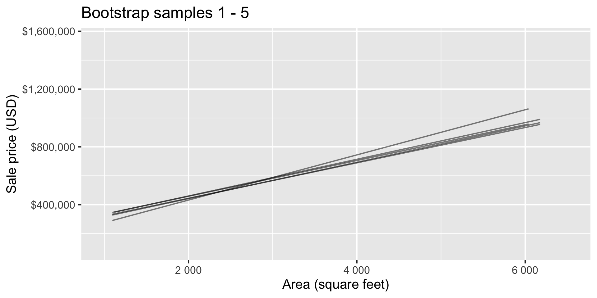](23-quantifying-uncertainty_files/figure-revealjs/unnamed-chunk-18-1.png)

## Bootstrap samples 1 - 100

[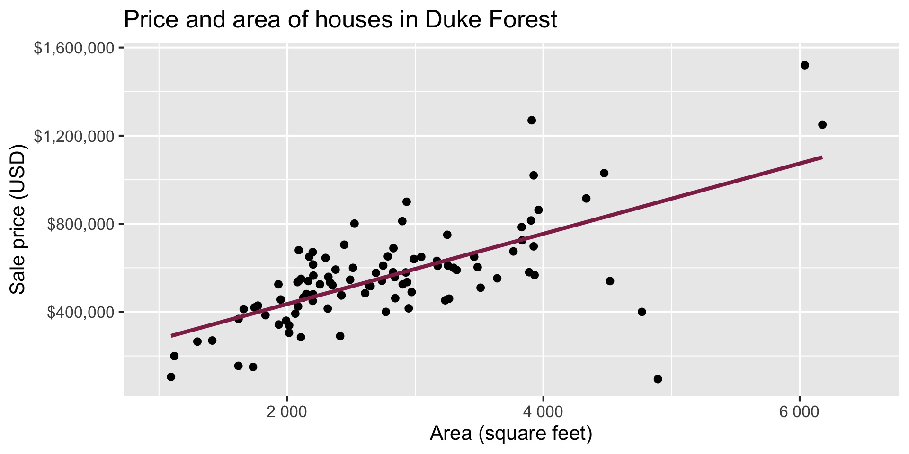](23-quantifying-uncertainty_files/figure-revealjs/unnamed-chunk-20-1.png)

[](23-quantifying-uncertainty_files/figure-revealjs/unnamed-chunk-21-1.png)

. . .

Look familiar?

## Look familiar?

[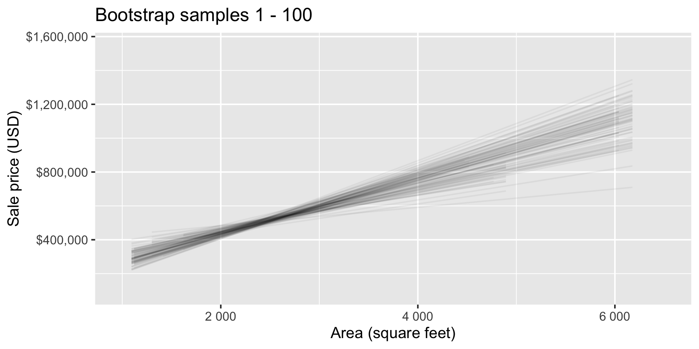](23-quantifying-uncertainty_files/figure-revealjs/unnamed-chunk-22-1.png)

[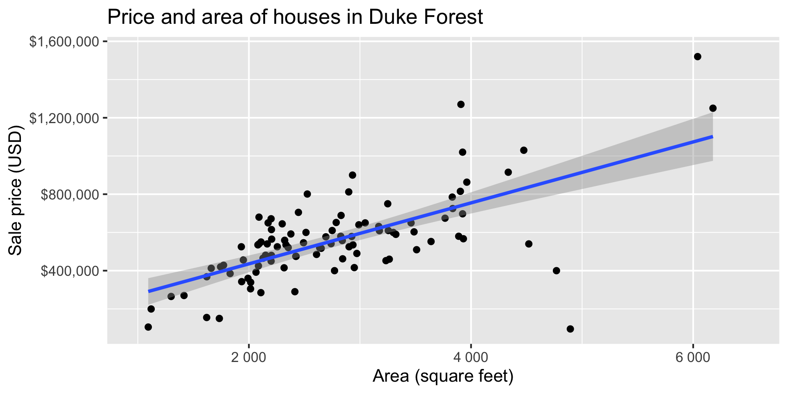](23-quantifying-uncertainty_files/figure-revealjs/unnamed-chunk-23-1.png)

## Slopes of bootstrap samples

**Fill in the blank:** For each additional square foot, the model predicts the sale price of Duke Forest houses to be higher, on average, by \$159, plus or minus \_\_\_ dollars.

[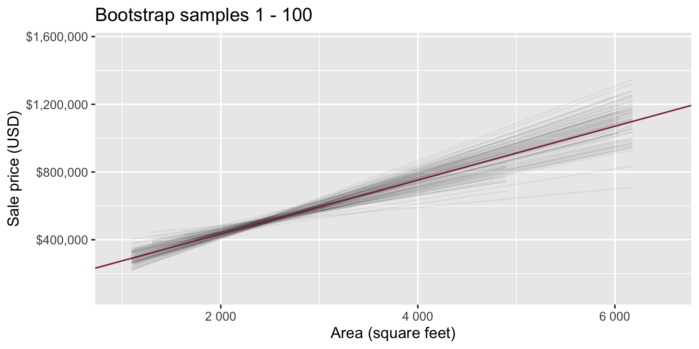](23-quantifying-uncertainty_files/figure-revealjs/unnamed-chunk-24-1.png)

## Slopes of bootstrap samples

**Fill in the blank:** For each additional square foot, we expect the sale price of Duke Forest houses to be higher, on average, by \$159, plus or minus \_\_\_ dollars.

[](23-quantifying-uncertainty_files/figure-revealjs/unnamed-chunk-25-1.png)

## Confidence level

How confident are you that the true slope is between \$0 and \$250? How about \$150 and \$170? How about \$90 and \$210?

[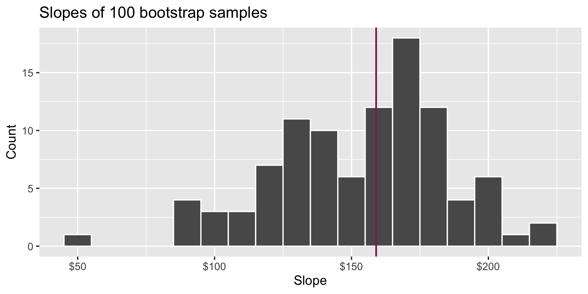](23-quantifying-uncertainty_files/figure-revealjs/unnamed-chunk-26-1.png)

## 95% confidence interval

[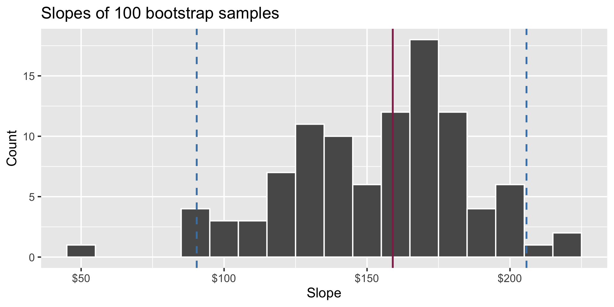](23-quantifying-uncertainty_files/figure-revealjs/unnamed-chunk-27-1.png)

- A 95% confidence interval is bounded by the middle 95% of the bootstrap distribution
- We are 95% confident that for each additional square foot, the model predicts the sale price of Duke Forest houses to be higher, on average, by \$90.43 to \$205.77.

## Application exercise

- Go to your ae project in Positron.

- If you haven’t yet done so, make sure all of your changes up to this point are committed and pushed, i.e., there’s nothing left in your source control pane.

- If you haven’t yet done so, pull to get today’s application exercise file: `ae-XX-???.qmd`.

- Work through the application exercise in class, and render, commit, and push your edits by the end of class.
